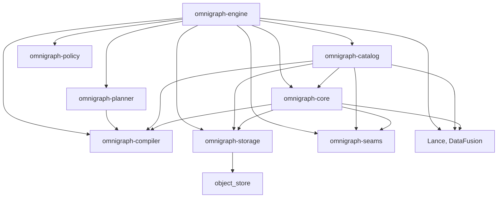

엔진 크레이트가 나머지 크레이트를 감싸 공개하는 구조를 본다.

## 크레이트 의존 관계

엔진 계열 크레이트의 의존 방향은 각 Cargo.toml의 `[dependencies]`에서 읽힌다. 아래 그림은 핵심 엔진 여섯 크레이트에 `omnigraph-seams`, `omnigraph-policy`, Lance만 더한 것이다.



### 코드 분석: 엔진의 내부 의존

엔진이 의존하는 워크스페이스 크레이트 일곱 개다. [`crates/omnigraph/Cargo.toml` L32-L39](https://github.com/ModernRelay/omnigraph/blob/00b8cca842f2bf009bebeefcf765672b5ff64b26/crates/omnigraph/Cargo.toml#L32-L39)

```toml
[dependencies]
omnigraph-compiler = { path = "../omnigraph-compiler", version = "0.16.0" }
omnigraph-policy = { path = "../omnigraph-policy", version = "0.16.0" }
omnigraph-storage = { path = "../omnigraph-storage", version = "0.16.0" }
omnigraph-seams = { path = "../omnigraph-seams", version = "0.16.0" }
omnigraph-core = { path = "../omnigraph-core", version = "0.16.0" }
omnigraph-catalog = { path = "../omnigraph-catalog", version = "0.16.0" }
omnigraph-planner = { path = "../omnigraph-planner", version = "0.16.0" }
```

- 패키지 이름은 `omnigraph-engine`이지만 `[lib] name = "omnigraph"`이라서 코드에서는 `omnigraph::Omnigraph`로 쓴다([`crates/omnigraph/Cargo.toml` L1-L12](https://github.com/ModernRelay/omnigraph/blob/00b8cca842f2bf009bebeefcf765672b5ff64b26/crates/omnigraph/Cargo.toml#L1-L12))

컴파일러의 의존성은 Arrow 일부, pest, serde, sha2, ulid뿐이고 Lance와 DataFusion이 없다([`crates/omnigraph-compiler/Cargo.toml` L5-L23](https://github.com/ModernRelay/omnigraph/blob/00b8cca842f2bf009bebeefcf765672b5ff64b26/crates/omnigraph-compiler/Cargo.toml#L5-L23)). 계획기는 컴파일러와 `arrow-schema`, serde만 쓴다([`crates/omnigraph-planner/Cargo.toml` L11-L17](https://github.com/ModernRelay/omnigraph/blob/00b8cca842f2bf009bebeefcf765672b5ff64b26/crates/omnigraph-planner/Cargo.toml#L11-L17)). 그래서 계획기는 통계와 인덱스 정보를 Lance에서 직접 읽지 못하고, 엔진이 `PlanSource` 구현으로 답해 줘야 한다(05장). 반대로 카탈로그와 코어는 `__manifest`와 데이터 테이블을 직접 다루므로 Lance와 DataFusion을 쓴다([`crates/omnigraph-catalog/Cargo.toml` L16-L29](https://github.com/ModernRelay/omnigraph/blob/00b8cca842f2bf009bebeefcf765672b5ff64b26/crates/omnigraph-catalog/Cargo.toml#L16-L29), [`crates/omnigraph-core/Cargo.toml` L19-L33](https://github.com/ModernRelay/omnigraph/blob/00b8cca842f2bf009bebeefcf765672b5ff64b26/crates/omnigraph-core/Cargo.toml#L19-L33)). `omnigraph-storage`는 `object_store`만 쓰고 워크스페이스 크레이트에 의존하지 않는 가장 아래층이다([`crates/omnigraph-storage/Cargo.toml` L11-L15](https://github.com/ModernRelay/omnigraph/blob/00b8cca842f2bf009bebeefcf765672b5ff64b26/crates/omnigraph-storage/Cargo.toml#L11-L15)).

| 크레이트 | Lance | DataFusion | 워크스페이스 내부 의존 |
|---|---|---|---|
| `omnigraph-compiler` | 없음 | 없음 | 없음 |
| `omnigraph-planner` | 없음 | 없음 | compiler |
| `omnigraph-storage` | 없음 | 없음 | 없음 |
| `omnigraph-core` | 있음 | 있음 | storage, seams, compiler |
| `omnigraph-catalog` | 있음 | 있음 | core, storage, seams, compiler |
| `omnigraph-engine` | 있음 | 있음 | 위 전부와 planner, policy |

> **주의**: [아키텍처 문서의 시스템 그림](https://github.com/ModernRelay/omnigraph/blob/00b8cca842f2bf009bebeefcf765672b5ff64b26/docs/dev/architecture.md#L15-L63)에는 `omnigraph-seams`가 없다. 운영 표면까지 담은 개요라 시험용 의존을 뺀 것으로 보이며(추정), 실제 의존은 Cargo.toml이 기준이다.

## 엔진 크레이트의 공개 표면

엔진의 `lib.rs`는 내부 모듈 대부분을 `pub(crate)`로 감추고, 코어 크레이트의 모듈은 다시 내보내기로 엔진 경로처럼 쓴다.

### 코드 분석: 모듈 공개 범위

[`crates/omnigraph/src/lib.rs` L41-L53](https://github.com/ModernRelay/omnigraph/blob/00b8cca842f2bf009bebeefcf765672b5ff64b26/crates/omnigraph/src/lib.rs#L41-L53)

```rust
pub mod instrumentation;
pub(crate) use omnigraph_core::lance_access;
pub(crate) use omnigraph_core::lance_commit;
pub(crate) use omnigraph_core::{dataset_index, staging};
pub mod loader;
pub(crate) mod ordered_cursor;
pub(crate) mod runtime_cache;
pub mod seams;
pub mod session;
pub mod storage;
pub(crate) mod storage_layer;
pub(crate) mod table_store;
pub(crate) mod validate;
```

- `engine`(읽기 실행), `exec`(변경과 병합), `table_store`, `storage_layer`, `validate`는 모두 `pub(crate)`이다. 외부 호출자는 이 모듈의 타입을 만들 수 없다
- `lance_access`, `lance_commit`, `staging`, `dataset_index`는 코어 크레이트의 모듈을 다시 내보낸 것이다. 엔진 코드는 `crate::lance_access`로 쓰지만 구현은 `omnigraph-core`에 있다

`db` 모듈도 안에서 다시 `pub(crate)` 하위 모듈과 공개 타입으로 나뉘고([`crates/omnigraph/src/db/mod.rs` L1-L18](https://github.com/ModernRelay/omnigraph/blob/00b8cca842f2bf009bebeefcf765672b5ff64b26/crates/omnigraph/src/db/mod.rs#L1-L18)), 오류와 카탈로그 타입도 같은 방식이다. 엔진의 `error.rs`는 코어의 오류 모듈 전체를 크레이트 안에 들이고 외부에는 몇 이름만 내보낸다([`crates/omnigraph/src/error.rs` L1-L8](https://github.com/ModernRelay/omnigraph/blob/00b8cca842f2bf009bebeefcf765672b5ff64b26/crates/omnigraph/src/error.rs#L1-L8)). `db::manifest`도 `omnigraph_catalog`의 내용을 안으로 들이고 `DatasetEntry`, `DatasetUpdate` 같은 몇 타입만 공개한다([`crates/omnigraph/src/db/manifest.rs` L1-L13](https://github.com/ModernRelay/omnigraph/blob/00b8cca842f2bf009bebeefcf765672b5ff64b26/crates/omnigraph/src/db/manifest.rs#L1-L13)). 카탈로그 크레이트 문서 주석은 "no compatibility promise: depend on `omnigraph`"라고 적어, 엔진을 거쳐서만 쓰라고 밝힌다([`crates/omnigraph-catalog/src/lib.rs` L9-L10](https://github.com/ModernRelay/omnigraph/blob/00b8cca842f2bf009bebeefcf765672b5ff64b26/crates/omnigraph-catalog/src/lib.rs#L9-L10)).

변경 호출이 돌려주는 `MutationReceipt`는 결과 건수, 게시된 커밋, 대상 브랜치, 검증에 쓴 계획기 문서를 함께 담는다. 바뀐 엔티티가 없으면 `commit`은 `None`이다([`crates/omnigraph/src/lib.rs` L66-L79](https://github.com/ModernRelay/omnigraph/blob/00b8cca842f2bf009bebeefcf765672b5ff64b26/crates/omnigraph/src/lib.rs#L66-L79)).
