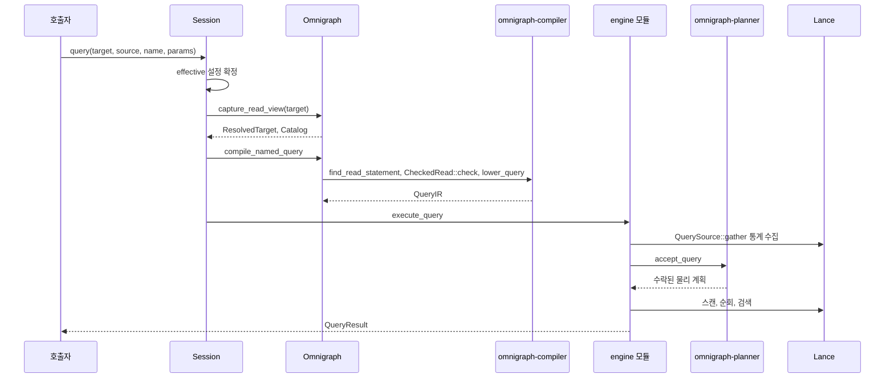
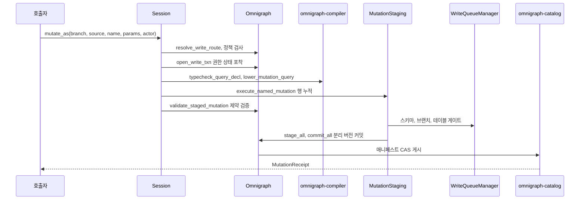

쿼리 하나와 쓰기 하나가 크레이트를 거치는 순서를 본다.

## 읽기 요청 경로

브랜치를 대상으로 한 이름 있는 읽기 쿼리는 아래 순서로 크레이트를 지난다.



### 코드 분석: 읽기 진입점

`Session::query`는 `query_with_head`를 부르고 결과만 남긴다. 본체의 앞부분이다. [`crates/omnigraph/src/exec/query_doors.rs` L70-L78](https://github.com/ModernRelay/omnigraph/blob/00b8cca842f2bf009bebeefcf765672b5ff64b26/crates/omnigraph/src/exec/query_doors.rs#L70-L78)

```rust
let settings = self.effective(query_source)?;
let (resolved, catalog) = self.capture_read_view(target).await?;

let compiled = self.compile_named_query(&catalog, query_source, query_name)?;
admit_wildcard_target(
    matches!(&resolved.requested, ReadTarget::Snapshot(_)),
    compiled.ir().has_wildcard_traversal(),
)?;
let head = resolved.graph_commit_id.clone();
```

- 설정 확정, 읽기 상태 포착, 컴파일의 세 단계가 차례로 있고, 뒤이어 `explain`이면 계획 행을, 아니면 실행 결과를 돌려준다
- `head`는 쿼리가 실제로 읽은 스냅샷의 그래프 커밋 id다. 이 값을 변경의 기대 헤드로 넘기면 읽은 뒤 쓰는 비교 후 교환이 된다(09장)
- 과거 스냅샷 대상에서는 와일드카드 순회를 거부한다([`crates/omnigraph/src/exec/query_doors.rs` L31-L38](https://github.com/ModernRelay/omnigraph/blob/00b8cca842f2bf009bebeefcf765672b5ff64b26/crates/omnigraph/src/exec/query_doors.rs#L31-L38))

대상은 `ReadTarget`으로, 브랜치 이름이나 스냅샷 id 중 하나다. `&str`과 `String`은 브랜치로 바뀐다([`crates/omnigraph/src/db/graph_coordinator.rs` L55-L81](https://github.com/ModernRelay/omnigraph/blob/00b8cca842f2bf009bebeefcf765672b5ff64b26/crates/omnigraph/src/db/graph_coordinator.rs#L55-L81)). 해석 결과인 `ResolvedTarget`은 요청 대상, 브랜치, 스냅샷 id, 그래프 헤드 커밋, `Snapshot`을 함께 담는다([`crates/omnigraph/src/db/graph_coordinator.rs` L89-L99](https://github.com/ModernRelay/omnigraph/blob/00b8cca842f2bf009bebeefcf765672b5ff64b26/crates/omnigraph/src/db/graph_coordinator.rs#L89-L99)).

### 코드 분석: 읽기 상태 포착

한 쿼리의 모든 테이블 읽기는 같은 스냅샷과 같은 카탈로그를 써야 한다. [`crates/omnigraph/src/db/omnigraph.rs` L2738-L2746](https://github.com/ModernRelay/omnigraph/blob/00b8cca842f2bf009bebeefcf765672b5ff64b26/crates/omnigraph/src/db/omnigraph.rs#L2738-L2746)

```rust
let _schema_permit = self.write_queue().acquire_schema_shared().await?;
let mut resolved = self.resolve_target_after_schema_validation(target).await?;
if validate_live_snapshot {
    let (catalog, _) = self
        .accepted_catalog_for_snapshot(&resolved.snapshot)
        .await?;
    validate_bound_catalog_against_snapshot(&catalog, &resolved.snapshot)?;
    return Ok((resolved, catalog));
}
```

- 스키마 게이트의 공유 허가만 잡는다. 스키마 적용 같은 배타 작업과는 겹치지 않고, 브랜치 게이트와 테이블 게이트는 잡지 않으므로 쓰기를 기다리지 않는다([아키텍처 문서](https://github.com/ModernRelay/omnigraph/blob/00b8cca842f2bf009bebeefcf765672b5ff64b26/docs/dev/architecture.md#L307-L316))
- 브랜치 읽기는 해석한 매니페스트 버전의 스키마 계약을 쓴다. 해석 단계에서 코디네이터를 새로 고치므로 다른 핸들이 바꾼 스키마도 보인다([`crates/omnigraph/src/db/omnigraph.rs` L2722-L2730](https://github.com/ModernRelay/omnigraph/blob/00b8cca842f2bf009bebeefcf765672b5ff64b26/crates/omnigraph/src/db/omnigraph.rs#L2722-L2730))
- 과거 스냅샷 읽기는 현재 계약을 쓰되 그 스냅샷의 테이블을 안정 식별자로 다시 묶는다(`bind_catalog_aliases`). 이름이 바뀐 타입의 과거 데이터를 읽을 수 있는 이유다(03장)

브랜치 읽기의 `Snapshot`에는 공유 Lance 세션과 테이블 핸들 캐시가 붙는다. 스냅샷 id 읽기에는 붙이지 않는데, 정리 작업이 지운 과거 버전을 캐시가 붙들고 있는 경우를 피하기 위해서다([`crates/omnigraph/src/db/omnigraph.rs` L2703-L2719](https://github.com/ModernRelay/omnigraph/blob/00b8cca842f2bf009bebeefcf765672b5ff64b26/crates/omnigraph/src/db/omnigraph.rs#L2703-L2719)).

### 코드 분석: 쿼리 컴파일

[`crates/omnigraph/src/exec/query_doors.rs` L412-L421](https://github.com/ModernRelay/omnigraph/blob/00b8cca842f2bf009bebeefcf765672b5ff64b26/crates/omnigraph/src/exec/query_doors.rs#L412-L421)

```rust
let statement = omnigraph_compiler::find_read_statement(query_source, query_name)
    .map_err(super::query_lookup_error)?;
let checked = CheckedRead::check(catalog, statement.decl())?;
let ir = Arc::new(lower_query(catalog, checked.query())?);
let query = CompiledQuery { ir, checked };
let compiled = if statement.is_explain() {
    CompiledRead::Explain(query)
} else {
    CompiledRead::Query(query)
};
```

- 컴파일러 크레이트의 세 함수가 차례로 불린다. `find_read_statement`(파싱과 선언 선택), `CheckedRead::check`(타입 검사), `lower_query`(IR 하강)이며 04장에서 다룬다
- 결과는 핸들의 컴파일 쿼리 캐시에 들어간다. 캐시 조회에는 카탈로그 `Arc`가 같은지도 들어가므로 스키마가 바뀌면 같은 원본도 다시 컴파일된다. 오류는 캐시하지 않는다([`crates/omnigraph/src/exec/query_doors.rs` L401-L411](https://github.com/ModernRelay/omnigraph/blob/00b8cca842f2bf009bebeefcf765672b5ff64b26/crates/omnigraph/src/exec/query_doors.rs#L401-L411))

컴파일된 쿼리는 `execute_on_route`로 넘어간다. 파이프라인에 `Expand`나 `AntiJoin`이 있을 때만 그래프 인덱스 핸들을 준비하고, 살아 있는 대상은 핸들의 런타임 캐시를, 과거 버전 읽기는 캐시 없는 직접 생성을 쓴다([`crates/omnigraph/src/exec/query_doors.rs` L365-L383](https://github.com/ModernRelay/omnigraph/blob/00b8cca842f2bf009bebeefcf765672b5ff64b26/crates/omnigraph/src/exec/query_doors.rs#L365-L383)).

### 코드 분석: 계획과 실행

엔진 모듈의 `execute_query`는 통계 수집, 계획 수락, 바인딩, 실행을 이어 붙인다. [`crates/omnigraph/src/engine/mod.rs` L358-L367](https://github.com/ModernRelay/omnigraph/blob/00b8cca842f2bf009bebeefcf765672b5ff64b26/crates/omnigraph/src/engine/mod.rs#L358-L367)

```rust
let source = QuerySource::gather(query, catalog, snapshot, params, settings).await?;
let accepted = accept_query(&source).await?;
let bound = bind(accepted, &source, embedding).await?;
let context = EngineContext {
    snapshot,
    catalog,
    graph_index: Arc::new(graph_index),
    load: None,
};
let run = Box::pin(execute(bound, &context)).await?;
```

- `QuerySource::gather`는 계획 전의 유일한 I/O다. 매개변수를 묶고 상수를 접고, 계획기가 물을 Lance 통계를 미리 읽는다([`crates/omnigraph/src/engine/plan_source.rs` L144-L175](https://github.com/ModernRelay/omnigraph/blob/00b8cca842f2bf009bebeefcf765672b5ff64b26/crates/omnigraph/src/engine/plan_source.rs#L144-L175))
- `accept_query`는 계획기 크레이트의 `omnigraph_planner::accept_query`를 부른다([`crates/omnigraph/src/engine/plan_source.rs` L647-L653](https://github.com/ModernRelay/omnigraph/blob/00b8cca842f2bf009bebeefcf765672b5ff64b26/crates/omnigraph/src/engine/plan_source.rs#L647-L653)). 계획기가 Lance를 모르므로 `QuerySource`가 계획기의 질의에 답한다
- `execute`는 수락된 계획을 DataFusion 계획으로 내려 실행하고, 메모리 한도와 순회 작업 한도를 여기서 정한다([`crates/omnigraph/src/engine/mod.rs` L489-L510](https://github.com/ModernRelay/omnigraph/blob/00b8cca842f2bf009bebeefcf765672b5ff64b26/crates/omnigraph/src/engine/mod.rs#L489-L510)). 계획기는 05장, 실행은 06장에서 다룬다

## 쓰기 요청 경로

변경은 `Session::mutate` 계열 메서드로 들어온다. 공개 메서드 일곱 개가 모두 `mutate_as_with_optional_branch_receipt`로 모인다([`crates/omnigraph/src/exec/mutation.rs` L926-L1103](https://github.com/ModernRelay/omnigraph/blob/00b8cca842f2bf009bebeefcf765672b5ff64b26/crates/omnigraph/src/exec/mutation.rs#L926-L1103)). 이 함수는 선언을 찾아 쓰기 모드(`Publish`, `AsCommit`, `Unattached`)를 확인하고, `resolve_write_route`에서 엔진 계층 정책을 검사한다([`crates/omnigraph/src/exec/mutation.rs` L1116-L1133](https://github.com/ModernRelay/omnigraph/blob/00b8cca842f2bf009bebeefcf765672b5ff64b26/crates/omnigraph/src/exec/mutation.rs#L1116-L1133)). 묶이지 않은 자식 쓰기에서 정책 거부는 "커밋 없음" 오류로 바뀌어 커밋의 존재가 드러나지 않는다([`crates/omnigraph/src/exec/mutation.rs` L1134-L1144](https://github.com/ModernRelay/omnigraph/blob/00b8cca842f2bf009bebeefcf765672b5ff64b26/crates/omnigraph/src/exec/mutation.rs#L1134-L1144)).



### 코드 분석: 쓰기 트랜잭션 포착

`mutate_with_current_actor`는 효과 이전에 실패하면 다시 준비하는 반복문이다([`crates/omnigraph/src/exec/mutation.rs` L1291-L1319](https://github.com/ModernRelay/omnigraph/blob/00b8cca842f2bf009bebeefcf765672b5ff64b26/crates/omnigraph/src/exec/mutation.rs#L1291-L1319)). 시도 하나는 쓰기 트랜잭션을 여는 데서 시작한다. [`crates/omnigraph/src/exec/mutation.rs` L1345-L1353](https://github.com/ModernRelay/omnigraph/blob/00b8cca842f2bf009bebeefcf765672b5ff64b26/crates/omnigraph/src/exec/mutation.rs#L1345-L1353)

```rust
let opened = match route {
    WriteRoute::UnattachedChild(base) => {
        self.open_write_txn_on_unattached(requested.as_deref(), base)
            .await
    }
    WriteRoute::Publish | WriteRoute::AsCommit | WriteRoute::UnattachedRoot => {
        self.open_write_txn(requested.as_deref()).await
    }
};
```

- `WriteTxn`은 브랜치 식별, 그래프 헤드, 수락된 스키마와 카탈로그, 기준 테이블 스냅샷을 한 번에 포착한다. 실행, 검증, 스테이징, 게시가 모두 이 값을 쓴다([`crates/omnigraph/src/exec/mutation.rs` L1339-L1344](https://github.com/ModernRelay/omnigraph/blob/00b8cca842f2bf009bebeefcf765672b5ff64b26/crates/omnigraph/src/exec/mutation.rs#L1339-L1344))
- 첫 시도의 열기 실패에는 `before_effect()`로 "효과 이전" 증거가 붙는다([`crates/omnigraph/src/exec/mutation.rs` L1354-L1360](https://github.com/ModernRelay/omnigraph/blob/00b8cca842f2bf009bebeefcf765672b5ff64b26/crates/omnigraph/src/exec/mutation.rs#L1354-L1360))
- 호출자가 기대 헤드를 넘겼으면 이 트랜잭션의 헤드와 바로 비교한다. 따로 헤드를 다시 조회하면 경쟁이 다시 열리기 때문이라고 주석이 설명한다([`crates/omnigraph/src/exec/mutation.rs` L1361-L1374](https://github.com/ModernRelay/omnigraph/blob/00b8cca842f2bf009bebeefcf765672b5ff64b26/crates/omnigraph/src/exec/mutation.rs#L1361-L1374))

컴파일은 읽기와 같은 컴파일러를 쓰되 변경용 함수를 쓴다. `lower_named_mutation`은 `typecheck_query_decl`과 `lower_mutation_query`로 `MutationIR`을 만들고, 삽입이나 수정과 삭제를 한 쿼리에 섞는 것은 I/O 전에 거부한다([`crates/omnigraph/src/exec/mutation.rs` L1582-L1605](https://github.com/ModernRelay/omnigraph/blob/00b8cca842f2bf009bebeefcf765672b5ff64b26/crates/omnigraph/src/exec/mutation.rs#L1582-L1605)).

### 코드 분석: 스테이징과 분리 커밋

실행으로 쌓인 행은 `commit_staged_mutation`에서 검증, 스테이징, 분리 커밋된다. [`crates/omnigraph/src/exec/mutation.rs` L1501-L1514](https://github.com/ModernRelay/omnigraph/blob/00b8cca842f2bf009bebeefcf765672b5ff64b26/crates/omnigraph/src/exec/mutation.rs#L1501-L1514)

```rust
let (staged, early) = futures::join!(
    staging.stage_all_with_concurrency(self, requested, stage_write_concurrency),
    self.early_revalidation(txn),
);
let staged = staged.map_err(OmniError::unpublished)?;
fail(&MUTATION_POST_STAGE_PRE_EFFECT_GATE).map_err(OmniError::unpublished)?;
let lineage_intent = self
    .new_lineage_intent_for_branch(requested, actor_id, history_release_bytes)
    .await
    .map_err(OmniError::unpublished)?;
let committed = staged
    .commit_all(self, requested, txn, early, attempt)
    .await
    .map_err(OmniError::unpublished)?;
```

- 주석대로 첫 스테이징 파일부터 게시 직전까지 생기는 효과는 어떤 매니페스트도 가리키지 않는 새 파일이나 분리 버전이다. 그래서 이 구간의 실패는 모두 `Unpublished`다([`crates/omnigraph/src/exec/mutation.rs` L1496-L1500](https://github.com/ModernRelay/omnigraph/blob/00b8cca842f2bf009bebeefcf765672b5ff64b26/crates/omnigraph/src/exec/mutation.rs#L1496-L1500))
- 스테이징과 조기 재검증이 `futures::join!`으로 동시에 돈다
- `commit_all` 뒤 `publish_committed_mutation`이 `commit_updates_on_branch_with_expected`를 불러 매니페스트를 한 번의 CAS로 바꾼다([`crates/omnigraph/src/exec/mutation.rs` L1562-L1571](https://github.com/ModernRelay/omnigraph/blob/00b8cca842f2bf009bebeefcf765672b5ff64b26/crates/omnigraph/src/exec/mutation.rs#L1562-L1571), [`crates/omnigraph/src/db/omnigraph/table_ops.rs` L1644-L1654](https://github.com/ModernRelay/omnigraph/blob/00b8cca842f2bf009bebeefcf765672b5ff64b26/crates/omnigraph/src/db/omnigraph/table_ops.rs#L1644-L1654)). 스테이징은 09장, 검증은 10장에서 다룬다

게시를 맡는 카탈로그 크레이트 `publisher.rs`의 머리 주석은 역할을 분명히 한다. Lance가 테이블 저장, 테이블별 버전, 네이티브 이력을 맡고, Omnigraph는 여러 테이블에 걸친 원자적 게시 지점 하나만 직접 구현한다. 주석은 Lance Rust가 브랜치를 인식하는 일괄 버전 게시를 지원하면 이 모듈이 사라져야 한다고 적는다([`crates/omnigraph-catalog/src/publisher.rs` L1-L19](https://github.com/ModernRelay/omnigraph/blob/00b8cca842f2bf009bebeefcf765672b5ff64b26/crates/omnigraph-catalog/src/publisher.rs#L1-L19)). 게시 프로토콜은 11장에서 다룬다.

### 코드 분석: 쓰기 게이트

같은 프로세스 안의 쓰기는 `WriteQueueManager`의 게이트로 순서가 정해진다. [`crates/omnigraph/src/db/write_queue.rs` L695-L706](https://github.com/ModernRelay/omnigraph/blob/00b8cca842f2bf009bebeefcf765672b5ff64b26/crates/omnigraph/src/db/write_queue.rs#L695-L706)

```rust
pub(crate) async fn acquire_branch_write_gates(
    &self,
    branch: Option<&str>,
) -> Result<BranchWriteGates> {
    let schema = self.acquire_schema_shared().await?;
    let guard = self.acquire_branch(branch).await?;
    Ok(BranchWriteGates {
        branch_key: branch.map(str::to_string),
        schema,
        branch: guard,
    })
}
```

- 순서는 스키마 공유 허가, 브랜치 게이트, 정렬된 테이블 게이트다
- 모듈 머리 주석은 이 큐가 테이블 데이터의 정확성 장치가 아니라고 밝힌다. 모든 쓰기는 분리 스테이징 뒤 매니페스트 CAS로만 보이게 되므로, 큐는 같은 프로세스 안의 낭비와 파괴적 ref 삭제 충돌을 줄인다([`crates/omnigraph/src/db/write_queue.rs` L17-L36](https://github.com/ModernRelay/omnigraph/blob/00b8cca842f2bf009bebeefcf765672b5ff64b26/crates/omnigraph/src/db/write_queue.rs#L17-L36)). 프로세스 사이의 쓰기는 게시 시점의 CAS가 승자 하나를 정한다

## 오류 타입과 완료 증거

엔진 계열 크레이트는 모두 코어의 `OmniError` 하나를 쓴다. 변형은 34개이고, 호출자가 메시지 문자열을 파싱하지 않고 판단할 수 있도록 상황마다 나눠 두었다.

### 코드 분석: OmniError의 첫 변형

[`crates/omnigraph-core/src/error.rs` L296-L308](https://github.com/ModernRelay/omnigraph/blob/00b8cca842f2bf009bebeefcf765672b5ff64b26/crates/omnigraph-core/src/error.rs#L296-L308)

```rust
pub enum OmniError {
    /// Operation-local completion evidence. Composing callers must discard
    /// `BeforeEffect` once earlier work may have had effects; uncertainty wins.
    #[error("{source}")]
    Completion {
        evidence: CompletionEvidence,
        #[source]
        source: Box<OmniError>,
    },
    #[error("{0}")]
    Compiler(#[from] omnigraph_compiler::error::CompilerError),
    #[error("{0}")]
    Storage(StorageFailure),
```

- `Completion`은 다른 오류를 감싸 완료 증거를 붙인다. 쓰기 경로의 `before_effect()`, `OmniError::unpublished`가 이 변형을 만든다
- `Compiler`는 컴파일러 크레이트의 `CompilerError`를 담는다. 파서와 타입 검사의 진단 코드(04장)가 여기로 전달된다
- `Storage`는 Lance와 객체 저장소 오류를 분류한 값이다. 아키텍처 문서는 이 분류가 재시도 허가가 아니라고 강조한다([아키텍처 문서](https://github.com/ModernRelay/omnigraph/blob/00b8cca842f2bf009bebeefcf765672b5ff64b26/docs/dev/architecture.md#L336-L346))

이 밖에 병합 충돌 목록(`MergeConflicts`), 엄격한 삽입의 키 충돌(`KeyConflict`), 쓰기 계획의 안전 상한 초과(`ResourceLimitExceeded`), 기대 헤드 불일치(`PreconditionFailed`), 정책 거부(`Policy`)처럼 호출자가 다르게 처리해야 하는 경우마다 변형이 따로 있다([`crates/omnigraph-core/src/error.rs` L341-L365](https://github.com/ModernRelay/omnigraph/blob/00b8cca842f2bf009bebeefcf765672b5ff64b26/crates/omnigraph-core/src/error.rs#L341-L365)).

### 코드 분석: 완료 증거

쓰기 실패에는 그래프가 바뀌었을 수 있는지를 나타내는 네 값이 붙는다. [`crates/omnigraph-core/src/error.rs` L18-L36](https://github.com/ModernRelay/omnigraph/blob/00b8cca842f2bf009bebeefcf765672b5ff64b26/crates/omnigraph-core/src/error.rs#L18-L36)

```rust
pub enum CompletionEvidence {
    /// The owning operation has not attempted any durable effect.
    BeforeEffect,
    /// The owning operation attempted no publication. Every durable effect it
    /// may have left (a staged data file, a detached table version, its
    /// transaction file) is one no `__manifest` version names, so the graph
    /// did not move and the collector reclaims the effect once its recorded
    /// authority is gone.
    Unpublished,
    /// An earlier step of the owning operation published, such as the branch
    /// a load forks before its rows, and a later step failed; the operation as
    /// a whole is neither unstarted nor unpublished. `step_unpublished` says
    /// the failing step proved it published nothing itself (it carried
    /// `BeforeEffect` or `Unpublished`); without that proof the failure's own
    /// type says what the step did.
    PartlyPublished { step_unpublished: bool },
    /// The owning operation cannot establish settled completion.
    Uncertain,
}
```

- `BeforeEffect`와 `Unpublished`는 확정 값이고 둘 다 그래프가 바뀌지 않았다는 뜻이다. `Unpublished`는 저장소에 남은 파일이 있을 수 있고, 수집기가 나중에 회수한다
- `Uncertain`은 결과를 확인할 수 없다는 뜻이며 다른 증거와 합쳐져도 사라지지 않는다([`crates/omnigraph-core/src/error.rs` L12-L16](https://github.com/ModernRelay/omnigraph/blob/00b8cca842f2bf009bebeefcf765672b5ff64b26/crates/omnigraph-core/src/error.rs#L12-L16))
- `ManifestError`의 `publication_in_doubt`는 응답이나 재읽기를 받지 못해 게시 여부가 불확실한 그래프 커밋 id를 담는다. 주석은 그 커밋이 더는 게시될 수 없음이 확인될 때까지 보존 장치를 유지해야 한다고 적는다([`crates/omnigraph-core/src/error.rs` L91-L104](https://github.com/ModernRelay/omnigraph/blob/00b8cca842f2bf009bebeefcf765672b5ff64b26/crates/omnigraph-core/src/error.rs#L91-L104))
