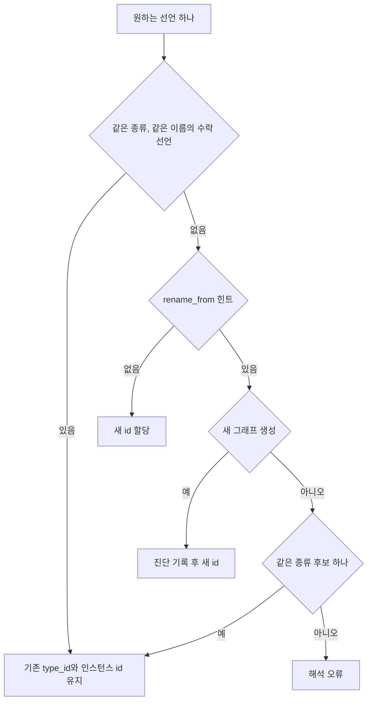

정규형과 안정 식별자, 시스템 컬럼 세대를 본다.

## SchemaShape: 식별자 없는 정규형

`compile_schema_shape`는 AST를 비교 가능한 정규형으로 바꾼다. 이름 순으로 정렬하고, 주석과 제약을 정규 순서로 맞춘다. 같은 의미의 원본 두 개는 줄 순서나 공백이 달라도 같은 shape가 된다.

### 코드 분석: 이름 변경 힌트의 직렬화 제외

[`crates/omnigraph-compiler/src/catalog/schema_shape.rs` L129-L138](https://github.com/ModernRelay/omnigraph/blob/00b8cca842f2bf009bebeefcf765672b5ff64b26/crates/omnigraph-compiler/src/catalog/schema_shape.rs#L129-L138)

```rust
pub struct PropertyShape {
    pub name: String,
    #[serde(skip)]
    pub rename_from: Option<String>,
    pub prop_type: PropType,
    /// Opaque, non-relational annotations.  Known relationships such as
    /// `@embed`, `@key`, `@unique`, and `@index` have typed fields below.
    pub annotations: Vec<Annotation>,
    pub property_constraints: Vec<PropertyConstraintShape>,
    pub embed_source: Option<EmbedSourceShape>,
```

- `rename_from`은 `#[serde(skip)]`이다. 식별자 해석에는 쓰이지만 shape의 JSON과 해시에는 들어가지 않는다. 모듈 머리 주석도 마이그레이션 힌트는 해석에만 쓰고 직렬화와 해시에서 뺀다고 적는다([`crates/omnigraph-compiler/src/catalog/schema_shape.rs` L1-L7](https://github.com/ModernRelay/omnigraph/blob/00b8cca842f2bf009bebeefcf765672b5ff64b26/crates/omnigraph-compiler/src/catalog/schema_shape.rs#L1-L7))

선언은 인터페이스, 노드, 엣지별로 이름 순 정렬된 뒤 검증되고([`crates/omnigraph-compiler/src/catalog/schema_shape.rs` L293-L304](https://github.com/ModernRelay/omnigraph/blob/00b8cca842f2bf009bebeefcf765672b5ff64b26/crates/omnigraph-compiler/src/catalog/schema_shape.rs#L293-L304)), `schema_shape_hash`는 JSON 직렬화의 SHA-256을 `sha256:` 접두와 함께 돌려준다([`crates/omnigraph-compiler/src/catalog/schema_shape.rs` L316-L321](https://github.com/ModernRelay/omnigraph/blob/00b8cca842f2bf009bebeefcf765672b5ff64b26/crates/omnigraph-compiler/src/catalog/schema_shape.rs#L316-L321)). 이 해시는 저장된 원본이 수락된 IR과 어긋났는지(source drift) 확인하는 데 쓰인다. IR 자체의 해시(`schema_ir_hash`)는 쓰기와 복구의 권위로 따로 쓴다([`crates/omnigraph-compiler/src/catalog/schema_ir.rs` L1233-L1238](https://github.com/ModernRelay/omnigraph/blob/00b8cca842f2bf009bebeefcf765672b5ff64b26/crates/omnigraph-compiler/src/catalog/schema_ir.rs#L1233-L1238)).

## SchemaIR와 안정 식별자

SchemaIR은 shape에 식별자를 붙인 것이다. 식별자는 세 종류이고 모두 0이 아닌 `u64` 새 타입이다([`crates/omnigraph-compiler/src/catalog/schema_ir.rs` L358-L360](https://github.com/ModernRelay/omnigraph/blob/00b8cca842f2bf009bebeefcf765672b5ff64b26/crates/omnigraph-compiler/src/catalog/schema_ir.rs#L358-L360)).

### 코드 분석: SchemaIR 구조

[`crates/omnigraph-compiler/src/catalog/schema_ir.rs` L362-L377](https://github.com/ModernRelay/omnigraph/blob/00b8cca842f2bf009bebeefcf765672b5ff64b26/crates/omnigraph-compiler/src/catalog/schema_ir.rs#L362-L377)

```rust
#[derive(Debug, Clone, PartialEq, Serialize, Deserialize)]
pub struct SchemaIR {
    pub ir_version: u32,
    /// The feature names this graph requires (RFC 0040). Absent below
    /// [`SCHEMA_IR_VERSION_FEATURES`], so an IR with no names serializes to
    /// exactly the pre-feature bytes.
    #[serde(default, skip_serializing_if = "BTreeSet::is_empty")]
    pub features: BTreeSet<String>,
    pub schema_identity_domain: SchemaIdentityDomain,
    /// The next value to consume.  Type, property, and incarnation IDs share
    /// this monotonically increasing, no-reuse sequence.
    pub next_identity_id: u64,
    pub interfaces: Vec<InterfaceIR>,
    pub nodes: Vec<NodeIR>,
    pub edges: Vec<EdgeIR>,
}
```

- `schema_identity_domain`은 그래프 루트 하나의 식별자 공간을 가리키는 ULID 문자열이다. 같은 숫자 id도 도메인이 다르면 다른 대상이다
- `next_identity_id`는 다음에 쓸 값이다. 타입, 속성, 테이블 인스턴스 id가 이 수열 하나를 함께 쓰고 재사용하지 않는다
- 노드와 엣지는 `type_id`와 별도로 `table_incarnation_id`를 가진다([`crates/omnigraph-compiler/src/catalog/schema_ir.rs` L393-L415](https://github.com/ModernRelay/omnigraph/blob/00b8cca842f2bf009bebeefcf765672b5ff64b26/crates/omnigraph-compiler/src/catalog/schema_ir.rs#L393-L415)). 같은 이름으로 지웠다 다시 만든 타입은 새 인스턴스 id를 받아 이전 테이블과 구분된다

제약은 이름이 아니라 식별자로 필드를 가리킨다. `FieldRefIR`은 사용자 속성(`PropertyRefIR`)이나 시스템 필드 역할(`Id`, `Src`, `Dst`) 중 하나다([`crates/omnigraph-compiler/src/catalog/schema_ir.rs` L443-L464](https://github.com/ModernRelay/omnigraph/blob/00b8cca842f2bf009bebeefcf765672b5ff64b26/crates/omnigraph-compiler/src/catalog/schema_ir.rs#L443-L464)). 그래서 속성 이름을 바꿔도 제약이 가리키는 대상은 그대로다.

### 코드 분석: 이름 변경 힌트 해석

`resolve`는 shape의 각 선언을 수락된 IR의 선언과 짝짓는다. 이름이 정확히 같으면 그대로 짝이 되고, 다르면 `@rename_from` 힌트를 본다. [`crates/omnigraph-compiler/src/catalog/schema_ir.rs` L661-L680](https://github.com/ModernRelay/omnigraph/blob/00b8cca842f2bf009bebeefcf765672b5ff64b26/crates/omnigraph-compiler/src/catalog/schema_ir.rs#L661-L680)

```rust
    let candidates = accepted_by_name.get(hint).cloned().unwrap_or_default();
    if candidates.is_empty() {
        return resolution_error(format!(
            "{} '{name}' declares @rename_from(\"{hint}\") but no accepted declaration has that name",
            kind.label()
        ));
    }
    let same_kind = candidates
        .iter()
        .filter(|candidate| candidate.kind == kind)
        .copied()
        .collect::<Vec<_>>();
    if same_kind.len() != 1 {
        return resolution_error(format!(
            "{} '{name}' cannot rename accepted '{hint}' across declaration kinds",
            kind.label()
        ));
    }
    Some(same_kind[0])
}
```

- 힌트가 가리키는 이름이 수락된 IR에 없으면 오류다
- 같은 이름이 다른 종류(노드와 엣지 등)에만 있으면 거부한다. 종류를 넘는 이름 변경은 없다
- 새 그래프를 만들 때의 힌트와, 이름이 정확히 같은데 힌트도 있는 경우는 오류가 아니라 진단으로 남는다([`crates/omnigraph-compiler/src/catalog/schema_ir.rs` L643-L660](https://github.com/ModernRelay/omnigraph/blob/00b8cca842f2bf009bebeefcf765672b5ff64b26/crates/omnigraph-compiler/src/catalog/schema_ir.rs#L643-L660)). 엔진은 이 진단을 경고 로그로 남긴다
- 속성의 이름 변경은 같은 소유 타입 안에서만 된다. 다른 타입으로 속성을 옮기는 것은 거부한다([`crates/omnigraph-compiler/src/catalog/schema_ir.rs` L742-L763](https://github.com/ModernRelay/omnigraph/blob/00b8cca842f2bf009bebeefcf765672b5ff64b26/crates/omnigraph-compiler/src/catalog/schema_ir.rs#L742-L763))



### 코드 분석: deterministic 할당 순서

짝이 없는 선언은 새 id를 받는다. 할당 순서는 입력 순서와 무관하게 정해진다. 타입은 (종류, 이름) 순 `BTreeMap`을 따라 인터페이스, 노드, 엣지 순으로 받고([`crates/omnigraph-compiler/src/catalog/schema_ir.rs` L713-L716](https://github.com/ModernRelay/omnigraph/blob/00b8cca842f2bf009bebeefcf765672b5ff64b26/crates/omnigraph-compiler/src/catalog/schema_ir.rs#L713-L716)), 새 속성은 (소유 타입 id, 이름) 순으로 정렬해 받으며([`crates/omnigraph-compiler/src/catalog/schema_ir.rs` L799-L805](https://github.com/ModernRelay/omnigraph/blob/00b8cca842f2bf009bebeefcf765672b5ff64b26/crates/omnigraph-compiler/src/catalog/schema_ir.rs#L799-L805)), 테이블 인스턴스 id는 타입 id 순으로 받는다([`crates/omnigraph-compiler/src/catalog/schema_ir.rs` L807-L818](https://github.com/ModernRelay/omnigraph/blob/00b8cca842f2bf009bebeefcf765672b5ff64b26/crates/omnigraph-compiler/src/catalog/schema_ir.rs#L807-L818)). 마지막 단계는 IR을 조립하고 버전과 기능 집합을 다시 정한다. [`crates/omnigraph-compiler/src/catalog/schema_ir.rs` L912-L927](https://github.com/ModernRelay/omnigraph/blob/00b8cca842f2bf009bebeefcf765672b5ff64b26/crates/omnigraph-compiler/src/catalog/schema_ir.rs#L912-L927)

```rust
let mut schema_ir = SchemaIR {
    ir_version: SCHEMA_IR_VERSION,
    features: carried_features,
    schema_identity_domain: domain,
    next_identity_id: allocator.next,
    interfaces,
    nodes,
    edges,
};
schema_ir.features = required_features(&schema_ir);
schema_ir.ir_version = required_ir_version(&schema_ir.features);
validate_schema_ir(&schema_ir)?;
Ok(SchemaResolution {
    schema_ir,
    diagnostics,
})
```

- `next_identity_id`는 할당이 끝난 뒤의 값으로 저장된다. 지운 선언의 id도 이 값 아래에 남으므로 다시 쓰이지 않는다
- 기능 집합과 `ir_version`은 선언에서 다시 계산된다. 다음 절에서 다룬다

RFC 0028의 수명 표가 이 규칙을 정리한다. 아래는 그 일부다([RFC 0028 수명 표](https://github.com/ModernRelay/omnigraph/blob/00b8cca842f2bf009bebeefcf765672b5ff64b26/docs/rfcs/0028-stable-schema-identity.md#L400-L415)).

| 사건 | 타입 id | 속성 id | 테이블 인스턴스 id |
|---|---|---|---|
| 타입 추가 | 새로 할당 | 새로 할당 | 새로 할당(노드, 엣지) |
| 속성 추가 | 유지 | 새로 할당 | 유지 |
| 명시적 타입 이름 변경 | 유지 | 유지 | 유지 |
| 속성 삭제 뒤 같은 이름 추가 | 유지 | 새로 할당 | 유지 |
| 타입 삭제 뒤 같은 이름 추가 | 새로 할당 | 새로 할당 | 새로 할당 |

## 기능 집합과 시스템 컬럼 세대

모든 노드 테이블에는 id 컬럼이, 엣지 테이블에는 id, 출발, 도착 컬럼이 선언 없이 붙는다. 이 시스템 컬럼의 철자는 그래프가 만들어진 세대에 따라 다르다.

### 코드 분석: 세 가지 철자

[`crates/omnigraph-compiler/src/catalog/schema_ir.rs` L71-L82](https://github.com/ModernRelay/omnigraph/blob/00b8cca842f2bf009bebeefcf765672b5ff64b26/crates/omnigraph-compiler/src/catalog/schema_ir.rs#L71-L82)

```rust
pub const SYSTEM_COLUMNS_LEGACY: SystemColumns = SystemColumns {
    id: "id",
    src: "src",
    dst: "dst",
};

/// Spellings for graphs whose feature set carries [`FEATURE_SYSTEM_COLUMNS`].
pub const SYSTEM_COLUMNS_V3: SystemColumns = SystemColumns {
    id: "__id",
    src: "__src",
    dst: "__dst",
};
```

- 바로 앞의 `SYSTEM_COLUMNS_META`는 원본과 쿼리에서 쓰는 역할 이름 `@id`, `@src`, `@dst`다([`crates/omnigraph-compiler/src/catalog/schema_ir.rs` L65-L69](https://github.com/ModernRelay/omnigraph/blob/00b8cca842f2bf009bebeefcf765672b5ff64b26/crates/omnigraph-compiler/src/catalog/schema_ir.rs#L65-L69)). `$p.@id`, `@key(@src, @dst)`처럼 어느 세대에서나 같다
- `SYSTEM_COLUMNS_LEGACY`는 구형 그래프의 물리 컬럼 이름이다. 이 그래프에서는 `id`, `src`, `dst`를 사용자 속성 이름으로 쓸 수 없다
- `SYSTEM_COLUMNS_V3`는 `system-columns` 기능을 가진 그래프의 물리 컬럼 이름이다. 새로 만든 그래프는 이 철자를 쓰고, `id`, `src`, `dst`는 일반 속성 이름이 된다

어느 철자를 쓸지는 IR의 기능 집합에 `system-columns`가 있는지로만 정해진다([`crates/omnigraph-compiler/src/catalog/schema_ir.rs` L86-L92](https://github.com/ModernRelay/omnigraph/blob/00b8cca842f2bf009bebeefcf765672b5ff64b26/crates/omnigraph-compiler/src/catalog/schema_ir.rs#L86-L92)). 이 기능은 선언에서 파생되지 않고 그래프 생성 때나 업그레이드 때만 붙는다. `resolve`는 새 그래프에는 이 기능을 붙이고, 기존 그래프에는 수락된 IR이 가진 값을 그대로 옮긴다([`crates/omnigraph-compiler/src/catalog/schema_ir.rs` L615-L619](https://github.com/ModernRelay/omnigraph/blob/00b8cca842f2bf009bebeefcf765672b5ff64b26/crates/omnigraph-compiler/src/catalog/schema_ir.rs#L615-L619)). RFC 0040은 이 설계를 "vintage"라고 부르고, 기존 그래프는 이전 철자를 유지해 이전 없이 계속 읽힌다고 설명한다([RFC 0040 요약](https://github.com/ModernRelay/omnigraph/blob/00b8cca842f2bf009bebeefcf765672b5ff64b26/docs/rfcs/0040-system-column-namespace.md#L21-L49)).

### 코드 분석: 기능 집합 계산

[`crates/omnigraph-compiler/src/catalog/schema_ir.rs` L110-L124](https://github.com/ModernRelay/omnigraph/blob/00b8cca842f2bf009bebeefcf765672b5ff64b26/crates/omnigraph-compiler/src/catalog/schema_ir.rs#L110-L124)

```rust
pub fn required_features(ir: &SchemaIR) -> BTreeSet<String> {
    let mut features = BTreeSet::new();
    if ir.features.contains(FEATURE_SYSTEM_COLUMNS) {
        features.insert(FEATURE_SYSTEM_COLUMNS.to_string());
    }
    let has_edge_key = ir.edges.iter().any(|edge| {
        edge.constraints
            .iter()
            .any(|constraint| matches!(constraint, ConstraintIR::Key { .. }))
    });
    if has_edge_key {
        features.insert(FEATURE_EDGE_KEYS.to_string());
    }
    features
}
```

- `system-columns`는 이전 IR에서 옮겨 오고, `edge-keys`는 엣지 하나라도 `@key`를 선언하면 붙는다
- `ir_version`은 기능 집합이 비어 있으면 2, 하나라도 있으면 5다([`crates/omnigraph-compiler/src/catalog/schema_ir.rs` L129-L135](https://github.com/ModernRelay/omnigraph/blob/00b8cca842f2bf009bebeefcf765672b5ff64b26/crates/omnigraph-compiler/src/catalog/schema_ir.rs#L129-L135))

| `ir_version` | 의미 | 현재 동작 |
|---|---|---|
| 2 | 기능 집합 없음, 구형 철자 | 읽기, 쓰기 |
| 3 | 철회된 빌드가 쓴 번호 | 사용하지 않음 |
| 4 | 기능 집합 이전의 엣지 키 스키마 | 읽기만, 새로 쓰지 않음 |
| 5 | 기능 이름 집합을 가짐 | 읽기, 쓰기 |

이 표는 상수 주석([`crates/omnigraph-compiler/src/catalog/schema_ir.rs` L28-L53](https://github.com/ModernRelay/omnigraph/blob/00b8cca842f2bf009bebeefcf765672b5ff64b26/crates/omnigraph-compiler/src/catalog/schema_ir.rs#L28-L53))과 지원 판정 함수 `is_supported_ir_version`([`crates/omnigraph-compiler/src/catalog/schema_ir.rs` L96-L100](https://github.com/ModernRelay/omnigraph/blob/00b8cca842f2bf009bebeefcf765672b5ff64b26/crates/omnigraph-compiler/src/catalog/schema_ir.rs#L96-L100))을 따른 것이다. 모르는 기능 이름이 있는 IR은 `validate_schema_ir`가 "upgrade omnigraph before opening this graph" 메시지로 거부한다([`crates/omnigraph-compiler/src/catalog/schema_ir.rs` L1398-L1411](https://github.com/ModernRelay/omnigraph/blob/00b8cca842f2bf009bebeefcf765672b5ff64b26/crates/omnigraph-compiler/src/catalog/schema_ir.rs#L1398-L1411)). 이후 기능은 번호를 올리지 않고 이름만 더한다.
