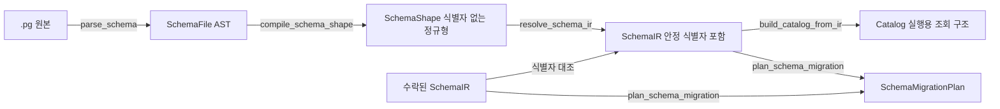

Omnigraph의 스키마는 `.pg` 원본 하나로 쓰지만, 그래프가 실제로 믿는 것은 원본이 아니라 수락된 SchemaIR이다. 원본은 pest 문법으로 파싱되어 AST가 되고, 식별자 없는 정규형 SchemaShape로 바뀐 뒤, 이전에 수락된 SchemaIR과 대조되어 타입, 속성, 테이블마다 바뀌지 않는 숫자 식별자를 받는다. 이 장은 `omnigraph-compiler` 크레이트의 `schema`, `catalog` 모듈을 따라 이 변환 단계를 설명하고, 이름 변경과 삭제가 식별자에 어떤 영향을 주는지, 마이그레이션 계획이 어떤 변경을 허용하는지 정리한다.

## 스키마 처리 단계 개요

스키마 원본에서 실행 시점의 카탈로그까지는 다섯 개의 값을 거친다. 엔진은 새 그래프를 만들 때와 스키마를 바꿀 때 이 단계를 같은 순서로 부른다.



### 코드 분석: 엔진의 스키마 해석 호출

엔진의 스키마 적용 모듈이 원하는 원본을 IR로 바꾸는 함수다. [`crates/omnigraph/src/db/omnigraph/schema_apply.rs` L15-L29](https://github.com/ModernRelay/omnigraph/blob/00b8cca842f2bf009bebeefcf765672b5ff64b26/crates/omnigraph/src/db/omnigraph/schema_apply.rs#L15-L29)

```rust
let desired_shape = crate::db::omnigraph::read_schema_shape_for_vintage(
    desired_schema_source,
    accepted_ir.system_columns(),
)?;
let resolution = omnigraph_compiler::resolve_schema_ir(accepted_ir, &desired_shape)
    .map_err(|error| OmniError::manifest(error.to_string()))?;
let source_hash = omnigraph_compiler::schema_shape_hash(&desired_shape)
    .map_err(|error| OmniError::manifest(error.to_string()))?;
let resolved_hash = omnigraph_compiler::schema_shape_hash_from_ir(&resolution.schema_ir)
    .map_err(|error| OmniError::manifest(error.to_string()))?;
if source_hash != resolved_hash {
    return Err(OmniError::manifest(
        "desired schema source does not match its resolved schema; refusing before schema apply effects",
    ));
}
```

- `read_schema_shape_for_vintage`가 파싱과 정규화를 한 번에 하고, 그래프의 시스템 컬럼 세대에 맞춰 이름 규칙을 고른다([`crates/omnigraph/src/db/omnigraph.rs` L5512-L5525](https://github.com/ModernRelay/omnigraph/blob/00b8cca842f2bf009bebeefcf765672b5ff64b26/crates/omnigraph/src/db/omnigraph.rs#L5512-L5525))
- 해석 뒤 원본의 shape 해시와 해석된 IR에서 다시 만든 shape 해시를 비교한다. 다르면 적용 효과가 생기기 전에 거부한다
- 해석된 IR은 `plan_schema_migration`으로 넘어가 변경 계획이 된다([`crates/omnigraph/src/db/omnigraph/schema_apply.rs` L78-L86](https://github.com/ModernRelay/omnigraph/blob/00b8cca842f2bf009bebeefcf765672b5ff64b26/crates/omnigraph/src/db/omnigraph/schema_apply.rs#L78-L86))

RFC 0028의 결정 요약은 이 구조의 이유를 적는다. `.pg` 파일은 정규 형태와 이름 변경 힌트만 담고, 권위 있는 식별자를 담거나 정하지 않는다. 식별자의 유일한 권위는 수락된 SchemaIR이다([RFC 0028 결정 요약](https://github.com/ModernRelay/omnigraph/blob/00b8cca842f2bf009bebeefcf765672b5ff64b26/docs/rfcs/0028-stable-schema-identity.md#L50-L78)).

## 정리

- 스키마는 `.pg` 원본에서 AST, SchemaShape, SchemaIR, Catalog 순으로 바뀌고, 변경은 수락된 IR과 원하는 IR을 비교한 마이그레이션 계획을 거친다
- 원본은 정규 형태와 이름 변경 힌트만 담고, 타입, 속성, 테이블 인스턴스의 안정 식별자는 수락된 SchemaIR만 정한다. 이름 변경은 식별자를 유지하고, 삭제 뒤 같은 이름 추가는 새 식별자를 받는다
- 식별자는 그래프 루트마다 하나인 도메인 안에서 재사용 없는 수열 하나로 deterministic 순서로 할당된다
- 시스템 컬럼 철자는 IR 기능 집합의 `system-columns`로만 정해지며, 새 그래프는 `__id`, `__src`, `__dst`를 쓰고 기존 그래프는 이전 철자를 유지한다. 이후 기능은 `ir_version` 5 위에 이름으로만 더해진다
- 카탈로그는 IR에서 만들어지고 키 열 순서도 속성 id로 정해져, 이름 변경이 물리 키를 바꾸지 않는다
- 마이그레이션 계획은 메타데이터만 바꾸는 변경과 저장된 행 검사로 끝나는 변경만 허용하고, 데이터 채우기가 필요한 변경은 진단 코드와 함께 거부한다
