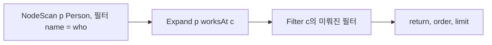

타입 검사 결과가 계획기 입력 IR이 되는 과정을 본다.

## IR: QueryIR와 MutationIR

하강의 결과는 계획기가 받는 IR이다. 읽기 IR은 연산 파이프라인, 반환 식, 정렬, `limit`으로 이뤄진다([`crates/omnigraph-compiler/src/ir/mod.rs` L31-L41](https://github.com/ModernRelay/omnigraph/blob/00b8cca842f2bf009bebeefcf765672b5ff64b26/crates/omnigraph-compiler/src/ir/mod.rs#L31-L41)).

### 코드 분석: 파이프라인 연산

[`crates/omnigraph-compiler/src/ir/mod.rs` L127-L152](https://github.com/ModernRelay/omnigraph/blob/00b8cca842f2bf009bebeefcf765672b5ff64b26/crates/omnigraph-compiler/src/ir/mod.rs#L127-L152)

```rust
pub enum IROp {
    NodeScan {
        variable: String,
        type_name: String,
        /// Boolean expressions over `variable`, one per inline binding match.
        filters: Vec<IRExpr>,
    },
    Expand {
        src_var: String,
        dst_var: String,
        edges: EdgeSelection,
        src_type: String,
        dst_type: String,
        min_hops: u32,
        max_hops: Option<u32>,
        /// Filters from a deferred destination binding, pushed into the
        /// Expand so the executor can apply them during hydration (Lance
        /// SQL pushdown) rather than as a separate post-expand pass.
        dst_filters: Vec<IRExpr>,
        /// Variable bound to the matched edge row (`$p $w:knows $f`), if any.
        /// Changes the op's contract: one output row per matching edge ROW
        /// (not per distinct endpoint pair), edge property columns carried
        /// under this prefix. Always single-hop (typecheck T23).
        edge_binding: Option<String>,
    },
```

- 연산은 `NodeScan`, `Expand`, `Filter`, `AntiJoin` 네 가지다([`crates/omnigraph-compiler/src/ir/mod.rs` L153-L165](https://github.com/ModernRelay/omnigraph/blob/00b8cca842f2bf009bebeefcf765672b5ff64b26/crates/omnigraph-compiler/src/ir/mod.rs#L153-L165))
- `Expand`의 `dst_filters`는 도착 쪽 바인딩의 필터를 순회 안으로 넣은 것이다. 실행기가 도착 노드를 읽을 때 Lance의 SQL 조건 내리기(predicate pushdown)로 적용할 수 있다
- `edge_binding`이 있으면 출력이 끝점 쌍마다 한 행이 아니라 엣지 행마다 한 행이 된다

`IRExpr`는 AST의 `Expr`과 비슷하지만 모든 노드가 타입(`ExprType`)을 들고, 매개변수(`Param`)와 형 변환(`Cast`)이 따로 있다([`crates/omnigraph-compiler/src/ir/mod.rs` L1393-L1463](https://github.com/ModernRelay/omnigraph/blob/00b8cca842f2bf009bebeefcf765672b5ff64b26/crates/omnigraph-compiler/src/ir/mod.rs#L1393-L1463)). `ExprType`에는 선언된 매개변수나 결과로는 나오지 않는 내부 비교 전용 `ExactInteger`가 있다([`crates/omnigraph-compiler/src/types.rs` L308-L325](https://github.com/ModernRelay/omnigraph/blob/00b8cca842f2bf009bebeefcf765672b5ff64b26/crates/omnigraph-compiler/src/types.rs#L308-L325)).

변경 IR은 문장마다 `Insert`, `Update`, `Delete` 중 하나와 대상 타입을 담는다. 대상은 `MutationTarget::Node`나 `Edge`로 종류까지 확정되어 있어, 실행기가 이름으로 종류를 다시 추측하지 않는다([`crates/omnigraph-compiler/src/ir/mod.rs` L88-L116](https://github.com/ModernRelay/omnigraph/blob/00b8cca842f2bf009bebeefcf765672b5ff64b26/crates/omnigraph-compiler/src/ir/mod.rs#L88-L116)). 쓰기 모드도 IR에 그대로 실린다.

## 하강: 순회 순서와 물리 컬럼

`lower_query`는 검사된 쿼리를 IR로 바꾸면서 세 가지를 정한다. 어느 바인딩을 스캔으로 시작할지, 메타 필드를 어떤 물리 컬럼으로 읽을지, 비교 피연산자를 어떤 형으로 맞출지다.

### 코드 분석: 루트 선택 규칙

`lower_clauses`의 주석이 알고리즘을 설명한다. [`crates/omnigraph-compiler/src/ir/lower.rs` L367-L384](https://github.com/ModernRelay/omnigraph/blob/00b8cca842f2bf009bebeefcf765672b5ff64b26/crates/omnigraph-compiler/src/ir/lower.rs#L367-L384)

```rust
// ── Determine which bindings are "deferred" ─────────────────────────
//
// When multiple bindings in the same match clause are connected by
// traversals, only the first-declared binding needs a NodeScan; the
// rest will be introduced by Expand operations.  Making them all
// NodeScans triggers expensive cross-joins followed by cycle-closing
// filters.
//
// Algorithm: build an undirected graph of variables connected by
// traversals, then walk connected components in binding declaration
// order.  The first binding in each component becomes the root (gets
// a NodeScan); all other bindings in the same component are deferred
// — their inline filters become post-Expand Filter ops.
//
// A component holding a binding the leading order key ranks roots there
// instead, whatever the declaration order: the ranking starts the
// traversal. A ranked binding only a traversal introduces gets a NodeScan
// of its checked type, so declaring it does not change the plan.
```

- 순회로 이어진 바인딩들을 연결 요소로 묶고, 요소마다 먼저 선언된 바인딩 하나만 `NodeScan`으로 만든다. 나머지는 `Expand`가 데려오고, 그 바인딩의 인라인 필터는 `Expand` 뒤로 미뤄진다
- 모든 바인딩을 스캔하면 교차 곱 뒤에 사이클 닫기 필터가 붙어 비싸다는 것이 이유다
- 정렬 첫 키가 순위를 매기는 바인딩(`nearest`, `bm25`, `rrf` 대상)이 있으면 그 바인딩에서 시작한다. 연결 요소 탐색은 너비 우선이다([`crates/omnigraph-compiler/src/ir/lower.rs` L420-L483](https://github.com/ModernRelay/omnigraph/blob/00b8cca842f2bf009bebeefcf765672b5ff64b26/crates/omnigraph-compiler/src/ir/lower.rs#L420-L483))

예를 들어 `$p: Person { name: $who }`, `$c: Company`, `$p worksAt $c`를 담은 match는 아래 파이프라인이 된다. `$c`는 `$p`와 같은 연결 요소라 스캔되지 않는다.



양 끝이 이미 묶인 순회는 임시 변수로 `Expand`한 뒤 id가 같은지 거르는 사이클 닫기로 바뀐다([`crates/omnigraph-compiler/src/ir/lower.rs` L559-L560](https://github.com/ModernRelay/omnigraph/blob/00b8cca842f2bf009bebeefcf765672b5ff64b26/crates/omnigraph-compiler/src/ir/lower.rs#L559-L560)). 이름 없는 끝점 `_`과 임시 변수에는 쿼리 전체에서 겹치지 않는 새 이름을 붙인다. 실행기가 열 이름을 `<변수>.<속성>`으로 짓고 같은 변수의 두 생산자를 합치지 않기 때문이다([`crates/omnigraph-compiler/src/ir/lower.rs` L17-L22](https://github.com/ModernRelay/omnigraph/blob/00b8cca842f2bf009bebeefcf765672b5ff64b26/crates/omnigraph-compiler/src/ir/lower.rs#L17-L22)).

### 코드 분석: 메타 필드의 물리 철자

[`crates/omnigraph-compiler/src/ir/lower.rs` L1026-L1034](https://github.com/ModernRelay/omnigraph/blob/00b8cca842f2bf009bebeefcf765672b5ff64b26/crates/omnigraph-compiler/src/ir/lower.rs#L1026-L1034)

```rust
fn physical_property(property: &str, system_columns: SystemColumns) -> String {
    match property {
        EDGE_TYPE_META => EDGE_TYPE_COLUMN.to_string(),
        name if name == SYSTEM_COLUMNS_META.id => system_columns.id.to_string(),
        name if name == SYSTEM_COLUMNS_META.src => system_columns.src.to_string(),
        name if name == SYSTEM_COLUMNS_META.dst => system_columns.dst.to_string(),
        other => other.to_string(),
    }
}
```

- `@id`, `@src`, `@dst`는 그래프의 `SystemColumns`에 따라 `__id`나 `id` 같은 실제 컬럼 이름이 된다(03장)
- `@type`은 저장 컬럼이 아니라 쿼리 전용 열 `~edge_type`이 된다([`crates/omnigraph-compiler/src/traversal.rs` L8-L12](https://github.com/ModernRelay/omnigraph/blob/00b8cca842f2bf009bebeefcf765672b5ff64b26/crates/omnigraph-compiler/src/traversal.rs#L8-L12))
- 맨 이름은 그대로 사용자 속성이다

하강 결과는 `validate_query`가 한 번 더 검사한다. 파이프라인의 각 변수가 연산 하나에서만 만들어지는지, 모든 참조가 그 뒤에 오는지, 반환 타입이 내부 전용 `ExactInteger`를 드러내지 않는지 본다. 하강 규칙이 새 모양을 만들어도 실행기에 가기 전에 변수 이름과 함께 실패하게 하는 장치다([`crates/omnigraph-compiler/src/ir/validate.rs` L1-L40](https://github.com/ModernRelay/omnigraph/blob/00b8cca842f2bf009bebeefcf765672b5ff64b26/crates/omnigraph-compiler/src/ir/validate.rs#L1-L40)). 변경 하강은 문장마다 대입과 조건을 내리는 단순한 변환이다([`crates/omnigraph-compiler/src/ir/lower.rs` L259-L272](https://github.com/ModernRelay/omnigraph/blob/00b8cca842f2bf009bebeefcf765672b5ff64b26/crates/omnigraph-compiler/src/ir/lower.rs#L259-L272)).

## 형 강제, 상수 접기, 소거

### 코드 분석: 공통 수치 형

비교의 두 피연산자 형이 다르면 `coerce.rs`가 비교할 형을 정하고 명시적인 `Cast` 노드를 넣는다. 모듈 주석은 실행 단계가 매개변수 값을 보고 형을 고르는 일이 없다고 못 박는다([`crates/omnigraph-compiler/src/ir/coerce.rs` L1-L2](https://github.com/ModernRelay/omnigraph/blob/00b8cca842f2bf009bebeefcf765672b5ff64b26/crates/omnigraph-compiler/src/ir/coerce.rs#L1-L2)). [`crates/omnigraph-compiler/src/ir/coerce.rs` L94-L107](https://github.com/ModernRelay/omnigraph/blob/00b8cca842f2bf009bebeefcf765672b5ff64b26/crates/omnigraph-compiler/src/ir/coerce.rs#L94-L107)

```rust
fn common_numeric(left: Domain, right: Domain) -> Domain {
    use Domain::{Exact, Scalar};
    use ScalarType::{F32, F64, I32, I64, U32, U64};
    if left == right {
        return left;
    }
    match (left, right) {
        (Scalar(F32 | F64), _) | (_, Scalar(F32 | F64)) => Scalar(F64),
        (Exact, _) | (_, Exact) => Exact,
        (Scalar(U64), Scalar(I32 | I64)) | (Scalar(I32 | I64), Scalar(U64)) => Exact,
        (Scalar(U32 | U64), Scalar(U32 | U64)) => Scalar(U64),
        _ => Scalar(I64),
    }
}
```

| 왼쪽 | 오른쪽 | 비교 형 |
|---|---|---|
| 같은 형 | 같은 형 | 그 형 |
| `F32` 또는 `F64` | 수치 | `F64` |
| `U64` | `I32` 또는 `I64` | `ExactInteger` |
| `U32` 또는 `U64` | `U32` 또는 `U64` | `U64` |
| 그 밖의 정수 | 정수 | `I64` |

- `U64`와 부호 있는 정수를 섞으면 어느 쪽으로 바꿔도 값이 잘릴 수 있어 내부 정확 정수 형으로 비교한다
- 한쪽이 리터럴이고 그 값이 상대 형으로 손실 없이 옮겨지면, 공통 형 대신 상대 형으로 맞춘다([`crates/omnigraph-compiler/src/ir/coerce.rs` L155-L170](https://github.com/ModernRelay/omnigraph/blob/00b8cca842f2bf009bebeefcf765672b5ff64b26/crates/omnigraph-compiler/src/ir/coerce.rs#L155-L170)). 매개변수 값은 이 판단에 쓰지 않는다
- Blob과 Vector는 비교 형이 될 수 없다([`crates/omnigraph-compiler/src/ir/coerce.rs` L122-L129](https://github.com/ModernRelay/omnigraph/blob/00b8cca842f2bf009bebeefcf765672b5ff64b26/crates/omnigraph-compiler/src/ir/coerce.rs#L122-L129))

형을 맞춘 뒤 `fold::binary`가 양쪽이 모두 리터럴인 비교와 논리식을 컴파일 시점에 계산한다. `{ adult: true or false }`는 IR에 `true`로 들어간다. 날짜 비교와 `Cast`가 남은 트리는 접지 않고 엔진의 타입 있는 평가기에 맡긴다([`crates/omnigraph-compiler/src/ir/fold.rs` L1-L29](https://github.com/ModernRelay/omnigraph/blob/00b8cca842f2bf009bebeefcf765672b5ff64b26/crates/omnigraph-compiler/src/ir/fold.rs#L1-L29), [`crates/omnigraph-compiler/src/ir/coerce.rs` L264-L276](https://github.com/ModernRelay/omnigraph/blob/00b8cca842f2bf009bebeefcf765672b5ff64b26/crates/omnigraph-compiler/src/ir/coerce.rs#L264-L276)).

### 코드 분석: 참조 실행기용 소거

`QueryIR::erase`는 타입 정보를 지운 고정 형식 IR을 만든다. [`crates/omnigraph-compiler/src/ir/erase.rs` L10-L19](https://github.com/ModernRelay/omnigraph/blob/00b8cca842f2bf009bebeefcf765672b5ff64b26/crates/omnigraph-compiler/src/ir/erase.rs#L10-L19)

```rust
pub fn erase(&self) -> untyped::QueryIR {
    let Self {
        name,
        params,
        pipeline,
        return_exprs,
        distinct: _,
        order_by,
        limit,
    } = self;
```

- 받는 쪽은 `omnigraph-reference-engine`, 고정된 v1 실행기다. 시험 도구가 같은 쿼리를 v2 엔진과 v1 실행기에서 돌려 결과를 비교할 때만 쓰며, 운영 경로에서는 호출되지 않는다([아키텍처 문서](https://github.com/ModernRelay/omnigraph/blob/00b8cca842f2bf009bebeefcf765672b5ff64b26/docs/dev/architecture.md#L116))
- `distinct`는 옮기지 않는다. 고정 형식이 이 기능보다 오래되었기 때문이고, 그래서 `return distinct` 쿼리는 v1 비교 대상에서 빠진다
- `Cast` 노드는 지워지고 안쪽 식만 남는다([`crates/omnigraph-compiler/src/ir/erase.rs` L132-L135](https://github.com/ModernRelay/omnigraph/blob/00b8cca842f2bf009bebeefcf765672b5ff64b26/crates/omnigraph-compiler/src/ir/erase.rs#L132-L135)). 소거는 한 방향이라 소거된 IR에서 타입 있는 IR로 돌아갈 수 없다

이름 흔적 하나가 남아 있다. 쿼리 문법 파일의 첫 줄은 "NanoGraph Query Grammar"이고([`crates/omnigraph-compiler/src/query/query.pest` L1](https://github.com/ModernRelay/omnigraph/blob/00b8cca842f2bf009bebeefcf765672b5ff64b26/crates/omnigraph-compiler/src/query/query.pest#L1)), `now()`가 쓰는 내부 매개변수 이름도 `__nanograph_now`다([`crates/omnigraph-compiler/src/query/ast.rs` L6](https://github.com/ModernRelay/omnigraph/blob/00b8cca842f2bf009bebeefcf765672b5ff64b26/crates/omnigraph-compiler/src/query/ast.rs#L6)). 이전 프로젝트 이름의 흔적으로 보인다(추정).
