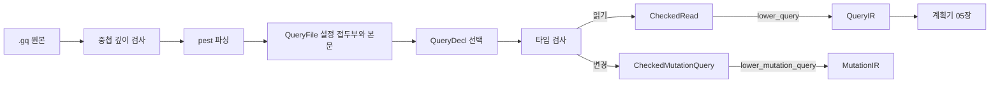

`.gq` 파일은 이름 있는 읽기 쿼리와 변경 쿼리, 또는 브랜치, 커밋, 적재, `show`, `explain` 문장 하나를 담는다. 컴파일러는 이 원본을 pest 문법으로 파싱해 AST를 만들고, 카탈로그에 대고 타입을 검사한 뒤, 계획기가 받는 타입 있는 IR(`QueryIR`, `MutationIR`)로 내린다. 이 장은 `omnigraph-compiler`의 `query`, `ir` 모듈과 `query_input.rs`, `settings.rs`를 따라 이 세 단계를 설명한다. IR을 받아 계획을 세우는 일은 05장, 실행은 06장에서 다룬다.

## 컴파일 단계 개요

엔진의 읽기 진입점은 원본과 쿼리 이름을 받아 컴파일러 함수 세 개를 차례로 부른다(02장). 변경 진입점도 같은 순서지만 변경용 함수를 쓴다.

| 단계 | 함수 | 결과 | 진단 코드 |
|---|---|---|---|
| 파싱 | `parse_query_diagnostic` | `QueryFile` | `Q001`~`Q006` |
| 선언 선택 | `find_read_statement`, `find_named_query` | `ReadStatement`, `QueryDecl` | 없음(메시지) |
| 타입 검사 | `CheckedRead::check`, `typecheck_query_decl` | `CheckedReadQuery`, `CheckedMutationQuery` | `T1`~`T59` |
| 하강 | `lower_query`, `lower_mutation_query` | `QueryIR`, `MutationIR` | 계획 오류 |

진단 코드는 `query/codes.rs` 한 곳에 모여 있다. `Q`는 파서, `T`는 타입 검사기, `P`는 계획기 코드이고, 한 번 공개된 코드의 뜻은 바뀌지 않으며 철회된 번호는 다시 쓰지 않는다([`crates/omnigraph-compiler/src/query/codes.rs` L1-L6](https://github.com/ModernRelay/omnigraph/blob/00b8cca842f2bf009bebeefcf765672b5ff64b26/crates/omnigraph-compiler/src/query/codes.rs#L1-L6)).

## 정리

- `.gq` 파일은 설정 줄 다음에 쿼리 선언 여러 개 또는 문장 하나를 담고, 파서는 이를 `QueryFile`의 `FileBody` 일곱 종류 중 하나로 분류한다. 중첩 깊이는 문법을 돌리기 전에 잰다
- 선언은 이름, 매개변수, 쓰기 절, 읽기 본문이나 변경 본문으로 이뤄지고, 쓰기 절(`as commit`, `as unattached branch`)은 변경 결과가 갈 곳을 정한다
- 타입 검사기는 카탈로그에 대고 바인딩, 순회, 식을 검사해 모든 식에 타입을 붙이며, 오류마다 고정된 `T` 코드를 붙인다. 무한 순회와 `limit` 없는 순위 정렬은 여기서 막힌다
- 하강은 순회로 이어진 바인딩마다 시작점 하나만 스캔하도록 파이프라인 순서를 정하고, 메타 필드를 그래프의 물리 철자로 바꾸고, 비교마다 명시적 `Cast`를 넣는다
- 결과 IR은 `NodeScan`, `Expand`, `Filter`, `AntiJoin` 파이프라인과 타입 있는 식으로 이뤄지며, 계획기(05장)의 입력이 된다. 시험용 v1 실행기에는 타입을 지운 별도 형식으로 넘긴다
