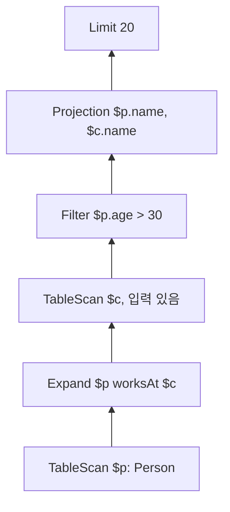
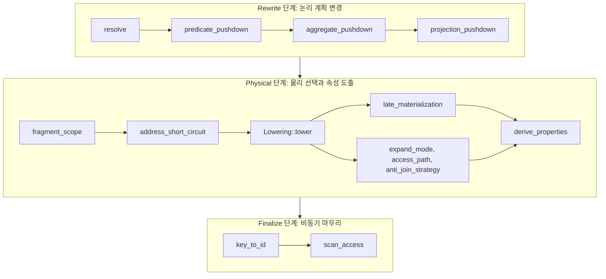

논리 계획 구조와 패스 등록, 재작성 규칙을 본다.

## 논리 계획: LogicalNode와 아레나

논리 계획은 쿼리의 의미를 노드 트리로 적은 것이다. 노드는 `LogicalPlan` 아레나(arena, 인덱스로 참조하는 배열 저장소)에 들어가고 서로를 `LogicalId`로 가리킨다 ([logical.rs L798-L803](https://github.com/ModernRelay/omnigraph/blob/00b8cca842f2bf009bebeefcf765672b5ff64b26/crates/omnigraph-planner/src/logical.rs#L798-L803)). 노드마다 Arrow schema를 함께 저장하므로 패스는 언제든 노드의 출력 열을 조회할 수 있다. 재작성 패스가 노드를 지울 때 쓰는 `splice_out`은 참조를 대체 노드로 옮기고 지운 칸을 `None`(tombstone)으로 남긴다. 배열에서 빼지 않으므로 다른 노드가 들고 있는 `LogicalId`가 무효가 되지 않는다.

### 노드 종류

`LogicalNode`는 23개 변형을 가지며 쿼리, 변경 피드, 병합, 적재, 쓰기가 같은 열거형을 공유한다 ([logical.rs L518-L676](https://github.com/ModernRelay/omnigraph/blob/00b8cca842f2bf009bebeefcf765672b5ff64b26/crates/omnigraph-planner/src/logical.rs#L518-L676)).

| 범주 | 변형 | 역할 |
|---|---|---|
| 읽기 잎 | `TableScan`, `MetadataCount` | 고정 버전 테이블 읽기, manifest 행 수로 `count` 응답 |
| 행 연산 | `Filter`, `Projection`, `Sort`, `Limit` | GQ 필터 conjunct, 반환식, 정렬, 행 수 제한 |
| 순회 | `Expand`, `AntiJoin`, `OuterReference` | 그래프 홉, 상관 블록, 블록 내부의 외부 행 참조 |
| 검색 | `Nearest`, `TextSearch`, `RankFuse` | 벡터 순위, BM25 순위, RRF 결합 |
| 집계 | `Aggregate` | 그룹 키와 집계식 |
| 조인 | `CrossJoin`, `Join` | 연결되지 않은 바인딩의 곱, diff와 병합의 키 조인 |
| 변경 피드와 병합 | `Ordered`, `Page`, `RowDiff`, `MergeClassify` | 순서 요구, 페이지 예산, 행 비교, 3방향 분류 |
| 적재와 쓰기 | `CsvSource`, `DeltaSource`, `Validate`, `FragmentWrite` | 원본 읽기, 제약 검증, fragment 기록 |

`Expand`는 토폴로지와 엣지 바인딩만 다루고, 목적지 노드의 속성과 필터는 그 위의 `TableScan`이 맡는다 ([logical.rs L586-L601](https://github.com/ModernRelay/omnigraph/blob/00b8cca842f2bf009bebeefcf765672b5ff64b26/crates/omnigraph-planner/src/logical.rs#L586-L601)). 한 홉은 항상 "`Expand` 다음 입력이 있는 `TableScan`" 두 노드다. 검색 함수는 정렬의 첫 키로 들어올 때 노드가 된다. `order { nearest(...) }`는 `Nearest`, `order { bm25(...) }`는 `TextSearch`, `order { rrf(a, b) }`는 `RankFuse`다 ([logical.rs L614-L644](https://github.com/ModernRelay/omnigraph/blob/00b8cca842f2bf009bebeefcf765672b5ff64b26/crates/omnigraph-planner/src/logical.rs#L614-L644)). 세 노드의 실행은 7장에서 다룬다.

### 코드 분석: ScanSpec

`crates/omnigraph-planner/src/logical.rs`, [logical.rs L387-L402](https://github.com/ModernRelay/omnigraph/blob/00b8cca842f2bf009bebeefcf765672b5ff64b26/crates/omnigraph-planner/src/logical.rs#L387-L402)

`TableScan`이 들고 다니는 명세로, 이후 패스 대부분이 이 구조체의 필드를 채운다.

```rust
pub struct ScanSpec {
    pub access: Option<ScanAccess>,
    pub side: SideId,
    pub table: TableRef,
    /// The pinned dataset version, absent when no dataset belongs to this image.
    pub version: Option<u64>,
    pub columns: SystemColumns,
    pub fragments: Option<Vec<u64>>,
    pub projection: Option<Vec<String>>,
    pub filter: Option<Predicate>,
    /// The GQ `match` variable this scan binds; `None` on a diff or merge side.
    pub binding: Option<String>,
    /// The filter the join above this scan fills at run time, when the
    /// physical plan chose one; always `None` on a logical scan.
    pub runtime_filter: Option<RuntimeFilterSpec>,
}
```

| 필드 | 채우는 단계 |
|---|---|
| `version`, `table`, `side`, `binding` | `resolve` (snapshot에 고정된 버전) |
| `filter` | `predicate_pushdown` |
| `projection` | `projection_pushdown` |
| `fragments` | `fragment_scope` (변경 피드 전용) |
| `runtime_filter` | 물리 선택의 `ContainsJoin` |
| `access` | `scan_access` (마무리 단계) |

`side`는 `SideId`다. 쿼리에서는 `match` 변수마다 파이프라인 순서로 번호가 매겨진 `Binding(n)`이고, diff와 병합에서는 `Parent`, `Child`, `Base`다.

### 논리 계획 생성

`resolve`는 패스 목록의 첫 패스이며 연산 종류별로 논리 계획을 만든다 ([optimizer.rs L101-L179](https://github.com/ModernRelay/omnigraph/blob/00b8cca842f2bf009bebeefcf765672b5ff64b26/crates/omnigraph-planner/src/optimizer.rs#L101-L179)). 쿼리는 `resolve_query`로, 커밋 diff는 두 스캔 위의 키 조인과 `RowDiff`로, 3방향 병합은 세 스캔 위의 `MergeClassify`로 만들어진다.

`resolve_query`는 노드를 만들기 전에 두 경우를 거부한다 ([optimizer.rs L425-L452](https://github.com/ModernRelay/omnigraph/blob/00b8cca842f2bf009bebeefcf765672b5ff64b26/crates/omnigraph-planner/src/optimizer.rs#L425-L452)). 첫째, 전문 검색 함수가 가리키는 속성에 인덱스 segment가 없으면 `FullTextIndexRequired`다. 주석은 그 이유를 "Lance would fall back to a bare, case-sensitive tokenizer"라고 적는다. 인덱스 없이 실행하면 분석기(analyzer)가 달라 결과가 달라지므로 거부한다. 둘째, 엣지 선택(edge selection)은 유한한 `traversal_work_limit` 없이는 계획되지 않고 CSR 강제 모드와도 함께 쓸 수 없다.

파이프라인은 `resolve_pipeline`이 IR 연산을 하나씩 접어 만든다. IR의 `Expand` 하나는 `Expand` 노드와 그 위의 목적지 `TableScan`(`input: Some(expand)`)이 되고, 목적지 필터는 그 위 `Filter`로 감싸진다 ([optimizer.rs L654-L696](https://github.com/ModernRelay/omnigraph/blob/00b8cca842f2bf009bebeefcf765672b5ff64b26/crates/omnigraph-planner/src/optimizer.rs#L654-L696)). 두 번째 `NodeScan`, 즉 연결되지 않은 바인딩이면 `CrossJoin`이 생긴다 ([optimizer.rs L618-L636](https://github.com/ModernRelay/omnigraph/blob/00b8cca842f2bf009bebeefcf765672b5ff64b26/crates/omnigraph-planner/src/optimizer.rs#L618-L636)). 컴파일러의 IR 변환은 연결된 패턴마다 `NodeScan`을 하나만 주므로 연결된 바인딩이 곱으로 만들어진 뒤 필터로 걸러지는 일은 없다 ([docs/dev/execution.md L123-L127](https://github.com/ModernRelay/omnigraph/blob/00b8cca842f2bf009bebeefcf765672b5ff64b26/docs/dev/execution.md#L123-L127)). 상관 블록(`not { ... }`)은 내부 파이프라인을 `OuterReference`를 씨앗으로 재귀 해석해 `AntiJoin`의 `inner`로 둔다.

파이프라인 위에는 반환 노드가 쌓인다. 첫 정렬 키가 검색 함수면 검색 노드를 올리고, 집계나 `distinct`가 있으면 `Aggregate`와 그 위 `Projection`을, 아니면 `Projection` 하나를 둔다. 정렬 키가 있으면 `Sort`, `limit`가 있으면 `Limit`가 마지막이다 ([optimizer.rs L549-L571](https://github.com/ModernRelay/omnigraph/blob/00b8cca842f2bf009bebeefcf765672b5ff64b26/crates/omnigraph-planner/src/optimizer.rs#L549-L571)). `Sort`의 `fetch`에 쿼리의 limit가 미리 들어가 상위 N개 정렬이 가능하고, `tiebreak`의 메타데이터 열이 같은 키를 가진 행의 순서를 deterministic하게 만든다.

아래는 `match { $p: Person  $p worksAt $c  $p.age > 30 }`, `return { $p.name, $c.name }`, `limit 20` 형태의 쿼리가 해석 직후 갖는 논리 트리다.



이 시점에 `Filter`는 스캔 밖에 있고 두 스캔은 모든 열을 읽는다. 다음 두 절의 패스가 이 상태를 바꾼다.

## 패스 등록과 세 단계

패스의 이름, 순서, 단계는 `passes!` 매크로 한 곳에서 선언된다 ([passes.rs L43-L57](https://github.com/ModernRelay/omnigraph/blob/00b8cca842f2bf009bebeefcf765672b5ff64b26/crates/omnigraph-planner/src/passes.rs#L43-L57)). 세 단계의 루프가 모두 이 목록을 순회하고 `PassId`로 매치하므로, 패스가 다른 이름이나 위치로 실행되거나 보고될 수 없다 ([passes.rs L1-L5](https://github.com/ModernRelay/omnigraph/blob/00b8cca842f2bf009bebeefcf765672b5ff64b26/crates/omnigraph-planner/src/passes.rs#L1-L5)). `@Pass` 카탈로그 타입도 같은 목록을 읽는다 ([passes.rs L89-L98](https://github.com/ModernRelay/omnigraph/blob/00b8cca842f2bf009bebeefcf765672b5ff64b26/crates/omnigraph-planner/src/passes.rs#L89-L98)).

| 위치 | 이름 | 단계 | 대상 |
|---|---|---|---|
| 0 | `resolve` | Rewrite | 논리 계획 생성 |
| 1 | `predicate_pushdown` | Rewrite | 필터 conjunct를 스캔이나 조인으로 이동 |
| 2 | `aggregate_pushdown` | Rewrite | `count($v)`를 manifest 행 수로 대체 |
| 3 | `projection_pushdown` | Rewrite | 스캔이 읽을 열 축소 |
| 4 | `fragment_scope` | Physical | 변경 피드 스캔을 바뀐 fragment로 한정 |
| 5 | `address_short_circuit` | Physical | 행 주소가 같은 쌍을 diff 전에 제거 |
| 6 | `late_materialization` | Physical | 반환 전용 열을 `limit` 뒤에 행 주소로 조회 |
| 7 | `join_algorithm` | Physical | 조인 알고리즘 선택 |
| 8 | `expand_mode` | Physical | `Expand`의 인덱스 스캔과 CSR 선택 |
| 9 | `access_path` | Physical | 의존 스캔의 id 조회와 해시 조인 선택 |
| 10 | `anti_join_strategy` | Physical | 상관 블록의 실행 전략 선택 |
| 11 | `key_to_id` | Finalize | 문자열 키 등식을 id 등식으로 좁힘 |
| 12 | `scan_access` | Finalize | 스캔별 접근 방식 확정 |



### 코드 분석: rewrite_with

`crates/omnigraph-planner/src/optimizer.rs`, [optimizer.rs L1485-L1512](https://github.com/ModernRelay/omnigraph/blob/00b8cca842f2bf009bebeefcf765672b5ff64b26/crates/omnigraph-planner/src/optimizer.rs#L1485-L1512)

재작성 단계의 루프로, 실제로 계획을 바꾼 패스만 `fired`에 남긴다.

```rust
    for pass in PassId::of_stage(PassStage::Rewrite) {
        let applied = match pass {
            PassId::Resolve => true,
            PassId::PredicatePushdown => {
                if query {
                    place_query_filters(plan, source, tracer)
                } else {
                    resume_pushdown(plan)
                }
            }
            PassId::AggregatePushdown => query && aggregate_pushdown(plan)?,
            PassId::ProjectionPushdown => query && projection_pushdown(plan, source, tracer)?,
            PassId::FragmentScope
            | PassId::AddressShortCircuit
            | PassId::LateMaterialization
```

매치에 와일드카드 팔이 없다. 패스를 추가하면 세 루프가 모두 컴파일 오류를 내므로 각 루프가 새 패스를 어떻게 다룰지 명시해야 한다. 같은 패스가 계획 종류에 따라 다르게 동작하는 점도 보인다. 변경 피드 계획에서 `predicate_pushdown`은 재개 커서를 스캔에 넣는다.

물리 단계는 패스 목록을 두 번 돈다 ([optimizer.rs L1546-L1566](https://github.com/ModernRelay/omnigraph/blob/00b8cca842f2bf009bebeefcf765672b5ff64b26/crates/omnigraph-planner/src/optimizer.rs#L1546-L1566)). 첫 순회는 논리 계획을 직접 고치는 패스 4, 5만 실행하고 패스 6에서 `break`한다. 패스 6~10은 독립 함수가 아니라 `Lowering::lower`가 논리 노드를 물리 노드로 바꾸는 도중의 결정이다. 두 번째 순회는 `Lowering`이 남긴 플래그를 읽어 발동한 패스를 기록한다. 마지막으로 루트 schema가 해석 직후와 같은지(`root_shape_kept`), 집계 명세와 출력 schema가 맞는지 확인한다 ([optimizer.rs L1630-L1642](https://github.com/ModernRelay/omnigraph/blob/00b8cca842f2bf009bebeefcf765672b5ff64b26/crates/omnigraph-planner/src/optimizer.rs#L1630-L1642)).

## 논리 재작성 패스

### 코드 분석: 필터 배치

`crates/omnigraph-planner/src/optimizer.rs`, [optimizer.rs L1894-L1912](https://github.com/ModernRelay/omnigraph/blob/00b8cca842f2bf009bebeefcf765672b5ff64b26/crates/omnigraph-planner/src/optimizer.rs#L1894-L1912)

쿼리 계획의 패스 1은 범위(scope)마다 실행된다. 최상위 트리와 각 `not { ... }` 내부 트리가 각각 하나의 범위다.

```rust
            for conjunct in conjuncts {
                let target = placement_target(&conjunct, &scans, &dependent_scans, source);
                match target.and_then(|target| plan.node_mut(target)) {
                    Some(LogicalNode::TableScan { spec, .. }) => {
                        spec.filter = Some(and_filter(spec.filter.take(), gq_conjunct(&conjunct)));
                        tracer.absorb(&conjunct);
                        fired = true;
                    }
                    _ => match join_target(plan, input, &conjunct) {
                        Some(join) if join != input => {
                            match moved.iter_mut().find(|(target, _)| *target == join) {
                                Some((_, onto)) => onto.push(conjunct),
                                None => moved.push((join, vec![conjunct])),
                            }
                        }
                        _ => residual.push(conjunct),
                    },
                }
            }
```

인접한 `Filter`는 먼저 하나로 합쳐지고 중복 conjunct는 한 번만 남는다. 그다음 conjunct마다 `placement_target`이 갈 곳을 정한다 ([optimizer.rs L1962-L1998](https://github.com/ModernRelay/omnigraph/blob/00b8cca842f2bf009bebeefcf765672b5ff64b26/crates/omnigraph-planner/src/optimizer.rs#L1962-L1998)).

- 검색 conjunct(`search`, `fuzzy`, `match_text`)는 그 필드의 바인딩 스캔으로 간다. 다른 바인딩을 읽으면 이동하지 않는다
- 일반 conjunct는 정확히 한 바인딩만 읽고, 소스가 `filter_pushable`로 스캐너 평가 가능을 답할 때만 그 바인딩 스캔으로 간다
- 두 바인딩을 읽는 conjunct는 둘을 함께 묶는 `CrossJoin`이 있으면 그 조인으로 간다

엔진의 `filter_pushable`은 conjunct를 DataFusion 식으로 바꿀 수 있는지로 답한다 ([plan_source.rs L450-L452](https://github.com/ModernRelay/omnigraph/blob/00b8cca842f2bf009bebeefcf765672b5ff64b26/crates/omnigraph/src/engine/plan_source.rs#L450-L452)). 남은 conjunct가 없으면 `Filter`는 `splice_out`으로 사라진다. 앞 절의 예시에서 `$p.age > 30`은 `$p` 스캔의 `filter`로 이동하고 `Filter` 노드는 없어진다.

### 집계 pushdown

패스 2는 `return { count($p) }`처럼 필터 없는 단일 스캔의 개수만 묻는 쿼리를 데이터 없이 응답하게 만든다 ([optimizer.rs L2139-L2183](https://github.com/ModernRelay/omnigraph/blob/00b8cca842f2bf009bebeefcf765672b5ff64b26/crates/omnigraph-planner/src/optimizer.rs#L2139-L2183)). 스캔에 필터, fragment 한정, 카탈로그 원본이 없어야 하고, 모든 반환식이 그 바인딩의 `count`여야 한다. 조건이 맞으면 `Aggregate`와 `TableScan` 두 노드가 `MetadataCount` 하나로 바뀐다. 행 수 추정에서 이 노드는 항상 1행이다.

### 코드 분석: 투영 pushdown

`crates/omnigraph-planner/src/optimizer.rs`, [optimizer.rs L2237-L2252](https://github.com/ModernRelay/omnigraph/blob/00b8cca842f2bf009bebeefcf765672b5ff64b26/crates/omnigraph-planner/src/optimizer.rs#L2237-L2252)

트리 전체의 열 요구(`Demand`)를 바인딩별로 모은 뒤, 스캔마다 읽을 열 목록을 정한다.

```rust
        let identity = whole_object || demand.is_some_and(|demand| demand.identity);
        let is_key = |name: &str| node_type.key.iter().any(|key| key == name);
        let is_object = |name: &str| node_type.object_columns.iter().any(|column| column == name);
        let named = |name: &str| demand.is_some_and(|demand| demand.properties.contains(name));
        let projection: Vec<String> = node_type
            .schema
            .fields()
            .iter()
            .map(|field| field.name().as_str())
            .filter(|name| {
                (identity && *name == node_type.columns.id)
                    || is_key(name)
                    || (whole_object && is_object(name))
                    || named(name)
            })
            .map(str::to_string)
```

열이 남는 조건은 넷이다. id 열은 무엇인가가 행을 id로 식별할 때, `@key` 열은 항상, 객체 열은 바인딩 전체를 반환할 때, 나머지 속성은 어느 노드가 이름으로 읽을 때 남는다. 이 결과가 `ScanSpec::projection`이 되고, 6장의 스캔 연산자는 Lance에 이 열만 요청한다.
