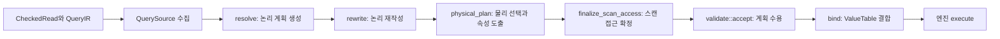

타입 검사를 통과한 쿼리 IR은 `omnigraph-planner` 크레이트에서 논리 계획, 재작성, 물리 선택, 속성 도출을 거쳐 물리 계획이 되고, 검증기를 통과해야만 엔진에 전달된다. 이 장은 그 경로를 `gate.rs` 입구부터 `validate/` 수용 단계까지 코드로 따라간다.

계획기는 스스로 데이터를 열지 않는다. 크레이트 문서는 "The planner reads no environment and opens no data"라고 적고, 필요한 통계는 모두 `PlanSource` 트레이트로 받는다 ([lib.rs L1-L24](https://github.com/ModernRelay/omnigraph/blob/00b8cca842f2bf009bebeefcf765672b5ff64b26/crates/omnigraph-planner/src/lib.rs#L1-L24)). 계획기는 메모리 안의 소스로 단위 테스트되고, 엔진은 고정된 snapshot 위에서 같은 트레이트를 구현한다.

## 계획기의 위치와 입구

읽기 쿼리는 snapshot 확정, 파싱과 타입 검사, IR 변환, 계획 입력 수집, 계획과 수용, 값 바인딩과 실행, 직렬화의 7단계로 처리된다 ([docs/dev/execution.md L7-L21](https://github.com/ModernRelay/omnigraph/blob/00b8cca842f2bf009bebeefcf765672b5ff64b26/docs/dev/execution.md#L7-L21)). 이 장의 범위는 5단계 "계획과 수용"이다. 파싱과 IR은 4장에서, 바인딩 이후 실행은 6장에서 다룬다.



엔진의 진입점 `execute_query`는 `QuerySource::gather`로 계획 입력을 한 번 모으고, `accept_query`로 계획과 수용을 처리한 뒤 `bind`와 `execute`로 넘긴다 ([engine/mod.rs L346-L370](https://github.com/ModernRelay/omnigraph/blob/00b8cca842f2bf009bebeefcf765672b5ff64b26/crates/omnigraph/src/engine/mod.rs#L346-L370)). 엔진 래퍼 `accept_query`는 계획기의 같은 이름 함수에 `ValidationLimits::DEFAULT`를 넘긴다 ([plan_source.rs L647-L653](https://github.com/ModernRelay/omnigraph/blob/00b8cca842f2bf009bebeefcf765672b5ff64b26/crates/omnigraph/src/engine/plan_source.rs#L647-L653)).

### 코드 분석: plan_query

`crates/omnigraph-planner/src/gate.rs`, [gate.rs L477-L497](https://github.com/ModernRelay/omnigraph/blob/00b8cca842f2bf009bebeefcf765672b5ff64b26/crates/omnigraph-planner/src/gate.rs#L477-L497)

수용 검사 없이 물리 계획만 만드는 가장 짧은 경로다.

```rust
pub async fn plan_query(
    query: &QueryIR,
    source: &(dyn PlanSource + Sync),
    bounds: &Bounds,
) -> Result<PhysicalPlan, Unrouted> {
    let mut optimized = {
        let operation = Operation::Query(Box::new(query.clone()));
        let recorded = Recorded::new(source, query.has_wildcard_traversal());
        let mut logical = resolve(&operation, &recorded).map_err(Unrouted::of)?;
        let mut optimized =
            crate::optimizer::optimize(&mut logical, &recorded, bounds).map_err(Unrouted::of)?;
        optimized
            .physical
            .set_assumptions(recorded.assumptions(bounds));
        optimized
    };
    crate::scan_access::finalize_scan_access(&mut optimized, source)
        .await
        .map_err(Unrouted::of)?;
    Ok(optimized.physical)
}
```

순서는 `resolve`, `optimize`, `finalize_scan_access`다. 앞의 둘은 동기 함수이고 마지막만 `await`한다. 스캔 접근 확정은 Lance 스캐너의 인덱스 분할을 물어야 하기 때문이다. 소스는 `Recorded`로 감싼다. `Recorded`는 계획기가 읽은 파라미터 이름, 설정, 환경 변수, dataset 버전을 기록하는 래퍼이고, 계획이 끝나면 이 기록이 `Assumptions`로 물리 계획에 붙는다.

실제 실행과 explain은 `plan_and_accept`를 공유한다 ([gate.rs L571-L622](https://github.com/ModernRelay/omnigraph/blob/00b8cca842f2bf009bebeefcf765672b5ff64b26/crates/omnigraph-planner/src/gate.rs#L571-L622)). 이 함수는 `plan_traced`로 계획을 만들면서 `Tracer`에 재작성 규칙 적용 이력을 남기고, 스캔 접근 단계의 키 좁히기도 규칙 하나로 기록한 뒤 `validate::accept`를 부른다. explain 문서는 같은 계획 실행에서 렌더링되므로 explain에 보이는 계획과 실행되는 계획이 다를 수 없다.

### 계획 실패의 분류

계획기가 계획을 만들지 못한 이유는 `Unrouted`로 구분된다 ([gate.rs L282-L320](https://github.com/ModernRelay/omnigraph/blob/00b8cca842f2bf009bebeefcf765672b5ff64b26/crates/omnigraph-planner/src/gate.rs#L282-L320)). 읽기 쿼리는 실행기 경로가 따로 없으므로 이 값이 그대로 쿼리 실패가 된다.

| `Unrouted` 변형 | 발생 조건 | 호출자 측 의미 |
|---|---|---|
| `PlannerError` | 해석 실패, 패스 오류, 새 계획의 검증 실패 | 계획기 결함 (내부 오류) |
| `UnsupportedQuery` | 설계상 지원하지 않는 쿼리 형태 | 사용자 요청 오류 |
| `ValidationExhausted` | 검증 예산 소진 | 자원 한도 결과 |
| `SourceError` | `PlanSource` 조회 실패 | 소스의 오류 그대로 반환 |
| `FullTextIndexRequired` | 전문 검색 대상 속성에 인덱스 segment 없음 | 타입이 있는 409 충돌 |
| `DeclaredBytesOverBound` | 선언된 보유 메모리가 연산자 한계 초과 | 계획 거부 |

마지막 행은 `over_bound`가 판정하며, build 측이 있는 `SortMergeJoin`과 `HydrateByAddress`만 비교한다 ([gate.rs L936-L949](https://github.com/ModernRelay/omnigraph/blob/00b8cca842f2bf009bebeefcf765672b5ff64b26/crates/omnigraph-planner/src/gate.rs#L936-L949)).

변경 피드와 병합 같은 비쿼리 연산은 `route`로 들어가 등록부(`REGISTRY`)에서 계획 모양을 찾는다 ([gate.rs L629-L640](https://github.com/ModernRelay/omnigraph/blob/00b8cca842f2bf009bebeefcf765672b5ff64b26/crates/omnigraph-planner/src/gate.rs#L629-L640)). 기준 커밋의 등록부는 빈 배열이다 ([registry.rs L54-L57](https://github.com/ModernRelay/omnigraph/blob/00b8cca842f2bf009bebeefcf765672b5ff64b26/crates/omnigraph-planner/src/registry.rs#L54-L57)). 그래서 두 연산의 계획은 explain에 후보로 표시만 되고 실행은 기존 실행기가 맡는다. 해당 실행은 12장과 13장에서 다룬다.

## 정리

- 읽기 쿼리의 계획은 `accept_query` 한 경로로만 만들어지고 실행과 explain이 같은 계획 실행을 공유한다. 계획기는 `PlanSource`로만 통계를 읽고, 읽은 값을 `Assumptions`로 계획에 기록한다
- 논리 계획은 tombstone을 남기는 아레나이며, 한 홉은 토폴로지 전용 `Expand`와 입력이 있는 목적지 `TableScan` 두 노드로 표현된다
- 13개 패스는 `passes!` 한 곳에 등록되고 Rewrite, Physical, Finalize 세 단계로 실행된다. 패스 6~10은 독립 함수가 아니라 `Lowering::lower` 도중의 결정이다
- 비용 모델은 manifest 수치만 쓰는 순수 함수다. `Expand`는 $h \cdot F \cdot p$와 $1.5 \cdot |V_{src}|$의 비교, 목적지 스캔은 행 비율 8과 풀의 4분의 1, 상관 블록은 두 트리의 행 수 합으로 결정된다
- 물리 노드 24종은 `physical_nodes!`에서 분류 토큰과 함께 정의되고, `Lower` 트레이트의 와일드카드 없는 매치가 노드 하나당 연산자 하나를 컴파일 단계에서 강제한다
- 검증기는 모든 계획의 요구사항 보존을 검사하고, 정확 부분집합 쿼리는 재작성 규칙 6개를 다시 적용해 노드 단위로 비교한다. 저장된 계획의 재생도 같은 검사를 통과해야 한다
