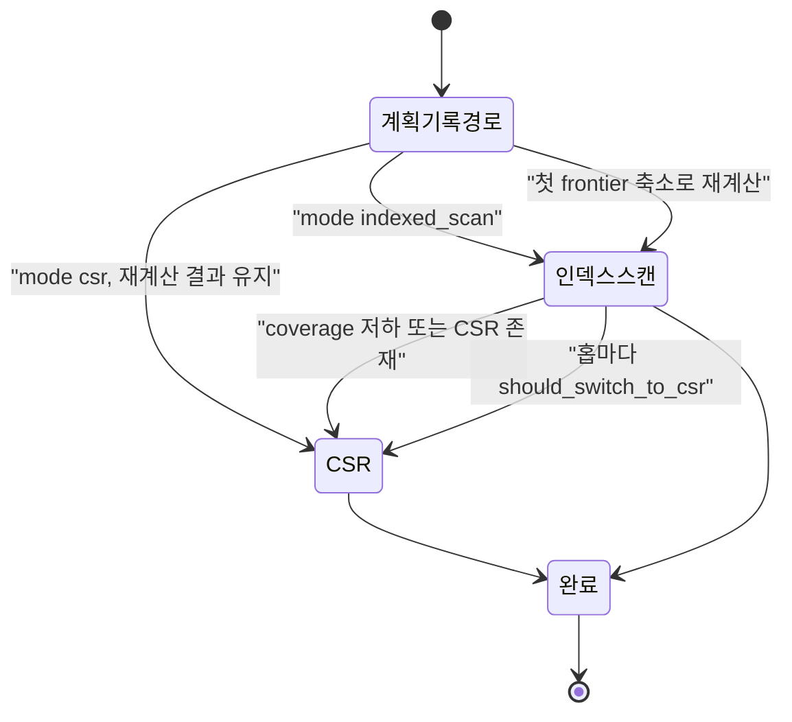

노드 스캔과 Expand, 조인과 상관 블록 연산자를 본다.

## 노드 스캔

`ScanExec` 은 한 바인딩의 노드 테이블을 읽어 column 이름 앞에 바인딩 이름을 붙인 batch 를 내보낸다. 생성자가 출처와 순위 여부로 형태를 정한다([engine/operators/scan/mod.rs L107-L133](https://github.com/ModernRelay/omnigraph/blob/00b8cca842f2bf009bebeefcf765672b5ff64b26/crates/omnigraph/src/engine/operators/scan/mod.rs#L107-L133)).

| 형태 | 조건 | 실행 함수 |
|---|---|---|
| `Pipelined` | 테이블 출처, `bm25` 와 `nearest` 둘 다 없음 | `execute_pipelined` |
| `Ranked` | 테이블 출처, `bm25` 또는 `nearest` | `execute_node_scan` |
| `Dependent` | 입력 연산자가 있음 | `execute_input` (id lookup) |

순위 없는 읽기는 Lance batch 를 읽는 대로 내보낸다. 테이블 전체를 들고 있지 않으므로 상위 `Limit` 이 멈추면 읽기도 멈추고, 작은 fragment 가 많은 테이블도 batch 크기를 채워 내보낸다([engine/operators/scan/pipelined.rs L1-L6](https://github.com/ModernRelay/omnigraph/blob/00b8cca842f2bf009bebeefcf765672b5ff64b26/crates/omnigraph/src/engine/operators/scan/pipelined.rs#L1-L6)). 순위 스캔은 overfetch 재실행이 스캔 전체를 다시 돌리므로 breaker 다. dependent 스캔은 앞 연산자가 넘긴 id 로 목적지 행을 조각 단위로 찾아 읽는다.

### 코드 분석: NodeRead

Lance 읽기 설정은 `NodeRead` 에 모인다.

[engine/scan.rs L38-L51](https://github.com/ModernRelay/omnigraph/blob/00b8cca842f2bf009bebeefcf765672b5ff64b26/crates/omnigraph/src/engine/scan.rs#L38-L51)

```rust
pub(super) struct NodeRead<'n> {
    ds: Dataset,
    pub(super) node_type: &'n omnigraph_compiler::catalog::NodeType,
    filter_expr: Option<Expr>,
    fts_query: Option<FullTextSearchQuery>,
    scalar_index: Option<bool>,
    pub(super) columns: ScanColumns<'n>,
    /// The gate proved the answer empty, or a BM25 filter matched no row: no
    /// Lance read runs.
    pub(super) proven_empty: bool,
    /// The pushed filter runs after the full-text search scores rows
    /// (Lance's postfilter) instead of before it.
    filter_after_scoring: bool,
}
```

`filter_expr` 는 Lance scanner 로 내리는 predicate 이고, gate 가 정한 후보 id 집합과 BM25 filter 가 찾은 id 도 여기에 합쳐진다. `proven_empty` 이면 Lance 읽기를 하지 않는다. `fts_query` 와 ANN probe 는 7장에서 다룬다.

GQ filter 를 Lance 로 내리는 변환은 `build_lance_filter_expr` 가 한다. 변환할 수 있는 conjunct 만 AND 로 묶고 나머지는 건너뛰며, 건너뛴 conjunct 는 계획에 남은 `Filter` 노드가 메모리에서 평가한다([engine/scan.rs L1037-L1060](https://github.com/ModernRelay/omnigraph/blob/00b8cca842f2bf009bebeefcf765672b5ff64b26/crates/omnigraph/src/engine/scan.rs#L1037-L1060)). 어떤 conjunct 를 스캔에 흡수할지는 계획기의 filter pushdown 이 정한다(5장에서 다룬다).

변환 결과는 "값이 아니라 filter" 다. 원래 predicate 가 null 인 행에서 false 가 될 수 있으므로 부정하거나 값으로 읽으면 안 된다([engine/scan.rs L1065-L1087](https://github.com/ModernRelay/omnigraph/blob/00b8cca842f2bf009bebeefcf765672b5ff64b26/crates/omnigraph/src/engine/scan.rs#L1065-L1087)). 같은 nullable column 을 두 번 이상 검사하는 predicate 는 그 column 의 null 여부로 둘로 나눈 형태로 내린다. DataFusion 54 의 식 단순화가 IN-list 조합을 null 을 무시한 상수로 접는 문제를 피하기 위해서다. 나누는 column 은 최대 `MAX_NULL_SPLIT_COLUMNS = 4` 개라 predicate 사본이 16개를 넘지 않고, 넘으면 내리지 않는다([engine/scan.rs L1089-L1092](https://github.com/ModernRelay/omnigraph/blob/00b8cca842f2bf009bebeefcf765672b5ff64b26/crates/omnigraph/src/engine/scan.rs#L1089-L1092)).

id 목록 filter 는 구조화된 `id IN (ids)` 식으로 만들어 `id` BTREE scalar index 를 타게 한다. 주석은 100k 노드 1홉에서 `InListEval` 경로가 인덱스 경로의 72배였다고 적는다(자체 측정, 측정 조건은 주석에 없음)([engine/scan.rs L15-L30](https://github.com/ModernRelay/omnigraph/blob/00b8cca842f2bf009bebeefcf765672b5ff64b26/crates/omnigraph/src/engine/scan.rs#L15-L30)).

### 코드 분석: stored_field

과거 snapshot 을 현재 schema 로 읽을 때 column 을 이름이 아닌 stable property id 로 찾는다.

[engine/typed_value.rs L458-L475](https://github.com/ModernRelay/omnigraph/blob/00b8cca842f2bf009bebeefcf765672b5ff64b26/crates/omnigraph/src/engine/typed_value.rs#L458-L475)

```rust
if let Ok(actual) = stored.field_with_name(name) {
    match actual
        .metadata()
        .get(crate::db::STABLE_PROPERTY_ID_METADATA_KEY)
    {
        Some(stored_id) if stored_id == declared_id => return Ok(actual),
        None if contract_covers => return Ok(actual),
        None => {
            return Err(OmniError::manifest(unwitnessed_graph_property_at_snapshot(
                table, name,
            )));
        }
        Some(_) => {}
    }
}
if contract_covers {
    return Err(internal());
}
```

`contract_covers` 는 열린 테이블 버전이 현재 schema 계약과 함께 게시되었는지를 뜻한다. 그렇지 않은 과거 버전에서는 같은 이름의 column 이 다른 property(삭제 뒤 같은 이름으로 다시 추가)일 수 있고, 선언된 property 가 다른 이름(rename 이후) 아래 있거나 없을(나중에 추가) 수 있다. 세 경우 모두 해당 snapshot 에 타입이 없는 것처럼 거부된다. id 가 없는 column(0.10 이전에 쓴 것)도 과거 버전에서는 거부된다. 모든 스캔, hydration, 간선 읽기가 `check_stored_schema` 를 거쳐 이 함수를 쓴다([engine/typed_value.rs L392-L401](https://github.com/ModernRelay/omnigraph/blob/00b8cca842f2bf009bebeefcf765672b5ff64b26/crates/omnigraph/src/engine/typed_value.rs#L392-L401)). stable property id 의 저장 방식은 3장과 8장에서 다룬다.

## 그래프 순회 Expand

`ExpandExec` 은 입력 행의 출발 노드 id 에서 간선을 따라 목적지 id 를 붙인 행을 만든다. 행은 평탄한 Arrow batch 라 입력 행 하나가 목적지 수만큼 복제되며, 출력 chunk 는 최대 256행이다([engine/operators/expand_stream.rs L32-L35](https://github.com/ModernRelay/omnigraph/blob/00b8cca842f2bf009bebeefcf765672b5ff64b26/crates/omnigraph/src/engine/operators/expand_stream.rs#L32-L35)).

### 코드 분석: ExpandExecution 과 형태

실행 방식은 `ExpandExecution` 의 `Named`, `Budgeted` 두 경로로 나뉜다([engine/operators/expand.rs L42-L46](https://github.com/ModernRelay/omnigraph/blob/00b8cca842f2bf009bebeefcf765672b5ff64b26/crates/omnigraph/src/engine/operators/expand.rs#L42-L46)). 간선 이름 하나로 쓴 순회(`Named`)는 계획이 정한 경로(`csr` 또는 `indexed_scan`)와 그 경로를 바꿀 수 있는지(`ModeOrigin`)를 갖는다. 간선 대안(`A | B`)과 와일드카드는 `Budgeted` 로만 실행되고 항상 per-hop 인덱스 스캔이다. 공유 CSR 아티팩트가 선택된 타입보다 많은 간선을 담을 수 있기 때문이다([docs/dev/execution.md](https://github.com/ModernRelay/omnigraph/blob/00b8cca842f2bf009bebeefcf765672b5ff64b26/docs/dev/execution.md) "Selected edge traversal" 절).

| `ExpandPolicy` | 실행 중 경로 변경 |
|---|---|
| `Costed { inputs }` | 비용 모형을 관측값으로 다시 계산해 변경 가능 |
| `Pinned` | 변경 없음 (테스트용 고정) |
| `Uncosted` | 변경 없음 (통계 없음, CSR 로 시작) |
| `Budgeted` | 변경 없음, 인덱스 스캔만 |

형태는 생성자에서 정해진다.

[engine/operators/expand.rs L270-L276](https://github.com/ModernRelay/omnigraph/blob/00b8cca842f2bf009bebeefcf765672b5ff64b26/crates/omnigraph/src/engine/operators/expand.rs#L270-L276)

```rust
step.validate(&env.catalog)?;
let schema = expand_output_schema(&input.schema(), &env.catalog, &step)?;
let shape = if step.single_hop() || step.budgeted() {
    ExpandShape::Streaming(Streaming::new(schema))
} else {
    ExpandShape::Breaker(Breaker::new(schema))
};
```

1홉과 budgeted 순회는 streaming 이다. budgeted 다중 홉은 입력을 8,192행 고정 source window 로 다시 잘라 처리해 위쪽 batch 경계와 무관하게 작업량 승인을 일정하게 한다([engine/operators/expand_stream.rs L273-L274](https://github.com/ModernRelay/omnigraph/blob/00b8cca842f2bf009bebeefcf765672b5ff64b26/crates/omnigraph/src/engine/operators/expand_stream.rs#L273-L274)). 이름 하나로 쓴 다중 홉은 입력 전체를 받은 뒤 BFS 를 도는 breaker 다. `expand_stream::execute` 는 바인딩 없는 1홉 `Named` 를 `SingleHop` 으로 보내고, 나머지는 batch 크기를 256으로 줄인 context 에서 실행한다([engine/operators/expand_stream.rs L43-L80](https://github.com/ModernRelay/omnigraph/blob/00b8cca842f2bf009bebeefcf765672b5ff64b26/crates/omnigraph/src/engine/operators/expand_stream.rs#L43-L80)).

### 지연 생성 CSR

CSR 은 `GraphIndexHandle` 의 `OnceCell` 안에서 처음 요청될 때 한 번 만들어진다([engine/graph.rs L348-L384](https://github.com/ModernRelay/omnigraph/blob/00b8cca842f2bf009bebeefcf765672b5ff64b26/crates/omnigraph/src/engine/graph.rs#L348-L384)). 인덱스 스캔 경로는 `get` 을 부르지 않으므로, 인덱스만으로 답하는 쿼리는 전체 간선 수에 비례하는 CSR 빌드 비용을 내지 않는다. `is_built` 는 앞선 연산자가 이미 CSR 을 만들었는지 알려 주고, 비용 모형은 이미 있는 CSR 을 비용 없음으로 본다. CSR 의 구조, 영속 아티팩트, 캐시 무효화는 8장에서 다룬다.

### 코드 분석: decide_expand_start

이름 하나로 쓴 순회의 시작 경로를 정한다. 계획이 CSR 을 기록했지만 관측한 첫 frontier 가 추정보다 작으면 다시 계산한다.

[engine/graph.rs L723-L733](https://github.com/ModernRelay/omnigraph/blob/00b8cca842f2bf009bebeefcf765672b5ff64b26/crates/omnigraph/src/engine/graph.rs#L723-L733)

```rust
let observed_indexed = match (&named.origin, frontier_rows, named.mode) {
    (ModeOrigin::Costed(inputs), Some(observed), ExpandMode::Csr)
        if (observed as u64) < inputs.frontier_rows =>
    {
        let mut inputs = inputs.clone();
        inputs.frontier_rows = observed as u64;
        inputs.csr_cached = inputs.csr_cached || graph_index.is_built();
        choose_expand_mode(&inputs) == ExpandMode::IndexedScan
    }
    _ => false,
};
```

`choose_expand_mode` 는 계획기의 비용 함수 그대로다(5장에서 다룬다). 엔진은 새 비용 규칙을 만들지 않고 계획에 기록된 `ExpandCostInputs` 중 frontier 크기, CSR 존재 여부, 인덱스 coverage 만 관측값으로 바꾸어 같은 함수를 다시 부른다. 인덱스 경로로 시작하면 간선 dataset 을 열고 schema 를 검사한 뒤, coverage 를 `pinned_index_facts` 로 기록하지 않은 오래된 계획에 한해 BTREE coverage 를 실제로 조회한다([engine/graph.rs L754-L776](https://github.com/ModernRelay/omnigraph/blob/00b8cca842f2bf009bebeefcf765672b5ff64b26/crates/omnigraph/src/engine/graph.rs#L754-L776)). 결과는 `ExpandStart::Csr` 또는 홉마다 재판단할 정책(`HopPolicy`)을 가진 `ExpandStart::Indexed` 다([engine/graph.rs L666-L676](https://github.com/ModernRelay/omnigraph/blob/00b8cca842f2bf009bebeefcf765672b5ff64b26/crates/omnigraph/src/engine/graph.rs#L666-L676)).



### 코드 분석: BFS 와 중간 전환

다중 홉 순회는 `execute_expand_bfs` 가 수행한다. 출발 행마다 frontier 와 방문 집합을 따로 두고, 홉마다 모든 frontier 의 합집합으로 이웃을 한 번에 조회한다. 두 번째 홉부터는 CSR 로 넘어갈지 다시 판단한다.

[engine/graph.rs L1396-L1406](https://github.com/ModernRelay/omnigraph/blob/00b8cca842f2bf009bebeefcf765672b5ff64b26/crates/omnigraph/src/engine/graph.rs#L1396-L1406)

```rust
if hop > 1 && matches!(active, ActiveExpandSource::Indexed(_)) {
    let switch = match &hop_policy {
        HopPolicy::Off => false,
        HopPolicy::Full(inputs) => should_switch_to_csr(
            union_dense.len() as u64,
            prev_union_len as u64,
            max - hop + 1,
            graph_index.is_built(),
            inputs,
        ),
    };
```

전환할 때는 인덱스 경로의 interner 가 매긴 dense id 를 CSR 의 dense id 로 번역해 frontier, 방문 집합, 이미 내보낸 목적지 집합을 그대로 옮긴다([engine/graph.rs L1459-L1479](https://github.com/ModernRelay/omnigraph/blob/00b8cca842f2bf009bebeefcf765672b5ff64b26/crates/omnigraph/src/engine/graph.rs#L1459-L1479)). 그래서 전환 전후 결과가 같다. 이웃을 따라가는 안쪽 반복([engine/graph.rs L1527-L1597](https://github.com/ModernRelay/omnigraph/blob/00b8cca842f2bf009bebeefcf765672b5ff64b26/crates/omnigraph/src/engine/graph.rs#L1527-L1597))에서 같은 타입 간 순회는 `visited.insert` 가 실패한 이웃을 건너뛰므로 `{min,max}` 홉은 최단 거리 의미를 갖고, 목적지는 `seen_dst` 로 출발 행마다 한 번만 내보낸다. budgeted 순회는 이웃 하나마다 `charge_traversal(1)` 로 작업량을 센다. 1홉의 `SingleHop` 은 같은 판단을 batch 사이에서 한다([engine/operators/single_hop.rs L61-L78](https://github.com/ModernRelay/omnigraph/blob/00b8cca842f2bf009bebeefcf765672b5ff64b26/crates/omnigraph/src/engine/operators/single_hop.rs#L61-L78)).

### 코드 분석: scan_edges_stream

인덱스 경로의 각 홉은 간선 테이블에서 `key IN (keys)` 스캔을 한다. key 목록을 Lance 로 내릴지 판단하는 부분이다.

[engine/graph.rs L1892-L1900](https://github.com/ModernRelay/omnigraph/blob/00b8cca842f2bf009bebeefcf765672b5ff64b26/crates/omnigraph/src/engine/graph.rs#L1892-L1900)

```rust
let pushdown = match pushdown {
    Some(true) => true,
    _ if keys.len() <= PUSHDOWN_KEYS_MAX => true,
    Some(false) => false,
    None => matches!(
        omnigraph_core::dataset_index::key_column_index_coverage(ds, key_col).await,
        Ok(omnigraph_core::dataset_index::IndexCoverage::Indexed)
    ),
};
```

key column 에 BTREE 가 있으면 항상 내린다. 없으면 key 가 `PUSHDOWN_KEYS_MAX = 1024` 개 이하일 때만 내린다([engine/graph.rs L1841-L1846](https://github.com/ModernRelay/omnigraph/blob/00b8cca842f2bf009bebeefcf765672b5ff64b26/crates/omnigraph/src/engine/graph.rs#L1841-L1846)). 주석에 따르면 Lance 13 이 내려받은 목록을 fragment 마다 복제하므로, 긴 목록은 filter 없이 읽고 엔진이 key 집합으로 걸러낸다. 이 값이 인덱스 경로 frontier 상한의 기본값 1024 와 같아서, 계획이 인덱스 경로로 보낸 frontier 는 항상 내려간다. 간선 속성을 읽어야 하는 바인딩된 간선(`-[e:Knows]->`)은 topology 만으로 답할 수 없어 항상 간선 테이블을 스캔한다.

## 조인과 상관 블록

순회가 만든 목적지 id 에 목적지 노드 속성을 붙이는 일과 `not { }`, `exists { }`, `count { } > n` 같은 상관 블록 평가는 join 연산자가 맡는다. 문자열 id 를 키로 하는 해시 표는 `KeyGroups` 하나로 통일되어 있어 null 처리, 충돌 비교, hash seed 를 한 곳에서 관리한다.

### 코드 분석: HashJoinExec 과 id lookup 대체

`HashJoinExec` 은 목적지 테이블을 한 번 읽어(build) id 로 해시하고 순회 행(probe)을 순서대로 맞춘다. 첫 probe batch 를 build 보다 먼저 읽으므로 순회가 비면 목적지를 읽지 않는다([engine/operators/hash_join.rs L1-L9](https://github.com/ModernRelay/omnigraph/blob/00b8cca842f2bf009bebeefcf765672b5ff64b26/crates/omnigraph/src/engine/operators/hash_join.rs#L1-L9)). build 결과에 따른 분기를 본다.

[engine/operators/hash_join.rs L274-L292](https://github.com/ModernRelay/omnigraph/blob/00b8cca842f2bf009bebeefcf765672b5ff64b26/crates/omnigraph/src/engine/operators/hash_join.rs#L274-L292)

```rust
self.side = match build_side(&self.build, &id_column, memory).await {
    Ok(built) => {
        Switch::HashJoin.record(&self.switch);
        if built.batch.num_rows() == 0 {
            Side::Empty
        } else {
            Side::Hashed(Box::new(built))
        }
    }
    Err(error) if self.fallback.is_some() && OmniError::is_query_memory_failure(&error) => {
        self.fallbacks.add(1);
        Switch::IdLookup.record(&self.switch);
        Side::Lookup(Lookup {
            spec: Arc::clone(&self.lookup),
            declared: Arc::clone(&self.declared),
        })
    }
    Err(error) => return Err(error),
};
```

build 가 쿼리 메모리를 넘으면, 계획 노드가 `fallback: id_lookup` 을 선언한 경우에만 build 를 버리고 probe 조각마다 id 로 목적지를 찾아 읽는다. 선언이 없으면 오류가 그대로 올라간다. 탄 경로는 `switch` gauge 에 남아 실행 보고의 `ran` 값이 된다. build 는 그룹 표와 행마다 `u64` 해시 버퍼를 예약하고 그룹 생성 뒤 해시 버퍼 몫을 돌려준다([engine/operators/hash_join.rs L137-L171](https://github.com/ModernRelay/omnigraph/blob/00b8cca842f2bf009bebeefcf765672b5ff64b26/crates/omnigraph/src/engine/operators/hash_join.rs#L137-L171)).

`CrossJoinExec` 은 연결되지 않은 두 패턴의 모든 쌍에 filter 를 적용하고, `ContainsJoinExec` 은 오른쪽 텍스트가 왼쪽 needle 을 포함하는 쌍을 만든다. 둘 다 왼쪽을 모은 뒤 오른쪽 batch 마다 `PairBuffer` 로 짝을 만든다. `ContainsJoin` 은 하강 때 오른쪽 스캔의 런타임 filter slot 을 받아 `open` 에서 needle 집합으로 채우므로, 오른쪽 스캔은 needle 을 포함하지 않는 행을 읽는 즉시 버린다([engine/lower.rs L752-L787](https://github.com/ModernRelay/omnigraph/blob/00b8cca842f2bf009bebeefcf765672b5ff64b26/crates/omnigraph/src/engine/lower.rs#L752-L787)).

### 상관 블록 실행 경로

`AntiJoinMaskExec` 은 바깥 행을 모두 받은 뒤 행마다 유지 여부 mask 를 만드는 breaker 다. 계획이 정한 전략(`Correlated`, `KeySet`)과 블록 모양에 따라 세 경로로 나뉜다([engine/operators/anti_join.rs L325-L344](https://github.com/ModernRelay/omnigraph/blob/00b8cca842f2bf009bebeefcf765672b5ff64b26/crates/omnigraph/src/engine/operators/anti_join.rs#L325-L344)).

| 경로 | 조건 | 동작 |
|---|---|---|
| `KeySet` | 계획이 key set 트리를 고름 | 안쪽 트리가 가장 좁은 바인딩에서 시작해 상관 바인딩 id 로 끝남, 키별 집계로 판정 |
| bulk CSR degree | `Correlated`, 1홉, filter 없는 행 수 술어 | CSR 차수(또는 존재 여부)로 판정, 안쪽 트리를 실행하지 않음 |
| `Correlated` | 그 밖 | 바깥 batch 에 행 번호 tag 를 붙여 slot 에 넣고 안쪽 트리를 한 번 실행, `SubqueryAggregate` 가 행별로 판정 |

bulk 경로를 쓸 수 있는 모양은 하강 때 `bulk_row_count` 가 고른다([engine/lower.rs L276-L300](https://github.com/ModernRelay/omnigraph/blob/00b8cca842f2bf009bebeefcf765672b5ff64b26/crates/omnigraph/src/engine/lower.rs#L276-L300)). `Correlated` 경로의 안쪽 트리는 `OuterReferenceExec` leaf 에서 시작하고, 이 leaf 는 바깥 연산자가 채운 `OuterSlot` 에서 tag 붙은 batch 를 꺼내 읽는다. 하강은 `anti_join_outer` 에서 slot 을 열고 안쪽 트리를 하강한 뒤 `anti_join` 에서 닫는다([engine/lower.rs L816-L871](https://github.com/ModernRelay/omnigraph/blob/00b8cca842f2bf009bebeefcf765672b5ff64b26/crates/omnigraph/src/engine/lower.rs#L816-L871)). 두 전략 중 무엇을 고르는지는 5장에서 다룬다.

### 관계 연산자

| 연산자 | 동작 | 근거 |
|---|---|---|
| `FilterExec` | GQ filter 를 batch 에 평가해 하나의 mask 로 AND | [filter.rs L117-L140](https://github.com/ModernRelay/omnigraph/blob/00b8cca842f2bf009bebeefcf765672b5ff64b26/crates/omnigraph/src/engine/operators/filter.rs#L117-L140) |
| `SortExec` | `fetch` 가 있으면 streaming top-k, 없으면 입력 전체를 정렬(spill 없음) | [sort.rs L1-L7](https://github.com/ModernRelay/omnigraph/blob/00b8cca842f2bf009bebeefcf765672b5ff64b26/crates/omnigraph/src/engine/operators/sort.rs#L1-L7) |
| `LimitExec` | 행 수만큼 자르고 끝나면 입력을 더 당기지 않음, `limit 0` 은 입력을 실행하지 않음 | [limit.rs L85-L110](https://github.com/ModernRelay/omnigraph/blob/00b8cca842f2bf009bebeefcf765672b5ff64b26/crates/omnigraph/src/engine/operators/limit.rs#L85-L110) |
| `ProjectionExec` | 반환 식 평가, 위 `Sort` 가 쓸 column 을 `~` 접두어로 숨겨 전달 | [lower.rs L975-L989](https://github.com/ModernRelay/omnigraph/blob/00b8cca842f2bf009bebeefcf765672b5ff64b26/crates/omnigraph/src/engine/lower.rs#L975-L989) |
| `HydrateExec` | 반환 전용 column 을 `Limit` 위에서 row address 로 늦게 읽음 | [hydrate.rs L1-L9](https://github.com/ModernRelay/omnigraph/blob/00b8cca842f2bf009bebeefcf765672b5ff64b26/crates/omnigraph/src/engine/operators/hydrate.rs#L1-L9) |

`HydrateExec` 은 계획기의 late materialization pass 가 만든 `HydrateColumns` 노드를 실행한다. projection 아래에서는 대상 column 대신 바인딩의 row address 를 숨긴 column 으로 실어 올리고, `Limit` 을 통과한 행만 주소로 다시 읽으므로 반환만 하는 넓은 column 은 남은 행 수만큼만 읽힌다.
