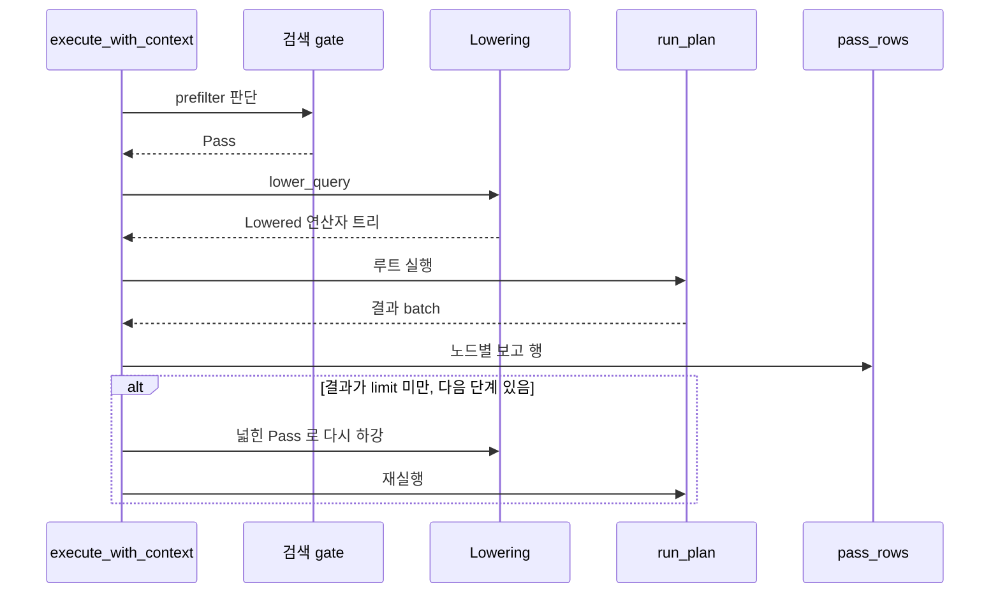

실행 보고 형식과 테스트용 참조 엔진을 본다.

## 실행 순서와 실행 보고

`execute` 는 실행 승인 검사, 검색 gate, 하강과 실행, overfetch 재실행, 보고 수집을 한 흐름으로 묶는다.

### 코드 분석: execute

[engine/mod.rs L495-L503](https://github.com/ModernRelay/omnigraph/blob/00b8cca842f2bf009bebeefcf765672b5ff64b26/crates/omnigraph/src/engine/mod.rs#L495-L503)

```rust
let (bound, evidence) = accepted.into_parts();
let traversal_limit = validate_traversal_admission(&bound.plan)?;
let ranking = omnigraph_planner::planned_ranking(&bound.plan)
    .map_err(|error| OmniError::manifest_internal(error.to_string()))?;
let ctx =
    QueryContext::with_traversal_limit(bound.plan.assumptions().memory_limit, traversal_limit)?;
let (mut run, scans) = ctx
    .run_owned(execute_with_context(bound, evidence, context, &ctx))
    .await?;
```

입력 타입 `AcceptedBoundPlan` 은 계획기의 수락 검사만 만들 수 있으므로 검사를 거치지 않은 계획은 실행에 도달하지 않는다. 엔진에 남은 검사는 실행 승인에 의존하는 것뿐이다. `validate_traversal_admission` 은 순회 작업량 상한이 있을 때 모든 `Expand` 가 budgeted 인덱스 경로인지, 간선 선택의 각 member 버전이 계획이 고정한 dataset 버전과 같은지, CSR 을 쓰는 prefilter 가 없는지 확인한다([engine/mod.rs L411-L485](https://github.com/ModernRelay/omnigraph/blob/00b8cca842f2bf009bebeefcf765672b5ff64b26/crates/omnigraph/src/engine/mod.rs#L411-L485)). `run_owned` 는 실행이 성공, 실패, panic 어느 쪽으로 끝나도 쿼리가 띄운 producer task 가 정리될 때까지 기다린다.

`execute_with_context` 는 계획의 순위 스캔을 먼저 찾는다([engine/mod.rs L288-L325](https://github.com/ModernRelay/omnigraph/blob/00b8cca842f2bf009bebeefcf765672b5ff64b26/crates/omnigraph/src/engine/mod.rs#L288-L325)). RRF 융합이 있으면 gate 를 한 번 돌리고 한 pass 로 끝낸다. 독립 `nearest` 스캔이 있으면 prefilter gate 뒤 첫 pass 를 실행하고, 결과가 `limit` 보다 적으면 계획의 `RankedAccess.overfetch` 에 선언된 단계만 차례로 밟는다([engine/mod.rs L653-L664](https://github.com/ModernRelay/omnigraph/blob/00b8cca842f2bf009bebeefcf765672b5ff64b26/crates/omnigraph/src/engine/mod.rs#L653-L664)). 단계마다 `Pass` 가 바뀌고 트리를 처음부터 다시 하강해 실행한다(`run_once`, [engine/mod.rs L249-L265](https://github.com/ModernRelay/omnigraph/blob/00b8cca842f2bf009bebeefcf765672b5ff64b26/crates/omnigraph/src/engine/mod.rs#L249-L265)). 집계가 있는 쿼리와 gate 가 빈 답을 증명한 쿼리는 재실행하지 않는다. gate 판단 기준과 overfetch 단계의 의미는 7장에서 다룬다.



### 결과 schema 검사

`run_plan` 은 루트를 실행해 결과를 하나의 batch 로 모으고 계획이 선언한 결과 schema 와 대조한다([engine/run.rs L55-L68](https://github.com/ModernRelay/omnigraph/blob/00b8cca842f2bf009bebeefcf765672b5ff64b26/crates/omnigraph/src/engine/run.rs#L55-L68)). 이름, 순서, 개수, 타입이 하나라도 다르거나 non-null 로 선언된 column 에 null 이 있으면 내부 오류다. 모은 batch 도 `WorkMemory` 로 쿼리 pool 에 예약된다. `AggregateExec` 은 그룹 키를 먼저 내보내므로, 루트 아래 결과 노드가 `Aggregate` 일 때만 `return_order` 로 column 순서를 반환 순서로 되돌린다([engine/lower.rs L1520-L1533](https://github.com/ModernRelay/omnigraph/blob/00b8cca842f2bf009bebeefcf765672b5ff64b26/crates/omnigraph/src/engine/lower.rs#L1520-L1533)).

### 코드 분석: pass_rows

pass 가 끝나면 계획 노드와 연산자 트리를 나란히 순회하며 노드마다 보고 행을 만든다.

[engine/run.rs L107-L120](https://github.com/ModernRelay/omnigraph/blob/00b8cca842f2bf009bebeefcf765672b5ff64b26/crates/omnigraph/src/engine/run.rs#L107-L120)

```rust
let op = operator(id)?;
let inputs = node.inputs();
let children = op.children();
let same_shape = inputs.len() == children.len()
    && inputs
        .iter()
        .zip(children)
        .all(|(input, child)| operator(*input).is_ok_and(|op| Arc::ptr_eq(op, child)));
if !same_shape {
    return Err(OmniError::manifest_internal(format!(
        "the lowered tree does not have the plan's shape at node {id} ({})",
        node.name()
    )));
}
```

연산자의 자식이 계획 노드의 입력이 만든 연산자와 포인터 수준에서 같아야 한다. 하강이 "노드 하나에 연산자 하나" 를 지켰는지 실행 뒤에 다시 확인하는 셈이다. 선언된 경로 선택지는 `HashJoin`, `IdLookup`, `Csr`, `IndexedScan` 네 값이다([engine/operators/mod.rs L82-L95](https://github.com/ModernRelay/omnigraph/blob/00b8cca842f2bf009bebeefcf765672b5ff64b26/crates/omnigraph/src/engine/operators/mod.rs#L82-L95)).

| 보고 필드 | 값 | 의미 |
|---|---|---|
| `status` | `executed`, `skipped` | 연산자의 stream 이 한 번이라도 poll 되었는지 |
| `ran` | `true`, `false` 또는 `hash_join`, `id_lookup`, `csr`, `indexed_scan` | poll 여부, 경로 선택이 있는 연산자는 탄 경로 |
| `actual_rows` | 정수 | 출력 행 수, `drained` 가 참일 때만 완전한 값 |
| `drained` | `true`, `false`, `null` | 끝까지 읽혔는지, DataFusion 연산자는 `null` |
| `rung` | 0 이상 | 0 은 첫 pass, 이후는 overfetch 단계 번호 |

`query_inspected` 가 반환하는 `Executed` 는 결과, 실행한 `BoundPlan`, 같은 계획에서 그린 explain, 보고를 함께 담고 `replay_envelope` 로 재실행용 바이트를 만든다([engine/report.rs L284-L319](https://github.com/ModernRelay/omnigraph/blob/00b8cca842f2bf009bebeefcf765672b5ff64b26/crates/omnigraph/src/engine/report.rs#L284-L319)). explain 문서의 형식은 5장에서 다룬다.

## 참조 엔진과 엔진 밖의 읽기 경로

### ReferenceEngine 구조

`omnigraph-reference-engine` 은 plan runner 이전의 실행기(engine v1)를 고정해 둔 크레이트로, `publish = false` 이고 설명에 "Never published" 라고 적혀 있다([omnigraph-reference-engine/Cargo.toml L1-L8](https://github.com/ModernRelay/omnigraph/blob/00b8cca842f2bf009bebeefcf765672b5ff64b26/crates/omnigraph-reference-engine/Cargo.toml#L1-L8)).

v1 은 `ReferenceEngine` 이라는 `ReadExecutor` 로 세션에 설치되어([omnigraph-reference-engine/src/lib.rs L49-L64](https://github.com/ModernRelay/omnigraph/blob/00b8cca842f2bf009bebeefcf765672b5ff64b26/crates/omnigraph-reference-engine/src/lib.rs#L49-L64)) `execute_on_route` 의 테스트 통로로 들어온다. 물리 계획 없이 IR 파이프라인을 직접 해석하며, v1 이 지원하지 않는 기능(간선 선택, `@type` 메타데이터, 반환과 정렬의 비교식 등)은 `v1_refusal` 이 먼저 거부한다([omnigraph-reference-engine/src/gate.rs L51-L80](https://github.com/ModernRelay/omnigraph/blob/00b8cca842f2bf009bebeefcf765672b5ff64b26/crates/omnigraph-reference-engine/src/gate.rs#L51-L80)). GQT 테스트는 같은 쿼리를 두 엔진으로 실행해 결과를 비교한다.

| 항목 | engine v2 | engine v1 (참조 엔진) |
|---|---|---|
| 입력 | 수락된 물리 계획 | IR 파이프라인 |
| 연산자 | 노드당 연산자 하나, DataFusion 트리 | 파이프라인 단계 해석, 넓은 batch 하나를 갱신 |
| 실행 선택 | 계획에 선언된 경로만 | 실행 중 판단, 환경 변수를 직접 읽음 |
| 재실행 | 직렬화 계획으로 반복 가능 | 해당 없음 |
| 용도 | 운영 | GQT 비교 기준 |

v1 의 실행 함수는 `wide` batch 하나를 단계마다 바꾸어 가는 구조다([omnigraph-reference-engine/src/query.rs L654-L697](https://github.com/ModernRelay/omnigraph/blob/00b8cca842f2bf009bebeefcf765672b5ff64b26/crates/omnigraph-reference-engine/src/query.rs#L654-L697)). RRF gate 비율 같은 값도 함수 안에서 환경 변수로 읽는다. v2 가 이런 값을 계획에 옮겨 적는 이유가 이 대비에서 드러난다.

### push 파이프라인과 id 순서 조회

`engine/push/` 에는 change feed 와 merge 계획을 위한 push 방식 파이프라인이 있다. chunk 의 vector 크기는 DuckDB 의 `STANDARD_VECTOR_SIZE` 와 같은 2048 이다([engine/push/chunk.rs L17](https://github.com/ModernRelay/omnigraph/blob/00b8cca842f2bf009bebeefcf765672b5ff64b26/crates/omnigraph/src/engine/push/chunk.rs#L17)). 현재 판에서는 엔진 호출자가 없어 `dead_code` 로 표시되어 있다([engine/mod.rs L50-L56](https://github.com/ModernRelay/omnigraph/blob/00b8cca842f2bf009bebeefcf765672b5ff64b26/crates/omnigraph/src/engine/mod.rs#L50-L56)). 읽기 하강이 `SortMergeJoin`, `RowCompare`, `ClassifyThreeWay` 같은 노드를 거부하는 이유가 이것이다.

branch merge, change feed, export 처럼 완전한 행을 id 순서로 읽어야 하는 곳은 쿼리 엔진이 아니라 `ordered_cursor.rs` 의 `OrderedRowCursor` 를 쓴다. 먼저 `id`, `_rowid`, `_rowaddr` 만 정렬하고, 정렬된 키를 row address 로 조각 단위로 다시 읽어 완전한 행을 만든다. payload column 이 정렬 입력에 들어가지 않으므로 넓은 행이 정렬 메모리 상한을 넘지 않고, 조각이 상한을 넘으면 행 수를 반으로 줄여 다시 읽는다([ordered_cursor.rs L1-L21](https://github.com/ModernRelay/omnigraph/blob/00b8cca842f2bf009bebeefcf765672b5ff64b26/crates/omnigraph/src/ordered_cursor.rs#L1-L21)). 이 cursor 를 쓰는 merge 와 change feed 는 12장과 13장에서 다룬다.
