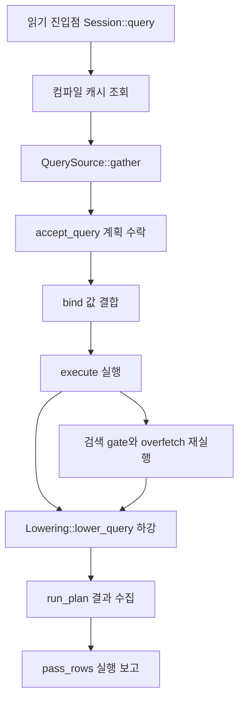

실행 엔진은 계획기가 받아들인 물리 계획(`AcceptedBoundPlan`)을 DataFusion 연산자 트리로 바꾸어 고정된 snapshot 위에서 실행한다. 계획 노드 하나는 연산자 하나가 되고, 실행 중 엔진이 내리는 선택(CSR 전환, id lookup 대체, overfetch 재실행)은 모두 계획 노드에 미리 선언된 경로 안에서만 일어난다.

## 실행 엔진 개요

엔진 코드는 `crates/omnigraph/src/engine/` 아래에 있다. 하강 모듈의 첫 주석([engine/lower.rs L1-L8](https://github.com/ModernRelay/omnigraph/blob/00b8cca842f2bf009bebeefcf765672b5ff64b26/crates/omnigraph/src/engine/lower.rs#L1-L8))은 모든 읽기 노드가 정확히 연산자 하나를 만들고, 집계를 뺀 관계 노드도 omnigraph 자체 연산자를 쓴다고 밝힌다. 그래서 모든 연산자가 poll 횟수를 세고 할당 메모리를 쿼리 pool 에 예약한다.

> **주의**: [engine/mod.rs L1-L4](https://github.com/ModernRelay/omnigraph/blob/00b8cca842f2bf009bebeefcf765672b5ff64b26/crates/omnigraph/src/engine/mod.rs#L1-L4) 의 주석은 "Relational nodes use DataFusion operators" 라고 적지만, 하강 코드에서 DataFusion 연산자는 `AggregateExec` 하나뿐이다. 이 장은 하강 코드를 기준으로 쓴다.

엔진을 고르는 세션 설정 `engine` 은 남아 있지만 허용 값은 `v2` 하나다([settings.rs L60-L68](https://github.com/ModernRelay/omnigraph/blob/00b8cca842f2bf009bebeefcf765672b5ff64b26/crates/omnigraph-compiler/src/settings.rs#L60-L68)). 이전 실행기(engine v1)는 `omnigraph-reference-engine` 크레이트로 옮겨져 테스트 비교 기준으로만 남았다.



| 모듈 | 역할 |
|---|---|
| `exec/query_doors.rs` | 세션의 읽기 진입점, 컴파일 캐시, 그래프 인덱스 handle 선택 |
| `engine/plan_source.rs` | 계획 입력 수집(`QuerySource::gather`), 환경 변수를 읽는 유일한 파일 |
| `engine/bind.rs` | 매개변수와 `nearest` 질의 벡터를 계획의 값 표에 결합 |
| `engine/mod.rs` | `execute`, 실행 승인 검사, overfetch 재실행 |
| `engine/lower.rs` | 물리 노드를 연산자로 하강(`Walk`) |
| `engine/run.rs` | 루트 실행, 결과 schema 검사, 노드별 보고 행 생성 |
| `engine/operators/` | 노드 종류별 연산자, 연산자 형태(`shape.rs`), 메모리(`memory.rs`) |
| `engine/graph.rs` | 순회 경로 선택, BFS, 간선 스캔, CSR handle |
| `engine/scan.rs` | 노드 스캔 설정, Lance filter 변환 |
| `engine/search.rs` | 벡터, 전문 검색, RRF gate (7장에서 다룬다) |

### 코드 분석: EngineContext

`execute` 가 계획 외에 받는 것은 `EngineContext` 하나다.

[engine/mod.rs L96-L103](https://github.com/ModernRelay/omnigraph/blob/00b8cca842f2bf009bebeefcf765672b5ff64b26/crates/omnigraph/src/engine/mod.rs#L96-L103)

```rust
pub(crate) struct EngineContext<'a> {
    pub(crate) snapshot: Option<&'a Snapshot>,
    pub(crate) catalog: &'a Arc<Catalog>,
    pub(crate) graph_index: Arc<GraphIndexHandle>,
    /// A load plan's facts; `None` under a read plan, whose lowering never
    /// reaches a load node.
    pub(crate) load: Option<&'a LoadFacts>,
}
```

`SessionSettings` 가 필드에 없다는 점이 설계의 중심이다. 세션 설정과 환경 변수는 계획 전 단계에서 한 번 읽혀 계획 노드와 `Assumptions` 에 기록되고, 실행은 계획에 적힌 값만 읽는다. 같은 직렬화 계획과 같은 snapshot 이면 실행 결과와 연산자 선택이 같다([docs/dev/execution.md](https://github.com/ModernRelay/omnigraph/blob/00b8cca842f2bf009bebeefcf765672b5ff64b26/docs/dev/execution.md) "V2 plan lowering" 절). `snapshot` 이 `Option` 인 것은 `og_catalog` 범위처럼 저장소 없이 엔진 카탈로그만 읽는 쿼리가 있기 때문이다. `load` 는 CSV 적재 계획에서만 채워지며 10장에서 다룬다.

## 정리

- 실행 엔진은 수락된 물리 계획(`AcceptedBoundPlan`)만 받으며, 세션 설정과 환경 변수는 `QuerySource::gather` 에서 계획에 기록된 뒤에는 실행에 닿지 않는다. 같은 직렬화 계획과 같은 snapshot 이면 결과와 연산자 선택이 같다.
- 하강(`Walk`)은 계획 노드 하나마다 연산자 하나를 만들고 형태와 출력 schema 를 계획의 선언과 대조한다. 실행 뒤 `pass_rows` 가 트리 모양을 다시 확인하고 노드별 보고를 만든다.
- 모든 연산자는 단일 partition, 8,192행 batch 로 실행되며 할당 메모리를 `WorkMemory` 로 쿼리 pool 에 먼저 예약한다. 그래프 breaker 는 spill 하지 않고 거부된다.
- 순회는 per-hop 인덱스 스캔과 지연 생성 CSR 두 경로가 있고, 엔진은 계획기의 비용 함수를 관측 frontier 로 다시 불러 시작 경로와 홉마다의 전환을 정한다. 전환 때 방문 상태를 번역해 옮기므로 결과는 같다.
- 실행 중 대체 경로(`HashJoin` 의 `id_lookup`, `Expand` 의 CSR 전환, 검색 overfetch)는 계획 노드에 선언된 경우에만 쓰이고, 탄 경로는 보고의 `ran` 에 남는다.
- engine v1 은 IR 을 직접 해석하는 참조 엔진으로 테스트 비교에만 쓰이며, id 순서 읽기(`OrderedRowCursor`)와 push 파이프라인은 쿼리 엔진 밖에 있다.
