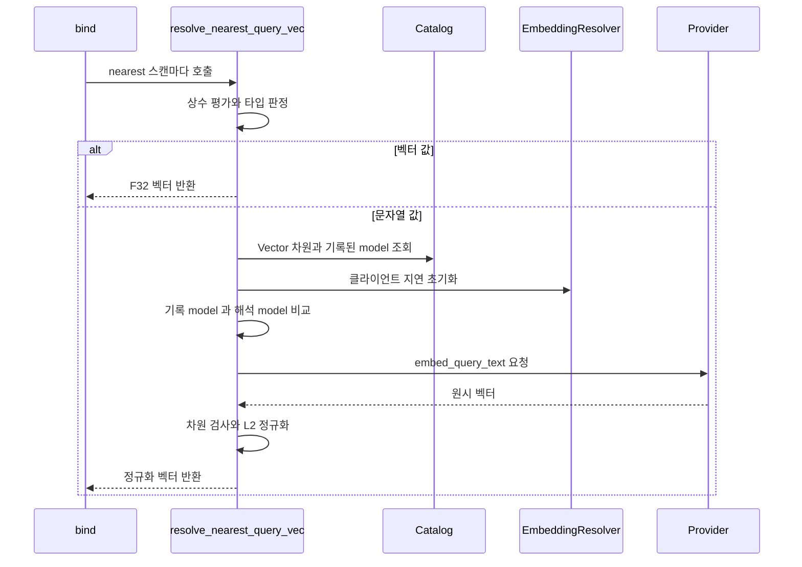

검색 함수의 계획 표현과 질의 텍스트 embedding을 본다.

## 계획 단계의 순위 접근

계획기는 검색을 별도 연산자로 두지 않고, 순위를 매길 binding 의 스캔 노드에 `RankedAccess` 를 붙인다. 순위 계산은 Lance index 가 스캔 도중 하므로 연산자가 아니라 접근 경로라는 것이 [physical.rs L313-L343](https://github.com/ModernRelay/omnigraph/blob/00b8cca842f2bf009bebeefcf765672b5ff64b26/crates/omnigraph-planner/src/physical.rs#L313-L343) 주석의 설명이다. 논리 계획에서 물리 계획으로 내리는 일반 절차는 5장에서 다루고, 여기서는 검색 노드 세 개의 내림만 본다.

| `RankedAccess` 필드 | 의미 | `nearest` | `bm25` |
|---|---|---|---|
| `kind` | 순위 종류 | `Nearest` | `Bm25` |
| `fetch` | index 에 요청할 후보 수 | `limit` 값 | `None` (일치 전부) |
| `nprobes` | index delta 당 IVF partition 상한 | `ann_nprobes` 설정 | 읽지 않음 |
| `scope` | 행의 목적지 | `Order`, 또는 `rrf` 의 `Primary`, `Secondary` | 같음 |
| `overfetch` | 짧은 답에서 다시 실행할 사다리 | `OverfetchRung::ladder(fetch)` | 비어 있음 |
| `prefilter` | 실행 전 사전 단계 | 순회가 binding 을 떠날 때만 | `rrf` 에서는 `RankFuse` 가 선언 |
| `eligibility` | 필터 적용 시점 | 항상 채점 전 | 전문 index 가 전체를 덮을 때만 채점 전 |
| `policy` | 적응 정책 | `NearestPolicy::DEFAULT` | `None` |

### 코드 분석: `nearest` 의 내림

`crates/omnigraph-planner/src/optimizer.rs` [optimizer.rs L3383-L3397](https://github.com/ModernRelay/omnigraph/blob/00b8cca842f2bf009bebeefcf765672b5ff64b26/crates/omnigraph-planner/src/optimizer.rs#L3383-L3397)

`LogicalNode::Nearest` 가 `RankedAccess` 로 바뀌는 지점을 본다.

```rust
                let lowered = self.lower(*input)?;
                let fetch = k.and_then(|k| usize::try_from(k).ok());
                let access = RankedAccess {
                    kind: RankKind::Nearest,
                    score: rank_score(binding, RankKind::Nearest),
                    property: property.clone(),
                    query: query.clone(),
                    fetch,
                    nprobes: self.source.ann_nprobes(),
                    scope: RankScope::Order,
                    overfetch: fetch.map(OverfetchRung::ladder).unwrap_or_default(),
                    prefilter: None,
                    eligibility: Eligibility::BeforeScoring,
                    policy: Some(NearestPolicy::DEFAULT),
                };
```

`fetch` 는 쿼리의 `limit` 이다. `limit` 이 없으면 실행 시점에 `search_mode` 에서 "nearest() ordering requires a limit clause" 로 거부된다. 이어지는 [optimizer.rs L3399-L3417](https://github.com/ModernRelay/omnigraph/blob/00b8cca842f2bf009bebeefcf765672b5ff64b26/crates/omnigraph-planner/src/optimizer.rs#L3399-L3417) 는 최상위 `Expand` 가 이 binding 에서 출발하면 prefilter 를 붙인다. 이 경우 빈 적격 집합은 `EmptyEligible::ProvenEmpty`, 즉 답이 비었다는 증명이 된다.

`bm25` 의 내림은 [optimizer.rs L3422-L3458](https://github.com/ModernRelay/omnigraph/blob/00b8cca842f2bf009bebeefcf765672b5ff64b26/crates/omnigraph-planner/src/optimizer.rs#L3422-L3458) 이다. `fetch` 가 `None` 이므로 BM25 스캔은 일치하는 모든 행을 읽고 나서 `limit` 을 적용한다. 사용자 문서가 "A `bm25()` ordering reads every matching entity before applying the final limit" 이라고 적은 동작이 여기서 나온다.

### 코드 분석: BM25 의 필터 적용 시점

`crates/omnigraph-planner/src/optimizer.rs` [optimizer.rs L2840-L2854](https://github.com/ModernRelay/omnigraph/blob/00b8cca842f2bf009bebeefcf765672b5ff64b26/crates/omnigraph-planner/src/optimizer.rs#L2840-L2854)

`rank` 가 스캔에 순위를 붙일 때 `eligibility` 를 정하는 부분을 본다.

```rust
        access.eligibility = match access.kind {
            RankKind::Nearest => Eligibility::BeforeScoring,
            RankKind::Bm25 => {
                let type_key = match self.physical.node(scan) {
                    Some(PhysicalNode::Scan { spec, .. }) => spec.table.type_key.clone(),
                    _ => String::new(),
                };
                match self.source.full_text_coverage(&type_key, &access.property) {
                    FullTextCoverage::Full => Eligibility::BeforeScoring,
                    FullTextCoverage::Partial | FullTextCoverage::Absent => {
                        Eligibility::AfterScoring
                    }
                }
            }
        };
```

BM25 점수는 문서 빈도 같은 말뭉치 통계에 의존한다. [physical.rs L266-L276](https://github.com/ModernRelay/omnigraph/blob/00b8cca842f2bf009bebeefcf765672b5ff64b26/crates/omnigraph-planner/src/physical.rs#L266-L276) 의 `Eligibility` 주석에 따르면 채점 전에 적용한 필터가 점수를 바꾸지 않는 경우는 index 가 모든 fragment 를 덮을 때뿐이다. 덮지 않은 fragment 가 있으면 필터를 채점 뒤로 옮겨 필터가 점수를 바꾸지 않게 한다. 실행 쪽에서는 스캔 설정이 이 값을 Lance의 `prefilter(false)` 로 옮긴다. `nearest` 는 후보 window 를 적격 행에서 뽑아야 하므로 항상 채점 전이다.

`FullTextCoverage` 의 세 값(`Full`, `Partial`, `Absent`)은 [source.rs L328-L347](https://github.com/ModernRelay/omnigraph/blob/00b8cca842f2bf009bebeefcf765672b5ff64b26/crates/omnigraph-planner/src/source.rs#L328-L347) 의 `of_facts` 가 index 사실로부터 계산한다. 종류를 모르는 index 나 범위를 모르는 segment 가 하나라도 있으면 `Full` 로 세지 않는다. 계획기가 읽은 범위 값은 `Assumptions.full_text` 에 기록되어 계획 재실행 시 같은 판단을 다시 세운다.

### `rrf` 의 두 arm

`LogicalNode::RankFuse` 는 [optimizer.rs L3459-L3555](https://github.com/ModernRelay/omnigraph/blob/00b8cca842f2bf009bebeefcf765672b5ff64b26/crates/omnigraph-planner/src/optimizer.rs#L3459-L3555) 에서 내려간다. 입력 subtree 를 복제해 arm 두 개를 만들고, 각 arm 의 스캔에 `scope` 가 `Primary`, `Secondary` 인 `RankedAccess` 를 붙인다([optimizer.rs L3497-L3505](https://github.com/ModernRelay/omnigraph/blob/00b8cca842f2bf009bebeefcf765672b5ff64b26/crates/omnigraph-planner/src/optimizer.rs#L3497-L3505)). `nearest` arm 은 쿼리 `limit` 만큼, `limit` 이 없으면 [optimizer.rs L4293](https://github.com/ModernRelay/omnigraph/blob/00b8cca842f2bf009bebeefcf765672b5ff64b26/crates/omnigraph-planner/src/optimizer.rs#L4293) 의 `RRF_NEAREST_ARM_K` 100 개를 요청한다. `bm25` arm 은 상한이 없다. arm 의 `overfetch` 는 비어 있으므로 `rrf` 안의 `nearest` 는 질의 수준 재실행을 하지 않는다. 두 arm 이 같은 binding 을 순위 매길 때만 prefilter 가 `bm25` 스캔에 연결된다. 서로 다른 binding 을 한 순회가 잇는 경우는 타입 검사 `T59` 가 이미 거부했고, 계획기는 같은 조건을 내부 오류로 다시 확인한다.

## 질의 embedding

`nearest` 의 두 번째 인자는 벡터일 수도 문자열일 수도 있다. 문자열이면 계획을 실행하기 전 `bind` 단계에서 embedding provider 를 불러 벡터로 바꾼다. `bind` 모듈 주석은 이곳을 "the one place the embedding client is used" 라고 적는다.



`crates/omnigraph/src/engine/bind.rs` [bind.rs L13-L61](https://github.com/ModernRelay/omnigraph/blob/00b8cca842f2bf009bebeefcf765672b5ff64b26/crates/omnigraph/src/engine/bind.rs#L13-L61) 의 `bind` 는 계획이 가정한 매개변수가 모두 있는지 확인한 뒤, `RankKind::Nearest` 인 스캔마다 [bind.rs L50-L58](https://github.com/ModernRelay/omnigraph/blob/00b8cca842f2bf009bebeefcf765672b5ff64b26/crates/omnigraph/src/engine/bind.rs#L50-L58) 에서 `resolve_nearest_query_vec` 를 부르고 결과를 스캔의 node id 를 키로 `ValueTable.vectors` 에 넣는다. 실행 엔진은 이 표에서 벡터를 꺼낼 뿐 다시 embedding 하지 않는다.

[search.rs L318-L366](https://github.com/ModernRelay/omnigraph/blob/00b8cca842f2bf009bebeefcf765672b5ff64b26/crates/omnigraph/src/engine/search.rs#L318-L366) 의 `resolve_nearest_query` 는 값을 선언된 타입 그대로 평가한 뒤 분기한다. String 이면 텍스트로, `Vector(N)` 이나 숫자 list 면 F32 로 변환한다. null 원소나 유한하지 않은 원소는 거부한다.

### 코드 분석: 기록된 model 과의 일치 검사

`crates/omnigraph/src/engine/search.rs` [search.rs L380-L397](https://github.com/ModernRelay/omnigraph/blob/00b8cca842f2bf009bebeefcf765672b5ff64b26/crates/omnigraph/src/engine/search.rs#L380-L397)

텍스트 질의를 embedding 하기 전 model 을 대조하는 부분을 본다.

```rust
        NearestQuery::Vector(values) => Ok(values),
        NearestQuery::Text(text) => {
            let (expected_dim, recorded_model) =
                nearest_property_dim_and_model(catalog, type_name, property)?;
            let client = embedding.resolve().await?;
            if let Some(recorded) = &recorded_model {
                let resolved = &client.config().model;
                if resolved != recorded {
                    return Err(OmniError::manifest(format!(
                        "nearest() on '{property}': its stored vectors were embedded with model \
                         '{recorded}', but the query embedder resolves to '{resolved}'. Set \
                         OMNIGRAPH_EMBED_MODEL='{recorded}' (and the matching provider) or re-embed \
                         the stored vectors."
                    )));
                }
            }
            client.embed_query_text(&text, expected_dim).await
        }
```

차원은 속성의 `Vector(N)` 에서, model 은 schema 의 `@embed("body", model="...")` 에서 온다 ([search.rs L415-L445](https://github.com/ModernRelay/omnigraph/blob/00b8cca842f2bf009bebeefcf765672b5ff64b26/crates/omnigraph/src/engine/search.rs#L415-L445)). model 이 기록되어 있으면 질의 쪽 클라이언트가 정확히 같은 model id 로 해석될 때만 진행한다. 서로 다른 벡터 공간을 조용히 비교하는 사고를 막는 장치이고, RFC 0012 의 동기가 바로 이 사고였다 ([0012-embedding-provider-config.md](https://github.com/ModernRelay/omnigraph/blob/00b8cca842f2bf009bebeefcf765672b5ff64b26/docs/rfcs/0012-embedding-provider-config.md)). 벡터를 직접 넘기는 쿼리는 클라이언트를 만들지 않는다.

`EmbeddingResolver` 는 [graph.rs L25-L74](https://github.com/ModernRelay/omnigraph/blob/00b8cca842f2bf009bebeefcf765672b5ff64b26/crates/omnigraph/src/engine/graph.rs#L25-L74) 에 있다. 핸들마다 `OnceCell` 하나를 두고 처음 필요할 때만 클라이언트를 만든다. 주입된 설정(클러스터의 `providers.embedding`)이 있으면 그것을, 없으면 환경 변수를 쓴다. `Explain` 변형은 embedding 요청이 있었는지만 기록하고 오류를 돌려주므로 계획 설명은 외부 호출을 하지 않는다.

### provider 와 설정

`Provider` 는 세 값이다. OpenAI 호환, Gemini, Mock 이다. `openai` 별칭은 별도 enum 값이 아니라 OpenAI 호환 provider 에 기본 주소와 key 순서만 다르게 준 것이다 ([embedding.rs L652-L686](https://github.com/ModernRelay/omnigraph/blob/00b8cca842f2bf009bebeefcf765672b5ff64b26/crates/omnigraph/src/embedding.rs#L652-L686)).

| 별칭 | `Provider` | 기본 base URL | 기본 model | key 환경 변수 순서 |
|---|---|---|---|---|
| 미지정, `openai-compatible` | `OpenAiCompatible` | `https://openrouter.ai/api/v1` | `openai/text-embedding-3-large` | `OPENROUTER_API_KEY`, `OPENAI_API_KEY` |
| `openai` | `OpenAiCompatible` | `https://api.openai.com/v1` | `text-embedding-3-large` | `OPENAI_API_KEY` |
| `gemini` | `Gemini` | `https://generativelanguage.googleapis.com/v1beta` | `gemini-embedding-2` | `GEMINI_API_KEY` |
| `mock` | `Mock` | 없음 | 환경 변수 또는 고정값 | 없음 |

기본값 상수는 [embedding.rs L11-L22](https://github.com/ModernRelay/omnigraph/blob/00b8cca842f2bf009bebeefcf765672b5ff64b26/crates/omnigraph/src/embedding.rs#L11-L22) 에 모여 있다. [embedding.rs L71-L124](https://github.com/ModernRelay/omnigraph/blob/00b8cca842f2bf009bebeefcf765672b5ff64b26/crates/omnigraph/src/embedding.rs#L71-L124) 의 `from_env` 는 `OMNIGRAPH_EMBEDDINGS_MOCK` 을 가장 먼저 본다. 이 값이 켜져 있으면 명시한 provider 를 덮고 경고를 남긴다. Mock 벡터는 차원과 norm 이 실제 벡터와 같아 구별할 수 없으므로, 새어 들어온 테스트 변수가 실제 데이터를 오염시키지 않게 소리를 내도록 했다는 것이 주석의 설명이다.

> **주의**: RFC 0012는 설정을 `EmbeddingConfig { provider, model, base_url, api_key, dim, normalize }` 6개 필드로 적는다 ([0012-embedding-provider-config.md L158](https://github.com/ModernRelay/omnigraph/blob/00b8cca842f2bf009bebeefcf765672b5ff64b26/docs/rfcs/0012-embedding-provider-config.md#L158)). 코드의 `EmbeddingConfig`는 `provider`, `model`, `base_url`, `api_key` 4개 필드뿐이다 ([embedding.rs L56-L61](https://github.com/ModernRelay/omnigraph/blob/00b8cca842f2bf009bebeefcf765672b5ff64b26/crates/omnigraph/src/embedding.rs#L56-L61)). schema에 기록되는 `EmbedSourceIR`도 원본 속성(`source`)과 `model`만 담는다 ([schema_ir.rs L500-L503](https://github.com/ModernRelay/omnigraph/blob/00b8cca842f2bf009bebeefcf765672b5ff64b26/crates/omnigraph-compiler/src/catalog/schema_ir.rs#L500-L503)). 차원은 설정이 아니라 대상 열의 `Vector(N)` 폭에서 오고, 정규화는 설정 없이 항상 수행된다. 이 책은 코드를 따른다.

| 환경 변수 | 기본값 |
|---|---|
| `OMNIGRAPH_EMBED_TIMEOUT_MS` | 30,000 ms (요청당) |
| `OMNIGRAPH_EMBED_RETRY_ATTEMPTS` | 4 |
| `OMNIGRAPH_EMBED_RETRY_BACKOFF_MS` | 200 ms |
| `OMNIGRAPH_EMBED_DEADLINE_MS` | 60,000 ms (전체), `0` 은 무제한 |

### 재시도와 정규화

[embedding.rs L389-L391](https://github.com/ModernRelay/omnigraph/blob/00b8cca842f2bf009bebeefcf765672b5ff64b26/crates/omnigraph/src/embedding.rs#L389-L391) 의 재시도 대기 시간은 시도마다 두 배가 되고 지수는 10에서 멈춘다. 재시도 대상은 timeout, 연결 오류, 5xx, 429 다 ([embedding.rs L506](https://github.com/ModernRelay/omnigraph/blob/00b8cca842f2bf009bebeefcf765672b5ff64b26/crates/omnigraph/src/embedding.rs#L506)). 재시도 전체는 [embedding.rs L331-L345](https://github.com/ModernRelay/omnigraph/blob/00b8cca842f2bf009bebeefcf765672b5ff64b26/crates/omnigraph/src/embedding.rs#L331-L345) 의 `run_with_deadline` 이 감싸므로 provider 가 느려져도 호출자는 deadline 이상 기다리지 않는다.

응답 벡터는 [embedding.rs L578-L616](https://github.com/ModernRelay/omnigraph/blob/00b8cca842f2bf009bebeefcf765672b5ff64b26/crates/omnigraph/src/embedding.rs#L578-L616) 의 `validate_and_normalize_embedding` 을 거친다. 차원이 다르면 거부하고, NaN 이나 Inf 원소, norm 0 벡터를 정규화 전에 거부한 뒤 L2 정규화한다. 정규화 순서가 중요한 이유도 주석에 있다. NaN 원소는 norm 을 NaN 으로 만들어 정규화를 건너뛰게 하고, 그런 벡터가 저장되면 관계없는 행의 ANN 결과까지 나빠진다. 정규화된 벡터끼리는 L2 순서와 cosine 순서가 같으므로 사용자 문서는 생성된 벡터에 대해 두 지표가 같은 순서를 낸다고 적는다.

문서 쪽과 질의 쪽 입력은 같은 문자열을 그대로 쓴다. [embedding.rs L270-L282](https://github.com/ModernRelay/omnigraph/blob/00b8cca842f2bf009bebeefcf765672b5ff64b26/crates/omnigraph/src/embedding.rs#L270-L282) 의 두 함수는 template 을 붙이지 않는다. 차이는 Gemini 의 `taskType` 뿐이다. [embedding.rs L555-L576](https://github.com/ModernRelay/omnigraph/blob/00b8cca842f2bf009bebeefcf765672b5ff64b26/crates/omnigraph/src/embedding.rs#L555-L576) 를 보면 Gemini 요청에는 `RETRIEVAL_QUERY` 또는 `RETRIEVAL_DOCUMENT` 가 들어가고 OpenAI 호환 요청에는 role 구분이 없다. `embed_document_text` 를 부르는 곳은 오프라인 `omnigraph embed` 명령 하나다 ([embed.rs L612](https://github.com/ModernRelay/omnigraph/blob/00b8cca842f2bf009bebeefcf765672b5ff64b26/crates/omnigraph-cli/src/embed.rs#L612)). CLI 는 14장에서 다룬다.

> **주의**: `@embed` 는 적재 시 벡터를 만들지 않는다. [lib.rs L793-L814](https://github.com/ModernRelay/omnigraph/blob/00b8cca842f2bf009bebeefcf765672b5ff64b26/crates/omnigraph-api-types/src/lib.rs#L793-L814) 의 `LoadEmbeddingGeneration` 은 `Unsupported` 한 값뿐이고, `@embed` 속성이 있는 타입을 적재하면 결과에 이 값이 붙는다. 적재 시 embedding 을 reconciler 로 채우는 설계인 RFC 0015 는 상태가 `draft`, 구현이 `not-started` 다 ([0015-ingest-embeddings.md](https://github.com/ModernRelay/omnigraph/blob/00b8cca842f2bf009bebeefcf765672b5ff64b26/docs/rfcs/0015-ingest-embeddings.md)). 적재 경로는 10장에서 다룬다.
