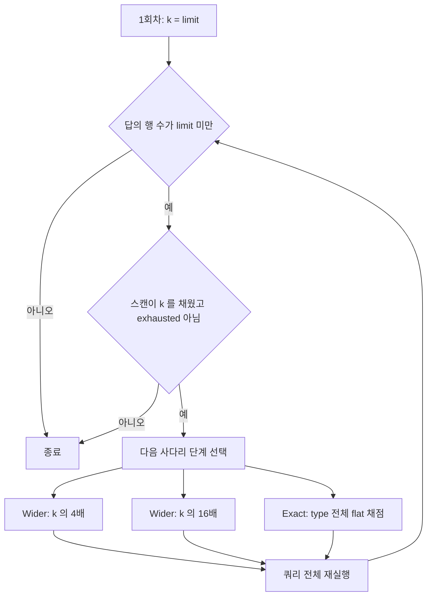

벡터 검색의 probe 사다리와 질의 수준 overfetch를 본다.

## 벡터 검색과 probe 사다리

`nearest` 스캔 하나는 [scan.rs L316-L598](https://github.com/ModernRelay/omnigraph/blob/00b8cca842f2bf009bebeefcf765672b5ff64b26/crates/omnigraph/src/engine/scan.rs#L316-L598) 의 `execute_node_scan` 에서 실행된다. 이 함수는 순위 없는 스캔의 pipelined 경로와 달리 결과를 모두 모으는 breaker 이고, 스캔 연산자 일반은 6장에서 다룬다. 이 절은 벡터 검색에 고유한 세 판단을 본다. index 를 쓸지, IVF partition 을 몇 개까지 탐색할지, 결과가 정확한지다.

### 코드 분석: index 사용 여부

`crates/omnigraph/src/engine/scan.rs` [scan.rs L370-L376](https://github.com/ModernRelay/omnigraph/blob/00b8cca842f2bf009bebeefcf765672b5ff64b26/crates/omnigraph/src/engine/scan.rs#L370-L376)

첫 시도에서 벡터 index 를 쓸지 정하는 부분을 본다.

```rust
    let mut use_index = match (nearest_target.as_ref(), known_matches, policy) {
        (Some(_), _, _) if search_mode.nearest_exact => false,
        (Some((_, _, k)), Some(matches), Some(policy)) => {
            !(policy.flat_when_eligible_within_fetch && matches <= *k)
        }
        _ => true,
    };
```

overfetch 사다리의 exact 단계는 index 를 쓰지 않는다. prefilter gate 가 적격 id 집합을 정했고 그 크기가 요청 후보 수 이하이면 처음부터 flat 으로 채점한다. 집합이 작으면 index 를 거치지 않고 모두 채점하는 편이 정확하고 저렴하다. `known_matches` 는 적격 id 수다.

이어지는 [scan.rs L383-L396](https://github.com/ModernRelay/omnigraph/blob/00b8cca842f2bf009bebeefcf765672b5ff64b26/crates/omnigraph/src/engine/scan.rs#L383-L396) 는 열에 걸린 벡터 index 가 squared L2 로 정확히 순위를 매기는지 확인하고, 아니면 flat 으로 바꾼다. 판정은 [indexes.rs L92-L112](https://github.com/ModernRelay/omnigraph/blob/00b8cca842f2bf009bebeefcf765672b5ff64b26/crates/omnigraph/src/engine/plan_source/indexes.rs#L92-L112) 의 `vector_index_ranks_exactly_by_l2` 다.

| index 상태 | 판정 | 이유 |
|---|---|---|
| IVF, 압축 없음 또는 `Flat`, L2, HNSW 없음 | 사용 | 탐색한 partition 의 모든 행을 정확히 채점 |
| PQ, SQ, RQ 양자화 | flat | 근사 거리 |
| HNSW 설정 있음 | flat | 그래프 탐색 근사 |
| L2 가 아닌 metric | flat | 다른 순위 |
| details 가 비었거나 디코딩 불가 | flat | 알 수 없음은 정확하지 않음으로 취급 |
| 알려지지 않은 필드가 있는 details | flat | 재인코딩 길이가 원본과 다르면 새 sub-index 일 수 있음 |
| 열에 벡터 index 없음 | flat (Lance 기본) | 모든 행 채점 |

엔진이 직접 만드는 벡터 index 는 IVF_FLAT, L2 뿐이라는 것이 주석의 전제다. 다른 도구가 만든 index 를 근사 결과로 쓰지 않고 정확한 flat 결과로 대신한다. Lance 호출 쪽에서도 [table_store.rs L398-L411](https://github.com/ModernRelay/omnigraph/blob/00b8cca842f2bf009bebeefcf765672b5ff64b26/crates/omnigraph/src/table_store.rs#L398-L411) 의 `nearest` 가 `distance_metric(MetricType::L2)` 를 명시한다. metric 을 지정하지 않으면 Lance가 열에 걸린 index 의 metric 을 따르기 때문이다.

### probe 사다리의 결정 규칙

`ann_nprobes` 상한(기본 20)은 Lance의 partition 탐색 범위를 묶는다. 상한 때문에 후보가 `k` 보다 적게 나오면 사다리를 오른다. `crates/omnigraph/src/engine/search.rs` 의 `ladder_step` 은 앞부분 [search.rs L907-L921](https://github.com/ModernRelay/omnigraph/blob/00b8cca842f2bf009bebeefcf765672b5ff64b26/crates/omnigraph/src/engine/search.rs#L907-L921) 에서 멈춤 조건을 확인하고, 뒷부분 [search.rs L922-L951](https://github.com/ModernRelay/omnigraph/blob/00b8cca842f2bf009bebeefcf765672b5ff64b26/crates/omnigraph/src/engine/search.rs#L922-L951) 에서 Lance 실행 요약의 `partitions_searched`, `partitions_ranked` 두 counter 로 판단한다.

| 조건 | 결정 |
|---|---|
| prefilter 가 허용한 행이 `_distance = +inf` 로 돌아옴 | `FlatRescan`: 상한 없이 flat 으로 1회 재스캔 |
| 상한 없음, 행 수가 `k` 이상, 적격 집합 전부, type 전부 | `Stop` |
| counter 두 개 모두 없음 | `Stop` (flat 계획으로 간주) |
| counter 하나만 있거나 요약 없음 | `RescanUncapped { summary_missing: true }`: fail closed |
| 탐색 partition 수가 순위 partition 수 이상 | `Stop` |
| 직전 단계와 행 수, 탐색 수가 같음 | `Stop` (넓혀도 변화 없음) |
| 다음 상한이 순위 partition 수 미만 | `Rescan(상한 × probe_factor)` |
| 그 밖 | `RescanUncapped { summary_missing: false }` |

`probe_factor` 는 [physical.rs L250-L255](https://github.com/ModernRelay/omnigraph/blob/00b8cca842f2bf009bebeefcf765672b5ff64b26/crates/omnigraph-planner/src/physical.rs#L250-L255) 의 `NearestPolicy::DEFAULT` 에서 4 이므로 상한은 20, 80, 320, 무제한 순으로 커진다. 다음 단계 계산은 `next_probe_budget` 이다. `+inf` 거리 판정은 [search.rs L956-L963](https://github.com/ModernRelay/omnigraph/blob/00b8cca842f2bf009bebeefcf765672b5ff64b26/crates/omnigraph/src/engine/search.rs#L956-L963) 에 있다. 주석에 따르면 이 값은 Lance의 늦은 탐색이 일치 수에 도달해 멈추면서 prefilter 가 허용했지만 탐색하지 못한 행에 붙이는 표시이고, 그 행들은 `nearest` 순서에 맞지 않는 자리에 있다.

사다리를 실제로 도는 루프는 [scan.rs L402-L582](https://github.com/ModernRelay/omnigraph/blob/00b8cca842f2bf009bebeefcf765672b5ff64b26/crates/omnigraph/src/engine/scan.rs#L402-L582) 다. 각 시도는 `ProbeAttempt` 로 기록되고, Lance 고유 진단 값은 결정 입력과 분리된 `AnnAttemptMetrics` 로 따로 남는다.

### 정확성 판정

`ScanReport.exact` 는 이 스캔의 마지막 시도가 정확했는지를 기록한다 ([scan.rs L502-L506](https://github.com/ModernRelay/omnigraph/blob/00b8cca842f2bf009bebeefcf765672b5ff64b26/crates/omnigraph/src/engine/scan.rs#L502-L506)). flat 이었거나, `+inf` 행 없이 모든 partition 을 탐색했거나, 적격 집합 전부 또는 type 전부를 돌려받았으면 정확하다. 상한 때문에 탐색하지 않은 partition 이 남았으면 `false` 다. 이 값이 장 끝 순위 보고 절의 `exhaustive` 가 된다.

## 질의 수준 overfetch 사다리

probe 사다리는 스캔 하나 안에서 partition 을 넓힌다. 그런데 `nearest` 의 후보 `k` 개를 모두 받아도 그 위의 순회나 필터가 후보를 떨어뜨리면 최종 답이 `limit` 보다 짧아진다. 이 경우 스캔이 아니라 쿼리 전체를 더 많은 후보로 다시 실행하는 것이 overfetch 사다리다.



### 코드 분석: `OverfetchRung::ladder`

`crates/omnigraph-planner/src/physical.rs` [physical.rs L298-L310](https://github.com/ModernRelay/omnigraph/blob/00b8cca842f2bf009bebeefcf765672b5ff64b26/crates/omnigraph-planner/src/physical.rs#L298-L310)

계획기가 미리 선언하는 사다리의 생성 방식을 본다.

```rust
    pub fn ladder(fetch: usize) -> Vec<Self> {
        let mut ladder = Vec::new();
        let mut factor = OVERFETCH_STEP;
        while factor <= OVERFETCH_MAX_FACTOR {
            ladder.push(Self::Wider {
                factor,
                k: fetch.saturating_mul(factor),
            });
            factor = factor.saturating_mul(OVERFETCH_STEP);
        }
        ladder.push(Self::Exact);
        ladder
    }
```

`OVERFETCH_STEP` 은 4, `OVERFETCH_MAX_FACTOR` 는 16 이다 ([physical.rs L292-L293](https://github.com/ModernRelay/omnigraph/blob/00b8cca842f2bf009bebeefcf765672b5ff64b26/crates/omnigraph-planner/src/physical.rs#L292-L293)). 사다리는 `4k`, `16k`, exact 세 단계다. 사다리가 실행 중 결정되지 않고 계획에 들어 있으므로, 계획 설명과 재실행에서 같은 단계를 볼 수 있다.

### 코드 분석: `next_overfetch_rung`

`crates/omnigraph/src/engine/search.rs` [search.rs L280-L295](https://github.com/ModernRelay/omnigraph/blob/00b8cca842f2bf009bebeefcf765672b5ff64b26/crates/omnigraph/src/engine/search.rs#L280-L295)

실행 시점에 다음 단계를 고르는 부분을 본다.

```rust
        let step = match *rung {
            OverfetchRung::Wider { k, .. } if k < whole => PassStep::Wider {
                k,
                maximum: scan.maximum_nprobes,
            },
            OverfetchRung::Wider { .. } => continue,
            OverfetchRung::Exact if whole > scan.k => PassStep::Exact { k: whole },
            OverfetchRung::Exact => return None,
        };
        return Some(NextPass {
            rung: index + 1,
            step,
        });
    }
    None
}
```

`whole` 은 type 의 살아 있는 행 수(`count_rows`)다. 넓힌 `k` 가 type 전체 이상이면 그 단계를 건너뛰고 바로 exact 로 간다. 사용자 문서의 "taken sooner once a rung would cover the whole type anyway" 가 이 `continue` 다. `Wider` 단계는 직전 실행에서 스캔을 채운 probe 상한을 물려받는다. probe 사다리를 기본 상한부터 다시 오르지 않기 위해서다.

재실행 정보는 `Pass` 에 담긴다. [search.rs L66-L135](https://github.com/ModernRelay/omnigraph/blob/00b8cca842f2bf009bebeefcf765672b5ff64b26/crates/omnigraph/src/engine/search.rs#L66-L135) 의 `Pass` 는 스캔 node id 별 사다리 단계, gate 의 적격 집합, 빈 답 증명을 들고 다니며, 계획 자체는 바꾸지 않는다. "The plan says what is ranked; this says how this pass runs it" 라는 주석이 역할 분담을 요약한다. 실행 시점의 `SearchMode` 는 [lower.rs L159-L205](https://github.com/ModernRelay/omnigraph/blob/00b8cca842f2bf009bebeefcf765672b5ff64b26/crates/omnigraph/src/engine/lower.rs#L159-L205) 의 `search_mode` 가 계획의 `RankedAccess` 와 `Pass` 를 합쳐 만든다.

### 재실행 루프

`crates/omnigraph/src/engine/mod.rs` 의 `execute_with_context` 는 [mod.rs L654-L662](https://github.com/ModernRelay/omnigraph/blob/00b8cca842f2bf009bebeefcf765672b5ff64b26/crates/omnigraph/src/engine/mod.rs#L654-L662) 에서 답이 `limit` 보다 짧은 동안 재실행한다. `full_scan` 은 스캔이 `k` 를 채웠고 `exhausted` 가 아닐 때만 값을 낸다 ([mod.rs L636-L652](https://github.com/ModernRelay/omnigraph/blob/00b8cca842f2bf009bebeefcf765672b5ff64b26/crates/omnigraph/src/engine/mod.rs#L636-L652)). 스캔이 짧았다면 원인이 overfetch 가 아니라 probe 상한이나 데이터 부족이므로 쿼리를 다시 돌려도 답이 늘지 않는다. 집계가 있는 쿼리와 빈 답이 증명된 쿼리는 사다리를 타지 않는다. exact 단계가 행을 늘렸다면 경고 로그를 남기고, 늘리지 못했다면 생존 행이 `limit` 보다 적다는 뜻이다 ([mod.rs L695-L711](https://github.com/ModernRelay/omnigraph/blob/00b8cca842f2bf009bebeefcf765672b5ff64b26/crates/omnigraph/src/engine/mod.rs#L695-L711)).

> **주의**: 사용자 문서가 밝히듯, 생존 행이 영구히 `limit` 보다 적은 쿼리는 실행할 때마다 type 전체 exact 단계를 거친다. 순회가 좁히는 쿼리라면 다음 절의 prefilter gate 가 먼저 후보를 줄여 이 비용을 피한다.
