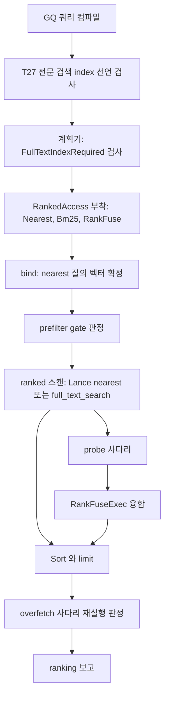

Omnigraph의 검색은 별도 검색 엔진이 아니라 그래프 쿼리 안의 정렬 키다. `nearest`, `bm25`, `rrf` 는 계획기가 노드 스캔 하나에 붙이는 순위 접근(`RankedAccess`)으로 바뀌고, 실행 엔진은 그 스캔을 Lance의 벡터 index 와 전문 검색 index 로 실행한다. 이 장은 질의 embedding, 벡터 검색의 probe 사다리와 overfetch 사다리, 전문 검색의 analyzer 인증서, RRF 융합과 prefilter gate, 그리고 실행 결과에 붙는 `ranking` 보고를 코드 단위로 따라간다.

## 검색 함수와 실행 경로 개요

쿼리 언어는 검색 함수 여섯 개를 제공한다. 사용자 문서 [docs/user/search/index.md](https://github.com/ModernRelay/omnigraph/blob/00b8cca842f2bf009bebeefcf765672b5ff64b26/docs/user/search/index.md) 의 표를 코드 기준으로 정리하면 다음과 같다.

| 함수 | 위치 | 실행 방식 | 결과 열 |
|---|---|---|---|
| `nearest($d.embedding, $q)` | `order` | 벡터 index 의 kNN, squared L2 | `_distance` (오름차순) |
| `bm25($d.body, $q)` | `order`, `return` | 전문 검색 index 의 BM25 점수 | `_score` (내림차순) |
| `search($d.body, $q)` | `match` | 전문 검색 일치 여부 | 없음 |
| `fuzzy($d.body, $q [, max_edits])` | `match` | 편집 거리 허용 전문 검색, 기본 2 | 없음 |
| `match_text($d.body, $q)` | `match` | 전문 검색 일치 여부 | 없음 |
| `rrf(rank_a, rank_b [, k])` | `order` | 두 순위의 Reciprocal Rank Fusion, 기본 `k` 60 | `_rrf` (내림차순) |

`order` 에 쓰는 두 순위 함수는 계획기 안에서 `RankKind` 두 값([physical.rs L31-L52](https://github.com/ModernRelay/omnigraph/blob/00b8cca842f2bf009bebeefcf765672b5ff64b26/crates/omnigraph-planner/src/physical.rs#L31-L52))으로 줄어든다. `Nearest` 는 `_distance` 열을 오름차순으로, `Bm25` 는 `_score` 열을 내림차순으로 정렬한다. `approximate` 는 `nearest` 의 계약이 근사라는 사실을 타입에 남긴다. 한 실행이 우연히 모든 행을 flat 으로 채점해도 계약은 근사로 남고, 실행이 실제로 정확했는지는 장 끝 순위 보고 절의 `exhaustive` 보고가 따로 판정한다. `bm25` 는 일치 집합이 정확하므로 근사가 아니다.

`search`, `fuzzy`, `match_text` 는 순위가 아니라 술어다. 엔진은 이 셋을 `= true` 와 비교한 형태만 스캔에서 답한다. [search.rs L785-L791](https://github.com/ModernRelay/omnigraph/blob/00b8cca842f2bf009bebeefcf765672b5ff64b26/crates/omnigraph/src/engine/search.rs#L785-L791) 의 `is_positive_search_filter` 가 그 형태를 판정하고, `search_filter_query` 는 다른 비교 형태를 거부한다. 타입 검사 단계의 거부 코드(`T35`, `T38`)는 4장에서 다룬다.

검색 쿼리 하나가 거치는 단계는 다음과 같다.

전문 검색 index 가 없는 속성은 두 번 막힌다. 첫째는 schema 만 보는 타입 검사 `T27` 이다. [typecheck.rs L2880-L2920](https://github.com/ModernRelay/omnigraph/blob/00b8cca842f2bf009bebeefcf765672b5ff64b26/crates/omnigraph-compiler/src/query/typecheck.rs#L2880-L2920) 의 `require_full_text_index` 는 String 속성에 한 열 `@index` 또는 `@key` 선언이 없으면 거부하고, enum 이면 `=` 비교를 쓰라는 수정안을 붙인다. 어떤 속성이 어떤 index 를 받는지는 `index_kind` 한 곳이 정한다. enum 은 BTREE, 자유 텍스트 String 은 전문 검색 index, `Vector` 는 벡터 index 다. 둘째는 계획 시점의 물리 상태 검사다. [optimizer.rs L413-L423](https://github.com/ModernRelay/omnigraph/blob/00b8cca842f2bf009bebeefcf765672b5ff64b26/crates/omnigraph-planner/src/optimizer.rs#L413-L423) 의 `require_full_text_indexes` 는 고정된 snapshot 에서 해당 속성에 전문 검색 segment 가 하나도 없으면(`FullTextCoverage::Absent`) `PlanError::FullTextIndexRequired` 를 낸다. 주석이 이유를 밝힌다. index 가 없으면 Lance가 대소문자를 구분하는 기본 tokenizer 로 flat scan 을 하므로, 다른 답을 내는 대신 거부한다.

## 정리

- 검색 함수는 별도 연산자가 아니라 노드 스캔의 `RankedAccess` 로 계획된다. `nearest` 는 `limit` 만큼, `bm25` 는 일치 전부를 요청하고, `rrf` 는 두 arm 을 `RankFuseExec` 가 entity 순위 기준 $1/(k+r)$ 합으로 융합한다.
- 텍스트 `nearest` 는 `bind` 단계에서 한 번 embedding 되고, `@embed` 에 기록된 model 과 질의 provider 의 model 이 다르면 거부된다. 응답 벡터는 차원, 유한성, norm 검사 후 L2 정규화된다. 적재는 벡터를 만들지 않는다.
- 벡터 검색은 IVF_FLAT, L2 index 만 쓰고 나머지는 flat 으로 대신한다. 스캔 안의 probe 사다리(20, 80, 320, 무제한)와 쿼리 수준의 overfetch 사다리(`4k`, `16k`, exact)가 짧은 답을 보완한다.
- 전문 검색은 schema 선언(`T27`)과 물리 segment(`FullTextIndexRequired`) 두 단계로 index 를 요구하고, BM25 필터는 index 범위가 전체일 때만 채점 전에 적용된다. index 마다 analyzer 세대 인증서를 검증하며, 실패하면 명시적 재빌드를 요구한다.
- prefilter gate 는 adjacency index 로 순회 생존자의 상위 집합을 세고, 비율 0.10 과 100,000 개 문턱 안에서만 `id IN (...)` 을 넣는다. `rrf` 에서는 답이 같은 두 계획 사이의 비용 선택이다.
- 실행 결과의 `ranking.exhaustive` 는 계획이 아니라 실행 증거로 정해진다. probe 상한 때문에 탐색하지 않은 partition 이 남으면 `false` 다.
