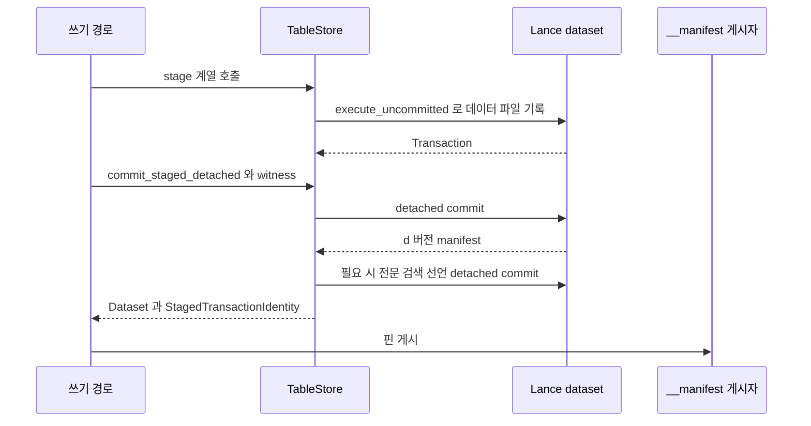

detached commit 규약과 Lance 호환 fence, 세션 구성을 본다.

## detached commit 과 Lance 호환 fence

Omnigraph 는 crates.io 의 Lance 13.0.0 을 수정하지 않고 고정해 쓴다([lance.md L1-L8](https://github.com/ModernRelay/omnigraph/blob/00b8cca842f2bf009bebeefcf765672b5ff64b26/docs/dev/lance.md#L1-L8)). 대신 Lance 의 어떤 동작에 의존하고 어떤 동작을 우회하고 어떤 API 를 금지하는지를 [lance-fences.md](https://github.com/ModernRelay/omnigraph/blob/00b8cca842f2bf009bebeefcf765672b5ff64b26/docs/dev/lance-fences.md#L1-L11) 에 fence 로 기록하고 테스트로 고정한다.

### 코드 분석: commit_detached

파일: `crates/omnigraph/src/table_store.rs`, [table_store.rs L1375-L1392](https://github.com/ModernRelay/omnigraph/blob/00b8cca842f2bf009bebeefcf765672b5ff64b26/crates/omnigraph/src/table_store.rs#L1375-L1392)

그래프 테이블 쓰기의 최종 commit 이다.

```rust
async fn commit_detached(
    ds: Arc<Dataset>,
    transaction: Transaction,
    affected_rows: Option<RowAddrTreeMap>,
) -> Result<Dataset> {
    let mut builder = crate::lance_commit::commit_builder(ds)
        .with_skip_auto_cleanup(true)
        .with_detached(true);
    if let Some(affected_rows) = affected_rows {
        builder = builder.with_affected_rows(affected_rows);
    }
    // A detached commit is unreachable until a manifest names it, so its
    // failure is definite for the graph whatever its storage cause.
    builder
        .execute(transaction)
        .await
        .map_err(|error| OmniError::storage(error).unpublished())
}
```

`with_detached(true)` 는 `_versions/d{version}.manifest` 를 만들고 HEAD 를 움직이지 않으며 충돌 해소 단계도 없다. 이 버전은 `__manifest` 의 핀이 가리키기 전까지 어떤 독자에게도 보이지 않으므로, 실패는 저장소 원인과 무관하게 "게시되지 않음" 으로 확정된다(`unpublished()`). `with_skip_auto_cleanup(true)` 는 Lance 자동 정리를 끈다. 출발점인 `commit_builder`([lance_commit.rs L28-L33](https://github.com/ModernRelay/omnigraph/blob/00b8cca842f2bf009bebeefcf765672b5ff64b26/crates/omnigraph-core/src/lance_commit.rs#L28-L33))는 엔진의 모든 Lance commit 에 공통 제한 시간을 건다. 운영 환경에서는 Lance 기본값을 쓰고, 결정적 시뮬레이션(DST) 시계가 설치된 스레드에서는 멈춘 시계 위의 commit 타이머가 가장 먼 알람이 되므로 제한 시간을 끈다.

### commit_staged_detached 의 결합 작업

`commit_staged_detached`([table_store.rs L4852-L4877](https://github.com/ModernRelay/omnigraph/blob/00b8cca842f2bf009bebeefcf765672b5ff64b26/crates/omnigraph/src/table_store.rs#L4852-L4877))는 스테이징한 효과를 `commit_detached` 로 확정하면서 두 가지 일을 결합한다.

- **witness 기록**: `StagingWitness` 를 트랜잭션 속성에 찍는다. witness 는 스테이징 기준이 된 브랜치 incarnation 과 그래프 head 를 담는다([staging.rs L62-L78](https://github.com/ModernRelay/omnigraph/blob/00b8cca842f2bf009bebeefcf765672b5ff64b26/crates/omnigraph-core/src/staging.rs#L62-L78)). 정리 작업은 manifest 하나만 읽고 그 버전의 소유자를 알아낸다.
- **전문 검색 분석기 보존**: 덮어쓰기처럼 인덱스를 모두 버리는 쓰기 뒤에는 선언된 전문 검색 열에 세그먼트가 없을 수 있고, 그러면 Lance 는 소문자화와 어간 추출 없이 토큰화한다. 그래서 학습하지 않은 빈 세그먼트를 두 번째 detached commit 으로 이어 붙이고, 반환하는 버전은 그 두 번째 버전이다. 세그먼트를 채우는 재구성은 7장과 13장에서 다룬다.



스테이징 함수는 같은 `WriteParams` 기본값을 공유한다. `stage_append`([table_store.rs L3870-L3876](https://github.com/ModernRelay/omnigraph/blob/00b8cca842f2bf009bebeefcf765672b5ff64b26/crates/omnigraph/src/table_store.rs#L3870-L3876))는 자동 정리를 끄고 `execute_uncommitted` 로 트랜잭션만 만든다. 새 테이블을 만드는 `stage_create`([table_store.rs L5373-L5387](https://github.com/ModernRelay/omnigraph/blob/00b8cca842f2bf009bebeefcf765672b5ff64b26/crates/omnigraph/src/table_store.rs#L5373-L5387))는 stable row ID 와 파일 형식 V2_2 를 명시한다. 스테이징 함수별 동작은 9장에서 다룬다.

### fence 요약

| fence | 내용 | lance-fences.md 절 |
|---|---|---|
| 파일 형식 | 모든 운영 쓰기는 안정판 V2_2 를 명시한다 | `file-format` |
| detached commit | 그래프 테이블 쓰기는 detached 버전이며 linear HEAD 는 생성 시 v1 에 머문다 | `detached-commits` |
| cleanup | Lance 의 `cleanup_old_versions` 는 호출하지 않는다 | `cleanup` |
| 카탈로그 게시 | `__manifest` 게시는 재시도 0 회의 엄격한 overwrite 이며 이것이 버전 CAS 다 | `catalog-publication` |
| 그래프 키 | 엄격한 insert 와 upsert 는 봉인된 필터 어댑터를 거치고 키 있는 raw Append 는 금지한다 | `graph-keys` |
| 브랜치 ref 읽기 | ref 는 GET 한 번으로 읽어 중간에 끼어든 재작성으로 잘리지 않게 한다 | `branch-ref-reads` |

cleanup fence 가 가장 무겁다. Lance 13 은 detached manifest 를 추적하지 않으며, `data/` 를 나열할 때 7일보다 오래된 파일을 삭제 후보로 본다. detached 버전만 참조하는 오래된 파일이 지워지면 현재 그래프를 포함한 보존 스냅샷을 읽을 수 없게 된다. 그래서 Omnigraph 는 자체 수집기로 보존 대상을 추적하고, `forbidden_apis.rs` 가 엔진 소스에서 `cleanup_old_versions(` 를 금지한다. 수집기는 13장에서 다룬다. 빈 테이블 재사용 검사 `validate_initial_empty_table`([table_store.rs L2496-L2510](https://github.com/ModernRelay/omnigraph/blob/00b8cca842f2bf009bebeefcf765672b5ff64b26/crates/omnigraph/src/table_store.rs#L2496-L2510))도 버전 1, stable row ID, 파일 형식 V2_2, 모든 fragment 의 물리 행 수 0 을 확인해 이 fence 들과 맞춘다.

## Lance 세션과 객체 저장소 registry

Lance 는 `ObjectStoreRegistry` 로 객체 저장소 클라이언트를 만들고 재사용한다. Omnigraph 는 이 registry 를 교체해 데이터와 제어 메타데이터의 캐시 분리, 그래프가 고정한 저장소 목적지의 전파, 쓰기 소유자의 IO 범위 적용을 보장한다.

### 코드 분석: LanceAccessContext

파일: `crates/omnigraph-core/src/lance_access.rs`, [lance_access.rs L60-L69](https://github.com/ModernRelay/omnigraph/blob/00b8cca842f2bf009bebeefcf765672b5ff64b26/crates/omnigraph-core/src/lance_access.rs#L60-L69)

`with_storage`([lance_access.rs L50-L58](https://github.com/ModernRelay/omnigraph/blob/00b8cca842f2bf009bebeefcf765672b5ff64b26/crates/omnigraph-core/src/lance_access.rs#L50-L58))가 저장소 어댑터의 성질(읽기 전용 mount, 캡처된 결합, IO 범위)에 따라 registry 를 고르면, `with_registry` 가 그 registry 위에 세션 두 개를 만든다.

```rust
    fn with_registry(registry: Arc<ObjectStoreRegistry>) -> Self {
        Self {
            data_session: Arc::new(Session::new(
                DEFAULT_INDEX_CACHE_SIZE,
                DEFAULT_METADATA_CACHE_SIZE,
                Arc::clone(&registry),
            )),
            control_session: Arc::new(Session::new(0, 0, registry)),
        }
    }
```

데이터 세션은 Lance 기본 캐시 크기를 쓰고 제어 세션은 캐시 크기가 0 이다. `__manifest` 처럼 끝이 계속 바뀌는 메타데이터를 캐시하면 브랜치를 재생성한 뒤에도 옛 값을 볼 수 있기 때문이다. 두 세션은 같은 registry 를 공유하므로 클라이언트 연결 풀은 하나다.

| registry 종류 | 선택 조건 | 효과 |
|---|---|---|
| 프로세스 공용 `STORE_REGISTRY` | 결합도 범위도 없음 | Lance 기본 공급자 사용 ([lance_access.rs L12-L17](https://github.com/ModernRelay/omnigraph/blob/00b8cca842f2bf009bebeefcf765672b5ff64b26/crates/omnigraph-core/src/lance_access.rs#L12-L17)) |
| `scoped::registry` | `StorageIoScope` 만 있음 | `file`, `s3`, `az`, `abfss` 공급자를 범위 래퍼로 감쌈 ([scoped.rs L12-L33](https://github.com/ModernRelay/omnigraph/blob/00b8cca842f2bf009bebeefcf765672b5ff64b26/crates/omnigraph-core/src/lance_access/scoped.rs#L12-L33)) |
| `bound::registry` | `CapturedStorageBinding` 있음 | 고정된 목적지 옵션을 공급자에 주입 ([bound.rs L13-L43](https://github.com/ModernRelay/omnigraph/blob/00b8cca842f2bf009bebeefcf765672b5ff64b26/crates/omnigraph-core/src/lance_access/bound.rs#L13-L43)) |
| `statement_session` | 문장 하나의 읽기 재사용 예산 | 문장 수명의 캐시 크기 지정 ([lance_access.rs L104-L114](https://github.com/ModernRelay/omnigraph/blob/00b8cca842f2bf009bebeefcf765672b5ff64b26/crates/omnigraph-core/src/lance_access.rs#L104-L114)) |

범위가 있으면 공용 registry 를 쓰지 않고 전용 registry 를 새로 만든다. 공용 registry 에 범위 없는 클라이언트가 이미 캐시돼 있으면 그 클라이언트가 범위를 우회할 수 있기 때문이다.

### CapturedStorageBinding

`CapturedStorageBinding`([binding.rs L23-L32](https://github.com/ModernRelay/omnigraph/blob/00b8cca842f2bf009bebeefcf765672b5ff64b26/crates/omnigraph-storage/src/binding.rs#L23-L32))은 호출 경계에서 한 번 캡처하는 저장소 목적지다. 요청 URI, 정규화 URI, 목적지, 공급자 옵션, Azure 루트 정보를 담고, 관련 URI 로 다시 결합해도 공급자 설정을 다시 읽지 않는다. `StorageDestination`([binding.rs L8-L21](https://github.com/ModernRelay/omnigraph/blob/00b8cca842f2bf009bebeefcf765672b5ff64b26/crates/omnigraph-storage/src/binding.rs#L8-L21))은 로컬, S3(리전, 엔드포인트, 가상 호스트 방식), Azure(계정, 엔드포인트, 에뮬레이터) 중 하나다. S3 캡처는 명시적인 리전을 요구하고 환경 변수에서는 인증 값만 상속한다. `for_uri`([binding.rs L244-L268](https://github.com/ModernRelay/omnigraph/blob/00b8cca842f2bf009bebeefcf765672b5ff64b26/crates/omnigraph-storage/src/binding.rs#L244-L268))는 같은 공급자 안의 다른 URI 로 결합을 옮기되, 공급자 종류, S3 버킷, Azure 컨테이너가 바뀌면 거부한다. `bound::registry` 는 이 결합을 Lance 공급자에 주입하면서 registry 에 `MARKER` 를 남긴다. 외부 Blob 원본을 읽을 때는 이 표시를 보고 공용 registry 로 바꿔, 그래프 목적지 설정이 외부 원본 주소를 덮어쓰지 않게 한다.

> **주의**: [lance-fences.md L640-L653](https://github.com/ModernRelay/omnigraph/blob/00b8cca842f2bf009bebeefcf765672b5ff64b26/docs/dev/lance-fences.md#L640-L653) 에 따르면 Lance 13 의 `Dataset::create_branch` 는 새 브랜치 위치의 존재 확인을 기본 세션으로 연다. 결합된 핸들의 dataset 에는 공급자 옵션이 없으므로 `lance_clone::create_branch` 가 결합 옵션을 직접 넘긴다. Lance 가 세션을 전달하게 되는 버전에서 제거할 우회다.
