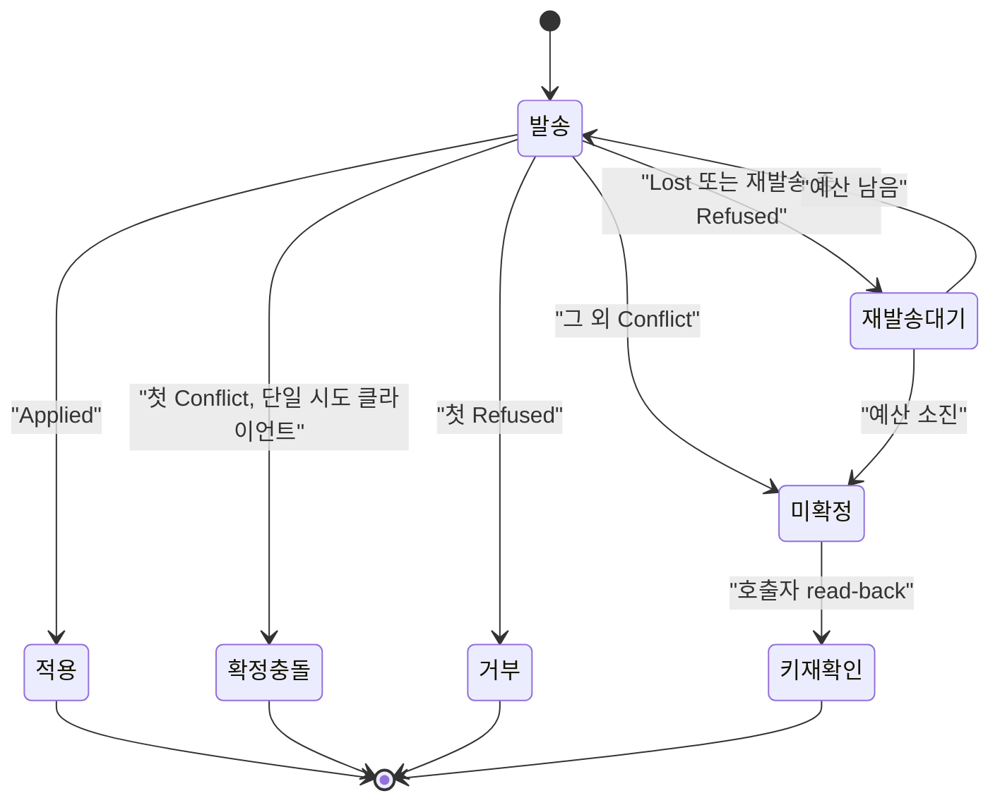

제어 객체 어댑터의 조건부 요청과 타입 있는 저장소 실패를 본다.

## 제어 객체 어댑터와 조건부 요청

Lance dataset 밖의 작은 제어 객체(클러스터 원장, 잠금, 쓰기 큐 표시)는 `omnigraph-storage` 의 `StorageAdapter` 로 읽고 쓴다. 이 크레이트는 엔진에 의존하지 않으므로 클러스터처럼 엔진 아래에 있는 크레이트도 쓸 수 있다. 엔진 쪽에는 같은 트레이트를 `OmniError` 로 감싼 호환 facade 가 있다([storage.rs L1-L6](https://github.com/ModernRelay/omnigraph/blob/00b8cca842f2bf009bebeefcf765672b5ff64b26/crates/omnigraph-core/src/storage.rs#L1-L6)).

### 코드 분석: StorageAdapter 의 조건부 쓰기 연산

파일: `crates/omnigraph-storage/src/lib.rs`, [lib.rs L1217-L1222](https://github.com/ModernRelay/omnigraph/blob/00b8cca842f2bf009bebeefcf765672b5ff64b26/crates/omnigraph-storage/src/lib.rs#L1217-L1222)

버전 토큰이 같을 때만 교체하는 CAS 메서드다.

```rust
    async fn write_text_if_match(
        &self,
        uri: &str,
        contents: &str,
        expected_version: &str,
    ) -> Result<Option<String>>;
```

`read_text_versioned` 가 돌려준 토큰과 현재 버전이 같으면 교체하고 새 토큰을, 경쟁에서 지면 `Ok(None)` 을 돌려준다. 짝이 되는 `write_text_if_absent`([lib.rs L1134-L1148](https://github.com/ModernRelay/omnigraph/blob/00b8cca842f2bf009bebeefcf765672b5ff64b26/crates/omnigraph-storage/src/lib.rs#L1134-L1148))는 객체가 없을 때만 만들고 이 호출이 만들었는지를 `bool` 로 돌려준다. 답을 잃은 요청은 다시 보낸 뒤 키를 읽어 같은 바이트면 성공으로 본다. 그러므로 `contents` 는 쓰는 주체를 식별해야 한다. 같은 바이트를 쓰는 두 호출자는 서로를 구분할 수 없다.

구현체는 `ObjectStorageAdapter` 하나뿐이다([lib.rs L1274-L1300](https://github.com/ModernRelay/omnigraph/blob/00b8cca842f2bf009bebeefcf765672b5ff64b26/crates/omnigraph-storage/src/lib.rs#L1274-L1300)). 로컬, S3, Azure 를 모두 `object_store::ObjectStore` 로 다루므로 원자적 PUT, 조건부 생성, 경로 나열의 의미는 상위 라이브러리가 맞춰 준다. 백엔드별 차이는 URI 와 객체 경로를 바꾸는 `UriCodec` 과 `supports_conditional_update` 플래그에만 남는다. 저장소 종류는 `storage_kind_for_uri`([lib.rs L2776-L2803](https://github.com/ModernRelay/omnigraph/blob/00b8cca842f2bf009bebeefcf765672b5ff64b26/crates/omnigraph-storage/src/lib.rs#L2776-L2803))가 `s3://`, `az://`, 그 외 스킴 없는 경로와 `file://` 로 정하고, 알 수 없는 스킴은 `Configuration` 오류다. Azure 백엔드는 [RFC 0029](https://github.com/ModernRelay/omnigraph/blob/00b8cca842f2bf009bebeefcf765672b5ff64b26/docs/rfcs/0029-azure-blob-storage.md#L19-L28) 가 다루며 상태는 accepted, 구현은 in-progress 다. 문서는 실제 Azure 에서의 동시성, 강제 종료, 리스 해제 검증이 남아 있어 운영 지원으로 광고하지 않는다고 적는다.

로컬 파일 시스템에는 ETag 조건부 PUT 이 없다. `write_text_if_match` 의 로컬 경로([lib.rs L2677-L2690](https://github.com/ModernRelay/omnigraph/blob/00b8cca842f2bf009bebeefcf765672b5ff64b26/crates/omnigraph-storage/src/lib.rs#L2677-L2690))는 내용을 읽어 토큰을 비교한 뒤 원자적으로 교체한다. 로컬 토큰은 mtime 기반 ETag 가 아니라 내용의 SHA-256 이다. mtime 해상도보다 짧은 간격의 재작성이 같은 토큰을 갖기 때문이다.

> **주의**: 로컬 if-match 는 읽기와 교체 사이에 틈이 있어 프로세스 간 CAS 가 아니다. 코드 주석은 호출자의 잠금 규약 아래에서만 안전하다고 적고, 이 한계를 invariants.md 의 Known Gaps 로 넘긴다.

### 코드 분석: ConditionalRequest::answer

파일: `crates/omnigraph-storage/src/conditional.rs`, [conditional.rs L168-L180](https://github.com/ModernRelay/omnigraph/blob/00b8cca842f2bf009bebeefcf765672b5ff64b26/crates/omnigraph-storage/src/conditional.rs#L168-L180)

답을 잃은 조건부 요청을 다시 보낼지 결정하는 앞부분이다. 뒤이어 그 밖의 충돌은 미확정으로, 첫 거부는 거부로 끝내고, 잃은 답과 재발송 중 거부는 다시 보낸다.

```rust
    pub fn answer<T, E>(&mut self, answer: Answer<T, E>) -> Step<T, E> {
        let first = self.reissues == 0;
        let error = match answer {
            Answer::Applied(value) => {
                return Step::Done(Resolution::Applied {
                    value,
                    reissues: self.reissues,
                });
            }
            Answer::Conflict(error) if first && self.first_conflict_settles => {
                return Step::Done(Resolution::Conflict(error));
            }
```

조건부 PUT 은 같은 키, 같은 조건의 복사본이 여러 개 가도 최대 한 번만 적용된다. 그래서 답을 잃은 요청은 그대로 다시 보내도 된다. 첫 요청의 충돌은 단일 시도 클라이언트에서만 확정 충돌이다. 재시도하는 클라이언트는 앞선 복사본이 이미 적용된 뒤에 충돌을 돌려줄 수 있기 때문이다. 재발송 뒤의 충돌은 항상 미확정이고 호출자가 키를 다시 읽어 판정한다.



| 상수, 함수 | 값 | 위치 |
|---|---|---|
| `CONDITIONAL_REQUEST_REISSUES` | 4 회 | [conditional.rs L21](https://github.com/ModernRelay/omnigraph/blob/00b8cca842f2bf009bebeefcf765672b5ff64b26/crates/omnigraph-storage/src/conditional.rs#L21-L21) |
| `reissue_pause` | 200 ms 에서 두 배씩 1.6 s 까지 | [conditional.rs L22-L27](https://github.com/ModernRelay/omnigraph/blob/00b8cca842f2bf009bebeefcf765672b5ff64b26/crates/omnigraph-storage/src/conditional.rs#L22-L27) |

주석은 네 번의 대기를 합해 3 초이고, 그 동안 답하지 않는 저장소는 일시적 제한이 아니라 장애로 본다고 적는다. 이 정책은 제어 객체 쓰기와 `omnigraph-core` 의 manifest commit 처리기(`lance_clone`)가 함께 쓴다. S3 if-match 가 미확정으로 끝나면 키를 다시 읽어, 여전히 기대 버전이면 `Unresolved` 오류, 우리 바이트면 성공, 다른 바이트면 CAS 패배로 판정한다.

## IO 범위와 타입 있는 저장소 실패

쓰기 소유자 하나의 저장소 요청을 묶어 결과를 정산하는 것이 `StorageIoScope` 이고, 저장소 오류를 재시도 판단과 분리해 분류하는 것이 `StorageFailureKind` 다.

### StorageIoScope 의 정산 규칙

`StorageIoScope` 는 진행 중 요청 수, 닫힘과 fence 여부, 리스 마감 시각, 결과를 모르는 가변 키 목록, 트랜잭션 파일 삭제 보류 여부를 기억한다([scoped.rs L114-L130](https://github.com/ModernRelay/omnigraph/blob/00b8cca842f2bf009bebeefcf765672b5ff64b26/crates/omnigraph-storage/src/scoped.rs#L114-L130)). 모듈 주석([scoped.rs L1-L72](https://github.com/ModernRelay/omnigraph/blob/00b8cca842f2bf009bebeefcf765672b5ff64b26/crates/omnigraph-storage/src/scoped.rs#L1-L72))이 정산 규칙을 정리한다. 이 범위는 프로세스 안의 정산 증거이지 쓰기 fence 가 아니다.

| 요청 종류 | 정산 규칙 |
|---|---|
| 새 이름의 불변 파일 쓰기, 없을 때만 만드는 manifest | 오류나 취소 후에도 정산된 것으로 본다. 늦게 도착해도 참조되지 않는다 |
| 가변 키(ref, 버전 힌트, 제어 객체), if-match, 재귀 삭제 | 답이 없으면 키를 미정산으로 남기고 같은 키의 다른 요청을 거부한다 |
| 저장소가 적용 전에 거부한 요청 | 정산할 것이 없다 |
| 미정산 키에 대한 같은 조건의 재발송 | 허용한다. 성공하면 키가 정산된다 |
| 답 없는 manifest 쓰기 | 범위가 끝날 때까지 트랜잭션 파일 삭제를 거부한다 |

미정산 키는 `MAX_UNSETTLED_KEYS` 4096 개까지 기억하고 넘으면 모든 변경 요청을 거부한다([scoped.rs L135](https://github.com/ModernRelay/omnigraph/blob/00b8cca842f2bf009bebeefcf765672b5ff64b26/crates/omnigraph-storage/src/scoped.rs#L135-L135)). 요청은 성격별로 다른 클라이언트로 간다. 불변 키의 읽기와 무조건 쓰기는 재시도 클라이언트로, 조건부 요청과 가변 키는 단일 시도 클라이언트로 간다.

`close` 는 새 변경 요청만 거부한다. `fence`([scoped.rs L255-L262](https://github.com/ModernRelay/omnigraph/blob/00b8cca842f2bf009bebeefcf765672b5ff64b26/crates/omnigraph-storage/src/scoped.rs#L255-L262))는 이미 받아들인 멀티파트 업로드의 부분, 완료, 중단까지 거부하고 실행 중인 요청을 취소한다. 리스가 끝나는 시점을 미리 걸어 두는 `fence_at` 도 있다. 프로세스 전체가 멈췄다가 재개되면 어느 태스크가 먼저 실행될지 모르므로, 요청 허용, 멀티파트 부분, 요청의 매 poll 이 마감을 확인한다. 이미 보낸 요청은 저장소가 여전히 적용할 수 있고, 호출자는 이 범위의 확정 거부 대신 모호한 오류를 받는다. 쓰기 큐와 리스를 쓰는 쪽은 9장과 14장에서 다룬다.

### StorageFailureKind

[lib.rs L43-L63](https://github.com/ModernRelay/omnigraph/blob/00b8cca842f2bf009bebeefcf765672b5ff64b26/crates/omnigraph-storage/src/lib.rs#L43-L63) 의 분류는 여섯 가지다.

| 종류 | 확인한 증거 |
|---|---|
| `Transient` | 시간 초과, 제한, 취소, 전송 중단 |
| `Configuration` | 인증, 권한, 지원하지 않는 연산, 잘못된 위치, 운영자가 조치할 용량 제약 |
| `NotFound` | 객체, dataset, ref, 버전, 인덱스의 부재 |
| `Precondition` | 이미 존재, CAS 경쟁, 오래된 권한, fence 된 권한 |
| `Permanent` | 손상, 불변식 위반, panic, 하위 계층 내부 실패 |
| `Unknown` | 타입 있는 증거 부족 |

[RFC 0038](https://github.com/ModernRelay/omnigraph/blob/00b8cca842f2bf009bebeefcf765672b5ff64b26/docs/rfcs/0038-typed-storage-failures.md#L22-L34) 은 문자열만 담던 `OmniError::Lance` 를 `OmniError::Storage(StorageFailure)` 로 바꾸는 결정을 기록한다(상태 accepted, 구현 complete). 분류는 증거의 성질을 말할 뿐 재시도해도 되는지는 말하지 않는다. 재시도 판단은 자기 효과의 경계를 증명할 수 있는 연산이 내린다. `object_store` 의 불투명한 `Generic` 오류는 일시적이라고 가정하지 않고 `Unknown` 으로 둔다. `StorageError`([lib.rs L266-L292](https://github.com/ModernRelay/omnigraph/blob/00b8cca842f2bf009bebeefcf765672b5ff64b26/crates/omnigraph-storage/src/lib.rs#L266-L292))는 이 분류를 담는 `Backend`, 원래 IO 오류를 보존하는 `Io`, 조건부 쓰기가 정산되지 않은 `Unresolved`, 상한 초과 `ResourceLimit` 을 구분한다.

> **주의**: `classify_object_store_error` 의 주석은 "`object_store` 0.13" 이라고 적지만 작업 공간이 고정한 버전은 [Cargo.toml L106](https://github.com/ModernRelay/omnigraph/blob/00b8cca842f2bf009bebeefcf765672b5ff64b26/Cargo.toml#L106-L106) 기준 0.14.1 이다.
