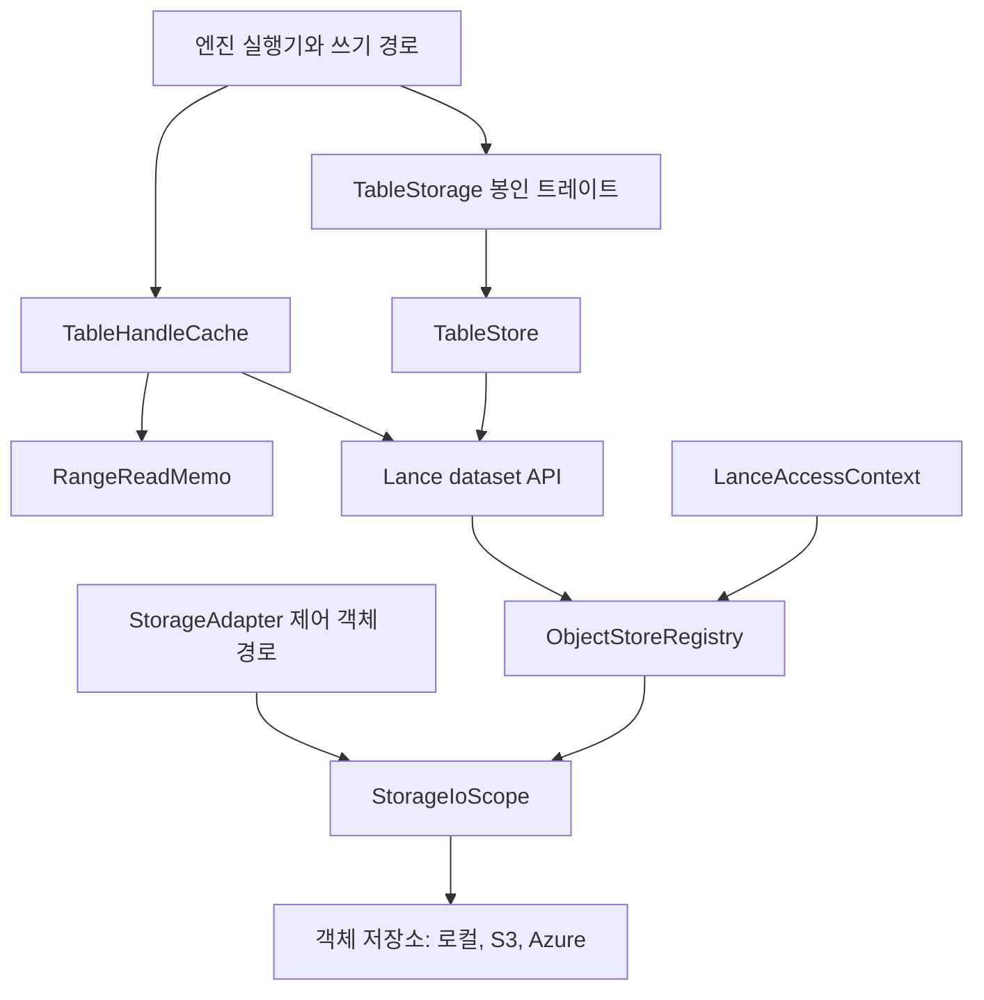

Omnigraph 의 저장 계층은 두 경로로 나뉜다. 노드와 엣지 테이블은 Lance dataset 으로 저장되고 `TableStore` 가 그 열기, 스캔, 스테이징, detached commit 을 맡는다. 클러스터 상태와 잠금 같은 제어 객체는 `omnigraph-storage` 의 `StorageAdapter` 가 조건부 쓰기로 다룬다. 이 장은 두 경로가 같은 객체 저장소를 어떻게 공유하는지, 그리고 Blob 값이 그 위에 어떻게 결합되는지를 코드로 따라간다.

## 저장 계층 개요

[architecture.md](https://github.com/ModernRelay/omnigraph/blob/00b8cca842f2bf009bebeefcf765672b5ff64b26/docs/dev/architecture.md#L78-L92) 는 상태를 세 종류로 나눈다. 수락된 그래프 상태(SchemaIR 와 `__manifest`), Lance 물리 상태(테이블마다 하나의 dataset 과 그 버전, 브랜치, fragment, 인덱스), 파생 런타임 상태(토폴로지 인덱스, 캐시, fragment 배치)다. 저장 계층은 두 번째를 읽고 쓰는 경로다. 첫 번째의 게시는 11장, 토폴로지 인덱스는 6장에서 다룬다.

### 크레이트별 역할

| 크레이트, 모듈 | 역할 |
|---|---|
| `omnigraph` 의 `table_store.rs` | Lance dataset 열기, 스캔, 스테이징, detached commit, Blob 배치 읽기 |
| `omnigraph` 의 `storage_layer.rs` | 봉인된 `TableStorage` 트레이트, 불투명 핸들, 쓰기 예산 상수 |
| `omnigraph` 의 `blob.rs` | Blob-v2 descriptor 해석, 외부 URI 정책, 단일 셀 읽기 facade |
| `omnigraph-core` 의 `lance_access` | 그래프 단위 Lance `Session` 과 객체 저장소 registry 구성 |
| `omnigraph-core` 의 `handle_cache.rs`, `read_memo.rs` | 버전 키 dataset 핸들 캐시, 문장 범위 읽기 memo |
| `omnigraph-core` 의 `metadata.rs`, `staging.rs` | 테이블 버전 메타데이터(핀), 트랜잭션 식별자, 스테이징 witness |
| `omnigraph-storage` | 로컬, S3, Azure 공용 `StorageAdapter`, 조건부 요청 정책, IO 범위, 타입 있는 실패 |

### 테이블 경로와 파일 종류

테이블 경로는 타입 이름이 아니라 안정 식별자에서 만들어진다. [lib.rs L1393-L1409](https://github.com/ModernRelay/omnigraph/blob/00b8cca842f2bf009bebeefcf765672b5ff64b26/crates/omnigraph-catalog/src/lib.rs#L1393-L1409) 의 `table_path_for_identity` 는 노드 테이블을 `nodes/{stable_table_id:016x}-{table_incarnation_id:016x}`, 엣지 테이블을 같은 형식의 `edges/...` 에 둔다. 이름을 바꿔도 경로와 이력은 그대로이고, drop 후 재추가는 incarnation 이 바뀌어 새 경로가 된다. 식별자 생성 규칙은 3장에서 다룬다.

테이블 디렉터리 안의 파일은 [scoped.rs L7-L17](https://github.com/ModernRelay/omnigraph/blob/00b8cca842f2bf009bebeefcf765672b5ff64b26/crates/omnigraph-storage/src/scoped.rs#L7-L17) 의 모듈 주석이 정리한다.

| 경로 | 내용 | 변경 성질 |
|---|---|---|
| `data/*.lance` 와 Blob sidecar | fragment 데이터 파일 | 새 이름으로만 쓰는 불변 파일 |
| `_transactions/*.txn` | 트랜잭션 파일 `{read_version}-{uuid}.txn` | 불변 |
| `_deletions/*.arrow`, `*.bin` | deletion vector | 불변 |
| `_indices/<uuid>/` | 보조 인덱스 파일 | 불변 |
| `_versions/d*.manifest` | detached manifest | 없을 때만 생성 |
| `_versions/{n}.manifest` | 번호 매긴 linear manifest | 없을 때만 생성 |
| `_refs/branches/` 등 | native 브랜치 ref, 버전 힌트 | 가변 키 |

이 구분은 뒤에서 보는 IO 범위와 읽기 memo 가 어떤 요청을 다시 보내거나 재사용해도 되는지 판단하는 기준이다.

> **주의**: `scoped.rs` 의 모듈 주석은 "Lance 11 key" 라고 적지만 작업 공간이 고정한 Lance 는 [Cargo.toml L53](https://github.com/ModernRelay/omnigraph/blob/00b8cca842f2bf009bebeefcf765672b5ff64b26/Cargo.toml#L53-L53) 기준 13.0.0 이다. 파일 목록 자체는 lance-fences.md 의 detached commit 설명과 일치한다.

## 정리

- 노드와 엣지 테이블은 `nodes/` 와 `edges/` 아래에 안정 테이블 ID 와 incarnation ID 로 이름 붙은 Lance dataset 이고, 엔진은 봉인된 `TableStorage` 트레이트를 통해서만 이 dataset 에 쓴다.
- 그래프 테이블 쓰기는 모두 detached commit 이며 `__manifest` 의 핀이 가리키기 전에는 보이지 않는다. 핀은 `TableVersionMetadata` 의 ETag 와 트랜잭션 uuid 로 자신이 가리키는 manifest 를 증명한다.
- 읽기는 버전, detached 핀, ETag 를 키로 하는 핸들 캐시와 불변 파일만 대상으로 하는 문장 범위 memo 로 저장소 요청을 줄이고, 정렬 스캔은 메모리와 디스크 상한이 있는 spill 실행기로만 돌린다.
- Lance 13.0.0 은 수정 없이 고정되고, V2_2 파일 형식, detached commit, `cleanup_old_versions` 금지, 재시도 0 회 manifest overwrite 같은 차이는 lance-fences.md 와 테스트로 고정된다.
- 제어 객체는 단일 `ObjectStorageAdapter` 가 다루며, 답을 잃은 조건부 요청은 최대 4 회 재발송과 read-back 으로 판정하고, `StorageIoScope` 가 소유자 단위로 미정산 키와 fence 를 관리한다.
- Blob 셀은 null, 관리형, 외부의 세 상태로 해석되고, 관리형 읽기는 4 MiB 범위 상한과 버전 고정 리더로, 외부 참조는 기본 거부 정책과 저장소 루트 분리 규칙으로 통제된다.
