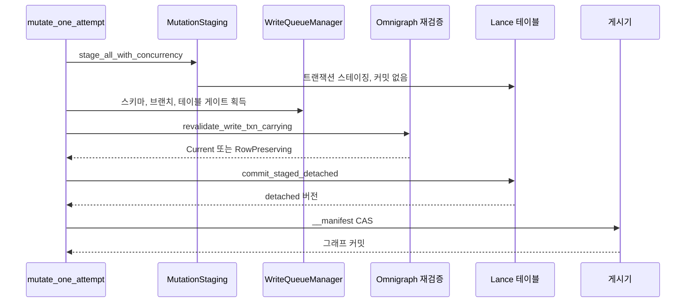

쓰기 게이트와 재검증, 게시와 재준비 루프를 본다.

## 쓰기 게이트와 재검증

`write_queue.rs`의 게이트는 같은 프로세스 안의 쓰기를 직렬화하는 장치다. 모듈 주석은 이 큐가 테이블 데이터의 정확성 권한이 아니라고 명시한다. 정확성은 게시 CAS가 맡고, 큐는 같은 프로세스의 쓰기가 재검증과 게시 사이에 끼어들어 detached 버전을 낭비하지 않게 막는다 ([write_queue.rs L17-L35](https://github.com/ModernRelay/omnigraph/blob/00b8cca842f2bf009bebeefcf765672b5ff64b26/crates/omnigraph/src/db/write_queue.rs#L17-L35)). 프로세스가 다르면 직렬화되지 않고 게시 CAS에서 한쪽만 이긴다.

모듈 주석은 프로세스 안에서 한 작업이 다른 작업을 기다리는 모든 지점을 여섯 게이트로 정리한다 ([write_queue.rs L45-L70](https://github.com/ModernRelay/omnigraph/blob/00b8cca842f2bf009bebeefcf765672b5ff64b26/crates/omnigraph/src/db/write_queue.rs#L45-L70)). `writes.md`도 같은 순서를 적는다 ([writes.md L166-L177](https://github.com/ModernRelay/omnigraph/blob/00b8cca842f2bf009bebeefcf765672b5ff64b26/docs/dev/writes.md#L166-L177)).

| 게이트 | 단위 | 잠금 형태 | 주요 사용자 |
|---|---|---|---|
| `table` | `(table_key, branch)` | 배타 mutex | 변경, 적재, 병합, 스키마 적용 |
| `branch` | 브랜치 | 배타 mutex | RFC 0022 쓰기, 브랜치 제어 |
| `schema_shared` | 그래프 전체 | 읽기 잠금 | 일반 쓰기, 병합, 유지보수 |
| `schema_exclusive` | 그래프 전체 | 쓰기 잠금 | 스키마 적용, 시스템 열 업그레이드, 브랜치 생성 |
| `export` | 그래프 전체 | 기다리지 않는 시도 | export 컷과 파괴적 제어 |
| `coordinator_cas` | 핸들 | 포인터 교체 | `install_coordinator` |

### 코드 분석: `WriteQueueManager`

파일: `crates/omnigraph/src/db/write_queue.rs`, [write_queue.rs L793-L806](https://github.com/ModernRelay/omnigraph/blob/00b8cca842f2bf009bebeefcf765672b5ff64b26/crates/omnigraph/src/db/write_queue.rs#L793-L806)

관리자는 테이블 큐 맵, 브랜치 큐 맵, export 게이트, 스키마 게이트를 가진다 ([write_queue.rs L614-L633](https://github.com/ModernRelay/omnigraph/blob/00b8cca842f2bf009bebeefcf765672b5ff64b26/crates/omnigraph/src/db/write_queue.rs#L614-L633)). 같은 루트를 여는 모든 `Omnigraph` 핸들이 관리자 하나를 공유하도록 프로세스 전역의 약한 참조 레지스트리를 쓰므로, 다른 핸들이 스키마를 적용하거나 ref를 지워도 살아 있는 쓰기와 직렬화된다. 쓰기의 앞 두 게이트는 `acquire_branch_write_gates`가 스키마 공유 허가, 브랜치 게이트 순으로 잡는다 ([write_queue.rs L695-L706](https://github.com/ModernRelay/omnigraph/blob/00b8cca842f2bf009bebeefcf765672b5ff64b26/crates/omnigraph/src/db/write_queue.rs#L695-L706)). 테이블 게이트는 `acquire_many`가 잡는다.

```rust
        let mut sorted: Vec<TableQueueKey> = keys.to_vec();
        sorted.sort();
        sorted.dedup();
        let mut guards = Vec::with_capacity(sorted.len());
        for key in &sorted {
            guards.push(self.acquire(key).await?);
        }
        Ok(guards)
```

키를 정렬하고 중복을 없앤 뒤 순서대로 잡는다. 모든 다중 테이블 쓰기가 같은 순서를 따르므로 잠금 순서 역전에 의한 교착이 생기지 않는다. 같은 키를 두 번 잡으면 자기 자신과 교착하므로 중복 제거도 필요하다.

스키마 게이트는 유일한 공유/배타 게이트다. 받아들인 스키마 뷰를 읽기만 하는 쓰기는 공유 허가를, 그 뷰를 바꾸는 스키마 적용과 시스템 열 업그레이드, 그리고 CAS가 덮지 않는 브랜치 생성은 배타 허가를 잡는다 ([write_queue.rs L334-L345](https://github.com/ModernRelay/omnigraph/blob/00b8cca842f2bf009bebeefcf765672b5ff64b26/crates/omnigraph/src/db/write_queue.rs#L334-L345)). tokio `RwLock`의 쓰기 우선 FIFO를 따르므로 배타 요청이 대기하면 이후 공유 요청은 그 뒤에서 기다린다. 스키마 적용 자체는 11장에서 다룬다.

### 코드 분석: 준비 범위 (`preparing`)

파일: `crates/omnigraph/src/db/write_queue.rs`, [write_queue.rs L113-L118](https://github.com/ModernRelay/omnigraph/blob/00b8cca842f2bf009bebeefcf765672b5ff64b26/crates/omnigraph/src/db/write_queue.rs#L113-L118)

재준비된 시도는 브랜치 게이트를 잡은 채로 다시 준비한다. 게이트가 재진입되지 않으므로 준비 도중 게이트를 잡으면 자기 게이트를 영원히 기다리게 된다. 이를 막기 위해 시도 하나를 task-local 범위로 감싼다.

```rust
pub(crate) fn preparing<'a, F>(attempt: F) -> impl Future<Output = F::Output> + 'a
where
    F: Future + 'a,
{
    PREPARING.scope(Cell::new(true), Box::pin(attempt))
}
```

범위 안에서 게이트 획득 함수는 기다리지 않고 내부 오류를 낸다 ([write_queue.rs L136-L145](https://github.com/ModernRelay/omnigraph/blob/00b8cca842f2bf009bebeefcf765672b5ff64b26/crates/omnigraph/src/db/write_queue.rs#L136-L145)). 그래서 규칙을 어기는 경로는 멈추는 대신 처음 도달한 테스트에서 실패한다. 범위는 시도의 커밋 지점인 `WriteAttempt::admitted_gates`가 끝낸다.

### 재검증과 detached 커밋 (`commit_all`)

`StagedMutation::commit_all`은 게이트를 잡고, 전체 권한을 다시 확인하고, 테이블마다 detached 커밋을 만든다 ([staging.rs L1170-L1398](https://github.com/ModernRelay/omnigraph/blob/00b8cca842f2bf009bebeefcf765672b5ff64b26/crates/omnigraph/src/exec/staging.rs#L1170-L1398)). 이 함수 이후로는 같은 프로세스의 다른 쓰기가 끼어들 수 없고, 반환된 게이트는 게시가 끝날 때까지 유지된다. 첫 시도는 여기서 스키마와 브랜치 게이트를 처음 잡고, 재준비된 시도는 이미 잡은 게이트를 `attempt`에서 꺼내 테이블 게이트만 더한다 ([staging.rs L1198-L1210](https://github.com/ModernRelay/omnigraph/blob/00b8cca842f2bf009bebeefcf765672b5ff64b26/crates/omnigraph/src/exec/staging.rs#L1198-L1210)).



### 코드 분석: 행 보존 이동의 판정

파일: `crates/omnigraph/src/db/omnigraph.rs`, [omnigraph.rs L2294-L2303](https://github.com/ModernRelay/omnigraph/blob/00b8cca842f2bf009bebeefcf765672b5ff64b26/crates/omnigraph/src/db/omnigraph.rs#L2294-L2303)

게이트 아래에서 `revalidate_write_txn_carrying`을 부르면 결과는 둘 중 하나다. 권한이 그대로면 `Current`, 헤드가 움직였지만 그 사이 게시가 행을 바꾸지 않았으면 `RowPreserving`이다 ([omnigraph.rs L2231-L2330](https://github.com/ModernRelay/omnigraph/blob/00b8cca842f2bf009bebeefcf765672b5ff64b26/crates/omnigraph/src/db/omnigraph.rs#L2231-L2330)). 호출자 CAS 불일치는 먼저 `PreconditionFailed`로 끝나고, 브랜치 식별자가 바뀌었으면 바로 `ReadSetChanged`다. 헤드가 움직였을 때의 판정을 본다.

```rust
            let same_schema = live.schema_ir_hash == txn.authority.schema_ir_hash
                && live.schema_identity_domain == txn.authority.schema_identity_domain
                && live.schema_identity_version == txn.authority.schema_identity_version;
            if !carry || !same_schema || txn.unattached_base.is_some() {
                return Err(moved);
            }
            match self.row_preserving_tables(&txn.base, &snapshot).await? {
                Some(tables) => Some(tables),
                None => return Err(moved),
            }
```

스키마가 같고 unattached 쓰기가 아닐 때만 테이블별 체인을 조사한다. 바인딩된 브랜치에서는 스테이징과 나란히 미리 확인한 결과(`EarlyRevalidation`)를 재사용해 게이트 아래 확인을 생략할 수 있다.

`row_preserving_chain`([table_store.rs L842-L886](https://github.com/ModernRelay/omnigraph/blob/00b8cca842f2bf009bebeefcf765672b5ff64b26/crates/omnigraph/src/table_store.rs#L842-L886))은 테이블의 현재 pin 에서 `read_version` 연결을 따라 캡처한 버전까지 내려가며, 모든 링크가 `Rewrite` 또는 `CreateIndex` 인지 확인한다. 하나라도 다른 연산이면 체인이 없는 것으로 본다. 링크 상한 `ROW_PRESERVING_CHAIN_MAX_LINKS`는 32다 ([table_store.rs L807](https://github.com/ModernRelay/omnigraph/blob/00b8cca842f2bf009bebeefcf765672b5ff64b26/crates/omnigraph/src/table_store.rs#L807-L807)). optimize 실행 한 번이 테이블당 rewrite, 인덱스 재빌드, 인덱스 생성 정도를 연결하므로 여러 번의 실행을 담을 여유를 둔 값이라고 주석이 설명한다. 중간 링크는 어떤 `__manifest` 버전도 이름 붙이지 않으므로 `cleanup`이 지웠을 수 있고, 그 경우 저장소 오류가 아니라 읽을 수 없는 체인으로 처리한다. optimize와 인덱스 빌드 자체는 13장에서 다룬다.

체인이 있는 테이블은 `rebase_staged_write`로 Lance의 충돌 해결기를 거쳐 현재 pin 위로 옮겨진다 ([staging.rs L1267-L1280](https://github.com/ModernRelay/omnigraph/blob/00b8cca842f2bf009bebeefcf765672b5ff64b26/crates/omnigraph/src/exec/staging.rs#L1267-L1280)). Lance가 이월을 거부하면, 예를 들어 rewrite가 교체한 fragment의 행을 갱신하거나 삭제하는 경우라면 `ReadSetChanged`로 돌아가 재준비한다. 삽입, append, overwrite는 이월되고 갱신, 삭제, upsert는 거부될 수 있다고 `writes.md`가 정리한다.

### 코드 분석: detached 커밋과 `DatasetUpdate`

파일: `crates/omnigraph/src/exec/staging.rs`, [staging.rs L1349-L1359](https://github.com/ModernRelay/omnigraph/blob/00b8cca842f2bf009bebeefcf765672b5ff64b26/crates/omnigraph/src/exec/staging.rs#L1349-L1359)

권한을 확인한 뒤 모든 테이블을 동시에 detached 커밋한다.

```rust
            let (detached, identity) = db
                .storage()
                .commit_staged_detached(dataset, staged_write, witness, &declared_full_text)
                .await?;
            let state = db.storage().table_state(&path.full_path, &detached).await?;
            let target = expected_version + 1;
            let version_metadata = state
                .version_metadata
                .with_table_fork_owner(table_fork_owner)
                .with_staged(state.version, identity.uuid.clone())
                .with_last_linear_version(path.entry.version_metadata.last_linear_version());
```

`witness`는 이 시도가 스테이징 기준으로 삼은 권한이며, detached 커밋의 트랜잭션 속성에 기록된다. 수집기와 변경 탐지가 이 속성을 읽는다 ([writes.md L324-L330](https://github.com/ModernRelay/omnigraph/blob/00b8cca842f2bf009bebeefcf765672b5ff64b26/docs/dev/writes.md#L324-L330)). 게시될 논리 버전은 `expected_version + 1`이고, 실제 Lance 버전은 `with_staged`로 따로 기록한다. detached 핸들은 곧바로 읽기 핸들 캐시에 넣어 다음 읽기가 manifest를 다시 열지 않게 한다. 커밋 하나마다 `DatasetUpdate`를 만들고, 이것들이 게시기의 입력이 된다. detached 커밋을 실제로 만드는 `TableStore`의 동작은 8장에서 다룬다.

## 게시, 재준비 루프, Blob 셀 기록

`commit_staged_mutation`과 `publish_committed_mutation`은 `.gq` 변경과 Blob 셀 쓰기가 함께 쓰는 프로토콜의 꼬리다.

### 코드 분석: `commit_staged_mutation`

파일: `crates/omnigraph/src/exec/mutation.rs`, [mutation.rs L1501-L1514](https://github.com/ModernRelay/omnigraph/blob/00b8cca842f2bf009bebeefcf765672b5ff64b26/crates/omnigraph/src/exec/mutation.rs#L1501-L1514)

```rust
        let (staged, early) = futures::join!(
            staging.stage_all_with_concurrency(self, requested, stage_write_concurrency),
            self.early_revalidation(txn),
        );
        let staged = staged.map_err(OmniError::unpublished)?;
        fail(&MUTATION_POST_STAGE_PRE_EFFECT_GATE).map_err(OmniError::unpublished)?;
        let lineage_intent = self
            .new_lineage_intent_for_branch(requested, actor_id, history_release_bytes)
            .await
            .map_err(OmniError::unpublished)?;
        let committed = staged
            .commit_all(self, requested, txn, early, attempt)
            .await
            .map_err(OmniError::unpublished)?;
```

검증(`validate_staged_mutation`, 10장)을 먼저 하고, 스테이징과 헤드 확인을 동시에 실행한다. 이후 계보 의도(`LineageIntent`)를 만든다. 이 의도는 새 ULID 커밋 id, 브랜치, 행위자, 시각을 담으며 CAS 재시도 동안 바뀌지 않는다. 부모 커밋은 여기서 정하지 않고 게시기가 시도마다 정한다 ([graph_coordinator.rs L1204-L1219](https://github.com/ModernRelay/omnigraph/blob/00b8cca842f2bf009bebeefcf765672b5ff64b26/crates/omnigraph/src/db/graph_coordinator.rs#L1204-L1219)). 이 구간의 모든 오류에 `unpublished` 표시를 붙이는데, 첫 스테이징 파일부터 게시 호출 전까지의 효과는 아무 manifest도 참조하지 않으므로 실패가 확정적이기 때문이다.

### 코드 분석: `commit_updates_on_branch_with_expected`

파일: `crates/omnigraph/src/db/omnigraph/table_ops.rs`, [table_ops.rs L1578-L1590](https://github.com/ModernRelay/omnigraph/blob/00b8cca842f2bf009bebeefcf765672b5ff64b26/crates/omnigraph/src/db/omnigraph/table_ops.rs#L1578-L1590)

`publish_committed_mutation`은 게이트를 쥔 채 이 함수를 부르고, 이월된 쓰기면 새 헤드 기준 `WriteTxn`으로 게시한다 ([table_ops.rs L1644-L1787](https://github.com/ModernRelay/omnigraph/blob/00b8cca842f2bf009bebeefcf765672b5ff64b26/crates/omnigraph/src/db/omnigraph/table_ops.rs#L1644-L1787)). 함수는 먼저 `prepare_updates_for_commit`을 부르는데, `WriteTxn`이 있으면 갱신 항목을 그대로 돌려준다 ([table_ops.rs L1394-L1403](https://github.com/ModernRelay/omnigraph/blob/00b8cca842f2bf009bebeefcf765672b5ff64b26/crates/omnigraph/src/db/omnigraph/table_ops.rs#L1394-L1403)). 게시되는 pin은 데이터 트랜잭션 하나만 가리켜야 하므로, 빠진 인덱스는 여기서 만들지 않고 `ensure_indices`와 optimize가 나중에 맞춘다. 게시 방식은 `Publication` 열거형이 정하며 ([table_ops.rs L1558-L1568](https://github.com/ModernRelay/omnigraph/blob/00b8cca842f2bf009bebeefcf765672b5ff64b26/crates/omnigraph/src/db/omnigraph/table_ops.rs#L1558-L1568)), 일반 게시는 `ExactGraphHead` 전제 조건으로 코디네이터의 커밋 함수를 부른다.

```rust
    match publication {
        Publication::Publish => {
            let precondition =
                crate::db::manifest::PublishPrecondition::ExactGraphHead(expectation);
            Ok(coordinator
                .commit_changes_with_intent_and_expected(
                    changes,
                    expected_table_versions,
                    lineage_intent,
                    &precondition,
                )
                .await?
                .commit)
```

`GraphCoordinator::commit_changes_with_intent_and_expected`는 테이블 버전 변경과 계보 의도를 manifest 코디네이터에 넘기고, 반환된 그래프 커밋 기록을 돌려준다 ([graph_coordinator.rs L1072-L1101](https://github.com/ModernRelay/omnigraph/blob/00b8cca842f2bf009bebeefcf765672b5ff64b26/crates/omnigraph/src/db/graph_coordinator.rs#L1072-L1101)). 테이블 버전 행과 `graph_commit`, `graph_head` 행이 한 manifest 버전에 함께 기록되는 구조는 11장에서 다룬다.

게시에 쓸 코디네이터는 두 경로로 얻는다. 쓰기 브랜치가 핸들이 바인딩된 브랜치이고 설치된 뷰가 캡처 시점과 같으면 그 뷰를 복제해 쓰고, 게시 뒤 결과를 `install_coordinator`로 설치한다 ([table_ops.rs L1700-L1733](https://github.com/ModernRelay/omnigraph/blob/00b8cca842f2bf009bebeefcf765672b5ff64b26/crates/omnigraph/src/db/omnigraph/table_ops.rs#L1700-L1733)). 다른 브랜치면 핸들의 바인딩을 바꾸지 않도록 `merge_authority_cache`의 항목 하나를 재사용하거나 새로 연다. 어느 경로든 게시기는 시도마다 최신 상태를 다시 읽고 `ExactGraphHead`를 확인하므로, 캐시는 시작 뷰를 제공할 뿐이다. 게시기의 헤드 거부는 호출자 CAS가 있을 때 `caller_precondition_at_publish`가 `PreconditionFailed`로 바꾼다 ([table_ops.rs L1792-L1815](https://github.com/ModernRelay/omnigraph/blob/00b8cca842f2bf009bebeefcf765672b5ff64b26/crates/omnigraph/src/db/omnigraph/table_ops.rs#L1792-L1815)). 그래서 경쟁이 게이트 아래 확인에서 잡히든 게시 CAS에서 잡히든 호출자는 같은 오류를 받는다.

게이트 아래 재검증이나 게시 CAS에서 `ReadSetChanged`가 나면 쓰기는 처음부터 다시 준비한다. 이 루프를 소유하는 것이 `db/reprepare.rs`의 `PreEffectReprepares`이며, 변경, 적재, Blob 쓰기가 모두 이것을 쓴다.

### 코드 분석: `mutate_with_current_actor`의 루프

파일: `crates/omnigraph/src/exec/mutation.rs`, [mutation.rs L1313-L1318](https://github.com/ModernRelay/omnigraph/blob/00b8cca842f2bf009bebeefcf765672b5ff64b26/crates/omnigraph/src/exec/mutation.rs#L1313-L1318)

각 시도를 `preparing`으로 감싸 실행하고, 오류가 재준비 대상이면 `prepare_again`을 부른다.

```rust
            match result {
                Err(err) if reprepares.may_prepare_again(&err) => {
                    reprepares.prepare_again().await?;
                }
                result => return result,
            }
```

재준비 조건은 오류가 `ReadSetChanged`이고, 횟수가 `MAX_PRE_EFFECT_REPREPARES`(32) 미만이며, 시도의 식별 정보가 바뀌지 않은 경우다 ([reprepare.rs L216-L220](https://github.com/ModernRelay/omnigraph/blob/00b8cca842f2bf009bebeefcf765672b5ff64b26/crates/omnigraph/src/db/reprepare.rs#L216-L220)). `prepare_again`은 다음 시도를 위해 브랜치의 쓰기 게이트를 먼저 잡고 코디네이터를 새로 고친다 ([reprepare.rs L224-L249](https://github.com/ModernRelay/omnigraph/blob/00b8cca842f2bf009bebeefcf765672b5ff64b26/crates/omnigraph/src/db/reprepare.rs#L224-L249)).

다음 시도가 게이트를 쥔 채 준비하기 때문에, 같은 프로세스에서는 그 시도 아래로 브랜치가 움직일 수 없다. 모듈 주석은 이로써 쓰기가 최대 두 번의 시도로 끝난다고 설명한다. 다른 프로세스의 게시는 이 상한 밖이며 CAS가 거부하고, 32회 안에서 다시 준비한다 ([reprepare.rs L26-L37](https://github.com/ModernRelay/omnigraph/blob/00b8cca842f2bf009bebeefcf765672b5ff64b26/crates/omnigraph/src/db/reprepare.rs#L26-L37)). 대가는 게이트를 쥔 동안 같은 브랜치의 다른 쓰기가 기다리고, 공정한 스키마 게이트 때문에 배타 요청과 그 뒤의 다른 브랜치 쓰기도 기다린다는 점이다 ([writes.md L447-L454](https://github.com/ModernRelay/omnigraph/blob/00b8cca842f2bf009bebeefcf765672b5ff64b26/docs/dev/writes.md#L447-L454)).

`WriteAttempt::admit`은 첫 시도의 브랜치 incarnation과 스키마를 기록하고, 이후 시도가 기존 행을 선택하는 쓰기(`selects_rows`)인데 둘 중 하나가 달라졌으면 `ReadSetChanged`를 낸다 ([reprepare.rs L154-L175](https://github.com/ModernRelay/omnigraph/blob/00b8cca842f2bf009bebeefcf765672b5ff64b26/crates/omnigraph/src/db/reprepare.rs#L154-L175)). 갱신이나 삭제는 컴파일된 시점의 브랜치와 스키마 기준으로 행을 고르므로, 브랜치가 다시 만들어졌거나 스키마가 바뀌면 요청의 의미가 달라진다. 삽입만 하는 변경은 그대로 진행한다.

`writes.md`의 실패 결과 표를 이 장의 범위로 줄이면 다음과 같다 ([writes.md L956-L970](https://github.com/ModernRelay/omnigraph/blob/00b8cca842f2bf009bebeefcf765672b5ff64b26/docs/dev/writes.md#L956-L970)).

| 관찰 | 결과 |
|---|---|
| 효과 전 파싱, 검증, 정책, 상한, 권한 실패 | 타입 오류, 그래프 변화 없음 |
| 효과 전 행 보존 게시에 의한 헤드 이동 | 현재 헤드로 이월, Lance가 거부하면 재준비 |
| 효과 전 그 밖의 권한 이동 | 시도 전체 폐기 후 게이트 아래에서 재준비 |
| 행 선택 쓰기의 이후 시도에서 incarnation 또는 스키마 변경, 또는 상한 도달 | `ReadSetChanged` |
| 엄격한 삽입의 중복 `id` | `KeyConflict` |
| detached 효과 후 게시 전 실패 | 타입 오류, 그래프 변화 없음, 수집기가 회수 |
| writer epoch 불일치 | `WriterFenced`, 재시도 없음 |

writer epoch는 프로세스가 브랜치를 점유했음을 `__manifest`의 제어 행으로 기록하고 게시마다 확인하는 fence다 ([writes.md L184-L211](https://github.com/ModernRelay/omnigraph/blob/00b8cca842f2bf009bebeefcf765672b5ff64b26/docs/dev/writes.md#L184-L211)). 저장 형식과 게시기의 확인 위치는 11장에서 다룬다.

### Blob 셀 기록

Blob 셀 쓰기는 새로운 쓰기 종류가 아니다. 행 교체를 변경 쿼리의 스테이징과 검증으로 준비하고, 같은 꼬리로 detached 커밋과 게시를 한다. Lance에는 셀 하나만 쓰는 Blob 쓰기가 없으므로 행 전체를 교체하고, 그 행의 다른 Blob 셀은 값으로 옮긴다 ([blob_write.rs L1-L8](https://github.com/ModernRelay/omnigraph/blob/00b8cca842f2bf009bebeefcf765672b5ff64b26/crates/omnigraph/src/exec/blob_write.rs#L1-L8)).

### 코드 분석: `put_blob_at_as`

파일: `crates/omnigraph/src/exec/blob_write.rs`, [blob_write.rs L60-L69](https://github.com/ModernRelay/omnigraph/blob/00b8cca842f2bf009bebeefcf765672b5ff64b26/crates/omnigraph/src/exec/blob_write.rs#L60-L69)

```rust
        let length = u64::try_from(bytes.len())
            .map_err(|_| OmniError::manifest_internal("Blob write payload length exceeds u64"))?;
        let limit = self.settings().write_max_bytes().min(BLOB_WRITE_MAX_BYTES);
        if length > limit {
            return Err(OmniError::resource_limit(
                BLOB_WRITE_PAYLOAD_RESOURCE,
                limit,
                length,
            ));
        }
```

크기 상한은 세션의 `write_max_bytes`와 `BLOB_WRITE_MAX_BYTES`(32 MiB) 중 작은 값이고, 테이블을 열기 전에 확인한다. 셀을 null로 비우는 `clear_blob_at_as`도 같은 내부 함수로 간다. 정책 `change` 검사 후 `write_blob_cell`이 변경 쿼리와 같은 재준비 루프를 돈다 ([blob_write.rs L133-L168](https://github.com/ModernRelay/omnigraph/blob/00b8cca842f2bf009bebeefcf765672b5ff64b26/crates/omnigraph/src/exec/blob_write.rs#L133-L168)).

### 셀 쓰기 시도의 순서

`write_blob_cell_attempt`는 다음 순서로 진행한다 ([blob_write.rs L171-L422](https://github.com/ModernRelay/omnigraph/blob/00b8cca842f2bf009bebeefcf765672b5ff64b26/crates/omnigraph/src/exec/blob_write.rs#L171-L422)).

| 순서 | 내용 |
|---|---|
| 1 | `WriteTxn`을 열고 `admit(&txn, true)`로 행 선택 쓰기임을 기록 |
| 2 | 대상 테이블을 `MutationOpKind::Update`로 열어 pin을 읽음 |
| 3 | 셀을 찾고 호출자 전제 조건(`AnyExisting` 또는 ETag 목록) 확인 ([blob_write.rs L266-L281](https://github.com/ModernRelay/omnigraph/blob/00b8cca842f2bf009bebeefcf765672b5ff64b26/crates/omnigraph/src/exec/blob_write.rs#L266-L281)) |
| 4 | 이미 null인 셀을 비우는 요청이면 게시 없이 종료 |
| 5 | 대상 열을 뺀 나머지 열을 스캔해 행 하나를 만들고 새 값을 끼워 `PendingMode::Upsert`로 추가 |
| 6 | `commit_staged_mutation`으로 detached 커밋까지 진행 |
| 7 | detached 버전에서 셀을 다시 읽어 길이 확인과 ETag 계산 ([blob_write.rs L347-L400](https://github.com/ModernRelay/omnigraph/blob/00b8cca842f2bf009bebeefcf765672b5ff64b26/crates/omnigraph/src/exec/blob_write.rs#L347-L400)) |
| 8 | `Publication::Publish`로 게시 |

7번이 게시 전에 오는 이유는 주석에 있다. 응답의 ETag가 게시 이후의 다른 쓰기와 무관하게 이 커밋의 값을 가리키도록, 게시 후에는 저장소를 읽지 않는다. 이 구간의 실패는 detached 버전만 남기고 아무 manifest도 그것을 가리키지 않으므로 확정적이다. Blob 열의 저장 형식과 ETag 계산은 8장에서 다룬다.

### 쓰기 경로 관련 RFC의 현재 상태

| RFC | 제목 | 상태 | 현재 코드와의 관계 |
|---|---|---|---|
| 0013 | Write-path latency and bounded history cost | superseded (0022, 0028) | 캡처 한 번의 `WriteTxn`, manifest 안의 계보의 출발점 |
| 0018 | Streaming-ingest WAL on Lance MemWAL | rejected | 코드 없음 |
| 0022 | Unified graph-write protocol | accepted, complete | 본 장의 상태 기계, 복구 절은 RFC 0067로 대체 |
| 0023 | Substrate-native key-conflict fencing | accepted, complete | `KeyedWriteSemantics`와 키 있는 쓰기 경로 |
| 0024 | Durable table heads | draft, not-started | 코드 없음 |
| 0026 | MemWAL streaming ingest | rejected, removed | 구현과 형식 제거 |

RFC 0013은 객체 저장소에서 작은 쓰기 하나가 커밋 이력 길이에 비례해 수백 번의 왕복을 일으키는 문제를 보고했다. opener 우회 시험 구현으로 depth 80 엣지 쓰기의 연산 수가 1618에서 593으로 2.7배 줄었다는 수치는 RFC 본문의 자체 발표다 ([0013-write-path-latency.md L51-L74](https://github.com/ModernRelay/omnigraph/blob/00b8cca842f2bf009bebeefcf765672b5ff64b26/docs/rfcs/0013-write-path-latency.md#L51-L74)). 이 RFC가 제안한 "캡처 한 번, 게시 한 번" 구조가 RFC 0022와 지금의 `WriteTxn`으로 이어졌다.

RFC 0018은 `__manifest` CAS를 그대로 공개 지점으로 두고 그 앞에 Lance MemWAL을 적재 버퍼로 두는 스트리밍 적재 WAL을 제안했다. 후속 RFC 0026이 이를 구현했지만, MemWAL이 행을 내구성 있게 받는 것과 별개로 그래프 수준의 검증, 권한, fold, 테이블 간 게시 장치가 따로 필요했고 그 조정 비용이 처리량을 지배했다. 그래서 구현과 미출시 형식이 제거되었다. 현재의 대량 적재는 일반 `load_as` 트랜잭션 위의 계층이며 10장에서 다룬다.

RFC 0024는 테이블별 현재 상태를 `__manifest` 안의 `table_head` 행으로 두어 이력 fold를 피하려는 초안이다. 첫 측정에서 후보 접근 방식이 이력 깊이에 대해 평탄하지 않아 출시하지 않았다.

> **주의**: RFC 0024의 처분 문단은 "현재 바이너리가 manifest v6을 제공한다"고 적는다 ([0024-durable-table-heads.md L20-L25](https://github.com/ModernRelay/omnigraph/blob/00b8cca842f2bf009bebeefcf765672b5ff64b26/docs/rfcs/0024-durable-table-heads.md#L20-L25)). 반면 `writes.md`는 앞 절에서 본 writer epoch 행을 저장 형식 v17의 일부로 설명한다. RFC 0024의 형식 번호는 작성 당시 기준으로 읽어야 하며, 현재 형식 번호와 버전 이력은 13장에서 다룬다.
