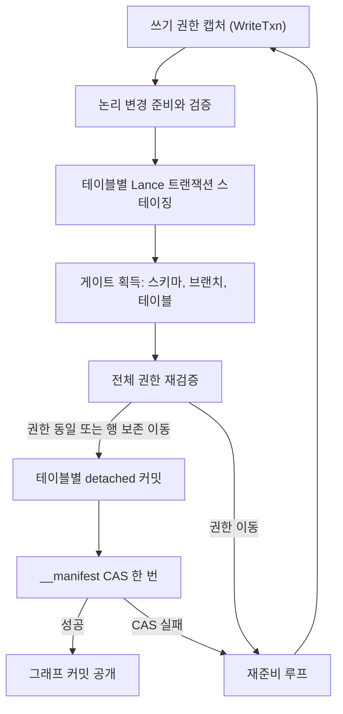

Omnigraph의 쓰기는 몇 개의 테이블을 건드리든 그래프에 보이는 시점이 하나뿐이다. 테이블마다 Lance 트랜잭션을 미리 만들어 두고, 게이트 아래에서 쓰기 권한을 다시 확인한 뒤 각 효과를 detached 커밋으로 남기고, 마지막에 `__manifest` 조건부 게시(CAS) 한 번으로 전체를 공개한다. 이 장은 `.gq` 변경 쿼리가 이 경로를 지나가는 순서를 따라 `WriteTxn`, `MutationStaging`, 쓰기 큐, `commit_all`, 게시, 재준비 루프를 코드 단위로 읽는다.

## 쓰기 프로토콜과 권한 캡처

개발 문서 `docs/dev/writes.md`는 그래프 내용을 바꾸는 모든 쓰기의 공개 지점을 조건부 `__manifest` 게시 하나로 정의한다 ([writes.md L7-L13](https://github.com/ModernRelay/omnigraph/blob/00b8cca842f2bf009bebeefcf765672b5ff64b26/docs/dev/writes.md#L7-L13)). 테이블 효과는 그보다 먼저 일어나지만, 고정된 기준 버전(pin)에서 갈라진 detached Lance 커밋이라 게시 전에는 아무도 참조하지 않는다. 문서가 제시하는 단계는 다음과 같다 ([writes.md L15-L29](https://github.com/ModernRelay/omnigraph/blob/00b8cca842f2bf009bebeefcf765672b5ff64b26/docs/dev/writes.md#L15-L29)).



게시 전 어느 단계에서 실패해도 그래프는 바뀌지 않는다. detached 버전은 게시되지 않은 스테이징으로 남고, `cleanup`의 수집기가 그 버전에 기록된 게시 권한이 사라진 것을 확인한 뒤 회수한다 ([writes.md L31-L45](https://github.com/ModernRelay/omnigraph/blob/00b8cca842f2bf009bebeefcf765672b5ff64b26/docs/dev/writes.md#L31-L45)). 게시가 성공하면 그것으로 쓰기가 끝나며, 게시 이후에 처리할 테이블 작업은 없다. 그래서 복구 기록(sidecar)을 미리 남기는 단계도 없다.

이 구조는 RFC 0022 "Unified graph-write protocol"에서 왔다. RFC 0022의 원래 상태 기계에는 복구 장벽(recovery barrier)과 복구 기록 단계(arm recovery)가 있었다 ([0022-unified-write-path.md L74-L96](https://github.com/ModernRelay/omnigraph/blob/00b8cca842f2bf009bebeefcf765672b5ff64b26/docs/rfcs/0022-unified-write-path.md#L74-L96)). RFC 0067이 `__recovery/` sidecar와 롤백을 제거했다는 사실은 RFC 0022 머리말에 적혀 있다 ([0022-unified-write-path.md L19-L24](https://github.com/ModernRelay/omnigraph/blob/00b8cca842f2bf009bebeefcf765672b5ff64b26/docs/rfcs/0022-unified-write-path.md#L19-L24)). 따라서 RFC 0022 본문의 복구 관련 절은 이력으로 읽어야 하고, 현재 기준은 `writes.md`와 코드다. 게시 결과가 기록되는 `__manifest`의 내부 구조와 커밋 그래프는 11장에서 다룬다.

### 쓰기 권한 캡처 (`WriteTxn`)

쓰기 한 번의 시도(attempt)는 변경되지 않는 `WriteTxn` 하나를 캡처하고, 계획, 검증, 스테이징, 게시가 모두 이 값을 본다.

### 코드 분석: `WriteTxn`

파일: `crates/omnigraph/src/db/omnigraph.rs`, [omnigraph.rs L282-L316](https://github.com/ModernRelay/omnigraph/blob/00b8cca842f2bf009bebeefcf765672b5ff64b26/crates/omnigraph/src/db/omnigraph.rs#L282-L316)

구조체 앞부분의 세 필드를 본다.

```rust
pub(crate) struct WriteTxn {
    /// The resolved branch (`None` = main).
    pub(crate) branch: Option<String>,
    /// The pinned base snapshot (per-table location + version + e_tag), captured once.
    pub(crate) base: Snapshot,
    /// Complete coarse authority token for this prepared attempt.
    pub(crate) authority: WriteAuthorityToken,
```

`base`는 테이블마다 위치, 버전, ETag가 고정된 스냅샷이다. `authority`는 브랜치 식별자, 그래프 헤드, 스키마 식별 정보를 묶은 토큰이며 재검증과 게시 전제 조건이 비교하는 대상이다. 나머지 필드는 다음과 같다.

| 필드 | 역할 |
|---|---|
| `effective_graph_head` | 상속된 헤드까지 포함한 실제 헤드 |
| `caller_expected_graph_head` | 호출자의 `--if-commit` 값, 불일치 시 종결 오류 |
| `catalog` | 캡처한 스키마로 만든 카탈로그 |
| `manifest_probe` | 캡처한 뷰가 아직 최신인지 확인하는 가벼운 확인 수단 |
| `head_on_record` | 이 프로세스가 기록한 헤드를 확인 대신 쓴 경우 |
| `unattached_base` | unattached 자식 쓰기의 기준 스냅샷 |

`catalog` 필드 덕분에 다른 핸들이 스키마를 적용해도 이 시도는 캡처한 카탈로그로 계획하고 검증한다. 캡처 함수 `open_write_txn`은 브랜치 이름을 정규화하고 권한과 스냅샷을 읽은 뒤, 그 스냅샷에서 받아들인 카탈로그를 꺼내 함께 묶는다 ([omnigraph.rs L1655-L1675](https://github.com/ModernRelay/omnigraph/blob/00b8cca842f2bf009bebeefcf765672b5ff64b26/crates/omnigraph/src/db/omnigraph.rs#L1655-L1675)). 캡처한 권한으로 하는 제약 검증의 세부는 10장에서 다룬다.

### 코드 분석: `MutationOpKind`

파일: `crates/omnigraph/src/db/mod.rs`, [db/mod.rs L101-L118](https://github.com/ModernRelay/omnigraph/blob/00b8cca842f2bf009bebeefcf765672b5ff64b26/crates/omnigraph/src/db/mod.rs#L101-L118)

연산 종류마다 엄격한 사전 확인 여부를 정하는 함수를 본다.

```rust
    pub(crate) fn strict_pre_stage_version_check(self) -> bool {
        match self {
            MutationOpKind::Insert | MutationOpKind::Merge => false,
            MutationOpKind::Update | MutationOpKind::Delete | MutationOpKind::SchemaRewrite => true,
        }
    }
```

Insert와 Merge는 엄격하지 않은 연산이고, Update, Delete, SchemaRewrite는 엄격한 연산이다. 이 구분이 실제로 바꾸는 것은 테이블을 여는 방식이다. `open_for_mutation_on_branch`는 `WriteTxn`이 있고 연산이 엄격하지 않으면 dataset을 열지 않고 pin의 버전만 돌려준다 ([table_ops.rs L1218-L1261](https://github.com/ModernRelay/omnigraph/blob/00b8cca842f2bf009bebeefcf765672b5ff64b26/crates/omnigraph/src/db/omnigraph/table_ops.rs#L1218-L1261)). 누적 단계에서 삽입은 기존 행을 읽을 필요가 없기 때문이다. 엄격한 연산은 pin이 가리키는 버전을 연다. 이름 있는 브랜치에서도 테이블별 fork를 만들지 않고, 상속받은 등록 항목의 dataset과 native ref를 그대로 연다.

> **주의**: `MutationOpKind` 문서 주석과 `open_for_mutation_on_branch` 주석([table_ops.rs L1210-L1217](https://github.com/ModernRelay/omnigraph/blob/00b8cca842f2bf009bebeefcf765672b5ff64b26/crates/omnigraph/src/db/omnigraph/table_ops.rs#L1210-L1217))은 엄격한 연산이 "live HEAD를 열고 `ensure_expected_version`을 실행한다"고 적는다. 그러나 `WriteTxn`이 있는 경로의 코드는 pin을 여는 `open_pinned_for_write`만 호출하고, `ensure_expected_version`은 `WriteTxn`이 없는 레거시 경로에서만 호출된다 ([table_ops.rs L1424-L1432](https://github.com/ModernRelay/omnigraph/blob/00b8cca842f2bf009bebeefcf765672b5ff64b26/crates/omnigraph/src/db/omnigraph/table_ops.rs#L1424-L1432)). `MutationStaging`이 연산 종류를 `op_kinds`에 모으지만 `stage_all_with_concurrency`는 이 필드를 버린다 ([staging.rs L520](https://github.com/ModernRelay/omnigraph/blob/00b8cca842f2bf009bebeefcf765672b5ff64b26/crates/omnigraph/src/exec/staging.rs#L520-L520)). 현재 동작의 근거는 코드이며, 엄격한 연산의 충돌은 뒤에서 볼 재검증과 게시 CAS가 막는다.

## 정리

- 그래프 쓰기의 공개 지점은 `__manifest` CAS 한 번이다. 테이블 효과는 pin에서 갈라진 detached Lance 커밋이라 게시 전 실패는 그래프를 바꾸지 않고, 남은 버전은 `cleanup`이 회수한다.
- 시도 하나는 `WriteTxn`을 캡처해 계획, 검증, 스테이징, 게시에 같은 권한을 쓴다. 호출자 `--if-commit`은 `PreconditionFailed`로 끝나고, 내부 권한 이동은 `ReadSetChanged`로 재준비된다.
- `MutationStaging`은 쿼리 동안 배치와 삭제 predicate를 메모리에 모으고, 쿼리 끝에서 테이블마다 Lance 트랜잭션 하나를 설정된 동시성(기본 8)으로 스테이징한다. 한 쿼리는 구성 연산과 삭제를 섞을 수 없다.
- 쓰기 큐는 스키마, 브랜치, 정렬된 테이블 순으로 게이트를 잡는 프로세스 내부 직렬화 장치다. 정확성은 게시 CAS가 맡고, 준비 범위가 재진입 교착을 오류로 바꾼다.
- 그 사이 게시가 행을 바꾸지 않았다면(`Rewrite`, `CreateIndex`만 있는 체인) 스테이징된 쓰기를 Lance 충돌 해결기로 현재 pin 위에 이월한다. 그렇지 않으면 게이트를 쥔 채 재준비하며, 같은 프로세스 안에서는 두 번째 시도로 끝난다.
- Blob 셀 쓰기와 대량 적재도 같은 누적기, 재준비 루프, 게시 꼬리를 쓴다. 키 있는 쓰기는 RFC 0023의 `id` 필터 경로를 따르고, WAL 기반 스트리밍 적재 제안(RFC 0018, 0026)은 기각되었다.
