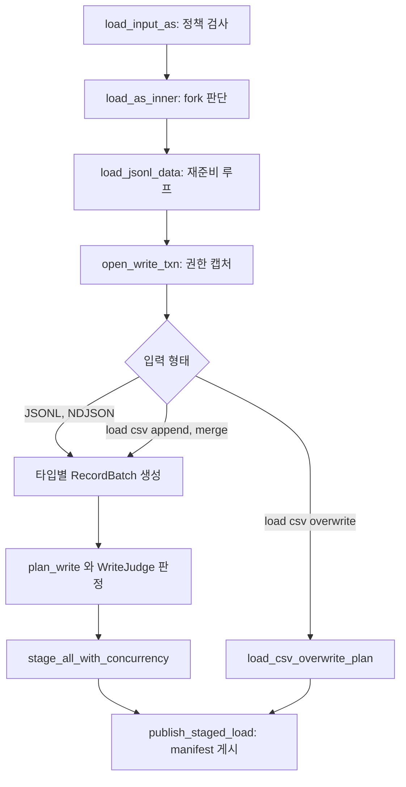

적재 트랜잭션 단계와 NDJSON 경계, ID 결정을 본다.

## 적재 트랜잭션의 단계

적재 하나는 브랜치 확인, 권한 캡처, 파싱, 검증, 스테이징, 게시 순서로 진행된다. 문서는 이를 7단계로 적고([ingestion.md L40-L46](https://github.com/ModernRelay/omnigraph/blob/00b8cca842f2bf009bebeefcf765672b5ff64b26/docs/dev/ingestion.md#L40-L46)), 코드는 `load_as_inner`, `load_jsonl_data`, `load_jsonl_reader_once`, `publish_staged_load` 네 함수로 나눈다.



### 코드 분석: 명시적 base 가 있을 때의 fork

파일: `crates/omnigraph/src/loader/mod.rs`, [mod.rs L540-L616](https://github.com/ModernRelay/omnigraph/blob/00b8cca842f2bf009bebeefcf765672b5ff64b26/crates/omnigraph/src/loader/mod.rs#L540-L616)

base 가 주어지고 대상 브랜치가 없을 때만 브랜치를 만든다.

```rust
        if let (Some(target), Some(base_name)) = (requested.as_deref(), base_branch.as_deref()) {
            let exists = self
                .branch_list()
                .await
                .map_err(OmniError::before_effect)?
                .iter()
                .any(|name| name == target);
            if !exists {
```

브랜치가 없으면 `branch_create_from_as` 에 actor 를 넘겨 fork 한다. fork 는 자체 게시로 끝나는 독립 연산이므로, 이후의 실패는 `after_earlier_publication` 으로 감싸 브랜치가 이미 만들어졌다는 사실을 오류에 남긴다. fork 직후의 `LOAD_POST_BRANCH_CREATE_PRE_STAGE` 는 deterministic 시뮬레이션 테스트가 실패를 주입하는 지점이고, 선언 주석은 그 결과를 "a failed load's surviving empty branch" 라고 설명한다.

### 코드 분석: 효과 이전 재준비 루프

파일: `crates/omnigraph/src/loader/mod.rs`, [mod.rs L726-L783](https://github.com/ModernRelay/omnigraph/blob/00b8cca842f2bf009bebeefcf765672b5ff64b26/crates/omnigraph/src/loader/mod.rs#L726-L783)

입력 문자열을 복사하지 않고 시도마다 같은 슬라이스를 다시 읽는다.

```rust
        match result {
            Err(err) if reprepares.may_prepare_again(&err) => {
                reprepares.prepare_again().await?;
            }
            result => return result,
        }
```

`PreEffectReprepares` 는 효과가 생기기 전에 `ReadSetChanged` 가 나면 다시 준비하게 하고, 그 횟수를 `MAX_PRE_EFFECT_REPREPARES` 32회로 제한한다([reprepare.rs L52-L54](https://github.com/ModernRelay/omnigraph/blob/00b8cca842f2bf009bebeefcf765672b5ff64b26/crates/omnigraph/src/db/reprepare.rs#L52-L54)). 두 번째 시도부터는 브랜치의 writer gate 를 잡은 채 준비하므로 같은 프로세스 안에서는 두 번 안에 끝난다([reprepare.rs L27-L37](https://github.com/ModernRelay/omnigraph/blob/00b8cca842f2bf009bebeefcf765672b5ff64b26/crates/omnigraph/src/db/reprepare.rs#L27-L37)). 재준비 규약과 writer gate 는 9장에서 다룬다. CSV 입력은 루프 밖에서 한 번 probe 하고, 실제 바이트 캡처는 `OnceCell` 에 담아 재시도마다 다시 가져오지 않는다.

### 코드 분석: 권한 캡처와 모드 매핑

파일: `crates/omnigraph/src/loader/mod.rs`, [mod.rs L797-L1370](https://github.com/ModernRelay/omnigraph/blob/00b8cca842f2bf009bebeefcf765672b5ff64b26/crates/omnigraph/src/loader/mod.rs#L797-L1370)

`load_jsonl_reader_once` 는 입력을 해석하기 전에 쓰기 트랜잭션을 연다.

```rust
    let txn = db.open_write_txn(branch).await.map_err(|error| {
        if first_attempt {
            error.before_effect()
        } else {
            error.without_pre_effect_evidence()
        }
    })?;
    // An overwrite replaces the rows it finds; an append or a merge only
    // adds or upserts by key (`WriteAttempt::admit`).
    attempt.admit(&txn, matches!(mode, LoadMode::Overwrite))?;
    let catalog = Arc::clone(&txn.catalog);
```

카탈로그는 핸들의 전역 카탈로그가 아니라 `WriteTxn` 에 포함된 것을 쓴다. 다른 핸들이 스키마를 바꿨다면 전역 카탈로그는 늦을 수 있기 때문이다. 불변식 3번 "Every operation uses one coherent accepted view" 의 적재 쪽 구현이다([invariants.md L39-L43](https://github.com/ModernRelay/omnigraph/blob/00b8cca842f2bf009bebeefcf765672b5ff64b26/docs/dev/invariants.md#L39-L43)). `attempt.admit` 의 두 번째 인자는 overwrite 여부로, 기존 행을 교체하는 쓰기는 브랜치 정체성이나 스키마가 바뀌면 재준비 대신 실패한다.

모드는 세 축으로 번역된다([mod.rs L1041-L1059](https://github.com/ModernRelay/omnigraph/blob/00b8cca842f2bf009bebeefcf765672b5ff64b26/crates/omnigraph/src/loader/mod.rs#L1041-L1059)). `Append` 가 `StrictInsert` 인 이유는 주석에 있다. format v6 에서는 키 없는 노드와 엣지를 포함해 모든 물리 테이블이 `id` 를 Lance PK 로 가지므로, append 도 정확한 `id` 기준의 엄격한 삽입이 된다.

| `LoadMode` | `PendingMode` (스테이징) | `MutationOpKind` (버전 정책) | `DeltaClass` (판정) |
|---|---|---|---|
| `Merge` | `Upsert` | `Merge` | `Upsert` |
| `Append` | `StrictInsert` | `Insert` | `Insert` |
| `Overwrite` | `Overwrite` | `SchemaRewrite` | `Replace` |

`DeltaClass` 매핑은 [mod.rs L1239-L1256](https://github.com/ModernRelay/omnigraph/blob/00b8cca842f2bf009bebeefcf765672b5ff64b26/crates/omnigraph/src/loader/mod.rs#L1239-L1256) 에 있고, 스테이징과 커밋에서 각 값의 동작은 9장에서 다룬다.

### 코드 분석: 스테이징과 게시

파일: `crates/omnigraph/src/loader/mod.rs`, [mod.rs L1346-L1351](https://github.com/ModernRelay/omnigraph/blob/00b8cca842f2bf009bebeefcf765672b5ff64b26/crates/omnigraph/src/loader/mod.rs#L1346-L1351)

검증이 통과한 뒤에야 Lance 파일을 쓴다.

```rust
    // From the first staged file to the publisher call nothing is
    // graph-visible: a failure is definite (`Unpublished`) whatever its cause.
    let staged = staging
        .stage_all_with_concurrency(db, branch, stage_write_concurrency)
        .await
        .map_err(OmniError::unpublished)?;
```

첫 스테이징 파일부터 게시 호출 전까지는 그래프에서 보이는 것이 없으므로 이 구간의 실패는 모두 `Unpublished` 다. `publish_staged_load` 는 `commit_all` 로 테이블별 detached 커밋을 만들고 `commit_updates_on_branch_with_expected` 로 manifest 를 한 번 갱신한다. 테이블 핀과 그래프 이력이 한 번의 manifest 게시로 함께 보이는 것은 불변식 2번이다([invariants.md L25-L37](https://github.com/ModernRelay/omnigraph/blob/00b8cca842f2bf009bebeefcf765672b5ff64b26/docs/dev/invariants.md#L25-L37)). detached 커밋은 9장, manifest 와 커밋 그래프는 11장에서 다룬다.

> **주의**: 적재는 ANN, FTS 인덱스를 동기적으로 학습하지 않는다. 문서는 "Load publishes logical data only" 라고 적고, 인덱스는 `ensure_indices` 나 `optimize` 가 따로 맞춘다. 인덱스 정비는 13장에서 다룬다.

## 엄격한 NDJSON 경계

`load_graph_batch_as` 는 새 HTTP 통합에 권하는 경계다([ingestion.md L9-L28](https://github.com/ModernRelay/omnigraph/blob/00b8cca842f2bf009bebeefcf765672b5ff64b26/docs/dev/ingestion.md#L9-L28)). 한 줄이 정확히 노드 또는 엣지 envelope 하나여야 하고, 호환 로더의 강제 변환을 거부한다.

| 입력 | 호환 로더 | 엄격한 NDJSON |
|---|---|---|
| 중복 JSON 멤버 | 마지막 값 사용 (serde 기본) | 거부 |
| 모르는 최상위 필드 | 무시 | 거부 |
| 물리 컬럼 이름(`_tombstone`, Lance 시스템 컬럼) | 읽지 않음 (스키마 필드만 읽음) | 거부 |
| 타입이 틀린 nullable 값 | NULL 로 변환 | 거부 |
| 여러 줄에 걸친 JSON 객체 | 허용 | 줄 단위만 허용 |
| 한 줄 크기 | 제한 없음 | `KEYED_WRITE_MAX_BYTES` |

호환 로더는 serde 의 스트리밍 역직렬화기로 값 사이의 공백을 모두 구분자로 취급하므로 여러 줄에 걸친 객체도 받는다. 엄격 경로는 줄마다 `read_bounded_graph_batch_line` 으로 읽고, 상한을 넘는 순간 버퍼를 비운 뒤 줄 끝까지 버리므로 넘친 줄의 내용을 메모리에 보관하지 않는다([mod.rs L1662-L1727](https://github.com/ModernRelay/omnigraph/blob/00b8cca842f2bf009bebeefcf765672b5ff64b26/crates/omnigraph/src/loader/mod.rs#L1662-L1727)). 상한 `GRAPH_BATCH_MAX_LINE_BYTES` 는 세션 설정이 아니라 상수 `KEYED_WRITE_MAX_BYTES`(32 MiB)다. 파싱 전에는 `validate_graph_batch_json_structure` 가 문자열 밖의 구조 문자 수를 세어, 64 MiB 를 슬롯당 512바이트로 나눈 상한을 넘는 입력을 거부한다.

중복 멤버 거부는 `serde_json::Value` 대신 별도 Visitor 인 `UniqueJsonValue` 로 디코딩해 구현한다([mod.rs L1764-L1785](https://github.com/ModernRelay/omnigraph/blob/00b8cca842f2bf009bebeefcf765672b5ff64b26/crates/omnigraph/src/loader/mod.rs#L1764-L1785)). 두 생산자가 `id` 나 엣지 끝점 필드에 대해 서로 다른 값을 보았다고 주장할 수 있으므로, 쓰기 권한 경계에서 "마지막 중복이 이긴다" 는 동작은 쓸 수 없다는 것이 주석의 설명이다. `parse_unique_json` 은 공개 함수이고 클러스터 저장소 코드도 같은 디코더를 쓴다.

### envelope 해석

`parse_strict_graph_rows` 는 `type` 과 `edge` 중 정확히 하나가 있는 envelope 만 받는다([mod.rs L1860-L1993](https://github.com/ModernRelay/omnigraph/blob/00b8cca842f2bf009bebeefcf765672b5ff64b26/crates/omnigraph/src/loader/mod.rs#L1860-L1993)). 노드 envelope 의 허용 필드는 `type`, `id`, `data` 이고 엣지는 `edge`, `id`, `from`, `to`, `data` 다. 엣지 `data` 안에 물리 끝점 컬럼 이름이 있으면 "reserved structural state" 로 거부하고, 통과한 `from`, `to` 는 `data` 안의 물리 컬럼 자리로 옮긴다. 행 단위 필드 검사는 `validate_strict_input_fields` 가 다시 한다. 예약 물리 필드, 신원 컬럼, 구조 필드, 선언된 속성 이외의 키는 모두 오류다([mod.rs L2842-L2866](https://github.com/ModernRelay/omnigraph/blob/00b8cca842f2bf009bebeefcf765672b5ff64b26/crates/omnigraph/src/loader/mod.rs#L2842-L2866)).

### 코드 분석: `place_identity`

파일: `crates/omnigraph/src/loader/mod.rs`, [mod.rs L1997-L2031](https://github.com/ModernRelay/omnigraph/blob/00b8cca842f2bf009bebeefcf765672b5ff64b26/crates/omnigraph/src/loader/mod.rs#L1997-L2031)

최상위 `id` 를 물리 `id` 컬럼 자리에 놓는다.

```rust
    if system_columns != SYSTEM_COLUMNS_LEGACY
        && data.contains_key("id")
        && !properties.contains_key("id")
    {
        return Err(OmniError::manifest(format!(
            "{location}: unknown input field 'id': move data.id to the top-level 'id' field; \
             data.id is only valid when the schema declares an 'id' property"
        )));
    }
```

현재 형식 그래프에서 `data.id` 는 스키마에 선언된 속성일 때만 허용되고, 그 밖에는 최상위로 옮기라는 오류가 난다. legacy 형식 그래프는 `data.id` 를 신원으로 받되 최상위 `id` 와 둘 다 있으면 거부한다. 문서의 설명과 일치한다. 시스템 컬럼 이름이 형식 세대마다 다른 점은 3장에서 다룬다.

## JSON 행의 Arrow 변환과 ID 결정

파싱된 행은 타입별로 모였다가 `build_node_batch`, `build_edge_batch`(호환 경로) 또는 `normalize_strict_json_rows`(엄격 경로)에서 카탈로그의 Arrow schema 를 따르는 `RecordBatch` 하나가 된다. 이 단계에서 물리 `id` 가 결정된다.

### 코드 분석: 노드 ID 결정

파일: `crates/omnigraph/src/loader/mod.rs`, [mod.rs L2285-L2415](https://github.com/ModernRelay/omnigraph/blob/00b8cca842f2bf009bebeefcf765672b5ff64b26/crates/omnigraph/src/loader/mod.rs#L2285-L2415)

`@key` 가 있으면 키 값, 없으면 명시 `id`, 그것도 없으면 ULID 를 쓴다.

```rust
                    node_id_remap.record(&node_type.name, explicit_id, &key_value)?;
                }
                Ok(key_value)
            } else if let Some(explicit_id) = explicit_id {
                Ok(explicit_id.to_string())
            } else {
                Ok(generate_id())
            }
```

| 조건 | 물리 `id` |
|---|---|
| `@key` 선언 있음 | 저장될 값의 정규 표기(`canonical_key_id`). 명시 `id` 가 있으면 정규 표기와 같아야 함 |
| `@key` 없음, 명시 `id` 있음 | 명시 `id` 그대로 |
| `@key` 없음, 명시 `id` 없음 | 새 ULID (`generate_id`) |

속성 컬럼을 먼저 만들고 그 컬럼에서 `@key` 를 읽는다. 주석은 키의 신원이 입력 JSON 토큰이 아니라 F32, I32 폭 변환과 U64 전체 범위를 포함한 "실제로 저장될 값" 의 표기여야 한다고 적는다. 같은 키가 입력 표기 차이로 다른 ID 가 되는 일을 막는다.

### 코드 분석: `canonical_key_id`

파일: `crates/omnigraph/src/loader/mod.rs`, [mod.rs L4059-L4078](https://github.com/ModernRelay/omnigraph/blob/00b8cca842f2bf009bebeefcf765672b5ff64b26/crates/omnigraph/src/loader/mod.rs#L4059-L4078)

단일 키와 복합 키의 표기가 다르다.

```rust
pub(crate) fn canonical_key_id(key_columns: &[ArrayRef], row: usize) -> Result<Option<String>> {
    let Some(parts) = composite_unique_key(key_columns, row)? else {
        return Ok(None);
    };
    match parts.as_slice() {
        [] => Err(OmniError::manifest_internal(
            "cannot derive an id from an empty @key tuple",
        )),
        [scalar] => Ok(Some(scalar.clone())),
        _ => serde_json::to_string(&parts)
            .map(Some)
            .map_err(|error| OmniError::manifest_internal(format!("encode @key tuple: {error}"))),
    }
}
```

단일 컬럼 키는 예전 스칼라 표기를 유지하고, 복합 키는 컬럼별 정규 문자열의 JSON 배열로 쓴다. JSON escape 덕분에 사용자 데이터로 구분자를 위조해 충돌을 만들 수 없다. 스칼라 정규화는 `canonical_scalar_key` 하나가 맡고 같은 함수가 고유성 검사의 튜플도 만든다. 그래서 ID 파생과 `@unique` 판정이 날짜, 부호 없는 정수, 불리언 표기에서 어긋나지 않는다. null 은 `None` 이 되어 고유성 검사에서 제외된다(SQL null 의미).

### legacy ID 재매핑과 엣지 ID

예전 형식의 내보내기 파일에는 지금의 정규 표기와 다른 노드 ID 가 있을 수 있고, 같은 파일의 엣지도 그 옛 ID 를 가리킨다. `TypedNodeIdRemap` 은 노드 타입별로 "옛 ID 에서 정규 ID" 표를 만들고, 한 타입 안에서 한 옛 ID 가 두 정규 ID 로 가면 모호하므로 거부한다([mod.rs L2257-L2283](https://github.com/ModernRelay/omnigraph/blob/00b8cca842f2bf009bebeefcf765672b5ff64b26/crates/omnigraph/src/loader/mod.rs#L2257-L2283)). `build_edge_batch` 는 끝점 타입 기준으로 이 표를 조회해 `src`, `dst` 를 바꾼다.

`@key` 가 있는 엣지 타입은 끝점과 키 속성으로 ID 를 만들고 명시 `id` 는 그 값과 같아야 한다. 키 컬럼 해석은 `edge_key_columns` 가 맡고 CSV 경로도 같은 함수를 쓴다([mod.rs L2542-L2580](https://github.com/ModernRelay/omnigraph/blob/00b8cca842f2bf009bebeefcf765672b5ff64b26/crates/omnigraph/src/loader/mod.rs#L2542-L2580)).

> **주의**: 호환 경로의 키 없는 엣지는 `data` 의 신원 값이 문자열이 아니면 오류 없이 ULID 를 만든다(`and_then(|v| v.as_str())`, [mod.rs L2520-L2526](https://github.com/ModernRelay/omnigraph/blob/00b8cca842f2bf009bebeefcf765672b5ff64b26/crates/omnigraph/src/loader/mod.rs#L2520-L2526)). 노드와 키 있는 엣지는 문자열이 아닌 명시 `id` 를 오류로 처리하므로 동작이 다르다. 다만 최상위 `id` 는 `take_lenient_identity` 가 이미 문자열인지 검사한다.

호환 경로와 엄격 경로는 같은 `build_column_from_json` 을 `JsonConversionMode::LoaderCompat` 과 `Strict` 로 나눠 부른다([mod.rs L3159-L3162](https://github.com/ModernRelay/omnigraph/blob/00b8cca842f2bf009bebeefcf765672b5ff64b26/crates/omnigraph/src/loader/mod.rs#L3159-L3162)). 호환 모드는 nullable 스칼라나 리스트 항목의 타입이 틀리면 NULL 로 바꾸지만, `Date` 와 `DateTime` 은 두 경로 모두 실패할 수 있는 파서를 거치므로 속성 이름을 밝혀 거부한다.
