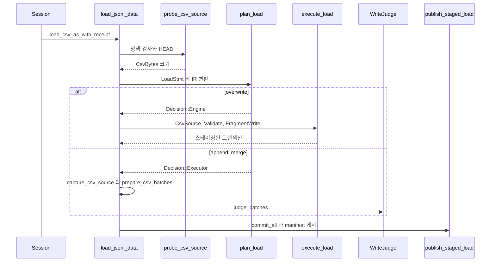

적재 예산과 `load csv` 경로를 본다.

## 입력 크기 제한

적재는 스테이징 전에 여러 독립 예산으로 제한된다. 문서는 "The write envelope is bounded before staging" 이라고 요약한다([ingestion.md L58](https://github.com/ModernRelay/omnigraph/blob/00b8cca842f2bf009bebeefcf765672b5ff64b26/docs/dev/ingestion.md#L58-L58)). 세션 설정의 기본값과 범위는 [settings.rs L101-L146](https://github.com/ModernRelay/omnigraph/blob/00b8cca842f2bf009bebeefcf765672b5ff64b26/crates/omnigraph-compiler/src/settings.rs#L101-L146) 에 있다.

| 예산 | 기본값 | 범위 |
|---|---|---|
| keyed 행 수 | 8,192 행 | 테이블별 (append, merge) |
| `write_max_bytes` | 33554432 (32 MiB) | 요청별 설정 |
| 파싱 추정 바이트 | `write_max_bytes` | 테이블별, 연산 전체 |
| 디코딩된 Blob 페이로드 | `write_max_bytes` | 연산 전체 |
| 보존 keyed 배치 | `write_max_bytes` | 연산 전체 |
| 제거 ID | `write_max_bytes` | 연산 전체 (overwrite) |
| `load_source_max_bytes` | 33554432 (32 MiB) | `load csv` 원본 객체 |
| `query_memory_bytes` | 157286400 | 적재 문장 메모리 풀 |
| `stage_write_concurrency` | 8 (1~64) | 동시에 스테이징하는 테이블 수 |

### 코드 분석: `account_keyed_json_row`

파일: `crates/omnigraph/src/loader/mod.rs`, [mod.rs L2126-L2211](https://github.com/ModernRelay/omnigraph/blob/00b8cca842f2bf009bebeefcf765672b5ff64b26/crates/omnigraph/src/loader/mod.rs#L2126-L2211)

append, merge 에서는 행을 파싱 버퍼에 담기 전에 행 수와 추정 바이트를 센다.

```rust
    if entry.rows > crate::storage_layer::KEYED_WRITE_MAX_ROWS {
        return Err(OmniError::resource_limit(
            format!("keyed entities for {table_key}"),
            crate::storage_layer::KEYED_WRITE_MAX_ROWS as u64,
            entry.rows as u64,
        ));
    }
```

추정은 하한이다. 숫자는 4바이트, 문자열은 길이, 리스트의 문자열 항목은 오프셋 4바이트를 더한다. 주석은 이전에 리스트 원소마다 오프셋을 매겨 Float32 벡터의 추정이 두 배가 되었고, 그래서 `write_max_bytes` 의 절반쯤에서 적재가 거부되던 문제를 고쳤다고 적는다. 정확한 검사는 배치를 만든 뒤 `retain_keyed_batch` 가 Arrow 크기로 한다. `base64:` 로 시작하는 Blob 값은 디코딩된 크기를 Blob 페이로드 예산에 따로 매긴다.

overwrite 가 기존 행 중 새 이미지에 없는 ID 를 모을 때는 `DeletedIdBudget` 이 ID 하나에 UTF-8 길이와 `String` 슬롯 크기를 더해 매긴다([storage_layer.rs L146-L159](https://github.com/ModernRelay/omnigraph/blob/00b8cca842f2bf009bebeefcf765672b5ff64b26/crates/omnigraph/src/storage_layer.rs#L146-L159)). 문서는 "UTF-8 length plus 24 bytes" 라고 적는데, 64비트 환경에서 `size_of::<String>()` 이 24바이트이므로 같은 값이다. 적재는 이 예산을 판정 단계의 `removed` 콜백으로 넘긴다.

> **주의**: overwrite 는 keyed 행 수와 배치 수 제한에서 빠진다. 문서는 "Overwrite keeps its bulk-input behavior and is exempt from keyed aggregate row/batch limits" 라고 적고, 코드에서도 `bounded_keyed_input` 이 `Append | Merge` 에서만 참이다([mod.rs L842-L846](https://github.com/ModernRelay/omnigraph/blob/00b8cca842f2bf009bebeefcf765672b5ff64b26/crates/omnigraph/src/loader/mod.rs#L842-L846)). 대신 엄격 정규화는 Arrow 할당 크기를 미리 계산한다.

## load csv 경로

`load csv` 는 GQ 문장으로, 외부 객체 하나를 `.pg` 선언에 맞춰 타입 있는 Arrow 배치로 읽는다([index.md L148-L158](https://github.com/ModernRelay/omnigraph/blob/00b8cca842f2bf009bebeefcf765672b5ff64b26/docs/user/mutations/index.md#L148-L158)). 모듈 주석은 CSV 리더가 JSON 정규화 단계만 대체하고 승인, 스테이징, 검증, 게시는 로더의 것을 그대로 쓴다고 적는다.



### 원본 probe 와 캡처

`probe_csv_source` 는 그래프의 외부 Blob 정책 검사, `HEAD`, 크기 거부까지만 하고 페이로드는 읽지 않는다([csv.rs L264-L294](https://github.com/ModernRelay/omnigraph/blob/00b8cca842f2bf009bebeefcf765672b5ff64b26/crates/omnigraph/src/loader/csv.rs#L264-L294)). 정책이 없는 그래프는 모든 원본을 거부하고, 기준 경로 밖 URI 나 `load_source_max_bytes` 를 넘는 객체도 바이트를 읽기 전에 거부된다([index.md L197-L205](https://github.com/ModernRelay/omnigraph/blob/00b8cca842f2bf009bebeefcf765672b5ff64b26/docs/user/mutations/index.md#L197-L205)). 모든 읽기는 `CSV_SOURCE_READ_DEADLINE` 120초 안에 끝나야 한다. append, merge 는 `capture_csv_source` 로 객체 전체를 한 번 읽어 probe 가 보고한 버전에 묶는다([csv.rs L155-L199](https://github.com/ModernRelay/omnigraph/blob/00b8cca842f2bf009bebeefcf765672b5ff64b26/crates/omnigraph/src/loader/csv.rs#L155-L199)). Blob 정책과 외부 원본은 8장에서 다룬다.

### 코드 분석: 컬럼 역할 해석

파일: `crates/omnigraph/src/loader/csv.rs`, [csv.rs L1240-L1306](https://github.com/ModernRelay/omnigraph/blob/00b8cca842f2bf009bebeefcf765672b5ff64b26/crates/omnigraph/src/loader/csv.rs#L1240-L1306)

엣지 파일의 첫 두 컬럼은 헤더 이름과 상관없이 끝점이다.

```rust
fn header_role_name(index: usize, header: &str, is_edge: bool) -> String {
    match (is_edge, index) {
        (true, 0) => FROM_COLUMN.to_string(),
        (true, 1) => TO_COLUMN.to_string(),
        _ => header.to_string(),
    }
}
```

LDBC 파일의 `Person.id|Person.id` 같은 헤더를 그대로 받기 위해서다. `resolve_roles` 는 선언되지 않은 속성, 두 번 쓰인 이름, 노드 파일의 끝점 컬럼, 끝점이 빠진 엣지 파일을 각각 이름을 밝혀 거부한다. 리스트, Vector, Blob 속성은 CSV 인코딩이 없어 매핑되면 거부되고, 매핑되지 않으면 nullable 일 때 null 로 저장된다. 숫자는 리더가 타입을 붙여 읽지만 `Bool`, `Date`, `DateTime` 은 텍스트로 읽어 로더의 리터럴 검사를 거친다. Arrow 파서가 밀리초 이하 자릿수나 날짜의 시간 부분을 허용해 버리는 것을 피하기 위해서다.

append, merge 는 `prepare_csv_batches` 가 리더 버퍼와 정규화 크기를 먼저 메모리 풀에서 승인받은 뒤 파싱한다([csv.rs L311-L348](https://github.com/ModernRelay/omnigraph/blob/00b8cca842f2bf009bebeefcf765672b5ff64b26/crates/omnigraph/src/loader/csv.rs#L311-L348)). 결과는 JSONL 경로의 배치와 같은 자리로 들어가고, ID 는 `node_ids`, `edge_ids` 가 JSONL 경로와 같은 `canonical_key_id` 로 만든다([csv.rs L1562-L1610](https://github.com/ModernRelay/omnigraph/blob/00b8cca842f2bf009bebeefcf765672b5ff64b26/crates/omnigraph/src/loader/csv.rs#L1562-L1610)).

### 코드 분석: overwrite 의 계획 실행

파일: `crates/omnigraph/src/loader/mod.rs`, [mod.rs L1376-L1500](https://github.com/ModernRelay/omnigraph/blob/00b8cca842f2bf009bebeefcf765672b5ff64b26/crates/omnigraph/src/loader/mod.rs#L1376-L1500)

overwrite 는 플래너가 만든 물리 계획을 엔진에서 실행하고, 파티션 실행이 원본 거부로 실패하면 한 파티션으로 다시 실행한다.

```rust
            Err(error)
                if !single_partition
                    && source_refused.load(std::sync::atomic::Ordering::Acquire) =>
            {
                tracing::debug!(
                    source = %request.source,
                    %error,
                    "load csv: a partitioned read refused; rerunning as one partition"
                );
                memory.reopen();
                single_partition = true;
            }
```

계획은 세 연산자로 이뤄진다. `CsvSource` 는 원본을 바이트 범위로 나눠 여러 파티션이 읽고([csv_source.rs L1-L4](https://github.com/ModernRelay/omnigraph/blob/00b8cca842f2bf009bebeefcf765672b5ff64b26/crates/omnigraph/src/engine/operators/csv_source.rs#L1-L4)), `Validate` 는 파티션 전체에 대해 검사 사실을 한 번에 추출한다. `FragmentWrite` 는 검증된 delta 를 Lance fragment 로 쓰되 커밋하지 않고, 드라이버가 나중에 슬롯에서 트랜잭션을 꺼내 커밋한다([fragment_sink.rs L1-L7](https://github.com/ModernRelay/omnigraph/blob/00b8cca842f2bf009bebeefcf765672b5ff64b26/crates/omnigraph/src/engine/operators/fragment_sink.rs#L1-L7)). 한 파티션 재실행은 거부 보고의 레코드 번호를 원본 기준으로 맞추기 위한 것이다. 파티션 크기 기준은 `SOURCE_PARTITION_BYTES` 8 MiB 다([cost.rs L511-L513](https://github.com/ModernRelay/omnigraph/blob/00b8cca842f2bf009bebeefcf765672b5ff64b26/crates/omnigraph-planner/src/cost.rs#L511-L513)). 연산자 실행 구조는 6장, 경로 선택은 5장에서 다룬다.
