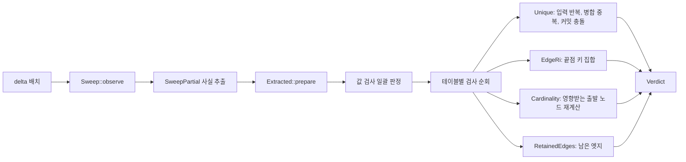

검증 계획과 WriteJudge의 판정, 커밋된 상태 조회를 본다.

## 검증 계획: 검사 목록과 접근 경로

검증은 두 단계로 나뉜다. 컴파일러가 스키마에서 테이블별 검사 목록을 만들고, 플래너가 각 검사가 커밋된 이미지를 읽는 방법(접근 경로)을 정한다. 판정기는 그 결정을 실행한다([validate.rs L1-L16](https://github.com/ModernRelay/omnigraph/blob/00b8cca842f2bf009bebeefcf765672b5ff64b26/crates/omnigraph/src/validate.rs#L1-L16)).

| `ValidateCheck` | 대상 | 커밋된 테이블 조회 | 위반 종류 |
|---|---|---|---|
| `Value` | `@range`, `@check`, enum | 없음 (delta 만) | `ValueConstraintViolation` |
| `Unique` (role `Key`) | `@key` | 없음 (ID 가 키에서 파생) | `UniqueViolation` |
| `Unique` (role `Unique`) | `@unique` 그룹 | 대상 테이블 (overwrite 면 없음) | `UniqueViolation` |
| `EdgeRi` | 엣지 끝점 | 끝점 노드 테이블 | `OrphanEdge` |
| `Cardinality` | 엣지 `@card` | 엣지 테이블 | `CardinalityViolation` |
| `RetainedEdges` | 교체, 삭제된 노드를 가리키는 남은 엣지 | 엣지 테이블 | `OrphanEdge` |
| `SourceCardinality` | 최소 `@card` 엣지의 출발 노드 적재 | 엣지 테이블 | `CardinalityViolation` |

`checks_for` 가 이 목록을 만들고, 목록 순서가 곧 거부 우선순위다([load.rs L177-L290](https://github.com/ModernRelay/omnigraph/blob/00b8cca842f2bf009bebeefcf765672b5ff64b26/crates/omnigraph-compiler/src/ir/load.rs#L177-L290)). 노드 테이블은 값 검사, `@key`, `@unique` 순이고, 그 뒤 이름순 엣지 타입마다 교체나 삭제가 있으면 `RetainedEdges`, 최소 `@card` 가 있으면 `SourceCardinality` 를 붙인다. 엣지 테이블은 값, 고유성, 두 끝점의 `EdgeRi`, `@card` 순이다. `unique_checks` 는 `@key` 그룹의 조회 대상을 `None` 으로 둔다. 키가 같으면 ID 가 같으므로 커밋된 다른 행이 같은 키를 가질 수 없기 때문이다. `@unique` 그룹은 overwrite 가 아닐 때만 대상 테이블을 조회한다([load.rs L295-L320](https://github.com/ModernRelay/omnigraph/blob/00b8cca842f2bf009bebeefcf765672b5ff64b26/crates/omnigraph-compiler/src/ir/load.rs#L295-L320)). 스키마 제약 문법은 3장에서 다룬다.

### 테이블 순서와 `plan_write`

`judgment_rank` 는 노드 테이블을 엣지 테이블보다 앞에 두고 같은 종류 안에서는 이름순으로 정렬한다([plan.rs L32-L37](https://github.com/ModernRelay/omnigraph/blob/00b8cca842f2bf009bebeefcf765672b5ff64b26/crates/omnigraph/src/validate/plan.rs#L32-L37)). 노드 자신의 위반이 그 노드를 가리키는 엣지의 위반보다 먼저 보고된다. 로더는 이 순서로 정렬한 테이블을 `plan_write` 에 넘겨 테이블마다 `Operation::Write` 를 계획한다([mod.rs L1257-L1285](https://github.com/ModernRelay/omnigraph/blob/00b8cca842f2bf009bebeefcf765672b5ff64b26/crates/omnigraph/src/loader/mod.rs#L1257-L1285)). `plan_write` 는 조회 대상 테이블의 행 수와 인덱스 사실만 읽고 행은 읽지 않으며, `judged_table` 이 결과 계획에서 `Validate` 노드를 꺼낸다. 계획이 실행기로 가지 않았거나 `Validate` 루트가 없으면 내부 오류다([plan.rs L123-L176](https://github.com/ModernRelay/omnigraph/blob/00b8cca842f2bf009bebeefcf765672b5ff64b26/crates/omnigraph/src/validate/plan.rs#L123-L176)).

### 접근 경로

플래너는 검사마다 `ValidateAccess` 를 `Delta`, `Probe`, `Scan` 중 하나로 정한다([cost.rs L515-L524](https://github.com/ModernRelay/omnigraph/blob/00b8cca842f2bf009bebeefcf765672b5ff64b26/crates/omnigraph-planner/src/cost.rs#L515-L524)). `Probe` 는 delta 키를 담은 필터 스캔으로 BTREE 인덱스가 응답하고, `Scan` 은 커밋된 테이블을 한 번 투영 스캔해 메모리에서 대조한다. 결정은 `validate_access` 가 인덱스 커버리지와 행 수 추정으로 한다([optimizer.rs L3845-L3852](https://github.com/ModernRelay/omnigraph/blob/00b8cca842f2bf009bebeefcf765672b5ff64b26/crates/omnigraph-planner/src/optimizer.rs#L3845-L3852)). overwrite 의 제거 ID 수집 여부는 `ValidateRemoval`, 엣지 끝점 검사를 파싱 중에 할지 끝난 뒤에 할지는 `EndpointProbe`가 정한다. 비용 모델은 5장에서 다룬다.

불변식 7번은 인덱스 커버리지가 비용만 바꾸고 정확성은 바꾸지 않아야 한다고 적는다([invariants.md L83-L87](https://github.com/ModernRelay/omnigraph/blob/00b8cca842f2bf009bebeefcf765672b5ff64b26/docs/dev/invariants.md#L83-L87)). 노드 제거 시 엣지를 읽는 `RemovalEdgeReads` 의 주석도 "Coverage decides cost only" 라고 적고, 인덱스가 덮지 않는 fragment 는 한 번 전체를 읽어 메모리에서 대조한다.

## WriteJudge 의 판정

`WriteJudge` 는 한 쓰기의 모든 테이블 계획 노드, 커밋된 이미지, 보고 방식을 묶은 판정기다. 적재, 변경 연산, Blob 셀 쓰기, 브랜치 병합이 모두 이것을 쓴다([load.rs L1-L9](https://github.com/ModernRelay/omnigraph/blob/00b8cca842f2bf009bebeefcf765672b5ff64b26/crates/omnigraph/src/validate/load.rs#L1-L9)).



### 적재의 `WriteJudge` 구성

적재는 기준 snapshot, 첫 위반 보고, 입력 전체 반복 규칙으로 판정기를 만든다([mod.rs L1298-L1306](https://github.com/ModernRelay/omnigraph/blob/00b8cca842f2bf009bebeefcf765672b5ff64b26/crates/omnigraph/src/loader/mod.rs#L1298-L1306)).

| 필드 | 적재의 값 | 의미 |
|---|---|---|
| `committed` | `JudgedSide::Base(snapshot)` | 트랜잭션이 고정한 기준 snapshot. 변경 연산은 `Live` 로 `@card` 를 현재 브랜치에서 셈 |
| `report` | `Report::First` | 첫 위반에서 거부. 병합은 `Every` 로 모두 나열 |
| `repeat` | `RepeatRule::AcrossInput` | 입력 어디서든 키가 반복되면 위반 |

`JudgedSide` 와 `Report` 정의는 `validate/load.rs` 앞부분에 있다.

### 코드 분석: `RepeatRule`

파일: `crates/omnigraph/src/validate/load.rs`, [load.rs L73-L91](https://github.com/ModernRelay/omnigraph/blob/00b8cca842f2bf009bebeefcf765672b5ff64b26/crates/omnigraph/src/validate/load.rs#L73-L91)

적재와 변경 연산은 고유 키 반복을 다르게 판단한다.

```rust
impl RepeatRule {
    pub(crate) fn for_write(kind: WriteKind) -> Self {
        match kind {
            WriteKind::Load => Self::AcrossInput,
            WriteKind::Mutation | WriteKind::BlobCell | WriteKind::BranchMerge => Self::ByFinalKey,
        }
    }
}
```

적재 입력은 행 순서에 의미가 없으므로 같은 키가 어디서든 두 번 나오면 위반이다. 변경 연산은 배치가 문장 순서대로 오므로 뒤 문장이 행의 키를 바꿔 값을 비울 수 있고, 그래서 배치 안 반복과 최종 키만 본다. 구현은 `UniquePartial` 의 `Repeats::Shared` 와 `Repeats::WithinBatch` 다.

### 한 번의 sweep

`Sweep` 은 각 테이블 배치를 원본 순서로 한 번 지나가며 모든 검사의 사실을 추출하고 배치를 해제한다([load.rs L248-L281](https://github.com/ModernRelay/omnigraph/blob/00b8cca842f2bf009bebeefcf765672b5ff64b26/crates/omnigraph/src/validate/load.rs#L248-L281)). 남는 것은 사실과 판정 후반에 다시 읽을 몇 컬럼(`id`, 끝점)뿐이고, 값 검사만 읽는 컬럼은 그 배치 안에서 판정이 끝난다. 브랜치 병합은 delta 를 저장소에서 스트리밍하므로 `Sweep::streamed` 로 남는 컬럼을 별도 버퍼에 복사한다. Lance 스캔이 배치 사이에 디코딩 버퍼를 공유할 수 있어 zero-copy 슬라이스가 버퍼 전체를 메모리에 유지하기 때문이다. 적재는 배치를 메모리에 보유하므로 `judge_batches` 가 `Sweep::new` 를 쓴다([load.rs L225-L245](https://github.com/ModernRelay/omnigraph/blob/00b8cca842f2bf009bebeefcf765672b5ff64b26/crates/omnigraph/src/validate/load.rs#L225-L245)).

### 코드 분석: 판정 순서

파일: `crates/omnigraph/src/validate/load.rs`, [load.rs L587-L904](https://github.com/ModernRelay/omnigraph/blob/00b8cca842f2bf009bebeefcf765672b5ff64b26/crates/omnigraph/src/validate/load.rs#L587-L904)

모든 테이블의 값 검사를 먼저 판정하고, 그 뒤에 테이블별 나머지 검사를 계획 순서대로 판정한다.

```rust
    for (index, table) in judge.tables.iter().enumerate() {
        if table
            .checks
            .iter()
            .any(|spec| matches!(spec.check, ValidateCheck::Value { .. }))
        {
            verdict.refuse_each(std::mem::take(&mut deltas[index].extracted.value))?;
        }
    }
```

값 위반은 고유성이나 참조 위반보다 항상 먼저 보고된다. 그 전에 교체되는 테이블은 `overwrite_removed_ids` 로 사라지는 ID 를 모으고, 계획이 제거 스캔을 생략했다면(`ValidateRemoval::None`) `removal_omitted_soundly` 로 생략이 타당한지 확인한다.

`Unique` 검사는 세 단계다([load.rs L679-L710](https://github.com/ModernRelay/omnigraph/blob/00b8cca842f2bf009bebeefcf765672b5ff64b26/crates/omnigraph/src/validate/load.rs#L679-L710)).

1. 입력 안의 반복. `RepeatRule` 을 따른다.
2. 같은 ID 끼리 마지막 값으로 합친 최종 이미지에서 서로 다른 ID 가 같은 키를 가진 경우([kernels.rs L411-L431](https://github.com/ModernRelay/omnigraph/blob/00b8cca842f2bf009bebeefcf765672b5ff64b26/crates/omnigraph/src/validate/kernels.rs#L411-L431)).
3. delta 에 들어 있지도, 삭제되지도 않는 커밋된 행이 같은 키를 가진 경우([kernels.rs L476-L504](https://github.com/ModernRelay/omnigraph/blob/00b8cca842f2bf009bebeefcf765672b5ff64b26/crates/omnigraph/src/validate/kernels.rs#L476-L504)). `@unique` 그룹이고 overwrite 가 아닐 때만 실행된다.

메시지 형식은 `"@unique violation on {Type}.{cols}: value ..."` 로 고정되어 있고 테스트가 이 접두어를 확인한다.

### 코드 분석: `@card` 재계산

파일: `crates/omnigraph/src/validate/kernels.rs`, [kernels.rs L567-L585](https://github.com/ModernRelay/omnigraph/blob/00b8cca842f2bf009bebeefcf765672b5ff64b26/crates/omnigraph/src/validate/kernels.rs#L567-L585)

`@card` 는 영향받는 출발 노드만 다시 센다.

```rust
    let mut affected: HashSet<String> = plan.delta_by_id.values().cloned().collect();
    for (_, src) in removed_edges.iter().chain(moved_from.iter()) {
        affected.insert(src.clone());
    }
    affected.extend(written.iter().cloned());
    affected.retain(|src| !deleted_src_nodes.contains(src));
    affected
}
```

영향받는 출발 노드는 delta 엣지의 새 출발 노드, 삭제되거나 바뀐 엣지의 옛 출발 노드, 최소값이 0보다 클 때 이 쓰기가 쓴 출발 노드다. 엣지를 다른 출발 노드로 옮기면 비워진 쪽도 다시 세야 최소값 위반을 놓치지 않는다. 셈은 커밋된 수에 delta 수를 더하고, 출발 노드 이름순으로 `max` 를 `min` 보다 먼저 확인한다([kernels.rs L587-L640](https://github.com/ModernRelay/omnigraph/blob/00b8cca842f2bf009bebeefcf765672b5ff64b26/crates/omnigraph/src/validate/kernels.rs#L587-L640)). 기본값(무제한) `@card` 는 조회 없이 건너뛴다. 엣지 테이블을 overwrite 하면서 최소값이 있으면 교체 전 이미지의 출발 노드를 한 번 스트리밍하는 `evaluate_replaced_cardinality` 로 넘어간다.

### 코드 분석: `Verdict`

파일: `crates/omnigraph/src/validate/load.rs`, [load.rs L1407-L1463](https://github.com/ModernRelay/omnigraph/blob/00b8cca842f2bf009bebeefcf765672b5ff64b26/crates/omnigraph/src/validate/load.rs#L1407-L1463)

보고 방식에 따라 첫 위반에서 멈추거나 모두 모은다.

```rust
    fn refuse(&mut self, violation: Option<Violation>) -> Result<()> {
        match (self.report, violation) {
            (_, None) => Ok(()),
            (Report::First, Some(violation)) => Err(violation.into_omni_error()),
            (Report::Every, Some(violation)) => {
                self.every.push(violation);
                Ok(())
            }
        }
    }
```

`Report::First` 에서 커널은 위반 하나를 `pending` 에 담고, 검사 하나가 끝날 때 `settle` 이 그것을 오류로 바꾼다. 그래서 한 검사 안의 위반 순서(ID 순, 출발 노드 순)가 보고되는 위반을 정한다. 불변식 8번 "Integrity failures are loud" 가 이 경로에서 지켜진다([invariants.md L88-L92](https://github.com/ModernRelay/omnigraph/blob/00b8cca842f2bf009bebeefcf765672b5ff64b26/docs/dev/invariants.md#L88-L92)).

## 커밋된 상태 조회와 정수 키 집합

판정기가 커밋된 그래프를 읽는 인터페이스는 `CommittedState` 다. 테이블마다 한 번만 열고 접근 경로에 따라 필터 스캔 또는 전체 투영 스캔을 한다.

### 코드 분석: `CommittedState`

파일: `crates/omnigraph/src/validate.rs`, [validate.rs L317-L326](https://github.com/ModernRelay/omnigraph/blob/00b8cca842f2bf009bebeefcf765672b5ff64b26/crates/omnigraph/src/validate.rs#L317-L326)

overwrite 된 테이블은 커밋된 이미지가 비어 있는 것으로 본다.

```rust
    async fn open(&self, table_key: &str) -> Result<Option<Dataset>> {
        if self.overwritten.contains(table_key) {
            return Ok(None);
        }
        let Some(committed) = self.committed else {
            return Ok(None);
        };
        if committed.dataset(table_key).is_none() {
            return Ok(None);
        }
```

`overwritten` 은 전역 플래그가 아니라 테이블 집합이다. overwrite 는 테이블 단위라서, 엣지만 overwrite 하는 적재도 끝점 검사에서는 커밋된 노드를 본다. `existing_ids` 는 `Probe` 에서 `id IN (...)` 필터 스캔을, `Scan` 에서 `id` 컬럼 전체를 한 번 읽어 메모리에서 대조한다([validate.rs L387-L432](https://github.com/ModernRelay/omnigraph/blob/00b8cca842f2bf009bebeefcf765672b5ff64b26/crates/omnigraph/src/validate.rs#L387-L432)). 고유성 조회 키는 청크당 `PROBE_CHUNK_KEYS` 8,192개로 나눈다.

> **주의**: `open_cardinality` 는 변경 연산 경로에서만 최신 브랜치 snapshot 을 다시 열어 `@card` 를 센다. 호출자가 그래프 head 전제 조건을 걸었는데 현재 head 가 다르면 효과 이전에 전제 조건 실패로 처리한다. 적재는 `JudgedSide::Base` 라 이 경로를 쓰지 않는다.

overwrite 의 제거 ID 는 `overwrite_removed_ids` 가 기준 snapshot 의 `id` 컬럼을 스트리밍하며 새 이미지에 없는 것을 모은다([validate.rs L824-L862](https://github.com/ModernRelay/omnigraph/blob/00b8cca842f2bf009bebeefcf765672b5ff64b26/crates/omnigraph/src/validate.rs#L824-L862)). ID 마다 제거 ID 예산을 먼저 거치고, 결과는 `RetainedEdges` 검사와 `@card` 재계산이 읽는다. 플래너가 이 스캔을 생략할 수 있는 경우는 엣지 대상, 어떤 엣지 타입도 참조하지 않는 노드 대상, 빈 테이블이다. `removal_omitted_soundly` 는 생략된 계획이 `RetainedEdges` 를 담고 있거나 참조되는 노드 테이블에 행이 있으면 내부 오류로 거부한다([load.rs L1737-L1769](https://github.com/ModernRelay/omnigraph/blob/00b8cca842f2bf009bebeefcf765672b5ff64b26/crates/omnigraph/src/validate/load.rs#L1737-L1769)).

### 코드 분석: 정수 키 집합 `IntKeySet`

파일: `crates/omnigraph/src/validate/key_set.rs`, [key_set.rs L45-L111](https://github.com/ModernRelay/omnigraph/blob/00b8cca842f2bf009bebeefcf765672b5ff64b26/crates/omnigraph/src/validate/key_set.rs#L45-L111)

정수 `@key` 노드를 가리키는 엣지 끝점 검사에는 전용 해시 집합을 쓴다.

```rust
        if tag(hash) & !(entry as u16) != 0 {
            return false;
        }
        let start = (self.directory[slot] >> TAG_BITS) as usize;
        let end = (entry >> TAG_BITS) as usize;
        let bucket = &self.keys[start..end];
        if bucket.len() > MAX_LINEAR_BUCKET {
            bucket.binary_search(&key).is_ok()
        } else {
            bucket.contains(&key)
        }
```

모듈 주석은 근거로 Birler, Schmidt, Fent, Neumann 의 DaMoN 2024 논문 "Simple, Efficient, and Robust Hash Tables for Join Processing" 을 밝힌다(논문 원문은 미검증). 디렉터리 항목은 상위 비트에 버킷 끝 오프셋, 하위 16비트에 4비트짜리 Bloom 태그를 담는다. 없는 키를 조회하면 대부분 태그만 보고 키 배열을 읽지 않은 채 `false` 를 돌려준다. 버킷이 32개를 넘으면 정렬해 이진 탐색하고, 그 이하면 선형 탐색한다. 해시는 splitmix64 의 마지막 단계를 쓴다.

정수 키 판정은 정규 표기에 엄격하다. `canonical_i64` 는 `i64::to_string` 이 만드는 표기만 정수로 인정해 `007`, `-0`, `+1` 은 `None` 이 된다([key_set.rs L136-L162](https://github.com/ModernRelay/omnigraph/blob/00b8cca842f2bf009bebeefcf765672b5ff64b26/crates/omnigraph/src/validate/key_set.rs#L136-L162)). 따라서 끝점 문자열 `"007"` 은 노드 `7` 로 해석되지 않고 고아 엣지로 거부된다. 집합의 메모리는 `IntKeySetLayout` 이 미리 계산해 승인받는다.

### 적재 단위 읽기 재사용

같은 적재 안에서 여러 검사가 같은 테이블의 메타데이터와 인덱스를 다시 읽지 않도록 `LoadReadReuse` 가 문장 단위 Lance 세션과 범위 읽기 메모를 만든다. 할당은 `query_memory_bytes` 에서 승인받은 만큼이고 1 MiB 미만이면 만들지 않는다([read_reuse.rs L47-L80](https://github.com/ModernRelay/omnigraph/blob/00b8cca842f2bf009bebeefcf765672b5ff64b26/crates/omnigraph/src/loader/read_reuse.rs#L47-L80)). 판정기는 `RetainedEdges` 검사나 정수 끝점 검사에 들어가기 전에 이 캐시를 해제해 메모리를 돌려준다. 읽기 메모와 핸들 캐시는 8장에서 다룬다.
