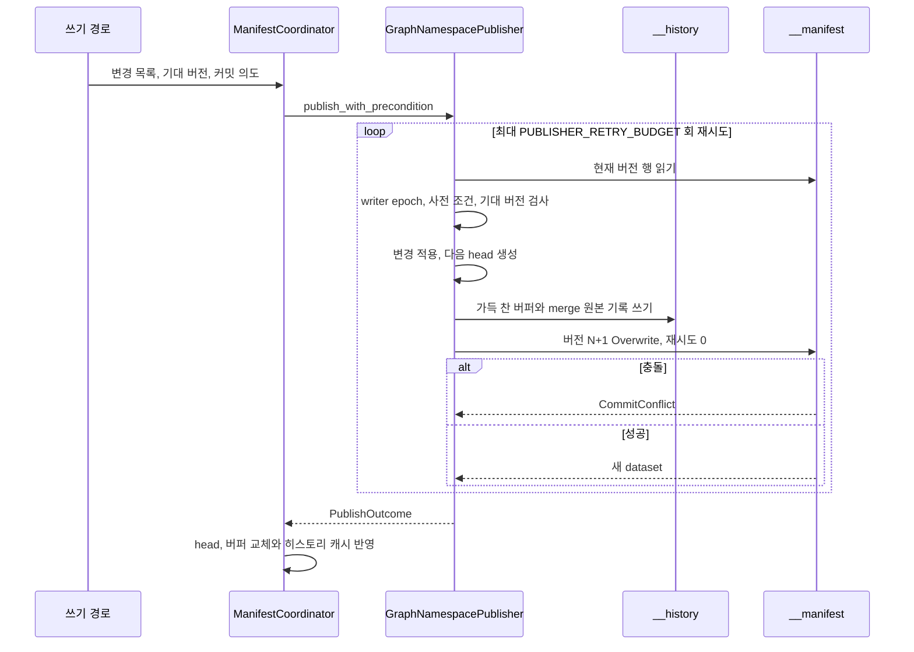

매니페스트 버전 번호를 CAS로 쓰는 게시 절차를 본다.

## 게시와 버전 CAS

게시는 `ManifestCoordinator::commit_changes_with_lineage_and_precondition` 에서 시작해 `GraphNamespacePublisher::publish_attempts` 루프로 들어간다 ([lib.rs L2339-L2377](https://github.com/ModernRelay/omnigraph/blob/00b8cca842f2bf009bebeefcf765672b5ff64b26/crates/omnigraph-catalog/src/lib.rs#L2339-L2377)). 변경도 기대값도 커밋 의도도 없으면 저장소에 아무것도 쓰지 않고 현재 버전을 돌려준다. 쓰기 큐와 스테이징이 이 호출에 무엇을 넘기는지는 9장에서 다룬다.



### 코드 분석: 게시 루프의 시작

시도마다 현재 상태를 새로 읽는 부분을 본다. [publisher.rs L1724-L1736](https://github.com/ModernRelay/omnigraph/blob/00b8cca842f2bf009bebeefcf765672b5ff64b26/crates/omnigraph-catalog/src/publisher.rs#L1724-L1736)

```rust
        for attempt in 0..=PUBLISHER_RETRY_BUDGET {
            // Route a retryable `load_publish_state` error through the SAME retry
            // path as a retryable `merge_rows` conflict below, so typed contention
            // composes with the publisher retry instead of aborting the publish.
            let loaded = match self.load_publish_state().await {
                Ok(loaded) => loaded,
                Err(err)
                    if attempt < PUBLISHER_RETRY_BUDGET && is_retryable_publish_conflict(&err) =>
                {
                    continue;
                }
                Err(err) => return Err(err),
            };
```

`PUBLISHER_RETRY_BUDGET` 은 5 다 ([publisher.rs L65-L68](https://github.com/ModernRelay/omnigraph/blob/00b8cca842f2bf009bebeefcf765672b5ff64b26/crates/omnigraph-catalog/src/publisher.rs#L65-L68)). Lance commit 자체의 재시도는 0 이고 바깥 루프가 재시도를 맡는다. 주석은 Lance 의 rebase 는 투명한 병합이 되어 낙관적 동시성 제어에 맞지 않는다고 설명한다. `load_publish_state` 는 스탬프를 검사한 뒤 직전 게시가 남긴 행 캐시가 같은 이미지면 그것을, 아니면 스캔 결과를 쓴다.

### 시도마다 거치는 검사

읽은 뒤에는 세 가지를 차례로 검사한다 ([publisher.rs L1752-L1767](https://github.com/ModernRelay/omnigraph/blob/00b8cca842f2bf009bebeefcf765672b5ff64b26/crates/omnigraph-catalog/src/publisher.rs#L1752-L1767)).

1. writer epoch: 이 프로세스가 붙잡은 epoch 가 행의 epoch 보다 낮으면 `manifest_writer_fenced` 로 거부한다. epoch 는 프로세스가 claim 을 게시한 브랜치에서만 보유하며, 거부되면 비워진다.
2. 사전 조건: `PublishPrecondition` 에 따라 브랜치 식별자, 정확한 head, 버전 번호를 비교한다.
3. 기대 테이블 버전: 호출자가 읽고 쓴 테이블의 버전이 그대로인지 확인한다. 어긋나면 재시도하지 않고 `PublishedDatasetVersionMismatch` 로 끝낸다.

사전 조건 종류는 다섯 가지다 ([publisher.rs L182-L206](https://github.com/ModernRelay/omnigraph/blob/00b8cca842f2bf009bebeefcf765672b5ff64b26/crates/omnigraph-catalog/src/publisher.rs#L182-L206)).

| 값 | 비교 대상 | 쓰는 곳 |
|---|---|---|
| `Any` | 없음. 충돌 후 재시도 때 부모를 새로 고른다 | 일반 디스패처 경로 |
| `ExactGraphHead` | 브랜치 식별자, 정확한 head 커밋 ID | 준비된 쓰기 |
| `ExactGraphVersion` | 위 두 가지에 더해 `__manifest` 버전 번호 | 스키마 게시와 그 정리 fence |
| `ExactCandidate` | `ExactGraphHead` 와 같고, 할당될 커밋 ID 가 후보 ID 와 같아야 함 | 미게시 커밋 게시 |
| `ExactBranchIdentity` | 브랜치 식별자만 | writer epoch claim |

비교 구현은 [publisher.rs L1128-L1226](https://github.com/ModernRelay/omnigraph/blob/00b8cca842f2bf009bebeefcf765672b5ff64b26/crates/omnigraph-catalog/src/publisher.rs#L1128-L1226) 이다. 어긋나면 모두 `manifest_read_set_changed` 오류가 되고 오류에 `graph_head:<branch>` 나 `branch_identifier:<branch>` 같은 read set 이름이 붙는다. 주석은 브랜치 식별자 검사가 지웠다 다시 만든 브랜치를 막을 뿐 분산 ref 제어 fence 는 아니며, Lance 브랜치 생성과 삭제에는 아직 조건부 CAS 가 없다고 밝힌다.

### 변경 적용

`ManifestChange` 는 다섯 종류다. `apply_changes` 는 두 번 돈다. 첫 바퀴에서 `RegisterTable` 과 `RenameTable` 을 적용하고, 둘째 바퀴에서 `Update` 와 `Tombstone` 을 적용한다. 같은 배치 안의 갱신이 그 배치가 남긴 이름 바인딩으로 해석되게 하려는 순서다 ([publisher.rs L688-L864](https://github.com/ModernRelay/omnigraph/blob/00b8cca842f2bf009bebeefcf765672b5ff64b26/crates/omnigraph-catalog/src/publisher.rs#L688-L864)).

| 변경 | 결과 상태 | 거부 조건 |
|---|---|---|
| `RegisterTable` | `Registered` | 경로가 identity 에서 만든 표준 경로와 다름, 같은 identity 가 다른 이름으로 이미 등록됨 |
| `RenameTable` | 이름만 교체, 버전 유지 | 살아 있는 identity 가 아님, 기대 이름이나 경로가 다름 |
| `Update` | `Pinned`, `manifest_version` 은 새 버전 | drop 된 identity |
| `Tombstone` | `Dropped { dropped_at, sealed_version }` | 이미 drop 됨 |
| `SchemaContract` | 계약 행 교체 | 한 게시에서 두 번 교체 |

한 게시에서 같은 identity 를 두 번 갱신하거나 drop 하는 것도 `claim` 이 막는다. 바뀐 행이 하나라도 있으면 커밋 의도가 반드시 있어야 한다. 운영 빌드에서 커밋 의도 없이 `table` 행이나 계약을 바꾸려 하면 내부 오류로 거부한다 ([publisher.rs L1826-L1834](https://github.com/ModernRelay/omnigraph/blob/00b8cca842f2bf009bebeefcf765672b5ff64b26/crates/omnigraph-catalog/src/publisher.rs#L1826-L1834)). "모든 버전의 `table` 행은 그 버전 head 커밋 시점의 상태다" 라는 불변식을 지키기 위해서다. 커밋 없이 쓸 수 있는 행은 writer epoch 같은 control fact 뿐이다.

### 코드 분석: 버전 번호 CAS

새 행 집합은 `commit::overwrite` 로 기록한다. 핵심은 Lance `Overwrite` 를 읽은 버전 기준으로 만들고 재시도 0 으로 commit 하는 부분이다. [commit.rs L178-L202](https://github.com/ModernRelay/omnigraph/blob/00b8cca842f2bf009bebeefcf765672b5ff64b26/crates/omnigraph-catalog/src/commit.rs#L178-L202)

```rust
    let operation = Operation::Overwrite {
        fragments,
        schema,
        config_upsert_values: None,
        initial_bases: None,
    };
    let mut transaction = TransactionBuilder::new(dataset.version().version, operation).build();
    let handler = crate::lance_clone::probed_commit_handler(&dataset, probe)
        .await
        .map_err(OmniError::storage)?;
    let builder = match placement {
        Placement::Linear => crate::lance_commit::commit_builder(dataset).with_max_retries(0),
        Placement::Detached { properties } => {
            transaction.transaction_properties = Some(Arc::new(properties));
            crate::lance_commit::commit_builder(dataset)
                .with_detached(true)
                .with_max_retries(DETACHED_VERSION_RETRIES)
        }
    };
    let committed = builder
        .with_commit_handler(handler)
        .with_skip_auto_cleanup(true)
        .execute(transaction)
        .await
        .map_err(map_lance_publish_error)?;
```

Lance 는 `_versions/{read_version + 1}.manifest` 가 없을 때만 그 파일을 쓴다. 그래서 버전 번호 자체가 put-if-absent CAS 가 된다 ([commit.rs L1-L8](https://github.com/ModernRelay/omnigraph/blob/00b8cca842f2bf009bebeefcf765672b5ff64b26/crates/omnigraph-catalog/src/commit.rs#L1-L8)). 모듈 문서는 `Update` 를 쓰면 호환되는 다른 commit 위로 rebase 되어 CAS 를 지나쳐 버린다고 설명하고, 재시도 0 인 `Overwrite` 가 Lance 의 strict overwrite 라서 rebase 되지 않는다고 적는다. auto-cleanup 을 끄는 이유도 같은 문서에 있다. `__manifest` 버전이 스냅샷과 시간 여행의 기준이기 때문이다.

Lance 가 돌려주는 `CommitConflict`, `RetryableCommitConflict`, `TooMuchWriteContention` 은 `RowLevelCasContention` 하나로 바뀌어 게시 루프가 다시 준비하게 한다 ([publisher.rs L1295-L1307](https://github.com/ModernRelay/omnigraph/blob/00b8cca842f2bf009bebeefcf765672b5ff64b26/crates/omnigraph-catalog/src/publisher.rs#L1295-L1307)). 이 밖의 오류는 저장소 오류로 남는다.

### 응답 유실과 재조회

commit 이 저장됐는데 응답을 받지 못하는 경우가 있다. 게시 루프는 이때 "실패" 로 단정하지 않고 시도한 버전 번호를 checkout 해서 되읽는다 ([publisher.rs L1951-L2050](https://github.com/ModernRelay/omnigraph/blob/00b8cca842f2bf009bebeefcf765672b5ff64b26/crates/omnigraph-catalog/src/publisher.rs#L1951-L2050)). 되읽은 head 행이 이번 시도의 head 와 같으면 성공 결과를 그대로 돌려준다. 다른 커밋이 그 버전을 차지했으면 이번 요청은 실패가 확정이다. 되읽기 자체가 실패하면 `manifest_publish_in_doubt` 를 돌려준다. 이 오류는 "커밋이 저장됐을 수 있으니 그래프를 다시 열어 그 커밋 ID 를 찾아본 뒤 재시도하라" 는 안내를 담는다. 커밋 의도가 없는 게시는 행으로 시도를 구별할 수 없으므로 `CompletionEvidence::Uncertain` 을 붙여 바로 돌려준다. 장애 복구 전반은 13장에서 다룬다.
