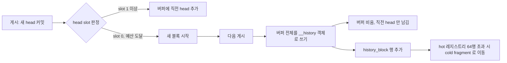

커밋 ID 형식, 히스토리 블록, merge base 탐색을 본다.

## 커밋 ID 와 히스토리 블록

커밋이 쌓이면 `__manifest` 의 hot fragment 가 끝없이 커질 수 있다. 카탈로그는 head 의 최근 조상 일부만 `__manifest` 에 버퍼로 두고, 버퍼가 일정 크기에 이르면 한 블록으로 묶어 `__history` 의 불변 객체로 내보낸다. 커밋 ID 형식이 이 블록 주소를 담는다.

### 코드 분석: `hb1` 커밋 ID

블록 주소가 들어간 커밋 ID 를 정의하는 부분을 본다. [graph_commit_id.rs L9-L33](https://github.com/ModernRelay/omnigraph/blob/00b8cca842f2bf009bebeefcf765672b5ff64b26/crates/omnigraph-core/src/graph_commit_id.rs#L9-L33)

```rust
/// The slot ceiling of one history block. A block closes on a byte budget
/// long before it, so the ceiling only bounds a buffer of tiny commits.
pub const HISTORY_BLOCK_SLOTS: u16 = 16 * 1024;

#[derive(Debug, Clone, Copy, PartialEq, Eq)]
pub struct HistoryBlockId {
    pub block: Ulid,
    pub slot: u16,
    pub nonce: Ulid,
}

impl HistoryBlockId {
    pub fn new(block: Ulid, slot: u16, nonce: Ulid) -> Result<Self> {
        if slot >= HISTORY_BLOCK_SLOTS {
            return Err(invalid_id());
        }
        Ok(Self { block, slot, nonce })
    }
}

impl fmt::Display for HistoryBlockId {
    fn fmt(&self, f: &mut fmt::Formatter<'_>) -> fmt::Result {
        write!(f, "hb1.{}.{}.{}", self.block, self.slot, self.nonce)
    }
}
```

커밋 ID 는 `hb1.<block>.<slot>.<nonce>` 다. nonce 는 호출자가 커밋 의도마다 한 번 만든 ULID 이고, block 과 slot 은 CAS 시도마다 게시기가 정한다. 그래서 같은 의도가 재시도로 다른 slot 을 받을 수 있다. 사용자가 nonce 만 들고 커밋을 찾아도 맞게 응답하도록 `commit_id_answers` 가 nonce 일치도 같은 커밋으로 인정한다.

### 코드 분석: slot 결정

slot 을 고르는 함수다. [publisher.rs L962-L976](https://github.com/ModernRelay/omnigraph/blob/00b8cca842f2bf009bebeefcf765672b5ff64b26/crates/omnigraph-catalog/src/publisher.rs#L962-L976)

```rust
        let slot = if buffer.is_full_under(parent, tables.values(), intent.history_release_bytes)? {
            1
        } else if buffer.closes_with_under(parent, tables.values(), intent.history_release_bytes) {
            0
        } else {
            buffer.commits().len() + 1
        };
        let slot = u16::try_from(slot)
            .ok()
            .filter(|slot| *slot < HISTORY_BLOCK_SLOTS)
            .ok_or_else(|| OmniError::manifest_internal("history block slot overflow"))?;
        let block = parse_history_block_id(&parent.graph_commit_id)?
            .filter(|id| parent.native_branch.as_deref() == native_branch && id.slot + 1 == slot)
            .map_or(nonce, |id| id.block);
        Ok(HistoryBlockId::new(block, slot, nonce)?.to_string())
```

slot 0 이 "이 커밋에서 버퍼가 예산에 도달했다" 는 결정을 기록한다. 부모가 같은 native 브랜치에서 바로 앞 slot 을 가졌으면 부모 블록을 잇고, 아니면 nonce 를 새 블록 id 로 쓴다. slot 0 은 부모 slot + 1 이 될 수 없으므로 언제나 새 블록을 연다. 그 다음 게시는 head 의 slot 이 0 인 것을 보고 버퍼가 가득 찼다고 판단한다 ([state.rs L392-L408](https://github.com/ModernRelay/omnigraph/blob/00b8cca842f2bf009bebeefcf765672b5ff64b26/crates/omnigraph-catalog/src/state.rs#L392-L408)). 결정이 ID 에 기록되므로 바이트 예산이 다른 세션끼리도 같은 판단을 내린다. 이 판단이 결정적이지 않으면 서로 다른 프로세스가 같은 버퍼를 다른 시점에 내보내게 된다.

| 상수 | 값 | 의미 |
|---|---|---|
| `HISTORY_RELEASE_BYTES` | 256 KiB ([lib.rs L163-L169](https://github.com/ModernRelay/omnigraph/blob/00b8cca842f2bf009bebeefcf765672b5ff64b26/crates/omnigraph-catalog/src/lib.rs#L163-L169)) | 버퍼 바이트 예산. 세션 설정 `history_release_bytes` 로 낮출 수 있다 |
| `TAIL_MAX_COMMITS` | 16,384 ([lib.rs L159-L162](https://github.com/ModernRelay/omnigraph/blob/00b8cca842f2bf009bebeefcf765672b5ff64b26/crates/omnigraph-catalog/src/lib.rs#L159-L162)) | 아주 작은 커밋만 쌓일 때를 위한 커밋 수 상한 |
| `HISTORY_BLOCK_SLOTS` | 16,384 | 블록 하나의 slot 상한 |
| `MAX_OBJECT_BYTES` | 64 MiB ([history.rs L94](https://github.com/ModernRelay/omnigraph/blob/00b8cca842f2bf009bebeefcf765672b5ff64b26/crates/omnigraph-catalog/src/history.rs#L94)) | `__history` 객체 하나의 크기 상한 |
| `MAX_RECORD_BYTES` | 객체 상한의 1/4 ([history.rs L88-L90](https://github.com/ModernRelay/omnigraph/blob/00b8cca842f2bf009bebeefcf765672b5ff64b26/crates/omnigraph-catalog/src/history.rs#L88-L90)) | 기록 하나가 넘으면 head 게시 자체를 거부 |

버퍼 크기는 `buffered_bytes` 가 문자열 길이에 행마다 고정 여유분을 더해 잰다. `__manifest` 한 버전만으로 계산되는 순수 함수다.

### 버퍼 갱신

게시 후의 버퍼는 `after_publish` 가 만든다 ([state.rs L535-L574](https://github.com/ModernRelay/omnigraph/blob/00b8cca842f2bf009bebeefcf765672b5ff64b26/crates/omnigraph-catalog/src/state.rs#L535-L574)). 버퍼가 가득 찼으면 비우고 직전 head 만 넣는다. 이때 빠져나가는 커밋이 이번 시도의 `__history` 쓰기에 모두 들어갔는지 확인하고, 하나라도 빠졌으면 내부 오류로 멈춘다. 가득 차지 않았으면 기존 버퍼 끝에 직전 head 를 붙인다. `replaced_table` 행은 버퍼의 가장 오래된 커밋보다 뒤에 바뀐 것만 남긴다.

`replaced_table` 행이 있어서 버퍼에 든 커밋 시점의 테이블 상태를 재구성할 수 있다. `tables_at` 은 identity 마다 지정 버전 이후 처음 바뀐 행의 "바뀌기 전" 값을 쓰고, 그런 행이 없으면 현재 행을 쓴다. 버퍼에서 `settled_commit` 과 `replaced_table` 행은 바로 다음 커밋과의 차이만 저장한다. 차이 저장 규칙은 `docs/dev/versioning.md` 의 v14 항목에 정리돼 있다 ([versioning.md L100-L131](https://github.com/ModernRelay/omnigraph/blob/00b8cca842f2bf009bebeefcf765672b5ff64b26/docs/dev/versioning.md#L100-L131)).



### `__history` 객체

`__history` 의 객체는 Lance `V2_2` 파일 하나이며 열 순서가 `tables`, `graph_commit_id`, packed `record` 다 ([history.rs L1-L16](https://github.com/ModernRelay/omnigraph/blob/00b8cca842f2bf009bebeefcf765672b5ff64b26/crates/omnigraph-catalog/src/history.rs#L1-L16)). 계보 열이 파일 끝쪽 footer 가까이에 있어서 계보만 읽을 때는 파일의 뒷부분 한 구간만 가져온다. 완결된 블록은 `blocks/<block>/all.lance` 라는 정해진 이름을 쓰므로 LIST 없이 GET 한 번으로 찾는다. 그 밖의 구간은 `blocks/<block>/<start>-<end>.lance` 이름을 쓰고, 읽는 쪽은 첫 이름이 없을 때 LIST 로 찾는다. 스키마 원문은 내용의 SHA-256 을 이름으로 쓰는 `schemas/<sha256>.schema` 객체에 한 번만 저장된다.

### 코드 분석: 조건부 생성으로 쓰는 extent

블록 구간 하나를 쓰는 함수를 본다. [history.rs L1327-L1353](https://github.com/ModernRelay/omnigraph/blob/00b8cca842f2bf009bebeefcf765672b5ff64b26/crates/omnigraph-catalog/src/history.rs#L1327-L1353) 중 테스트 계측을 뺀 핵심이다.

```rust
    let Some(bytes) = encode(&records, limit).await? else {
        return Ok(false);
    };
    if let Err(error) = store.put_if_absent(&key.path(base), bytes.into()).await {
        let Some(existing) = read_extent(store, &scheduler(store), base, key, false, None).await?
        else {
            return Err(OmniError::storage(error.into()));
        };
        if records_of(&existing)? != records {
            return Err(copies_differ(&records[0].commit.graph_commit_id));
        }
    }
    Ok(true)
```

`put_if_absent` 가 실패하면 같은 이름 객체가 이미 있다는 뜻이다. 내용이 같으면 성공으로 보고, 다르면 `copies_differ` 로 거부한다. 같은 버퍼를 두 프로세스가 동시에 내보내도 결과가 같으므로 둘 다 성공한다. 객체가 64 MiB 를 넘으면 `write_run` 이 구간을 반으로 나눠 다시 쓴다. 나뉜 구간은 `all` 이름을 쓰지 않는다 ([history.rs L1269-L1316](https://github.com/ModernRelay/omnigraph/blob/00b8cca842f2bf009bebeefcf765672b5ff64b26/crates/omnigraph-catalog/src/history.rs#L1269-L1316)). 어떤 블록이 완결됐는지는 `closed_blocks` 가 판정한다. 블록의 마지막 커밋 뒤에 같은 native 브랜치의 다른 블록 커밋이 오면 그 블록은 더 자라지 않는다.

## 커밋 그래프와 merge base 탐색

`CommitGraph` 는 브랜치 하나의 head, 버퍼, 그리고 프로세스가 이미 읽은 커밋 캐시를 묶는다 ([commit_graph.rs L520-L545](https://github.com/ModernRelay/omnigraph/blob/00b8cca842f2bf009bebeefcf765672b5ff64b26/crates/omnigraph-catalog/src/commit_graph.rs#L520-L545)). 커밋 하나의 공개 형태는 `GraphCommit` 이며 `published` 와 `kind` 로 게시된 커밋, 미게시 커밋, 비연결 스냅샷을 구분한다 ([commit_graph.rs L14-L55](https://github.com/ModernRelay/omnigraph/blob/00b8cca842f2bf009bebeefcf765672b5ff64b26/crates/omnigraph-catalog/src/commit_graph.rs#L14-L55)).

### 히스토리 캐시

`HistoryCache` 는 핸들 하나가 `__history` 에서 읽었거나 버퍼에서 빠져나가는 것을 본 커밋을 담는다 ([commit_graph.rs L105-L139](https://github.com/ModernRelay/omnigraph/blob/00b8cca842f2bf009bebeefcf765672b5ff64b26/crates/omnigraph-catalog/src/commit_graph.rs#L105-L139)). 게시된 커밋은 바뀌지 않으므로 캐시 내용은 그래프의 어느 브랜치에서도 참이다. 캐시는 "부모에 대해 닫혀 있음" 을 유지한다. `settle` 은 부모가 캐시에 있는 커밋만 받는다. 이 성질 덕분에 head 와 버퍼가 가리키는 바깥 부모가 모두 캐시에 있으면 조상 전체를 보유했다고 판단할 수 있다.

캐시에는 블록별 "home" 힌트도 있다. 버퍼에 있는 커밋을 찾을 때 어느 브랜치의 `__manifest` 부터 볼지 알려 주는 값이며 답이 아니라 힌트다. 상한은 `BLOCK_HOMES` 4096 개다 ([commit_graph.rs L143-L148](https://github.com/ModernRelay/omnigraph/blob/00b8cca842f2bf009bebeefcf765672b5ff64b26/crates/omnigraph-catalog/src/commit_graph.rs#L143-L148)).

### 코드 분석: merge base 의 두 단계

merge base 탐색은 보유한 기록만으로 증명을 먼저 시도하고, 결론이 나지 않을 때만 저장소를 읽는다. [commit_graph.rs L637-L650](https://github.com/ModernRelay/omnigraph/blob/00b8cca842f2bf009bebeefcf765672b5ff64b26/crates/omnigraph-catalog/src/commit_graph.rs#L637-L650)

```rust
    pub async fn merge_base(&self, other: &Self) -> Result<Option<GraphCommit>> {
        if self.root_uri != other.root_uri {
            return Err(OmniError::manifest_internal(
                "merge heads belong to different roots",
            ));
        }
        if let Some(base) = self.held_merge_base(other) {
            return Ok(Some(base));
        }
        let mut registry = self.registry().await?;
        registry.merge(&other.registry().await?);
        let index = RegistryIndex::new(&registry);
        let settled = self.history.held();
        let other_settled = other.history.held();
```

`held_merge_base` 는 저장소를 읽지 않는다. 결과가 `None` 이면 "공통 조상이 없음" 이 아니라 "이 범위로는 증명할 수 없음" 이다 ([commit_graph.rs L606-L629](https://github.com/ModernRelay/omnigraph/blob/00b8cca842f2bf009bebeefcf765672b5ff64b26/crates/omnigraph-catalog/src/commit_graph.rs#L606-L629)). 두 번째 단계는 두 head 버전의 블록 레지스트리를 합친 뒤 `lazy_merge_base_search` 로 진행한다. 레지스트리가 다루는 구간은 기록을 읽지 않고 건너가고, 그 밖의 커밋은 블록 단위로 최대 8개씩 가져온다.

| 상수 | 값 | 의미 |
|---|---|---|
| `MERGE_BASE_VISIT_BUDGET` | `4 * (TAIL_MAX_COMMITS + 1)` ([commit_graph.rs L93-L95](https://github.com/ModernRelay/omnigraph/blob/00b8cca842f2bf009bebeefcf765672b5ff64b26/crates/omnigraph-catalog/src/commit_graph.rs#L93-L95)) | 보유한 기록만 쓰는 증명의 방문 상한 |
| `LAZY_MERGE_VISITS` | 100,000 ([commit_graph.rs L97-L98](https://github.com/ModernRelay/omnigraph/blob/00b8cca842f2bf009bebeefcf765672b5ff64b26/crates/omnigraph-catalog/src/commit_graph.rs#L97-L98)) | 저장소를 읽는 탐색의 방문 상한 |
| `LAZY_MERGE_BYTES` | 32 MiB ([commit_graph.rs L99-L101](https://github.com/ModernRelay/omnigraph/blob/00b8cca842f2bf009bebeefcf765672b5ff64b26/crates/omnigraph-catalog/src/commit_graph.rs#L99-L101)) | 탐색이 보유할 계보 기록 바이트 상한 |
| `LAZY_MERGE_FETCH_IDS` | 8 ([commit_graph.rs L102-L103](https://github.com/ModernRelay/omnigraph/blob/00b8cca842f2bf009bebeefcf765672b5ff64b26/crates/omnigraph-catalog/src/commit_graph.rs#L102-L103)) | 한 번에 가져오는 미보유 커밋 수 |

### 탐색 알고리즘

`MergeBaseWalk` 는 generation 을 키로 하는 최대 힙을 쓴다 ([commit_graph.rs L1159-L1180](https://github.com/ModernRelay/omnigraph/blob/00b8cca842f2bf009bebeefcf765672b5ff64b26/crates/omnigraph-catalog/src/commit_graph.rs#L1159-L1180)). 두 head 에서 출발해 generation 이 높은 커밋부터 꺼내고, 각 커밋에 어느 head 에서 도달했는지를 `FROM_SOURCE`, `FROM_TARGET` 비트로 기록한다. 공통 조상의 조상에는 `STALE` 비트를 붙여 후보에서 뺀다. 부모의 generation 은 자식보다 작아야 하므로, 힙에서 꺼낸 순서가 위상 순서가 된다. 이 순서가 깨진 기록을 만나면 `generation_order_broken` 오류를 낸다.

최저 공통 조상이 여럿이면 두 head 까지의 거리 합이 작은 것, 그 다음 generation 이 높은 것을 고른다. 그래도 같으면 커밋 ID 가 작은 것을 고른다 ([commit_graph.rs L1530-L1546](https://github.com/ModernRelay/omnigraph/blob/00b8cca842f2bf009bebeefcf765672b5ff64b26/crates/omnigraph-catalog/src/commit_graph.rs#L1530-L1546)). 마지막 규칙 덕분에 같은 입력에서 merge base 가 deterministic 하게 정해진다. 노드는 커밋 ID 로도, 레지스트리 구간 안의 `(block, slot)` 으로도 표현되며 후자는 기록을 읽지 않고 generation 과 부모를 계산한다.

블록 레지스트리의 `BlockRun` 은 한 블록 안의 연속 slot 구간이다. 각 slot 의 첫 부모는 바로 앞 slot 이고, 구간 첫 slot 의 부모와 generation 만 저장한다. 구간 안 merge 커밋은 `MergeEdge` 로 따로 저장해 generation 증가분을 보정한다 ([state.rs L660-L694](https://github.com/ModernRelay/omnigraph/blob/00b8cca842f2bf009bebeefcf765672b5ff64b26/crates/omnigraph-catalog/src/state.rs#L660-L694)). 레지스트리는 `__history` 에서 유도한 값이며 권한이 없다. 구간이 다루지 않는 slot 은 블록을 읽어 확인한다. merge 가 merge base 를 어떻게 쓰는지는 12장에서 다룬다.

### 첫 부모 체인과 이력 조회

`first_parent_page` 는 첫 부모 링크를 따라 커밋 목록을 한 페이지씩 돌려준다 ([commit_graph.rs L791-L819](https://github.com/ModernRelay/omnigraph/blob/00b8cca842f2bf009bebeefcf765672b5ff64b26/crates/omnigraph-catalog/src/commit_graph.rs#L791-L819)). 한 페이지는 커밋들이 걸친 extent 수만큼만 읽고, 그 아래 이력은 읽지 않는다. 한 번 읽기의 상한은 32 MiB 다 ([commit_graph.rs L945-L946](https://github.com/ModernRelay/omnigraph/blob/00b8cca842f2bf009bebeefcf765672b5ff64b26/crates/omnigraph-catalog/src/commit_graph.rs#L945-L946)). 변경 피드가 비교하는 단위인 `FirstParentEdge` 는 merge 커밋을 그 커밋이 올라간 브랜치 상태(첫 부모)와만 비교하며, 두 번째 부모는 출처 정보로만 남긴다. 변경 피드의 계산은 13장에서 다룬다.
