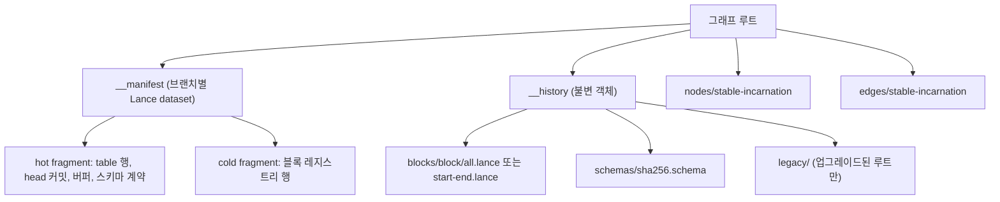

Omnigraph 의 그래프 상태는 브랜치마다 하나씩 있는 `__manifest` Lance dataset 의 한 버전이다. 이 장은 `omnigraph-catalog` 크레이트가 그 버전을 어떤 행으로 채우고, 버전 번호를 CAS 로 써서 여러 테이블의 변경을 한 번에 게시하며, 지나간 커밋을 `__history` 로 내보내 커밋 그래프를 유지하는 방식을 코드로 따라간다.

## 카탈로그 크레이트 개요

`omnigraph-catalog` 는 엔진 내부 크레이트다. 크레이트 문서가 "an internal crate of the omnigraph engine with no compatibility promise" 라고 밝히고, 바깥에서는 쓰기 경로를 막아 둔 `omnigraph` 파사드를 거쳐 쓰라고 적는다 ([lib.rs L9-L10](https://github.com/ModernRelay/omnigraph/blob/00b8cca842f2bf009bebeefcf765672b5ff64b26/crates/omnigraph-catalog/src/lib.rs#L9-L10)). 모듈 선언은 [lib.rs L17-L67](https://github.com/ModernRelay/omnigraph/blob/00b8cca842f2bf009bebeefcf765672b5ff64b26/crates/omnigraph-catalog/src/lib.rs#L17-L67) 에 모여 있다.

| 모듈 | 역할 | 이 장에서 다루는 위치 |
|---|---|---|
| `record`, `row` | `__manifest` 행의 저장 형태(packed struct)와 열 codec | `__manifest` 행 구조 |
| `state` | 한 버전의 행을 읽어 `ManifestRows`, `ManifestState` 로 접는 함수, 커밋 버퍼 | 매니페스트 상태와 스냅샷 |
| `publisher`, `commit` | 게시 루프와 버전 CAS 를 거는 Lance `Overwrite` | 게시와 버전 CAS |
| `history` | `__history` 아래 불변 객체 쓰기와 읽기 | 커밋 ID 와 히스토리 블록 |
| `commit_graph` | 커밋 그래프, 히스토리 캐시, merge base 탐색 | 커밋 그래프와 merge base 탐색 |
| `migrations`, `legacy` | 저장 형식 스탬프 검사, 오프라인 업그레이드 입력 판독 | 저장 형식 스탬프 |
| `unpublished`, `unattached` | detached 버전에 담는 미게시 커밋과 비연결 브랜치 | 미게시 커밋과 비연결 브랜치 |
| `graph` | 그래프 생성 시 genesis 버전 작성 | 매니페스트 상태와 스냅샷 |
| `namespace` | Lance namespace 계약 검증용 구현, 테스트 전용 | 개요만 |

`namespace` 모듈은 `cfg(any(test, feature = "test-util"))` 아래에서만 컴파일된다. 읽기와 쓰기 모두 Lance namespace 를 거치지 않게 바뀌어서 운영 경로에는 쓰이지 않고 계약 검증용으로만 남았다는 주석이 붙어 있다. `legacy` 모듈은 `#[doc(hidden)]` 으로 숨겨진 오프라인 업그레이드용 판독기다. 스탬프 8, 9, 13 의 `__manifest` 를 읽기만 한다 ([legacy.rs L1-L9](https://github.com/ModernRelay/omnigraph/blob/00b8cca842f2bf009bebeefcf765672b5ff64b26/crates/omnigraph-catalog/src/legacy.rs#L1-L9)). 업그레이드 절차 자체는 13장에서 다룬다.

### 게시기의 존재 이유

`publisher` 모듈 문서는 이 크레이트가 왜 필요한지 직접 설명한다. 테이블 저장, 테이블별 버전 관리, 테이블 이력은 Lance 가 맡는다. 남는 공백은 "여러 테이블을 한 번에 원자적으로 게시하는 지점" 하나다. 현재 Rust namespace 표면에는 브랜치를 인식하는 `BatchCreateTableVersions` 가 없어서, 게시기가 `__manifest` 행 교체로 그 역할을 대신한다 ([publisher.rs L1-L19](https://github.com/ModernRelay/omnigraph/blob/00b8cca842f2bf009bebeefcf765672b5ff64b26/crates/omnigraph-catalog/src/publisher.rs#L1-L19)).

```rust
//! Until Lance exposes that operation directly, this publisher owns only:
//! - validating batch publish invariants against the current `__manifest` state
//! - appending the commits a full buffer holds, and the records of a merged
//!   branch, to `__history`
//! - atomically replacing the `table` rows, the head commit's record and the
//!   buffer in `__manifest`
//! - returning the refreshed manifest dataset that defines the visible graph
//!
//! This module should disappear once Lance Rust can do branch-aware batch table
//! version publication against a managed namespace manifest.
```

목록의 네 항목은 실제 실행 순서와 같다. 게시 한 번은 현재 행을 검증하고, 버퍼가 찼으면 `__history` 에 내보내고, 새 행 집합으로 `__manifest` 를 교체하고, 그 결과 dataset 을 돌려준다. 마지막 문장은 이 모듈이 Lance 쪽 기능을 기다리는 임시 구조라는 설계 의도를 밝힌다.

### 그래프 루트의 디렉터리 구성

그래프 루트 아래 카탈로그가 쓰는 디렉터리는 두 개다. `__manifest` 와 `__history` 이름은 `layout.rs` 의 상수로 정해져 있다. 노드와 엣지 테이블은 `nodes/<stable>-<incarnation>`, `edges/<stable>-<incarnation>` 경로를 쓰며, 경로는 테이블 이름이 아니라 테이블 identity 에서 만든다 ([lib.rs L1393-L1410](https://github.com/ModernRelay/omnigraph/blob/00b8cca842f2bf009bebeefcf765672b5ff64b26/crates/omnigraph-catalog/src/lib.rs#L1393-L1410)). 테이블 데이터 파일의 배치는 8장에서 다룬다.



## 정리

- 그래프 상태는 브랜치마다 하나인 `__manifest` 의 한 버전이다. 버전 하나에 identity 별 `table` 행, head 커밋 행, 버퍼, 스키마 계약, 블록 레지스트리, writer epoch 가 함께 들어 있어서 그 버전을 읽으면 한 시점의 그래프가 정해진다.
- 여러 테이블의 변경은 `__manifest` 의 다음 버전 번호를 Lance `Overwrite` 재시도 0 으로 쓰는 방식으로 원자적으로 게시된다. 버전 번호가 CAS 이고, 재시도와 응답 유실 되읽기는 게시기 루프가 맡는다.
- 행을 바꾸는 게시는 반드시 커밋을 기록한다. 커밋 ID `hb1.<block>.<slot>.<nonce>` 의 slot 0 이 버퍼를 `__history` 로 내보낼 시점을 기록하므로, 세션마다 예산이 달라도 같은 판단을 내린다.
- `__history` 객체는 put-if-absent 로 쓰는 불변 Lance 파일이다. 같은 내용을 여러 번 써도 성공하고, 내용이 다르면 거부한다.
- merge base 는 generation 순 최대 힙 탐색으로 구하며, 보유한 기록으로 먼저 증명하고 필요할 때만 블록 레지스트리와 `__history` 를 읽는다. 후보가 여럿이면 거리, generation, 커밋 ID 순서로 deterministic 하게 고른다.
- 스탬프 14부터 17까지를 그대로 열고, 게시는 16 까지만 올린다. RFC 문서 일부는 이전 행 형식을 설명하므로 현재 형식은 코드와 `docs/dev/versioning.md` 를 기준으로 읽는다.
