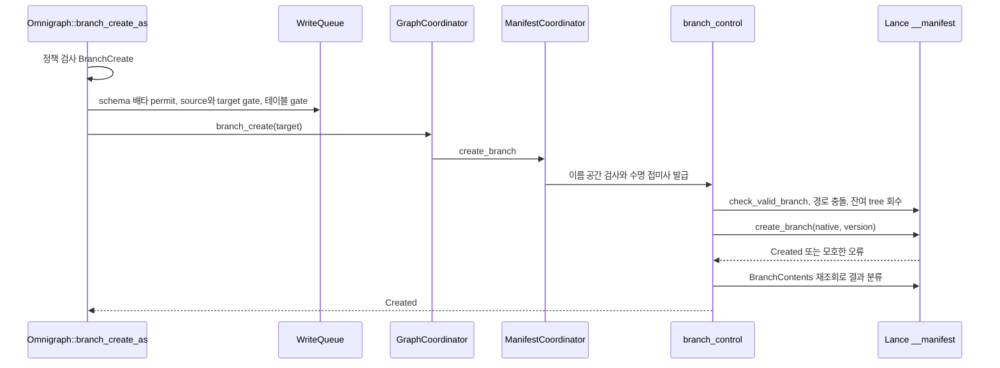

graph branch의 물리 이름과 생성, 삭제 절차를 본다.

## branch 의 물리 이름

사용자가 부르는 branch 이름은 논리 이름이다. 정책 범위, 쓰기 gate, `graph_head:<branch>` 행이 모두 이 이름을 쓴다. Lance 에 실제로 만들어지는 native ref 는 논리 이름 뒤에 수명(incarnation) 접미사를 붙인 `{logical}.{ULID}` 다. 같은 이름을 지웠다가 다시 만들면 새 ULID 를 받으므로, 새 branch 가 죽은 이전 branch 의 `tree/{ref}/` 경로를 공유하지 않는다. 이 설계는 [RFC 0042](https://github.com/ModernRelay/omnigraph/blob/00b8cca842f2bf009bebeefcf765672b5ff64b26/docs/rfcs/0042-incarnation-suffixed-branch-refs.md#L26-L33) 에서 accepted, complete 상태로 기록돼 있다.

### 코드 분석: 수명 접미사 발급

접미사 길이와 발급 함수를 본다. [branch_names.rs L20-L30](https://github.com/ModernRelay/omnigraph/blob/00b8cca842f2bf009bebeefcf765672b5ff64b26/crates/omnigraph-core/src/branch_names.rs#L20-L30)

```rust
pub const INCARNATION_LEN: usize = 26;

/// Mint a fresh branch incarnation.
pub fn mint_incarnation() -> String {
    crate::dst_ids::new_ulid().to_string()
}

/// The native Lance ref name for one incarnation of a logical branch.
pub fn native_branch_name(logical: &str, incarnation: &str) -> String {
    format!("{logical}.{incarnation}")
}
```

ULID 는 Crockford base32 26자다. native 이름에서 논리 이름을 되찾는 `split_native_branch_name` 은 마지막 `.` 뒤가 정확히 ULID 모양일 때만 접미사로 인정하고, 그렇지 않으면 접미사 없는 레거시 수명으로 본다. 그래서 `release.1.2` 같은 일반 점 표기 이름은 문제가 없다.

### 논리 이름 검사

`ensure_logical_branch_name` 은 `/` 로 나눈 모든 세그먼트에 접미사 모양이 있는지 보고, 있으면 거부한다 ([branch_names.rs L91-L101](https://github.com/ModernRelay/omnigraph/blob/00b8cca842f2bf009bebeefcf765672b5ff64b26/crates/omnigraph-core/src/branch_names.rs#L91-L101)). 중간 세그먼트(`feature.<id>/child`)까지 막는 이유는 자식 branch 의 tree 가 다른 native ref 의 물리 경로 아래에 놓이기 때문이다. 엔진 쪽 진입점은 `normalize_branch_name` 에서 이 검사를 부르고 `main` 을 `None` 으로 바꾼다 ([omnigraph.rs L5260-L5267](https://github.com/ModernRelay/omnigraph/blob/00b8cca842f2bf009bebeefcf765672b5ff64b26/crates/omnigraph/src/db/omnigraph.rs#L5260-L5267)). 이름은 정규화하지 않고 그대로 쓰며, 앞뒤 공백이나 제어 문자가 있으면 거부한다.

### 논리 이름과 native ref 의 대응

논리 branch 는 `__manifest` 의 ref 목록에서 정확히 하나의 native ref 가 그 이름으로 되돌아갈 때만 살아 있다. 둘 이상이면 추측하지 않고 오류를 낸다 ([branch_names.rs L270-L292](https://github.com/ModernRelay/omnigraph/blob/00b8cca842f2bf009bebeefcf765672b5ff64b26/crates/omnigraph-core/src/branch_names.rs#L270-L292)).

| 이름 종류 | 형식 | 쓰는 곳 |
|---|---|---|
| 논리 이름 | `feature/x` | 공개 API, 정책 범위, 쓰기 gate, `graph_head:<branch>` |
| native ref | `feature/x.{ULID}` | Lance branch, `tree/` 경로, 세션 캐시 키 |
| 레거시 native ref | `feature/x` (접미사 없음) | 접미사 도입 전에 만든 branch |
| merge 입력 태그 | `__omnigraph_merge_input_v1_{digest}_{head}_{ULID}` | merge 중 입력 snapshot 보존 |
| 미게시 커밋 태그 | `unpublished_...` | `branch merge ... as commit` 제안 |

storage v11 이전에는 테이블을 처음 건드릴 때 테이블 fork 를 따로 만들었고 그 이름이 `fork.{owner ULID}.m{base manifest version}.{commit ULID}` 였다 ([RFC 0042 L35-L41](https://github.com/ModernRelay/omnigraph/blob/00b8cca842f2bf009bebeefcf765672b5ff64b26/docs/rfcs/0042-incarnation-suffixed-branch-refs.md#L35-L41)). 현재 형식은 테이블 fork 를 새로 만들지 않고, 모든 branch 쓰기가 공유 dataset 위의 detached 커밋으로 들어간다. 이 detached 쓰기 경로는 9장에서 다룬다. 남아 있는 레거시 fork 의 회수 여부는 `retain_unpublished_table_fork` 가 이름만으로 보수적으로 판단한다.

## branch 생성과 삭제

branch 생성은 `__manifest` dataset 하나에 Lance branch 를 만드는 일이다. 노드, 엣지 테이블에는 아무것도 복사하지 않는다. 그래프 코디네이터의 `branch_create` 주석이 이를 명시한다 ([graph_coordinator.rs L547-L559](https://github.com/ModernRelay/omnigraph/blob/00b8cca842f2bf009bebeefcf765672b5ff64b26/crates/omnigraph/src/db/graph_coordinator.rs#L547-L559)). "Manifest BranchContents is the single branch authority" 라는 문장대로, branch 의 존재 여부는 `__manifest` 의 `BranchContents` 하나로 판정한다.



### 생성 진입점의 잠금 순서

`branch_create_as` 는 정책 검사(`BranchCreate`, 범위 `TargetBranch`) 뒤에 schema permit 을 배타로 잡는다 ([omnigraph.rs L4178-L4196](https://github.com/ModernRelay/omnigraph/blob/00b8cca842f2bf009bebeefcf765672b5ff64b26/crates/omnigraph/src/db/omnigraph.rs#L4178-L4196)). merge 가 공유로 잡는 것과 다르다. 이어서 source 와 target branch gate, 두 branch 에 걸친 테이블 gate 를 잡은 뒤 코디네이터에 생성을 맡긴다. 특정 게시 커밋에서 branch 를 시작하는 `branch_create_from_as` 는 미게시 커밋과 unattached snapshot 을 시작점으로 받지 않는다.

### native ref 이름 결정

카탈로그의 `create_branch_from` 은 먼저 `ensure_manifest_branch_create_namespace` 로 살아 있는 branch 를 논리 이름으로 바꿔 같은 이름, 조상, 자손 관계를 검사하고, `native_branch_name(name, &mint_incarnation())` 으로 새 native 이름을 만든 뒤 `create_branch_recoverably` 를 부른다 ([lib.rs L2789-L2808](https://github.com/ModernRelay/omnigraph/blob/00b8cca842f2bf009bebeefcf765672b5ff64b26/crates/omnigraph-catalog/src/lib.rs#L2789-L2808)). `review` 와 `review/alice` 가 동시에 살아 있을 수 없는 이유는 Lance branch 의 물리 경로가 이름의 `/` 구조를 따르기 때문이다 ([branch_control.rs L189-L231](https://github.com/ModernRelay/omnigraph/blob/00b8cca842f2bf009bebeefcf765672b5ff64b26/crates/omnigraph-core/src/branch_control.rs#L189-L231)). 한 논리 이름에 살아 있는 수명이 둘 이상이면 cleanup 을 먼저 요구한다.

### 코드 분석: 복구 가능한 native 생성

Lance 의 branch 생성은 얕은 clone 과 `BranchContents` 기록의 두 단계라서, 중간에 실패하면 clone 만 남은 tree 가 생길 수 있다. `create_branch_recoverably` 는 이 경우를 분류한다. [branch_control.rs L936-L947](https://github.com/ModernRelay/omnigraph/blob/00b8cca842f2bf009bebeefcf765672b5ff64b26/crates/omnigraph-core/src/branch_control.rs#L936-L947)

```rust
    for attempt in 0..2 {
        let native_error =
            match crate::lance_clone::create_branch(source, branch, source_version, binding)
                .await
                .map_err(OmniError::storage)
            {
                Ok(_) => match fail(&BRANCH_CREATE_POST_NATIVE) {
                    Ok(()) => return Ok(BranchCreateOutcome::Created),
                    Err(error) => error,
                },
                Err(error) => error,
            };
```

오류가 나면 `BranchContents` 를 다시 읽는다. 기대와 같은 내용이 있으면 응답만 잃은 성공으로 보고 `Created` 를 돌려준다. 다른 내용이면 지우지 않고 read-set 변경 오류를 낸다. 아무것도 없으면 ref 없는 tree 를 회수하고 한 번만 다시 시도한다. 첫 시도 전에는 이름 유효성, source 버전 일치, 경로 충돌, 보관된 조상 경로를 먼저 검사해 첫 durable 효과보다 앞에서 실패하게 한다.

`lance_clone::create_branch` 는 Lance 의 `Dataset::create_branch` 를 task-local `CLONE_CONTEXT` 안에서 부른다 ([lance_clone.rs L196-L216](https://github.com/ModernRelay/omnigraph/blob/00b8cca842f2bf009bebeefcf765672b5ff64b26/crates/omnigraph-core/src/lance_clone.rs#L196-L216)). 이 문맥은 clone 원본이 main 의 V2 이름 규칙 manifest 이고 크기와 e_tag 가 확인된 경우에만 원본 manifest 위치를 재사용하게 한다. 같은 파일의 commit handler 와 조건부 요청 재시도는 저장 계층에 속하므로 8장에서 다룬다.

### 코드 분석: 삭제와 은퇴

삭제는 논리 이름의 권한을 거두는 일이고 물리 데이터 회수는 아니다. `branch_delete_as` 의 주석이 "Returns after the manifest authority flip" 이라고 적는다. native 수준에서는 `retire_branch_recoverably` 가 은퇴 표시를 ref 메타데이터에 쓰고, 정확한 이력을 보관 파일에 남긴 뒤 ref 만 끊는다. 보관을 막는 조건은 다음 부분이다. [branch_control.rs L619-L635](https://github.com/ModernRelay/omnigraph/blob/00b8cca842f2bf009bebeefcf765672b5ff64b26/crates/omnigraph-core/src/branch_control.rs#L619-L635)

```rust
    let tags = dataset
        .tags()
        .list()
        .await
        .map_err(|error| OmniError::storage(error).before_effect())?;
    if let Some((tag, _)) = tags.iter().find(|(name, tag)| {
        tag.branch.as_deref() == Some(branch)
            && !crate::branch_names::is_merge_input_tag(name)
            && !crate::branch_names::is_unpublished_tag(name)
            && !crate::branch_names::is_unattached_tag(name)
    }) {
        return Err(OmniError::storage(lance::Error::RefConflict {
            message: format!(
                "cannot retire graph branch '{branch}' while native manifest tag '{tag}' pins it; remove the tag first"
            ),
        }).before_effect());
    }
```

사용자가 만든 태그가 branch 를 고정하고 있으면 은퇴를 거부한다. 엔진이 만든 merge 입력 태그, 미게시 커밋 태그, unattached 태그는 예외다. 따라서 merge 가 source 를 입력으로 고정한 동안에도 source branch 삭제는 진행된다. 은퇴 표시(`omnigraph.retired_manifest_branch`)의 형식 검사는 `manifest_branch_is_live` 가 맡는다. 남은 tree 와 테이블 데이터는 명시적 `cleanup` 이 다른 branch 의 필요 여부를 확인한 뒤 회수한다. cleanup 과 보존 규칙은 13장에서 다룬다.
