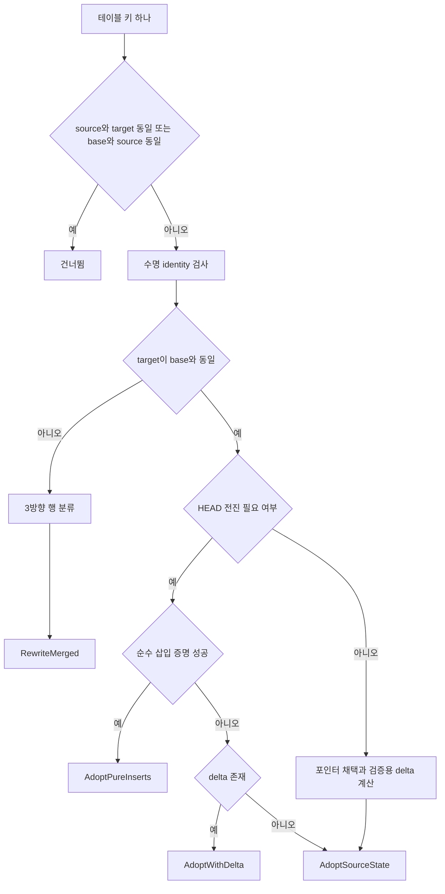

merge 진입 시 입력을 고정하고 테이블마다 경로를 나누는 과정을 본다.

## merge 진입점과 입력 고정

merge 의 공개 API 는 `Session` 에 있다. `branch_merge`, `branch_merge_as`, `branch_merge_as_with_options`, `branch_merge_dry_run` 네 개가 모두 `branch_merge_impl` 하나로 모인다 ([merge.rs L5304-L5407](https://github.com/ModernRelay/omnigraph/blob/00b8cca842f2bf009bebeefcf765672b5ff64b26/crates/omnigraph/src/exec/merge.rs#L5304-L5407)). 차이는 `MergeMode` 하나다.

| `MergeMode` | 호출 | 효과 |
|---|---|---|
| `Publish` | `branch_merge`, `branch_merge_as` | target 에 게시하는 일반 merge |
| `Propose` | `branch_merge_as_with_options(.., true)` | 미게시 커밋으로 기록, target head 불변, 입력 태그 유지 |
| `DryRun` | `branch_merge_dry_run` | 검증까지만 수행, 아무것도 쓰지 않음 |

`MergeMode` 는 `merge.rs` 안의 비공개 열거형이다.

### 정책 검사 범위

merge 의 정책 범위는 `BranchTransition { source, target }` 로 두 branch 를 함께 담는다 ([merge.rs L5339-L5346](https://github.com/ModernRelay/omnigraph/blob/00b8cca842f2bf009bebeefcf765672b5ff64b26/crates/omnigraph/src/exec/merge.rs#L5339-L5346)). 주석에 따르면 이 범위는 HTTP 계층의 `server_branch_merge` 와 같은 규약이라, `target_branch_scope: protected` 규칙이 보호 branch 로 들어가는 merge 만 막고 보호 branch 를 source 로 쓰는 merge 는 막지 않는다. dry run 은 이 검사를 거치지 않으며, 주석은 전송 계층이 두 branch 의 읽기 권한으로 허가한다고 적는다.

### gate 획득 순서

merge 는 schema permit 을 공유 모드로 잡은 뒤 ([merge.rs L5466-L5470](https://github.com/ModernRelay/omnigraph/blob/00b8cca842f2bf009bebeefcf765672b5ff64b26/crates/omnigraph/src/exec/merge.rs#L5466-L5470)), source 와 target branch gate 를 이름 순서로 잡는다 ([L5480-L5494](https://github.com/ModernRelay/omnigraph/blob/00b8cca842f2bf009bebeefcf765672b5ff64b26/crates/omnigraph/src/exec/merge.rs#L5480-L5494)). 정렬 순서는 `acquire_branches` 가 쓰는 순서와 같아 다른 다중 branch 작업과 교착되지 않는다. target gate 는 게시까지 유지하고, source gate 는 입력을 캡처하고 태그로 고정한 직후 놓는다. 그 뒤로는 source 에 대한 쓰기와 삭제가 merge 를 기다리지 않는다. 쓰기 큐와 gate 의 구조는 9장에서 다룬다.

### merge base 결정

두 branch 를 각각 권한 토큰과 불변 snapshot 으로 캡처한 뒤(`open_merge_write_txns`), 두 head 의 merge base 를 구한다 ([merge.rs L5421-L5439](https://github.com/ModernRelay/omnigraph/blob/00b8cca842f2bf009bebeefcf765672b5ff64b26/crates/omnigraph/src/exec/merge.rs#L5421-L5439)). `CommitGraph::merge_base` 는 먼저 이미 들고 있는 레코드만으로 고정 방문 예산 안에서 base 를 증명해 보고, 실패하면 블록 레지스트리를 써서 필요한 이력 블록만 읽는 지연 탐색으로 넘어간다 ([commit_graph.rs L637-L647](https://github.com/ModernRelay/omnigraph/blob/00b8cca842f2bf009bebeefcf765672b5ff64b26/crates/omnigraph-catalog/src/commit_graph.rs#L637-L647)). 방문 예산은 `MERGE_BASE_VISIT_BUDGET`, 지연 탐색 상한은 `LAZY_MERGE_VISITS` 100,000 이다. 공통 조상이 여럿일 때 고르는 규칙(두 head 까지 거리 합, generation, 커밋 id 순)은 사용자 문서에 적혀 있고 ([user/branching/merge.md L130-L144](https://github.com/ModernRelay/omnigraph/blob/00b8cca842f2bf009bebeefcf765672b5ff64b26/docs/user/branching/merge.md#L130-L144)), 탐색 알고리즘과 블록 레지스트리는 11장에서 다룬다.

### 이미 최신인 경우와 fast forward

base 가 정해지면 source head 와 target head 가 같거나 source head 가 base 인 경우 `AlreadyUpToDate` 를 바로 돌려준다 ([merge.rs L5520-L5529](https://github.com/ModernRelay/omnigraph/blob/00b8cca842f2bf009bebeefcf765672b5ff64b26/crates/omnigraph/src/exec/merge.rs#L5520-L5529)). target head 가 base 이면(`head_is_base`) 이후 fast forward 로 분류된다. head 가 base 가 아니어도 target 의 그래프 상태가 base 와 같으면 fast forward 다 (`same_graph_state`). 모든 게시 merge 는 fast forward 라도 자기 커밋을 새로 쓰므로, 같은 source 에서 두 번째 merge 를 하면 target head 는 더 이상 base 가 아니고 상태 비교가 판정을 맡는다.

### merge 입력 태그

source 와 target(그리고 base) 의 `__manifest` 버전에 Lance 태그를 걸어, merge 도중 cleanup 이 입력을 회수하지 못하게 한다. `MergeInputGuard::pin` 은 태그 이름에 target 수명의 digest, target head, 새 ULID 를 넣는다 ([retention.rs L141-L161](https://github.com/ModernRelay/omnigraph/blob/00b8cca842f2bf009bebeefcf765672b5ff64b26/crates/omnigraph-catalog/src/retention.rs#L141-L161)). 취소로 태그가 남으면 cleanup 이 나이가 아니라 이 소유자 정보로 해제 여부를 판단한다. 태그를 건 뒤 두 manifest 가 여전히 최신인지 확인하고, 아니면 `branch_merge_input_capture` read-set 변경으로 실패한다 ([merge.rs L5547-L5576](https://github.com/ModernRelay/omnigraph/blob/00b8cca842f2bf009bebeefcf765672b5ff64b26/crates/omnigraph/src/exec/merge.rs#L5547-L5576)). dry run 은 태그를 걸지 않으므로, 실행 중 입력이 회수되면 타입이 있는 이력 공백 오류로 드러난다. merge 가 끝나면 태그를 해제하되, 미게시 제안은 입력을 계속 들고 있고 게시 결과가 불확실한(in doubt) 실패는 해제하지 않는다.

## 테이블별 경로 분류

merge 는 base, source, target 세 snapshot 에 나타나는 모든 테이블 키를 모아 정렬한 뒤 하나씩 분류한다. 비교 단위는 행이 아니라 manifest 의 테이블 등록(`DatasetEntry`)이다.

### 코드 분석: 테이블 상태 동일성

두 등록이 같은 테이블 상태인지 판정하는 함수다. [merge.rs L3260-L3275](https://github.com/ModernRelay/omnigraph/blob/00b8cca842f2bf009bebeefcf765672b5ff64b26/crates/omnigraph/src/exec/merge.rs#L3260-L3275)

```rust
            let crate::db::DatasetEntry {
                identity,
                type_key: _,
                dataset_path,
                published_dataset_version,
                native_dataset_branch,
                entity_count,
                version_metadata,
                manifest_version: _,
            } = left;
            *identity == right.identity
                && *dataset_path == right.dataset_path
                && *published_dataset_version == right.published_dataset_version
                && *native_dataset_branch == right.native_dataset_branch
                && *entity_count == right.entity_count
                && *version_metadata == right.version_metadata
```

구조 분해로 모든 필드를 나열하므로, `DatasetEntry` 에 필드가 추가되면 컴파일 오류가 나서 비교 누락을 막는다. 제외하는 필드는 조회 키인 `type_key` 와 어느 `__manifest` 게시가 행을 썼는지 나타내는 `manifest_version` 뿐이다.

이 함수로 먼저 건너뛸 테이블을 거른다. source 와 target 이 같으면 이미 반영된 것이고, base 와 source 가 같으면 source 가 바꾼 것이 없다.

### 테이블 수명 검사

남은 테이블은 세 snapshot 의 `TableIdentity` 가 서로 같아야 한다. 이름이 같아도 drop 후 다시 만든 테이블은 다른 수명이라 행을 섞으면 오래된 데이터를 받아들이게 된다. `ensure_merge_identity_compatible` 은 존재하는 identity 끼리 비교하고, 한쪽에 테이블이 없는 경우는 행 수명 변화로 보고 허용한다 ([merge.rs L3293-L3315](https://github.com/ModernRelay/omnigraph/blob/00b8cca842f2bf009bebeefcf765672b5ff64b26/crates/omnigraph/src/exec/merge.rs#L3293-L3315)). 단위 테스트가 이 두 동작을 고정한다. rename 은 수명을 유지한다고 개발자 문서가 적는다.

### 코드 분석: 후보 상태 네 가지

분류 결과는 `CandidateTableState` 다. [merge.rs L41-L59](https://github.com/ModernRelay/omnigraph/blob/00b8cca842f2bf009bebeefcf765672b5ff64b26/crates/omnigraph/src/exec/merge.rs#L41-L59)

```rust
enum CandidateTableState {
    /// Publish the source endpoint without advancing table HEAD.
    /// `validation_delta` holds changed rows for constraint checks; `None` means equal rows.
    AdoptSourceState {
        validation_delta: Option<AdoptValidation>,
    },
    /// The target table still equals the merge base and Lance's complete source
    /// transaction interval proves that every logical change was an exact-id
    /// fenced insert. The pinned source interval is scanned directly into the
    /// established row/byte-bounded exact-transaction chain; no base scan, row
    /// signatures, or temporary delta dataset is needed.
    AdoptPureInserts(ProvenPureInsertAdopt),
    /// Adopt the source's state by applying a non-empty delta onto the target's
    /// lineage (strict-insert new + upsert changed + delete removed). The delta is
    /// pre-computed at classification so its publish can stage the complete
    /// detached chunk chain before the manifest commit.
    AdoptWithDelta(AdoptDelta),
    RewriteMerged(StagedMergeResult),
}
```

| 상태 | 조건 | 게시 방식 |
|---|---|---|
| `AdoptSourceState` | target 이 base 와 같고, target 이 source 의 등록을 그대로 가리킬 수 있음 | manifest 포인터만 교체, 행 복사 없음 |
| `AdoptPureInserts` | target 이 main, source 테이블이 pre-v11 fork, source 구간이 정확한 id 삽입만으로 증명됨 | 증명된 구간을 target lineage 에 삽입 chain 으로 적용 |
| `AdoptWithDelta` | target 이 main, source 테이블이 pre-v11 fork, 증명 실패 | 삽입, 갱신, 삭제 delta 를 target lineage 에 적용 |
| `RewriteMerged` | target 도 base 이후 테이블을 바꿈 | 3방향 행 분류 결과를 detached chain 으로 커밋 |



### HEAD 전진 판정

`AdoptPureInserts` 와 `AdoptWithDelta` 가 필요한 경우는 좁다. `adopt_advances_head` 는 target 이 main(`None`)이고 source 테이블 등록이 native 테이블 branch 를 가리킬 때만 참이다 ([merge.rs L3747-L3752](https://github.com/ModernRelay/omnigraph/blob/00b8cca842f2bf009bebeefcf765672b5ff64b26/crates/omnigraph/src/exec/merge.rs#L3747-L3752)). 현재 형식의 branch 쓰기는 테이블 fork 를 만들지 않으므로 `native_dataset_branch` 가 채워진 등록은 pre-v11 fork 에서 온 것이다. 그 밖의 모든 adopt 는 포인터 교체다. `classify_adopt` 는 이 판정 뒤에 순수 삽입 증명, 검증 전용 증명, 일반 adopt delta 계산 순서로 시도한다 ([L3757-L3830](https://github.com/ModernRelay/omnigraph/blob/00b8cca842f2bf009bebeefcf765672b5ff64b26/crates/omnigraph/src/exec/merge.rs#L3757-L3830)).

### main 이 자기 등록을 유지하는 예외

`plan_adopted_source_state` 는 source 가 fork 위에 있고 target 이 main 인 경우 source 의 버전을 받지 않는다. target 은 자기 `published_dataset_version` 과 `version_metadata` 를 유지하고 행 수만 source 에서 가져온다 ([merge.rs L3907-L3918](https://github.com/ModernRelay/omnigraph/blob/00b8cca842f2bf009bebeefcf765672b5ff64b26/crates/omnigraph/src/exec/merge.rs#L3907-L3918)). 계획한 등록이 현재 등록과 필드 단위로 같으면 `AdoptPublish::Nothing` 이 되어 후보에서 빠진다 ([L3948-L3971](https://github.com/ModernRelay/omnigraph/blob/00b8cca842f2bf009bebeefcf765672b5ff64b26/crates/omnigraph/src/exec/merge.rs#L3948-L3971)). 비어 있지 않은 검증 delta 는 포인터 교체여도 제약 검사의 입력이라 후보로 남는다.
