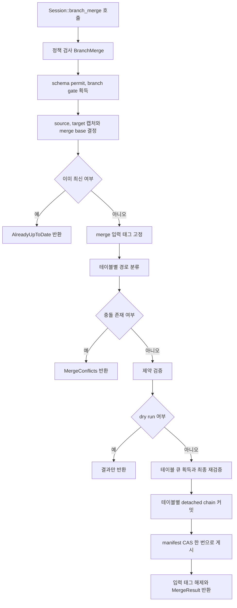

Omnigraph 의 branch 는 `__manifest` dataset 의 Lance branch 하나이고, merge 는 그 위에서 테이블마다 경로를 골라 결과를 단 한 번의 manifest CAS 로 게시하는 그래프 수준 3방향 병합이다. 이 장은 branch 의 물리 이름과 수명, merge 의 입력 고정, 테이블별 경로 분류, 행 단위 3방향 분류, 제약 검증, 최종 게시를 코드 순서대로 따라간다.

## 장의 구성

이 장은 `crates/omnigraph/src/exec/merge.rs`(6,551줄)와 `crates/omnigraph-core` 의 branch 제어 모듈 세 개를 중심으로 읽는다. 매니페스트 행, 커밋 그래프, 이력 블록, 게시기(publisher)의 내부는 11장에서 다루고, 이 장은 merge 가 그 기능을 어떤 순서로 부르는지만 다룬다.

| 파일 | 역할 | 이 장의 절 |
|---|---|---|
| `omnigraph-core/src/branch_names.rs` | 논리 이름과 native ref 이름(수명 접미사) 변환, merge 입력 태그 이름 | branch 의 물리 이름 |
| `omnigraph-core/src/branch_control.rs` | Lance native branch 생성, 은퇴, 회수의 장애 분류 | branch 생성과 삭제 |
| `omnigraph-core/src/lance_clone.rs` | clone 원본 위치 재사용, commit handler 감싸기 | branch 생성과 삭제 |
| `omnigraph/src/exec/merge.rs` | merge 진입점, 분류, 검증, 게시 | 나머지 절 전체 |
| `docs/dev/merge.md` | 개발자용 merge 설명(경로, 비용 모델, 진단) | 근거 문서 |

> **주의**: 원본의 `docs/dev/branch-protection.md` 는 그래프 branch 가 아니라 GitHub 저장소 `main` branch 의 보호 규칙(필수 CI 검사, 선형 이력)을 설명한다 ([branch-protection.md L1-L20](https://github.com/ModernRelay/omnigraph/blob/00b8cca842f2bf009bebeefcf765672b5ff64b26/docs/dev/branch-protection.md#L1-L20)). 그래프 branch 를 보호하는 장치는 Cedar 정책의 `target_branch_scope: protected` 이고, 정책 엔진은 14장에서 다룬다.

## 정리

- graph branch 는 `__manifest` dataset 의 Lance branch 하나이고, native ref 이름은 `{logical}.{ULID}` 다. 다시 만든 branch 는 새 수명을 받아 이전 branch 의 경로와 겹치지 않으며, 삭제는 논리 권한만 거두고 물리 회수는 cleanup 에 맡긴다.
- merge 는 정책 검사, schema 공유 permit, 이름 순 branch gate, 입력 태그 고정, merge base 결정 순서로 입력을 고정한다. source gate 는 입력 고정 직후 놓으므로 source 쪽 쓰기를 오래 막지 않는다.
- 테이블마다 `same_manifest_state` 와 `TableIdentity` 로 건너뛸지 판단한 뒤, target 이 base 와 같으면 adopt 계열(대부분 포인터 교체), target 도 바꿨으면 3방향 행 분류(`RewriteMerged`)로 보낸다.
- 행 분류 규칙은 "한쪽만 바꾸면 그쪽, 같게 바꾸면 target, 다르게 바꾸면 충돌" 하나이고, lineage 후보 경로와 전체 순서 스캔이 공유한다. 후보 경로는 fragment 와 deletion 파일 비교로 바뀐 id 만 찾고, 증명이나 예산이 맞지 않으면 전체 스캔으로 돌아간다.
- 제약 검증은 delta 를 배치 단위로 스트리밍하며 여러 행에 걸친 검사의 키만 유지하고, 그 키 바이트를 32 MiB 예산에 청구한다. 노드 타입의 증명된 순수 삽입 fast forward 만 검증을 건너뛴다.
- 게시 직전 target 의 테이블 큐를 잡고 target 권한과 source 수명, schema 를 다시 확인한 뒤, 테이블별 detached chain(최대 1,024 링크)과 포인터 교체를 한 번의 manifest CAS 로 게시한다. CAS 전 실패는 target 을 바꾸지 않는다.
