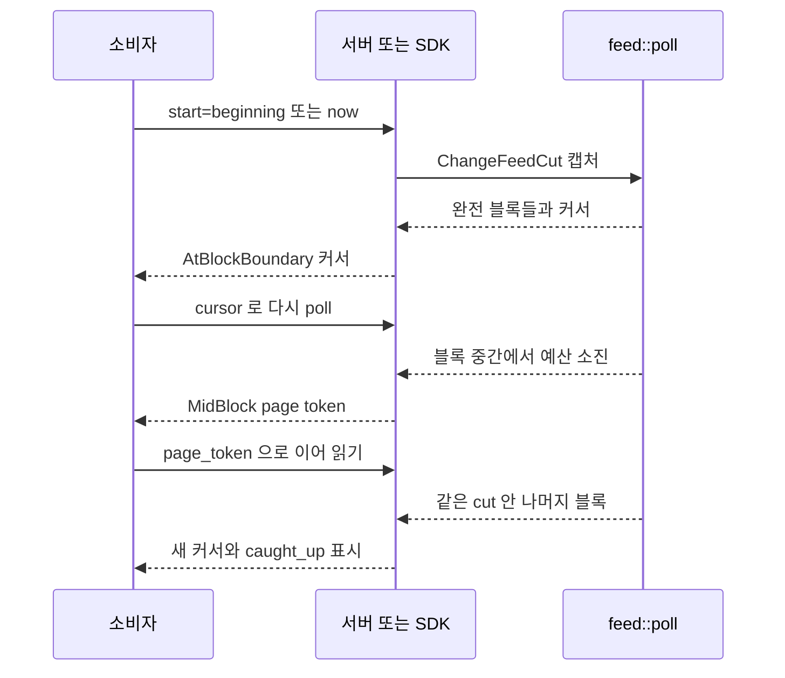

변경 피드 토큰과 시간 여행, 기준선 복구를 본다.

## 변경 피드와 연속 토큰

변경 피드는 브랜치의 첫 부모 체인을 따라 커밋마다 `GraphChangeBlock` 하나를 낸다. 서버는 소비자 상태를 저장하지 않고, 위치는 호출자가 가진 불투명 커서 안에 있다 ([feed.rs L1-L9](https://github.com/ModernRelay/omnigraph/blob/00b8cca842f2bf009bebeefcf765672b5ff64b26/crates/omnigraph/src/changes/feed.rs#L1-L9)). 커서는 완전한 커밋 경계에서만 전진한다.



### 코드 분석: chain_after

파일: `crates/omnigraph/src/changes/feed.rs`, [feed.rs L78-L92](https://github.com/ModernRelay/omnigraph/blob/00b8cca842f2bf009bebeefcf765672b5ff64b26/crates/omnigraph/src/changes/feed.rs#L78-L92)

커서 이후 커밋을 앞으로 걸어가며 고르는 부분을 본다.

```rust
        let mut chain = Vec::new();
        let mut cursor = after;
        while chain.len() <= limit {
            // Running past the head without meeting `from` means `from` is not
            // ahead of `after` on this chain.
            let child = self.first_parent_children.get(cursor)?;
            chain.push(child.clone());
            if child == from {
                return Some(chain);
            }
            cursor = child;
        }
        // Ceiling reached with `from` still ahead: `chain[..limit]` is a valid
        // oldest-first prefix of `(after, from]`, plus one sentinel element.
        Some(chain)
```

`ChangeFeedCut` 은 브랜치 head, 그 snapshot, incarnation witness, genesis, lineage 를 한 번에 캡처한 구조다 ([feed.rs L34-L58](https://github.com/ModernRelay/omnigraph/blob/00b8cca842f2bf009bebeefcf765672b5ff64b26/crates/omnigraph/src/changes/feed.rs#L34-L58)). `first_parent_children` 은 체인 위 커밋에서 유일한 자식으로 가는 색인이라 체인 소속 확인이 O(1) 이다. 걷기는 `limit + 1` 개에서 멈춘다. 마지막 하나는 남은 커밋이 있다는 표지(sentinel)라서, 밀린 이력 전체를 메모리에 올리지 않고도 상한에서 멈춘 것인지 끝까지 따라잡은 것인지 구분한다. 같은 브랜치를 반복 poll 하면 manifest incarnation 이 같은 동안 캐시된 cut 을 쓴다 ([omnigraph.rs L3073-L3095](https://github.com/ModernRelay/omnigraph/blob/00b8cca842f2bf009bebeefcf765672b5ff64b26/crates/omnigraph/src/db/omnigraph.rs#L3073-L3095)).

### 코드 분석: poll 의 블록 처리

파일: `crates/omnigraph/src/changes/feed.rs`, [feed.rs L354-L371](https://github.com/ModernRelay/omnigraph/blob/00b8cca842f2bf009bebeefcf765672b5ff64b26/crates/omnigraph/src/changes/feed.rs#L354-L371)

커밋 하나의 열거 결과를 페이지에 반영하는 분기를 본다.

```rust
            Ok(CommitEnumeration::Complete) => {
                blocks.push(GraphChangeBlock { cause, changes });
                after_completed = commit_id.clone();
                parent_snapshot = child_snapshot;
            }
            Ok(CommitEnumeration::Truncated(key)) => {
                let page_token = scope.mint_page_token(
                    &position.cut_commit_id,
                    &after_completed,
                    commit_id,
                    &key,
                )?;
                blocks.push(GraphChangeBlock { cause, changes });
                return Ok(ChangeFeedPage {
                    blocks,
                    continuation: ChangeFeedContinuation::MidBlock { page_token },
                });
            }
```

블록이 완전하면 `after_completed` 가 그 커밋으로 옮겨가고, 잘리면 page token 만 주고 커서는 주지 않는다. 호출자는 일부만 읽은 블록을 체크포인트할 수 없다 ([model.rs L312-L321](https://github.com/ModernRelay/omnigraph/blob/00b8cca842f2bf009bebeefcf765672b5ff64b26/crates/omnigraph/src/changes/model.rs#L312-L321)). 모든 커밋을 처리하면 새 커서와 `caught_up` 을 담아 끝난다. poll 전체는 [feed.rs L221-L407](https://github.com/ModernRelay/omnigraph/blob/00b8cca842f2bf009bebeefcf765672b5ff64b26/crates/omnigraph/src/changes/feed.rs#L221-L407) 이다.

읽을 수 없는 커밋은 `first_or_boundary` 가 처리한다. 정리로 회수된 이력은 `ChangeFeedGap` 으로 바꾸고, 그 커밋이 poll 의 첫 커밋이면 오류를, 아니면 직전 블록 경계에서 페이지를 닫는다. 다음 poll 이 같은 오류를 결정적으로 다시 낸다. 분류되지 않은 I/O 오류는 페이지 전체를 실패시킨다 ([feed.rs L409-L445](https://github.com/ModernRelay/omnigraph/blob/00b8cca842f2bf009bebeefcf765672b5ff64b26/crates/omnigraph/src/changes/feed.rs#L409-L445)).

### 시작 위치와 커서 검증

`ChangeFeedPosition` 은 시작 모드, 내구 커서, page token 셋 중 하나다 ([model.rs L274-L296](https://github.com/ModernRelay/omnigraph/blob/00b8cca842f2bf009bebeefcf765672b5ff64b26/crates/omnigraph/src/changes/model.rs#L274-L296)). `resolve_position` 은 `Now` 를 head 뒤, `Beginning` 을 genesis 뒤, `AfterCommit` 을 체인 위 해당 커밋 뒤로 해석한다 ([feed.rs L545-L566](https://github.com/ModernRelay/omnigraph/blob/00b8cca842f2bf009bebeefcf765672b5ff64b26/crates/omnigraph/src/changes/feed.rs#L545-L566)). page token 은 새 head 가 아니라 토큰에 담긴 cut 을 끝으로 쓰므로, poll 이 시작된 뒤 들어온 커밋은 그 페이지 묶음 밖에 남는다 ([feed.rs L612-L619](https://github.com/ModernRelay/omnigraph/blob/00b8cca842f2bf009bebeefcf765672b5ff64b26/crates/omnigraph/src/changes/feed.rs#L612-L619)). 커서와 토큰은 `FeedScope::validate` 의 다섯 검사를 통과해야 한다 ([feed.rs L152-L186](https://github.com/ModernRelay/omnigraph/blob/00b8cca842f2bf009bebeefcf765672b5ff64b26/crates/omnigraph/src/changes/feed.rs#L152-L186)).

| 검사 필드 | 막는 상황 |
|---|---|
| `graph_identity` | 다른 그래프의 커서 |
| `genesis_commit_id` | 같은 그래프의 다른 이력 incarnation |
| `branch` | 다른 브랜치의 커서 |
| `branch_witness` | 같은 이름으로 삭제 후 다시 만든 브랜치 |
| `filter_digest` | 다른 필터 scope 로 발급된 커서 |

### 코드 분석: 토큰 봉투

파일: `crates/omnigraph/src/changes/token.rs`, [token.rs L407-L414](https://github.com/ModernRelay/omnigraph/blob/00b8cca842f2bf009bebeefcf765672b5ff64b26/crates/omnigraph/src/changes/token.rs#L407-L414)

모든 연속 토큰이 공유하는 인코딩을 본다.

```rust
pub(crate) fn encode_token<T: Serialize>(payload: &T) -> Result<String> {
    let payload = serde_json::to_vec(payload)
        .map_err(|error| OmniError::manifest_internal(error.to_string()))?;
    let digest = Sha256::digest(&payload);
    let mut encoded = Vec::with_capacity(payload.len() + digest.len());
    encoded.extend_from_slice(&payload);
    encoded.extend_from_slice(&digest);
    let encoded = base64::engine::general_purpose::URL_SAFE_NO_PAD.encode(encoded);
```

형식은 `base64url_no_pad(json ‖ sha256)` 이고 다섯 종류(commit-page, diff-page, feed-cursor, feed-page, commit-list-page)가 `kind` 태그로 구분된다 ([token.rs L1-L14](https://github.com/ModernRelay/omnigraph/blob/00b8cca842f2bf009bebeefcf765672b5ff64b26/crates/omnigraph/src/changes/token.rs#L1-L14)). 해독은 길이, base64, 체크섬, kind, 버전 순으로 확인하고 실패마다 `ChangeCursorRejected` 를 이유와 함께 낸다 ([token.rs L428-L464](https://github.com/ModernRelay/omnigraph/blob/00b8cca842f2bf009bebeefcf765672b5ff64b26/crates/omnigraph/src/changes/token.rs#L428-L464)). 체크섬은 무결성 검사이지 인증이 아니다. 토큰 길이는 URL 쿼리 하나에 실리도록 4 KiB 로 묶인다 ([token.rs L25-L30](https://github.com/ModernRelay/omnigraph/blob/00b8cca842f2bf009bebeefcf765672b5ff64b26/crates/omnigraph/src/changes/token.rs#L25-L30)). 이를 위해 브랜치 이름은 SHA-256 고정 길이로 바꾸고, 256 바이트를 넘는 엔티티 id 는 64 바이트 접두사와 해시로 대신한다 ([token.rs L104-L125](https://github.com/ModernRelay/omnigraph/blob/00b8cca842f2bf009bebeefcf765672b5ff64b26/crates/omnigraph/src/changes/token.rs#L104-L125)). 공개 타입 id 는 스키마 identity 도메인과 `stable_table_id`, `table_incarnation_id` 를 해시한 값이라 이름 변경에는 유지되고 drop 후 재추가에는 바뀐다 ([token.rs L316-L328](https://github.com/ModernRelay/omnigraph/blob/00b8cca842f2bf009bebeefcf765672b5ff64b26/crates/omnigraph/src/changes/token.rs#L316-L328)).

## 시간 여행과 기준선

과거 시점 읽기는 그래프 커밋 id 나 snapshot 대상을 정확히 지정하는 방식만 공식 계약이다. RFC 0030 7절은 시각 기반 조회(`--at-time`)를 핵심 단계에서 제외한다. `created_at` 은 효과 이전의 작성 시각이고, `__manifest` 버전 시각도 단조 증가가 보장되지 않으며, 이진 탐색을 할 색인이 없다는 이유다.

### 코드 분석: resolve_target 의 snapshot 가지

파일: `crates/omnigraph/src/db/graph_coordinator.rs`, [graph_coordinator.rs L679-L688](https://github.com/ModernRelay/omnigraph/blob/00b8cca842f2bf009bebeefcf765672b5ff64b26/crates/omnigraph/src/db/graph_coordinator.rs#L679-L688)

읽기 대상이 snapshot 일 때의 해석을 본다.

```rust
            ReadTarget::Snapshot(snapshot_id) => {
                let CommitState { commit, snapshot } = self.commit_state(snapshot_id).await?;
                Ok(ResolvedTarget {
                    requested: target.clone(),
                    branch: commit.graph_branch.clone(),
                    snapshot_id: snapshot_id.clone(),
                    graph_commit_id: Some(commit.graph_commit_id),
                    snapshot,
                })
            }
```

`ReadTarget` 은 `Branch(String)` 과 `Snapshot(SnapshotId)` 두 변형뿐이다 ([graph_coordinator.rs L56-L59](https://github.com/ModernRelay/omnigraph/blob/00b8cca842f2bf009bebeefcf765672b5ff64b26/crates/omnigraph/src/db/graph_coordinator.rs#L56-L59)). 브랜치는 현재 head 로, snapshot 은 커밋 그래프에서 그 커밋의 상태로 해석된다. 얻은 `Snapshot` 이 각 테이블의 pin 을 담고 있어서 질의 엔진은 6장의 실행 경로 그대로 과거 버전의 Lance dataset 을 연다. 커밋 그래프와 매니페스트 구조는 11장에서 다룬다. 엔티티 하나를 과거 시점으로 읽는 `entity_at_target` 과 `__manifest` 버전 번호로 읽는 `entity_at` 도 같은 해석을 쓴다 ([export.rs L149-L171](https://github.com/ModernRelay/omnigraph/blob/00b8cca842f2bf009bebeefcf765672b5ff64b26/crates/omnigraph/src/db/omnigraph/export.rs#L149-L171)).

### 회수된 이력의 처리

정리가 과거 pin 을 지우면 그 시점은 열 수 없다. 엔진은 이를 공통 opener 에서 `HistoricalVersionReclaimed` 로 타입화한다 ([error.rs L309-L312](https://github.com/ModernRelay/omnigraph/blob/00b8cca842f2bf009bebeefcf765672b5ff64b26/crates/omnigraph-core/src/error.rs#L309-L312)). 피드는 이를 `ChangeFeedGap` 으로 바꾸고 ([error.rs L396-L403](https://github.com/ModernRelay/omnigraph/blob/00b8cca842f2bf009bebeefcf765672b5ff64b26/crates/omnigraph-core/src/error.rs#L396-L403)), HTTP 는 410 으로 응답한다 ([handlers.rs L4369](https://github.com/ModernRelay/omnigraph/blob/00b8cca842f2bf009bebeefcf765672b5ff64b26/crates/omnigraph-server/src/handlers.rs#L4369)). 복구 방법은 커서 재시도가 아니라 기준선을 다시 받는 것이다.

> **주의**: RFC 0030 6절은 직접 시간 여행 실패를 `HistoricalDataReclaimed { graph_commit_id, type }` 로 적는다. 코드의 변형은 `HistoricalVersionReclaimed { published_dataset_version }` 이고 그래프 커밋과 타입 대신 dataset 버전을 담는다. 이 책은 코드를 따른다.

### 코드 분석: capture_baseline_parts

파일: `crates/omnigraph/src/db/omnigraph/export.rs`, [export.rs L287-L294](https://github.com/ModernRelay/omnigraph/blob/00b8cca842f2bf009bebeefcf765672b5ff64b26/crates/omnigraph/src/db/omnigraph/export.rs#L287-L294)

기준선 export 를 live head 가 아닌 캡처한 커밋에 고정하는 부분을 본다.

```rust
    // Pin the export at the captured head commit, not the live branch tip: a
    // commit landing after the capture is outside the snapshot and arrives on
    // the first poll from the returned cursor.
    let (resolved, catalog) = db
        .capture_read_view(ReadTarget::Snapshot(super::SnapshotId::new(
            cut.head.clone(),
        )))
        .await?;
```

기준선 핸드셰이크는 브랜치 head 를 캡처하고, 그 커밋에 고정한 엔티티 snapshot 을 NDJSON 으로 흘려보낸 뒤, 바로 그 커밋 뒤에서 피드를 이어 읽을 커서를 돌려준다 ([omnigraph.rs L3918-L3936](https://github.com/ModernRelay/omnigraph/blob/00b8cca842f2bf009bebeefcf765672b5ff64b26/crates/omnigraph/src/db/omnigraph.rs#L3918-L3936)). export-cut 허가는 head 캡처 전부터 마지막 바이트까지 유지되어, 그동안 정리, 스키마 적용, 브랜치 교체가 해당 좌표를 지울 수 없다. export 가 실패하면 `Err` 이므로 깨진 snapshot 보다 오래 사는 커서가 생기지 않는다 ([export.rs L335-L356](https://github.com/ModernRelay/omnigraph/blob/00b8cca842f2bf009bebeefcf765672b5ff64b26/crates/omnigraph/src/db/omnigraph/export.rs#L335-L356)). 소비자의 순서는 다음과 같다.

1. `capture_change_baseline` 으로 snapshot 과 `resume_cursor` 를 받는다
2. snapshot 을 대상 시스템에 durable 하게 설치한다
3. `resume_cursor` 로 poll 을 시작하고 블록을 `graph_commit_id` 기준으로 멱등 적용한다. 피드는 at-least-once 라서 같은 커서로 재시도하면 다음 완전 커밋이 다시 올 수 있다 ([handlers.rs L4903-L4908](https://github.com/ModernRelay/omnigraph/blob/00b8cca842f2bf009bebeefcf765672b5ff64b26/crates/omnigraph-server/src/handlers.rs#L4903-L4908))
4. `ChangeFeedGap` 을 받으면 1번부터 다시 한다
