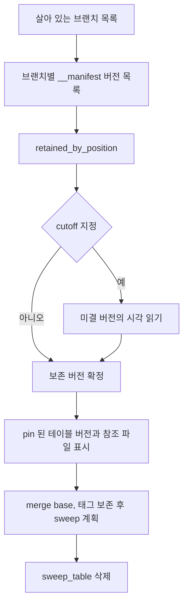

compaction 게시와 그래프 기준 버전 정리를 본다.

## 최적화

Lance 는 쓰기마다 fragment 와 manifest 를 늘린다. 오래 쓰면 dataset 을 여는 시간과 객체 수가 늘어난다. `optimize.rs` 는 이를 compaction 을 게시하는 `optimize_all_datasets` 와 버전을 회수하는 `cleanup_all_datasets` 두 작업으로 정리한다 ([optimize.rs L1-L23](https://github.com/ModernRelay/omnigraph/blob/00b8cca842f2bf009bebeefcf765672b5ff64b26/crates/omnigraph/src/db/omnigraph/optimize.rs#L1-L23)).

### 코드 분석: prepare_optimize_table

파일: `crates/omnigraph/src/db/omnigraph/optimize.rs`, [optimize.rs L1625-L1631](https://github.com/ModernRelay/omnigraph/blob/00b8cca842f2bf009bebeefcf765672b5ff64b26/crates/omnigraph/src/db/omnigraph/optimize.rs#L1625-L1631)

테이블 하나에 할 일이 있는지 판정하는 부분을 본다.

```rust
    // The plan `stage_compaction` executes, made once: a fragment still
    // holding a dropped property's values is compaction work even when
    // Lance's planner would leave the table alone.
    let options = CompactionOptions::default();
    let plan = TableStore::plan_table_compaction(snapshot.dataset(), &options).await?;
    let will_compact = plan.num_tasks() > 0;
    let needs_reindex = TableStore::has_foldable_unindexed_fragments(snapshot.dataset()).await?;
```

작업은 작은 fragment 의 compaction, 삭제된 속성 값을 아직 가진 fragment 의 재작성, 색인 커버리지 보충 세 종류다. 셋 다 없으면 `Unchanged` 로 끝나고, 있으면 `measure_plan` 이 설정된 상한과 비교해 넘으면 `Deferred(ResourceLimit)` 로 미룬다 ([optimize.rs L1665-L1673](https://github.com/ModernRelay/omnigraph/blob/00b8cca842f2bf009bebeefcf765672b5ff64b26/crates/omnigraph/src/db/omnigraph/optimize.rs#L1665-L1673)). 테이블별 결과는 `TableOptimizeOutcome` 네 가지로 보고된다 ([optimize.rs L93-L106](https://github.com/ModernRelay/omnigraph/blob/00b8cca842f2bf009bebeefcf765672b5ff64b26/crates/omnigraph/src/db/omnigraph/optimize.rs#L93-L106)).

### 한 커밋으로의 게시

compaction 은 내용을 바꾸지 않는 Lance `Rewrite` 연산이지만, 읽기는 manifest 가 가리키는 게시 버전을 열기 때문에 게시하지 않으면 보이지 않는다. 그래서 각 테이블의 compaction 을 detached 로 스테이징하고 main 에 한 번의 그래프 커밋으로 게시한다. Optimize 하나가 만드는 그래프 커밋은 최대 하나다 ([optimize.rs L882-L893](https://github.com/ModernRelay/omnigraph/blob/00b8cca842f2bf009bebeefcf765672b5ff64b26/crates/omnigraph/src/db/omnigraph/optimize.rs#L882-L893)). 진입 시 `maintain` 정책을 main 에 대해 검사하고, 권한 토큰을 게이트 전에 캡처한 뒤 schema, branch, table 게이트를 잡고 다시 확인한다. 게시 호출은 [optimize.rs L1113-L1127](https://github.com/ModernRelay/omnigraph/blob/00b8cca842f2bf009bebeefcf765672b5ff64b26/crates/omnigraph/src/db/omnigraph/optimize.rs#L1113-L1127) 이다. 게시된 커밋은 durable 하므로 그 뒤의 설정 정리는 실행을 실패시키지 않는다. 스테이징과 게시의 일반 구조는 9장에서 다룬다.

| 설정 | 의미 | 위치 |
|---|---|---|
| `OMNIGRAPH_MAINTENANCE_CONCURRENCY` | 동시 처리 테이블 수, 기본 8 | [optimize.rs L39-L50](https://github.com/ModernRelay/omnigraph/blob/00b8cca842f2bf009bebeefcf765672b5ff64b26/crates/omnigraph/src/db/omnigraph/optimize.rs#L39-L50) |
| `max_gate_hold` | main 게이트를 이만큼 잡으면 새 테이블을 시작하지 않음 | [optimize.rs L546-L564](https://github.com/ModernRelay/omnigraph/blob/00b8cca842f2bf009bebeefcf765672b5ff64b26/crates/omnigraph/src/db/omnigraph/optimize.rs#L546-L564) |
| `TableCeilings` | fragment, 행, 바이트, Blob 바이트, 색인 행 상한 | [optimize.rs L597-L603](https://github.com/ModernRelay/omnigraph/blob/00b8cca842f2bf009bebeefcf765672b5ff64b26/crates/omnigraph/src/db/omnigraph/optimize.rs#L597-L603) |
| `datasets`, `start_at` | 대상 테이블 선택과 순환 시작 위치 | [optimize.rs L695-L709](https://github.com/ModernRelay/omnigraph/blob/00b8cca842f2bf009bebeefcf765672b5ff64b26/crates/omnigraph/src/db/omnigraph/optimize.rs#L695-L709) |

`OptimizeReport::resume_at` 은 실행 전체 한도로 미뤄진 첫 테이블이다. 다음 실행이 이를 `start_at` 으로 넘기면 그 테이블부터 방문한다 ([optimize.rs L422-L444](https://github.com/ModernRelay/omnigraph/blob/00b8cca842f2bf009bebeefcf765672b5ff64b26/crates/omnigraph/src/db/omnigraph/optimize.rs#L422-L444)).

## 정리 수집기

정리(cleanup)는 Lance 의 `cleanup_old_versions` 를 쓰지 않는다. 테이블의 모든 쓰기가 detached commit 이고 그래프 커밋이 그것을 pin 하므로, 무엇을 남길지는 그래프 기준으로 정해야 한다. 사용자 문서는 Lance 자체 cleanup 을 그래프 루트에 돌리면 detached 버전만 쓰는 파일이 7일 뒤 지워져 snapshot 이 읽히지 않을 수 있다고 경고한다. 엔진은 자체 tracing collector 를 둔다. 계획만 세우는 `plan_collection` 과 한 위치의 계획을 수행하는 `sweep_table` 로 나뉜다 ([collector.rs L1-L6](https://github.com/ModernRelay/omnigraph/blob/00b8cca842f2bf009bebeefcf765672b5ff64b26/crates/omnigraph/src/db/omnigraph/collector.rs#L1-L6)).



### 코드 분석: retained_by_position

파일: `crates/omnigraph/src/db/omnigraph/collector.rs`, [collector.rs L799-L815](https://github.com/ModernRelay/omnigraph/blob/00b8cca842f2bf009bebeefcf765672b5ff64b26/crates/omnigraph/src/db/omnigraph/collector.rs#L799-L815)

`--keep` 이 버전 번호만으로 정하는 보존 규칙을 본다.

```rust
fn retained_by_position(
    versions: &[u64],
    keep: Option<u32>,
    keep_base: bool,
) -> (Vec<u64>, Vec<u64>) {
    let mut sorted = versions.to_vec();
    sorted.sort_unstable();
    let (Some(&base), Some(&head)) = (sorted.first(), sorted.last()) else {
        return (Vec::new(), Vec::new());
    };
    let floor = keep.map(|keep| sorted[sorted.len().saturating_sub((keep as usize).max(1))]);
    sorted.into_iter().partition(|&version| {
        version == head
            || (keep_base && version == base)
            || floor.is_some_and(|floor| version >= floor)
    })
}
```

head 는 항상 남고, 최신 `keep` 개도 남는다. `keep_base` 는 이름 있는 브랜치일 때 참이라 브랜치가 갈라진 시점의 가장 오래된 버전도 남는다 ([collector.rs L1086-L1092](https://github.com/ModernRelay/omnigraph/blob/00b8cca842f2bf009bebeefcf765672b5ff64b26/crates/omnigraph/src/db/omnigraph/collector.rs#L1086-L1092)). 나머지는 미결로 넘어가고, `--older-than` cutoff 가 있으면 각 버전의 manifest 시각을 읽어 cutoff 이후면 보존한다. 시각은 writer 마다 자기 시계로 찍어 버전 순으로 단조롭지 않으므로 미결 버전을 모두 읽는다 ([collector.rs L762-L794](https://github.com/ModernRelay/omnigraph/blob/00b8cca842f2bf009bebeefcf765672b5ff64b26/crates/omnigraph/src/db/omnigraph/collector.rs#L762-L794)). cutoff 가 없으면 미결 버전은 삭제 대상이다. 두 옵션을 함께 주면 어느 한쪽이라도 보존하는 버전은 남는다.

> **주의**: 사용자 문서 [maintenance.md](https://github.com/ModernRelay/omnigraph/blob/00b8cca842f2bf009bebeefcf765672b5ff64b26/docs/user/operations/maintenance.md) 는 `--keep N` 을 "the newest `N` graph commits of every live branch" 로 설명한다. 코드의 `retained_by_position` 이 세는 단위는 브랜치 `__manifest` 의 버전 번호다. 매니페스트 버전과 그래프 커밋이 항상 일대일인지는 확인하지 않았다 (미검증).

### 코드 분석: cleanup_all_datasets 의 진입 조건

파일: `crates/omnigraph/src/db/omnigraph/optimize.rs`, [optimize.rs L2235-L2244](https://github.com/ModernRelay/omnigraph/blob/00b8cca842f2bf009bebeefcf765672b5ff64b26/crates/omnigraph/src/db/omnigraph/optimize.rs#L2235-L2244)

정리가 삭제 전에 확인하는 조건을 본다.

```rust
    db.enforce(
        omnigraph_policy::PolicyAction::Reclaim,
        &omnigraph_policy::ResourceScope::Graph,
        actor,
    )?;
    if options.keep_versions.is_none() && options.older_than.is_none() {
        return Err(OmniError::manifest(
            "cleanup requires at least one of keep_versions or older_than",
        ));
    }
```

정책 행동은 그래프 범위의 `reclaim` 이다. 실행이 모든 브랜치 이력을 다루므로 브랜치 범위를 받지 않는다. 보존 옵션이 하나도 없으면 거절한다. export 배제 예약은 기준선 export 가 진행 중일 때 정리가 시작하지 못하게 한다. 이후 모든 브랜치와 그 테이블의 게이트를 잡고 권한을 다시 확인한 다음 수집기를 돌린다 ([optimize.rs L2269-L2276](https://github.com/ModernRelay/omnigraph/blob/00b8cca842f2bf009bebeefcf765672b5ff64b26/crates/omnigraph/src/db/omnigraph/optimize.rs#L2269-L2276)).

`TableCollectionPlan` 은 테이블 위치 하나에서 삭제할 것과 남길 것을 모두 기록한다 ([collector.rs L123-L178](https://github.com/ModernRelay/omnigraph/blob/00b8cca842f2bf009bebeefcf765672b5ff64b26/crates/omnigraph/src/db/omnigraph/collector.rs#L123-L178)).

| 필드 | 내용 |
|---|---|
| `roots` | 보존된 `__manifest` 버전이 pin 한 detached 버전 |
| `marked_paths` | root 가 참조하는 파일 |
| `sweep`, `sweep_paths` | 한때 게시되었으나 root 가 아닌 manifest 와 그것만 참조하는 파일 |
| `unpublished` | 어떤 `__manifest` 버전도 지목한 적 없는 스테이징과 판정 |
| `orphan_paths` | 어떤 manifest 도 참조하지 않고 7일보다 오래된 객체 |
| `foreign_versions` | `last_linear_version` 보다 높은 선형 버전, 삭제하지 않고 보고만 함 |

게시되지 않은 스테이징은 `StagingVerdict` 로 판정한다. 현재 권한과 일치하면 진행 중(`Live`), 게시될 수 없음이 증명되면 `Dead`, 판정할 수 없으면 보존(`Undecidable`)이다 ([collector.rs L105-L114](https://github.com/ModernRelay/omnigraph/blob/00b8cca842f2bf009bebeefcf765672b5ff64b26/crates/omnigraph/src/db/omnigraph/collector.rs#L105-L114)). 고아 객체의 7일 기준은 Lance 의 `UNVERIFIED_THRESHOLD_DAYS` 와 같은 값이다. `sweep_table` 은 해제된 파일, 오래된 게시 manifest, 죽은 스테이징, 고아 순으로 지우며 끝나지 않은 계획은 거절한다 ([collector.rs L290-L300](https://github.com/ModernRelay/omnigraph/blob/00b8cca842f2bf009bebeefcf765672b5ff64b26/crates/omnigraph/src/db/omnigraph/collector.rs#L290-L300)). `Omnigraph::cleanup_plan` 은 게이트 없이 계획만 돌려주는 진단용 진입점이다 ([omnigraph.rs L4051-L4061](https://github.com/ModernRelay/omnigraph/blob/00b8cca842f2bf009bebeefcf765672b5ff64b26/crates/omnigraph/src/db/omnigraph.rs#L4051-L4061)).

체크포인트 기반 보존을 제안한 [RFC 0025](https://github.com/ModernRelay/omnigraph/blob/00b8cca842f2bf009bebeefcf765672b5ff64b26/docs/rfcs/0025-checkpoint-retention.md) 는 draft 이고 "Gate 0 rejected the current in-manifest BTREE access shape" 판정과 함께 막혀 있다. 현재 활성화된 보존 형식은 `--keep`, `--older-than` 규칙뿐이다.
