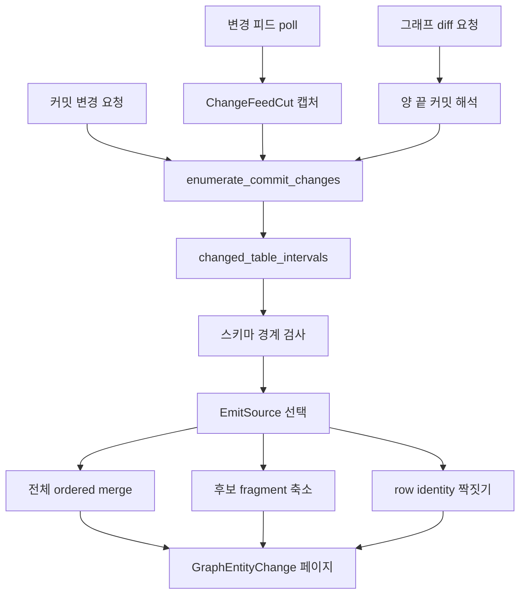

커밋된 그래프 이력은 두 방향으로 다시 쓰인다. 읽기 쪽은 두 커밋 사이의 변화를 노드와 엣지 단위로 돌려주는 변경 피드와 과거 시점 조회다. 저장 쪽은 작은 fragment 를 합치는 최적화, 아무 커밋도 가리키지 않는 Lance 버전을 지우는 정리, 오래된 저장 형식을 바꾸는 업그레이드다. 정리가 이력을 지우면 변경 피드가 그 구간을 이어 읽을 수 없으므로, 이 장은 두 방향을 함께 다룬다.

## 변경 읽기 경로 개요

Omnigraph 는 변경 기록을 따로 저장하지 않는다. 변경은 매번 두 그래프 snapshot 을 비교해 계산하는 파생 읽기 모델이다. 설계 문서 [RFC 0030](https://github.com/ModernRelay/omnigraph/blob/00b8cca842f2bf009bebeefcf765672b5ff64b26/docs/rfcs/0030-cdc-time-travel.md) 의 결정 절은 "This is a derived read model. It adds no WAL, transaction manager, change-log table, server-side cursor registry, delete tombstone, or second coordinator." 라고 적는다.

공개 표면은 세 가지이고, 모두 하나의 비공개 열거기를 공유한다.

| 표면 | 비교 대상 | 이어 읽기 수단 | 엔진 진입점 |
|---|---|---|---|
| 커밋 변경 | 한 커밋과 첫 번째 부모 | page token | [omnigraph.rs L2891-L2895](https://github.com/ModernRelay/omnigraph/blob/00b8cca842f2bf009bebeefcf765672b5ff64b26/crates/omnigraph/src/db/omnigraph.rs#L2891-L2895) |
| 변경 피드 | 브랜치 첫 부모 체인의 연속 커밋 | 내구 커서, page token | [omnigraph.rs L3043-L3047](https://github.com/ModernRelay/omnigraph/blob/00b8cca842f2bf009bebeefcf765672b5ff64b26/crates/omnigraph/src/db/omnigraph.rs#L3043-L3047) |
| 그래프 diff | 임의의 두 읽기 대상, 또는 브랜치와 merge base | page token | [omnigraph.rs L3132-L3138](https://github.com/ModernRelay/omnigraph/blob/00b8cca842f2bf009bebeefcf765672b5ff64b26/crates/omnigraph/src/db/omnigraph.rs#L3132-L3138) |



### 코드 분석: changed_table_intervals

파일: `crates/omnigraph/src/changes/mod.rs`, [mod.rs L85-L103](https://github.com/ModernRelay/omnigraph/blob/00b8cca842f2bf009bebeefcf765672b5ff64b26/crates/omnigraph/src/changes/mod.rs#L85-L103)

두 snapshot 에서 상태가 달라진 테이블 수명(lifetime)만 고르는 첫 단계를 본다.

```rust
pub(crate) fn changed_table_intervals<'a>(
    from: &'a Snapshot,
    to: &'a Snapshot,
) -> Vec<TableChangeInterval<'a>> {
    let mut by_identity =
        BTreeMap::<TableIdentity, (Option<&'a DatasetEntry>, Option<&'a DatasetEntry>)>::new();
    for entry in from.datasets() {
        by_identity.entry(entry.identity).or_default().0 = Some(entry);
    }
    for entry in to.datasets() {
        by_identity.entry(entry.identity).or_default().1 = Some(entry);
    }

    let mut intervals = by_identity
        .into_iter()
        .filter_map(|(identity, (from, to))| {
            (!same_state(from, to)).then_some(TableChangeInterval { identity, from, to })
        })
        .collect::<Vec<_>>();
```

manifest 항목을 타입 이름이 아니라 불변 `TableIdentity` 로 짝짓는다. 이름만 바꾼 타입은 한 구간으로 남고, 같은 이름으로 drop 후 다시 추가한 타입은 서로 다른 두 수명이 된다. `same_state` 는 게시 버전, native branch, staged 버전, transaction UUID 가 모두 같아야 같은 상태로 본다 ([mod.rs L112-L126](https://github.com/ModernRelay/omnigraph/blob/00b8cca842f2bf009bebeefcf765672b5ff64b26/crates/omnigraph/src/changes/mod.rs#L112-L126)). 두 브랜치가 같은 dataset 에서 detached 로 스테이징하면 게시 버전은 같아도 pin 이 다를 수 있기 때문이다. 이 단계가 행 열거 전에 비교할 테이블을 줄이는 CDC 가지치기 층이다.

## 정리

- 변경 피드, 커밋 변경, 그래프 diff 는 별도 로그 없이 두 snapshot 을 비교해 계산하며, 테이블을 불변 identity 로 짝지은 뒤 `id` 순 병합으로 insert, update, delete 를 정한다
- 후보 축소 경로는 Lance transaction 이 행 집합을 보존한다는 증명이 있을 때만 쓰고, `change_lineage` 가 row identity 짝짓기와 전체 merge 의 사용 방식을 정한다
- 피드 커서는 완전한 커밋 경계에서만 전진하고 블록 중간에서 끊긴 페이지는 page token 만 준다. 두 값 모두 체크섬이 붙은 4 KiB 이하 불투명 토큰이다
- 시간 여행은 커밋 id 나 snapshot 대상으로만 지정하고, 정리로 회수된 구간은 `ChangeFeedGap` 이 되어 기준선 핸드셰이크로 복구한다
- 최적화는 테이블별 compaction 을 detached 로 스테이징해 main 에 그래프 커밋 하나로 게시하고, 정리는 보존된 매니페스트 버전에서 시작하는 tracing collector 로 나머지를 지운다
- 저장 형식 17 로의 업그레이드는 오프라인 명령이 fence, legacy 기록, ref 변환, 활성화 순으로 진행하며 재실행으로 이어서 끝낸다
