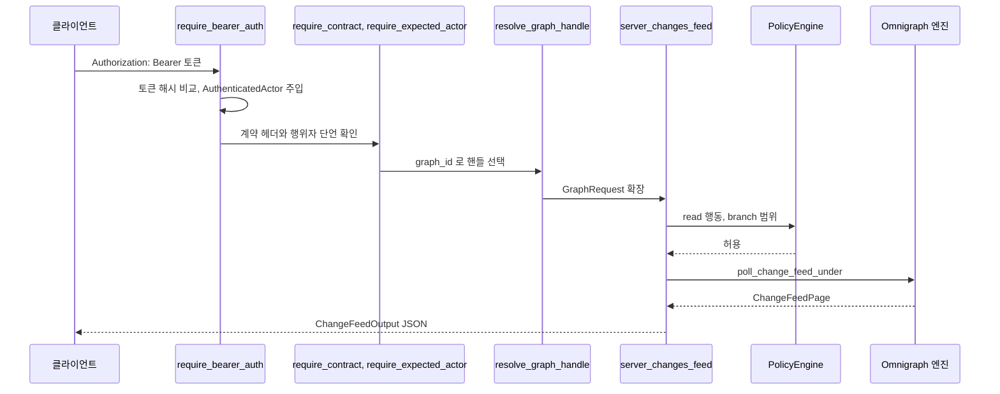

서버 라우터 구성과 인증, 요청 처리를 본다.

## HTTP 서버: 라우터와 작업 목록

`omnigraph-server` 는 axum 위에서 동작하는 클러스터 전용 서버다. 그래프별 경로는 모두 `/graphs/{graph_id}/` 아래에 있고 단일 그래프용 평면 경로는 없다 ([lib.rs L4053-L4059](https://github.com/ModernRelay/omnigraph/blob/00b8cca842f2bf009bebeefcf765672b5ff64b26/crates/omnigraph-server/src/lib.rs#L4053-L4059)).

### 코드 분석: build_app

파일: `crates/omnigraph-server/src/lib.rs`, [lib.rs L4055-L4069](https://github.com/ModernRelay/omnigraph/blob/00b8cca842f2bf009bebeefcf765672b5ff64b26/crates/omnigraph-server/src/lib.rs#L4055-L4069)

보호 라우터, 공개 probe, MCP 를 합치는 부분을 본다.

```rust
    let protected: Router<AppState> = Router::new()
        .nest(CATALOGUE_ROUTE_PREFIX, catalogue)
        .nest(handlers::CLUSTER_PATH_PREFIX, per_graph_protected)
        .merge(management)
        .merge(deployments);

    let mut app = http_operations::probes()
        .into_router()
        .route("/openapi.json", get(server_openapi))
        .merge(protected);
    // MCP needs an authenticated caller; without a credential source there is
    // no actor for its policy checks, so the endpoint does not exist.
    if state.has_credential_source() {
        app = app.merge(mcp::router(state.clone()));
    }
```

라우터는 네 묶음이다. 그래프별 작업, 그래프 목록 관리, 배포 제어, 카탈로그다. `/healthz`, `/readyz`, `/openapi.json` 만 인증 밖에 있다. 자격 증명 원본이 없으면 MCP 행위자를 정할 수 없으므로 `/mcp` 경로 자체가 생기지 않는다. 모든 응답에는 바깥 층에서 HTTP 계약 헤더, 401 challenge, 본문 크기 제한, 텔레메트리가 붙는다 ([lib.rs L4077-L4083](https://github.com/ModernRelay/omnigraph/blob/00b8cca842f2bf009bebeefcf765672b5ff64b26/crates/omnigraph-server/src/lib.rs#L4077-L4083)).

### 코드 분석: guarded

파일: `crates/omnigraph-server/src/lib.rs`, [lib.rs L4096-L4108](https://github.com/ModernRelay/omnigraph/blob/00b8cca842f2bf009bebeefcf765672b5ff64b26/crates/omnigraph-server/src/lib.rs#L4096-L4108)

모든 보호 라우터가 공유하는 미들웨어 순서를 본다.

```rust
fn guarded(
    state: &AppState,
    routes: Router<AppState>,
    inner: impl FnOnce(Router<AppState>) -> Router<AppState>,
) -> Router<AppState> {
    inner(routes.method_not_allowed_fallback(method_not_served))
        .route_layer(middleware::from_fn(require_expected_actor))
        .route_layer(middleware::from_fn(http_contract::require_contract))
        .route_layer(middleware::from_fn_with_state(
            state.clone(),
            require_bearer_auth,
        ))
}
```

axum 의 `route_layer` 는 나중에 붙인 층이 바깥이 된다. 그래서 요청은 bearer 인증, HTTP 계약 검사, 행위자 단언 검사 순으로 통과하고, 그래프별 라우터는 그 안에서 `resolve_graph_handle` 로 그래프 핸들을 잡는다 ([lib.rs L4006-L4024](https://github.com/ModernRelay/omnigraph/blob/00b8cca842f2bf009bebeefcf765672b5ff64b26/crates/omnigraph-server/src/lib.rs#L4006-L4024)). 메서드 fallback 을 가드 안쪽에 먼저 둔 이유를 주석이 설명한다. 인증 전에 어떤 메서드를 받는지 알려 주지 않기 위해서다 ([lib.rs L4086-L4095](https://github.com/ModernRelay/omnigraph/blob/00b8cca842f2bf009bebeefcf765672b5ff64b26/crates/omnigraph-server/src/lib.rs#L4086-L4095)). 배포와 카탈로그 라우터는 여기에 작업량 입장 제어 `admitted` 를 더한다 ([lib.rs L4110-L4118](https://github.com/ModernRelay/omnigraph/blob/00b8cca842f2bf009bebeefcf765672b5ff64b26/crates/omnigraph-server/src/lib.rs#L4110-L4118)).

### 코드 분석: 그래프 작업 등록

파일: `crates/omnigraph-server/src/http_operations.rs`, [http_operations.rs L169-L182](https://github.com/ModernRelay/omnigraph/blob/00b8cca842f2bf009bebeefcf765672b5ff64b26/crates/omnigraph-server/src/http_operations.rs#L169-L182)

13장의 변경 읽기와 유지보수가 경로로 등록되는 부분을 본다.

```rust
        .route("commit list", handlers::server_commit_list)
        .route("commit show", handlers::server_commit_show)
        .route("commit drop", handlers::server_commit_drop)
        .route("commit publish", handlers::server_commit_publish)
        .route("commit changes", handlers::server_commit_changes)
        .route("diff", handlers::server_diff)
        .route("changes poll", handlers::server_changes_feed)
        .route("changes baseline", handlers::server_changes_baseline)
        .route("start optimize", crate::recorded_operations::start_optimize)
        .route("get operation", crate::recorded_operations::get_operation)
        .route(
            "cancel operation",
            crate::recorded_operations::cancel_operation,
        );
```

등록은 경로 문자열이 아니라 작업 이름으로 한다. `route_with` 가 이름으로 공유 목록에서 `HttpOperation` 을 찾아 메서드와 경로를 꺼낸다 ([http_operations.rs L57-L72](https://github.com/ModernRelay/omnigraph/blob/00b8cca842f2bf009bebeefcf765672b5ff64b26/crates/omnigraph-server/src/http_operations.rs#L57-L72)). `HttpOperation` 은 이름, 메서드, 경로, 쓰기 능력, MCP 바인딩, CLI 바인딩을 담는다 ([operations.rs L91-L103](https://github.com/ModernRelay/omnigraph/blob/00b8cca842f2bf009bebeefcf765672b5ff64b26/crates/omnigraph-api-types/src/operations.rs#L91-L103)).

| 작업 이름 | 메서드와 경로 | MCP 도구 | 비고 |
|---|---|---|---|
| `changes poll` | `GET /graphs/{graph_id}/changes` | `changes_poll` | 읽기 |
| `changes baseline` | `POST /graphs/{graph_id}/changes/baseline` | 없음 | NDJSON 바이트 스트림이라 MCP 미노출 |
| `commit changes` | `GET /graphs/{graph_id}/commits/{commit_id}/changes` | `commits_changes` | 읽기 |
| `diff` | `GET /graphs/{graph_id}/diff` | `diff` | 읽기 |
| `start optimize` | `POST /graphs/{graph_id}/operations/optimize` | 없음 | 클러스터 작업 기록 아래에서 실행 |

행 정의는 [operations.rs L348-L366](https://github.com/ModernRelay/omnigraph/blob/00b8cca842f2bf009bebeefcf765672b5ff64b26/crates/omnigraph-api-types/src/operations.rs#L348-L366), [operations.rs L398-L406](https://github.com/ModernRelay/omnigraph/blob/00b8cca842f2bf009bebeefcf765672b5ff64b26/crates/omnigraph-api-types/src/operations.rs#L398-L406), [operations.rs L416-L424](https://github.com/ModernRelay/omnigraph/blob/00b8cca842f2bf009bebeefcf765672b5ff64b26/crates/omnigraph-api-types/src/operations.rs#L416-L424) 에 있다. 개발 문서 [http-api.md](https://github.com/ModernRelay/omnigraph/blob/00b8cca842f2bf009bebeefcf765672b5ff64b26/docs/dev/http-api.md) 는 서버, CLI, MCP 의 테스트가 각자 실제 등록을 이 목록과 대조한다고 적는다.

`start optimize` 는 요청 안에서 끝나지 않는다. `recorded_operations.rs` 의 머리 주석에 따르면 최적화는 호출자가 정한 작업 id 로 제출되고, 수락, 시작, 게시 직전, 종료 시점마다 `__cluster/operations.json` 에 조건부 쓰기 한 번으로 상태를 기록한다 ([recorded_operations.rs L1-L10](https://github.com/ModernRelay/omnigraph/blob/00b8cca842f2bf009bebeefcf765672b5ff64b26/crates/omnigraph-server/src/recorded_operations.rs#L1-L10)). 실행은 13장의 `Omnigraph::optimize_as` 를 부르되, 게이트 아래 권한 캡처, 기록 갱신용 게시 직전 훅, 취소 핸들을 붙이고 이전 결과의 `start_at` 에서 이어 간다 ([recorded_operations.rs L1068-L1084](https://github.com/ModernRelay/omnigraph/blob/00b8cca842f2bf009bebeefcf765672b5ff64b26/crates/omnigraph-server/src/recorded_operations.rs#L1068-L1084)).

## 인증과 요청 처리

요청 하나가 서버를 지나 엔진에 이르는 순서를 변경 피드 요청으로 따라간다.



### 코드 분석: require_bearer_auth

파일: `crates/omnigraph-server/src/handlers.rs`, [handlers.rs L411-L438](https://github.com/ModernRelay/omnigraph/blob/00b8cca842f2bf009bebeefcf765672b5ff64b26/crates/omnigraph-server/src/handlers.rs#L411-L438)

토큰에서 행위자를 만드는 미들웨어의 앞부분을 본다.

```rust
pub(crate) async fn require_bearer_auth(
    State(state): State<AppState>,
    mut request: Request,
    next: Next,
) -> std::result::Result<Response, ApiError> {
    // Request extensions supplied by an embedder are projections, never an
    // authentication result for this request. Rebuild both from its credential.
    request.extensions_mut().remove::<ResolvedActor>();
    request.extensions_mut().remove::<AuthenticatedActor>();
    if !state.requires_bearer_auth() {
        return Ok(next.run(request).await);
    }

    let provided_token = crate::challenge::bearer_token(request.headers())?;
    let actor = match state.authenticate_bearer_token(provided_token) {
        Ok(actor) => actor,
        Err(crate::oidc_identity::OidcRefusal::Invalid) => {
            return Err(ApiError::unauthorized(
                Unauthenticated::Refused,
                "invalid bearer token",
            ));
        }
```

임베딩한 쪽이 미리 넣어 둔 행위자 확장은 먼저 지운다. 인증 결과는 언제나 이 요청의 자격 증명에서 다시 만든다. 토큰 원본은 `TokenSource` 트레이트로 추상화되어 있고 기본 구현은 환경 변수와 파일에서 `(actor_id, token)` 쌍을 읽는다 ([auth.rs L22-L54](https://github.com/ModernRelay/omnigraph/blob/00b8cca842f2bf009bebeefcf765672b5ff64b26/crates/omnigraph-server/src/auth.rs#L22-L54)). 평문 토큰은 받자마자 SHA-256 으로 해시되어 저장된다 ([lib.rs L107-L112](https://github.com/ModernRelay/omnigraph/blob/00b8cca842f2bf009bebeefcf765672b5ff64b26/crates/omnigraph-server/src/lib.rs#L107-L112)). OIDC 신원 신뢰가 설정되면 같은 자리에서 서명된 토큰도 검증한다.

`require_expected_actor` 는 `omnigraph-if-actor` 헤더가 자격 증명이 해석한 행위자와 다르면 거절한다. 이 헤더는 요청을 좁힐 수만 있고 행위자를 공급하지는 않는다 ([handlers.rs L446-L489](https://github.com/ModernRelay/omnigraph/blob/00b8cca842f2bf009bebeefcf765672b5ff64b26/crates/omnigraph-server/src/handlers.rs#L446-L489)). CLI 의 `--as` 가 서버 대상에서 단언으로만 쓰이는 이유가 이것이다.

### 코드 분석: server_changes_feed

파일: `crates/omnigraph-server/src/handlers.rs`, [handlers.rs L4945-L4962](https://github.com/ModernRelay/omnigraph/blob/00b8cca842f2bf009bebeefcf765672b5ff64b26/crates/omnigraph-server/src/handlers.rs#L4945-L4962)

핸들러가 엔진을 부르는 마지막 부분을 본다.

```rust
    let scope = api::change_scope(&params.kinds, &params.types, &params.ops);
    let page = {
        let db = &handle.engine;
        db.poll_change_feed_under(
            omnigraph::changes::ChangeFeedRequest {
                branch: Some(branch.clone()),
                position,
                scope,
                max_changes: params.limit,
                max_bytes: None,
                max_commits: None,
            },
            state.change_lineage(),
        )
        .await
        .map_err(change_route_error)?
    };
    Ok(Json(api::change_feed_output(&page)))
```

핸들러는 쿼리를 파싱하고, 정책에 `read` 행동과 브랜치 범위로 묻고 ([handlers.rs L4915-L4926](https://github.com/ModernRelay/omnigraph/blob/00b8cca842f2bf009bebeefcf765672b5ff64b26/crates/omnigraph-server/src/handlers.rs#L4915-L4926)), `cursor`, `start`, `page_token` 이 둘 이상이면 거절한 뒤 엔진을 부른다 ([handlers.rs L4928-L4943](https://github.com/ModernRelay/omnigraph/blob/00b8cca842f2bf009bebeefcf765672b5ff64b26/crates/omnigraph-server/src/handlers.rs#L4928-L4943)). HTTP 는 바이트 상한과 커밋 상한을 노출하지 않으므로 둘 다 `None` 이다. `change_lineage` 는 서버 설정에서 온다. 엔진 오류는 `change_route_error` 가 HTTP 상태로 바꾼다. 13장의 `ChangeFeedGap` 은 410, 스키마 경계는 409 다 ([handlers.rs L4883-L4901](https://github.com/ModernRelay/omnigraph/blob/00b8cca842f2bf009bebeefcf765672b5ff64b26/crates/omnigraph-server/src/handlers.rs#L4883-L4901)).
