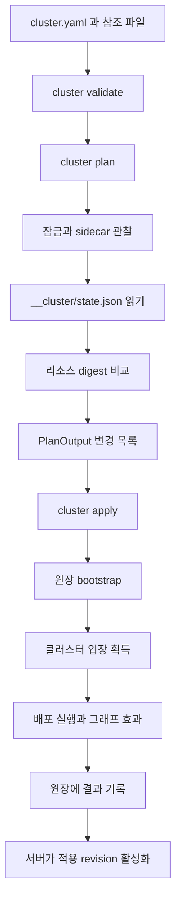

클러스터 선언의 미리보기와 적용 절차를 본다.

## 클러스터 plan 과 apply

클러스터는 그래프, 스키마, 저장 질의, 정책을 `cluster.yaml` 묶음으로 선언하고, 적용 결과를 저장소 루트의 원장(ledger)에 기록하는 제어면이다. [control-plane.md](https://github.com/ModernRelay/omnigraph/blob/00b8cca842f2bf009bebeefcf765672b5ff64b26/docs/dev/control-plane.md) 는 세 보기를 구분한다. 운영자 작업 공간의 원하는 구성, 저장소 루트의 적용 원장, 서버가 읽는 검증된 서빙 snapshot 이다. `cluster.yaml` 을 고쳐도 apply 전에는 아무것도 바뀌지 않는다. [RFC 0004](https://github.com/ModernRelay/omnigraph/blob/00b8cca842f2bf009bebeefcf765672b5ff64b26/docs/rfcs/0004-cluster-graph-schema-apply.md) 가 apply 를 그래프 생성과 스키마 갱신의 진입점으로 정했고, 복구 sidecar 와 승인 산출물 같은 일부 결정은 이후 서버 런타임 RFC 로 대체되었다.



### 코드 분석: plan 의 상태 관찰

파일: `crates/omnigraph-cluster/src/lib.rs`, [lib.rs L300-L318](https://github.com/ModernRelay/omnigraph/blob/00b8cca842f2bf009bebeefcf765672b5ff64b26/crates/omnigraph-cluster/src/lib.rs#L300-L318)

plan 이 쓰기 없이 현재 원장을 읽는 부분을 본다.

```rust
    backend
        .observe_lock(&mut observations, &mut diagnostics)
        .await;

    // Plan reports pending recovery without executing it.
    warn_pending_recovery_sidecars(&backend, &mut diagnostics).await;

    let mut prior_state: Option<ClusterState> = None;
    let mut prior_cas = None;
    if !has_errors(&diagnostics) {
        match backend.read_state(&mut observations).await {
            Ok(snapshot) => {
                prior_cas = snapshot.state_cas;
                if let Some(state) = snapshot.state {
                    prior_state = Some(state);
                }
            }
            Err(diagnostic) => diagnostics.push(diagnostic),
        }
```

plan 은 관찰이다. 잠금 상태와 남은 복구 sidecar 를 진단으로 보고만 하고, 원장을 읽은 뒤 적용된 리소스 digest 와 원하는 묶음의 digest 를 비교해 변경 목록을 만든다 ([lib.rs L321-L338](https://github.com/ModernRelay/omnigraph/blob/00b8cca842f2bf009bebeefcf765672b5ff64b26/crates/omnigraph-cluster/src/lib.rs#L321-L338)). 결과 `PlanOutput` 의 `authority` 필드 주석은 "Plans are observations and never reserve writer authority." 다 ([types.rs L244-L260](https://github.com/ModernRelay/omnigraph/blob/00b8cca842f2bf009bebeefcf765672b5ff64b26/crates/omnigraph-cluster/src/types.rs#L244-L260)). 변경 하나는 리소스 주소, `Create`, `Update`, `Delete` 중 하나의 연산, 전후 digest, 예상 처분을 담는다 ([types.rs L200-L219](https://github.com/ModernRelay/omnigraph/blob/00b8cca842f2bf009bebeefcf765672b5ff64b26/crates/omnigraph-cluster/src/types.rs#L200-L219)). 스키마 갱신이면 엔진의 마이그레이션 계획도 함께 싣는다.

### 코드 분석: apply_direct_bundle

파일: `crates/omnigraph-cluster/src/deployment/execution.rs`, [execution.rs L1668-L1683](https://github.com/ModernRelay/omnigraph/blob/00b8cca842f2bf009bebeefcf765672b5ff64b26/crates/omnigraph-cluster/src/deployment/execution.rs#L1668-L1683)

직접 apply 가 입장을 얻기 전까지의 순서를 본다.

```rust
    bootstrap_ledger(&store, &bundle, caller).await?;
    if let Some(id) = requested_id {
        let (state, _) = read_existing(&store).await?;
        let found = lookup(&state, id)?;
        if !matches!(found, DeploymentLookup::NotRecorded) {
            lookup_policies(&store, &state, caller, Some(id)).await?;
            verify_recorded_input(&state, id, &bundle)?;
            return Ok(found);
        }
    }
    // Every control and graph write of this deployment runs in one storage
    // scope, so a converged result can prove them settled before release.
    let store = store.with_io_scope(omnigraph_storage::StorageIoScope::new())?;
    let admission = admission::acquire_with_store(&store, ClusterAdmissionPurpose::Deployment)
        .await?
        .ok_or_else(|| refusal("state_missing", "cluster ledger is missing"))?;
```

같은 배포 id 로 다시 제출하면 기록된 결과를 조회만 하고 다시 실행하지 않는다 ([execution.rs L1602-L1620](https://github.com/ModernRelay/omnigraph/blob/00b8cca842f2bf009bebeefcf765672b5ff64b26/crates/omnigraph-cluster/src/deployment/execution.rs#L1602-L1620)). 실행 전에는 클러스터 입장을 얻고, 원장 버전이 2 가 아니면 `ledger_upgrade_required` 로 거절한다 ([execution.rs L20-L28](https://github.com/ModernRelay/omnigraph/blob/00b8cca842f2bf009bebeefcf765672b5ff64b26/crates/omnigraph-cluster/src/deployment/execution.rs#L20-L28)). 서버 소유 배포는 같은 실행을 서버 프로세스 안에서 하고 결과를 그 자리에서 활성화한다. 직접 apply 는 서버를 다시 시작해야 반영된다. 사용자 문서는 서버 소유 배포에 클러스터 범위의 `config_manage` 가, 스키마 변경과 그래프 삭제에 해당 그래프의 `read` 와 `schema_apply` 가 추가로 필요하다고 적는다 ([clusters/index.md](https://github.com/ModernRelay/omnigraph/blob/00b8cca842f2bf009bebeefcf765672b5ff64b26/docs/user/clusters/index.md)).

클러스터 저장소 루트에는 적용 원장 `__cluster/state.json`, 내용 주소 방식 리소스 `__cluster/resources/`, 제어 잠금 `__cluster/lock.json`, 기록된 작업 상태 `__cluster/operations.json`, apply 가 관리하는 그래프 루트 `graphs/<id>.omni/` 가 놓인다 ([control-plane.md](https://github.com/ModernRelay/omnigraph/blob/00b8cca842f2bf009bebeefcf765672b5ff64b26/docs/dev/control-plane.md)). [RFC 0035](https://github.com/ModernRelay/omnigraph/blob/00b8cca842f2bf009bebeefcf765672b5ff64b26/docs/rfcs/0035-served-operation-ownership.md) 의 서버 작업 소유 설계는 2026-09-29 에 서버 런타임 RFC 로 대체되었고, 현재 기록된 작업은 위 `operations.json` 기반으로 동작한다.
