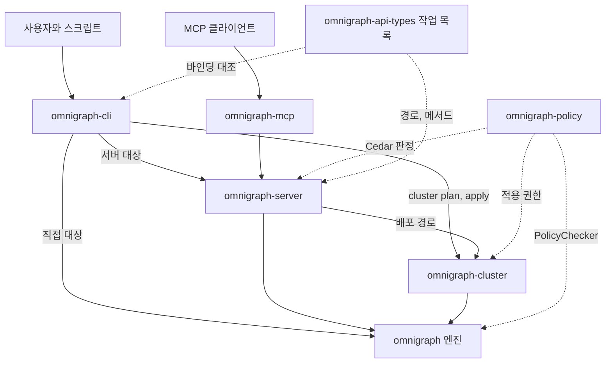

엔진 크레이트 `omnigraph` 는 라이브러리다. 사람과 에이전트가 실제로 그래프를 쓰는 길은 그 위에 놓인 다섯 크레이트가 만든다. CLI 는 명령을 해석해 엔진을 직접 열거나 서버에 요청하고, 서버는 HTTP 와 MCP 로 같은 핸들러를 노출하고, 정책 크레이트는 Cedar 로 허용 여부를 정하고, 클러스터 크레이트는 여러 그래프의 스키마, 저장 질의, 정책을 선언형 묶음으로 적용한다. 이 장은 각 크레이트의 진입점과 핵심 타입만 짚는 개요다. 엔진 내부의 쓰기, 병합, 변경 피드는 9장, 12장, 13장에서 다룬다.

## 운영 표면 구성 개요

다섯 크레이트는 서로 다른 층에 있지만 엔진을 호출하는 경로는 둘뿐이다. 프로세스 안에서 `Omnigraph` 핸들을 직접 여는 경로와, `omnigraph-server` 의 HTTP 핸들러를 거치는 경로다. MCP 는 서버 안에 마운트되어 HTTP 핸들러를 다시 쓰고, 클러스터는 서버와 CLI 양쪽에서 호출되는 제어면(control plane)이다.

| 크레이트 | 진입점 | 핵심 타입 |
|---|---|---|
| `omnigraph-cli` | `main`, `app::run_from` | `Requirement`, `TargetBinding`, `GraphClient` |
| `omnigraph-server` | `build_app`, `serve` | `HttpRoutes`, `AppState` |
| `omnigraph-policy` | `PolicyCompiler::compile` | `PolicyAction`, `PolicyEngine`, `PolicyChecker` |
| `omnigraph-mcp` | `router` | `Host`, `ToolSpec` |
| `omnigraph-cluster` | `plan_config_dir`, `apply_deployment` | `PlanOutput`, `PlanChange` |

세 표면이 어떤 작업을 노출하는지는 `omnigraph-api-types` 의 작업 목록이 한곳에 적는다. 머리 주석은 이 목록이 HTTP, MCP, CLI 바인딩을 기술할 뿐 동등성을 약속하지 않으며, 빠지거나 제한된 바인딩은 이유를 적는다고 밝힌다 ([operations.rs L1-L9](https://github.com/ModernRelay/omnigraph/blob/00b8cca842f2bf009bebeefcf765672b5ff64b26/crates/omnigraph-api-types/src/operations.rs#L1-L9)).

## 정리

- CLI 는 명령마다 `Requirement` 를 정해 대상 종류를 I/O 전에 거르고, 확정된 대상 하나를 `GraphClient` 의 임베디드 또는 원격 가지로 실행한다. 두 가지는 같은 출력 타입을 돌려준다
- 서버는 `omnigraph-api-types` 의 작업 목록에서 경로와 메서드를 가져와 라우터를 만들고, 모든 보호 경로에 bearer 인증, 계약 검사, 행위자 단언 순의 가드를 씌운다
- 정책은 YAML 규칙을 Cedar `permit` 문으로 컴파일해 strict 검증한 뒤 판정하며, 서버 핸들러와 엔진의 `enforce` 가 같은 `(branch, target_branch)` 범위로 같은 판정을 받는다
- MCP 는 리스너 없는 프로토콜 크레이트이고, 서버의 `Host` 구현이 HTTP 와 같은 핸들러, 행위자, 정책으로 도구를 실행한다. 호출자 대기는 기한으로 자르되 시작된 작업은 끝까지 소유한다
- 클러스터 plan 은 원장을 읽기만 하는 관찰이고, apply 는 원장 bootstrap, 입장 획득, 배포 실행, 원장 기록 순으로 진행하며 같은 배포 id 재제출은 다시 실행하지 않는다
