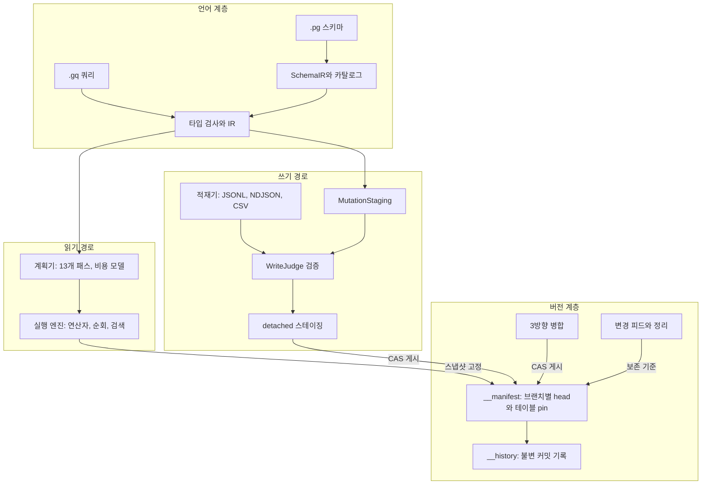

Omnigraph의 설계는 "여러 Lance dataset을 `__manifest` CAS 한 번으로 하나의 그래프 커밋처럼 보이게 한다"는 한 원칙으로 요약된다. 이 장은 앞 장의 내용을 이 원칙 기준으로 다시 묶고, 장점과 한계, 문서와 코드가 다른 곳, 유사 시스템과의 차이를 정리한다.

## 전체 구조 요약

쿼리와 쓰기는 같은 매니페스트를 기준으로 갈라진다. 읽기는 매니페스트 버전 하나를 스냅샷으로 고정하고, 쓰기는 detached 버전을 스테이징한 뒤 매니페스트의 다음 버전을 CAS로 게시한다.

| 계층 | 핵심 결정 | 장 |
|---|---|---|
| 스키마 | 이름이 아니라 수락된 SchemaIR의 안정 식별자가 타입과 테이블을 정한다. 이름 변경은 식별자를 유지한다 | 03 |
| 쿼리 언어 | 오류마다 고정 `T` 코드. 무한 순회와 `limit` 없는 순위 정렬은 타입 검사에서 거부한다 | 04 |
| 계획 | 계획은 `accept_query` 한 경로로만 만들고, 통계는 `PlanSource`로만 읽어 계획에 기록한다 | 05 |
| 실행 | 같은 직렬화 계획과 같은 스냅샷이면 결과와 연산자 선택이 같다. 실행 중 대체 경로는 계획에 선언된 것만 쓴다 | 06 |
| 검색 | `nearest`, `bm25`, `rrf`는 노드 스캔의 순위 접근으로 계획된다. 인덱스는 정확성이 아니라 비용만 바꾼다 | 07 |
| 저장 | 그래프 테이블 쓰기는 모두 detached commit이다. Lance 13.0.0을 수정 없이 고정한다 | 08 |
| 쓰기 | 공개 지점은 `__manifest` CAS 한 번이다. 프로세스 안 게이트는 순서만 정한다 | 09 |
| 적재와 검증 | 세 입력 형식이 `load_input_as` 하나로 모이고, 한 번의 sweep으로 제약을 판정한다 | 10 |
| 카탈로그 | 매니페스트 버전 하나가 한 시점의 그래프 전체를 정한다. 커밋 기록은 put-if-absent 불변 객체다 | 11 |
| 병합 | "한쪽만 바꾸면 그쪽, 같게 바꾸면 target, 다르게 바꾸면 충돌" 규칙 하나로 행을 분류한다 | 12 |
| 변경 피드와 유지 보수 | 별도 로그 없이 두 스냅샷을 비교해 변경을 계산한다. 정리는 그래프 기준의 tracing collector가 맡는다 | 13 |
| 운영 표면 | CLI 임베디드 경로와 서버 원격 경로가 같은 출력 타입을 쓰고, 정책 판정도 서버와 엔진이 공유한다 | 14 |

## 장점

| 장점 | 근거 | 장 |
|---|---|---|
| 그래프 전체 단위의 원자적 커밋 | 여러 테이블 변경을 매니페스트의 다음 버전 하나로 게시한다. 게시 전 실패는 그래프를 바꾸지 않는다 | 09, 11 |
| 브랜치 생성과 병합 비용이 낮음 | 브랜치는 `__manifest`의 Lance branch 하나다. target이 base와 같으면 병합 대부분이 포인터 교체로 끝난다 | 12 |
| 복구 절차가 단순함 | 일반 쓰기는 sidecar, roll-forward, rollback을 남기지 않는다. 게시되지 않은 버전은 수집기가 회수한다 | 13 |
| 그래프와 검색의 한 쿼리 결합 | 순회 결과로 후보를 좁히는 prefilter gate와 RRF 융합이 계획기 안에 있다 | 07 |
| deterministic 계획과 실행 | 실행이 세션 설정이나 환경 변수를 직접 읽지 않으므로 같은 계획이면 같은 결과와 연산자 선택이 나온다. explain과 실행이 같은 계획을 쓴다 | 05, 06 |
| 스키마 변경 이력의 안정성 | 이름 변경이 물리 키와 테이블 이력을 바꾸지 않는다. 데이터 채우기가 필요한 변경은 진단 코드와 함께 거부한다 | 03 |
| 개방형 저장 형식 | 노드와 엣지 테이블이 Lance dataset이라 다른 Lance 도구로도 읽을 수 있다(읽기 한정. 직접 쓰기는 금지된다) | 08 |
| 검증 장치의 규모 | GQT 논리 테스트, 고정된 v1 참조 엔진 비교, deterministic 시뮬레이션, failpoint 테스트를 갖춘다 | 02, 06 |

## 한계와 주의점

| 한계 | 내용 | 장 |
|---|---|---|
| 그래프 간 트랜잭션 없음 | 저장 루트 하나가 일관성 경계다 | 01, 08 |
| 쓰기 처리량의 상한 | 브랜치마다 매니페스트 CAS가 직렬화 지점이다. 동시 게시가 겹치면 재준비가 일어난다(같은 프로세스 안에서는 두 번째 시도로 끝난다) | 09, 11 |
| 쿼리 한 개의 쓰기 종류 제한 | 한 변경 쿼리는 구성 연산과 삭제를 섞을 수 없다 | 09 |
| 적재 예산 | append, merge는 테이블당 8,192행 단위와 바이트 예산으로 제한되고, 키 있는 쓰기 한 줄은 32 MiB가 상한이다 | 10 |
| 그래프 breaker는 spill 없음 | 메모리 예약을 넘는 그래프 연산자는 디스크로 내리지 않고 거부한다 | 06 |
| 벡터 인덱스 종류 | 벡터 검색은 IVF_FLAT, L2 인덱스만 쓰고 나머지는 flat 검색으로 대신한다 | 07 |
| 적재 시 임베딩 없음 | 적재기는 벡터를 만들지 않는다. 임베딩은 쿼리 텍스트에만 적용되고, 적재 시 임베딩 RFC 0015는 구현되지 않았다 | 07, 10 |
| 정리 도구 혼용 금지 | Lance 자체 `cleanup_old_versions`를 그래프 루트에 돌리면 detached 버전 파일이 지워져 스냅샷이 깨질 수 있다 | 08, 13 |
| 오프라인 업그레이드 | 저장 형식 13 이하 그래프는 오프라인 `omnigraph upgrade`로만 현재 형식 17이 된다 | 13 |
| 빠른 변화 속도 | 기준 커밋 하루 사이에도 여러 커밋이 들어오고, RFC 상태 표기가 코드보다 늦다. 아래 표 참고 | 15 |

## 문서와 코드의 차이

집필하면서 확인한 문서와 코드의 차이를 모았다. 대부분 RFC의 상태 표기가 구현을 따라가지 못했거나 설계가 바뀐 뒤 문서가 갱신되지 않은 경우다. 책 본문은 모두 코드를 기준으로 썼다.

| 대상 문서 | 문서 내용 | 코드 | 장 |
|---|---|---|---|
| RFC 0012 | 임베딩 설정 필드 6개(`dim`, `normalize` 포함) | `EmbeddingConfig` 필드 4개, 스키마에는 원본 속성과 모델만 기록 | 07 |
| RFC 0027 | not-started | `plan_lineage_merge` 구현 완료, 기본값 `On`(디버그 빌드는 `verify`), 열 필터가 아닌 fragment와 deletion 파일 비교 방식 | 12 |
| RFC 0030 | 실패 오류 `HistoricalDataReclaimed` | 변형 이름 `HistoricalVersionReclaimed { published_dataset_version }` | 13 |
| RFC 0043 | Lance 11 전제 | `Cargo.toml`은 Lance `=13.0.0`, analyzer 세대 상수 이름에는 `lance11.0.0`이 남음 | 07 |
| RFC 0047 | draft, in-progress | `T27`, `FullTextIndexRequired`, 순위 보고가 이미 구현됨 | 07 |
| RFC 0055 | 브랜치 문장 create, delete, merge, list | 문법은 `diff`, `merge-base`, `dry run`, `from commit`, `as commit`까지 받음 | 04 |
| RFC 0057 | Blob 없는 테이블 최대 4개 동시 준비 | 테이블을 하나씩 순서대로 처리 | 12 |
| RFC 0062, 0063 | `table_version:...` 키, `graph_head:<branch>` 행 | identity당 `table` 행 하나와 `manifest_version` 필드, `graph_commit` 행 하나가 head | 11 |
| RFC 0068 | not-started | `__history/legacy/` 배치는 구현됨 | 11 |
| 계획기 `lib.rs` 주석 | 계획기가 "RFC 0068" | 실제 0068번은 커밋 기록 RFC, 수락 모듈은 RFC 0047 인용 | 05 |
| `engine/mod.rs` 주석 | 관계형 노드는 DataFusion 연산자 사용 | 실제 사용하는 DataFusion 연산자는 `AggregateExec` 하나 | 06 |
| `docs/dev/execution.md` | `@key` 동등 조건만 추정 행 수를 1로 줄임 | unique 속성 동등 조건과 목록 포함 조건도 추정을 줄임 | 05 |
| `docs/user/schema/index.md` | 예약 이름 `_distance`, `_score` | `_rrf`도 예약 | 03 |
| `docs/user/operations/maintenance.md` | `--keep N`은 최신 그래프 커밋 N개 보존 | `retained_by_position`은 `__manifest` 버전 번호 단위로 셈 | 13 |
| `MutationOpKind` 주석 | Update, Delete가 live HEAD를 열고 `ensure_expected_version` 실행 | `WriteTxn` 경로는 `open_pinned_for_write`로 pin만 엶 | 09 |
| `docs/dev/architecture.md` 그림 | `omnigraph-seams` 없음 | 엔진, 코어, 카탈로그가 모두 의존 | 02 |
| `scoped.rs`, 오류 분류 주석 | Lance 11, object_store 0.13 | Lance 13.0.0, object_store 0.14.1 | 08 |

> **주의**: 위 차이는 기준 커밋 `00b8cca` 시점이다. 원본은 RFC 머리말에 상태를 직접 적는 방식이라, 이후 커밋에서 문서 쪽이 갱신됐을 수 있다.

## 유사 시스템과의 비교

아래 표의 다른 시스템 설명은 이 책에서 코드를 읽지 않았으므로 모두 (미검증)이다. Omnigraph 열만 이 책의 코드 분석에 근거한다.

| 구분 | Omnigraph | Neo4j (미검증) | Kùzu (미검증) | LanceDB (미검증) | Dolt, TerminusDB 류 버전 DB (미검증) |
|---|---|---|---|---|---|
| 데이터 모델 | 타입 있는 속성 그래프, 스키마 필수 | 속성 그래프, 스키마 선택 | 타입 있는 속성 그래프 | 벡터 중심 테이블 | 관계형 테이블 또는 문서 그래프 |
| 쿼리 언어 | 자체 `.gq` | Cypher | Cypher | SQL 유사 API, 벡터 검색 API | SQL 또는 자체 언어 |
| 저장 | 객체 저장소의 Lance dataset 여러 개 | 로컬 디스크 전용 저장 형식 | 내장형 컬럼 저장 | Lance dataset | 자체 저장 형식 |
| 브랜치와 병합 | 그래프 전체 브랜치, 3방향 행 병합 | 없음 | 없음 | dataset 단위 버전 | 브랜치, 병합 제공 |
| 벡터와 전문 검색 | 쿼리 언어 안에서 그래프 패턴과 결합 | 인덱스 기능으로 제공 | 확장으로 제공 | 핵심 기능 | 일반적으로 없음 |
| 배포 | 임베디드 라이브러리, CLI, 서버, 클러스터 선언 | 서버 | 임베디드 | 임베디드, 클라우드 | 서버 |

비교에서 Omnigraph가 차지하는 위치는 "Lance의 dataset 버전 기능을 그래프 단위로 묶어 버전 DB의 브랜치와 그래프 DB의 순회, 벡터 DB의 검색을 한 엔진에 모은 것"이다. 반대로 Cypher 호환성, 그래프 간 트랜잭션, 대규모 동시 쓰기 처리량은 설계 목표에 들어 있지 않다.

## 적합한 용도와 부적합한 용도

| 판단 | 용도 | 이유 |
|---|---|---|
| 적합 | 에이전트마다 브랜치를 주고 검토 뒤 병합하는 공유 메모리 | 그래프 전체 브랜치, 행 단위 충돌 보고, 원자적 병합 커밋 |
| 적합 | 스키마가 정해진 지식 그래프에서 순회와 하이브리드 검색을 함께 쓰는 검색 | 한 쿼리 안에서 순회 조건, `nearest`, `bm25`, `rrf` 결합 |
| 적합 | 실험 결과나 학습 데이터를 버전별로 남기고 시점 조회가 필요한 데이터 계층 | 커밋 단위 time travel, 두 시점 diff, 변경 피드 |
| 적합 | 서버 없이 객체 저장소만으로 운영해야 하는 환경 | 저장과 계산 분리, 임베디드 엔진 |
| 부적합 | 초당 많은 작은 쓰기가 한 브랜치에 몰리는 OLTP 부하 | 브랜치별 매니페스트 CAS 직렬화, 테이블별 Lance 커밋 비용 |
| 부적합 | 스키마 없이 속성이 자주 바뀌는 데이터 | 스키마 필수, 데이터 채우기가 필요한 마이그레이션은 거부 |
| 부적합 | Cypher 기반 기존 도구와 쿼리를 그대로 옮기는 경우 | 자체 `.gq` 언어 |
| 주의 | 대규모 벡터 검색 품질이 핵심인 경우 | IVF_FLAT, L2 인덱스만 사용. 적재 시 임베딩 미구현 |

## 정리

- Omnigraph는 Lance의 dataset 단위 기능(버전, branch, 인덱스, compaction)을 `__manifest` CAS로 묶어 그래프 단위로 끌어올린 엔진이다
- 강점은 그래프 전체 원자적 커밋, 저비용 브랜치와 행 단위 병합, deterministic 계획과 실행, 그래프 순회와 검색의 한 쿼리 결합이다
- 한계는 그래프 간 트랜잭션 부재, 브랜치별 CAS 직렬화로 인한 쓰기 처리량, 벡터 인덱스 종류, 적재 시 임베딩 부재다
- RFC 상태 표기가 구현보다 늦은 경우가 많으므로, 동작은 RFC가 아니라 코드와 `docs/dev`를 기준으로 판단해야 한다
- 다른 그래프 DB, 벡터 DB, 버전 DB와의 비교는 이 책에서 검증하지 않은 내용이며, 도입 판단 전에 각 시스템을 직접 확인해야 한다
