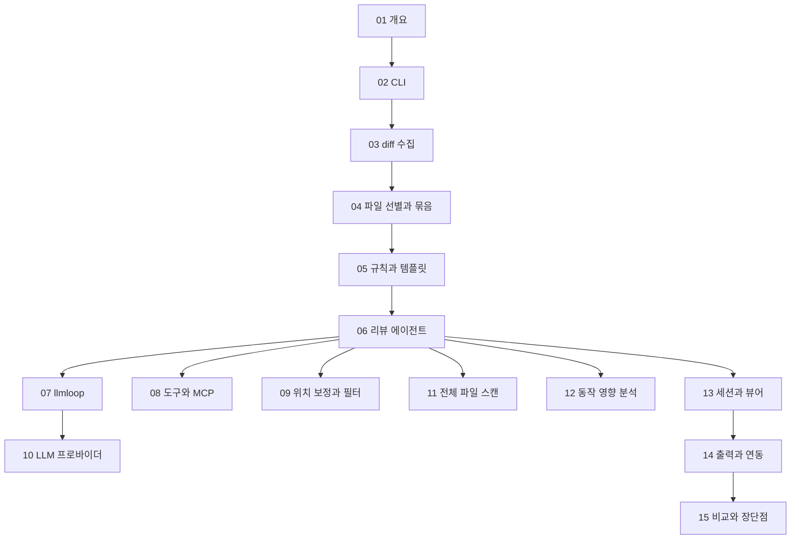

OpenCodeReview(`ocr`)는 Alibaba 그룹이 사내 공식 AI 코드 리뷰 도구로 쓰던 코드를 공개한 Go CLI다. 이 책은 그 코드를 diff 수집부터 코멘트 출력까지 따라가며, 리뷰 과정의 어느 부분을 코드가 정하고 어느 부분을 LLM 에이전트에게 맡기는지를 소스 위치와 함께 설명한다.

## 책의 구성

범용 코딩 에이전트에게 "이 PR을 리뷰해 달라"고 맡기면 일부 파일을 건너뛰거나, 지적한 줄 번호가 실제 코드와 어긋나거나, 프롬프트를 조금만 바꿔도 결과가 흔들린다. OpenCodeReview는 이 문제를 파일 선별, 묶음 구성, 규칙 매칭, 코멘트 위치 확인을 코드로 고정하고, 파일 읽기와 검색 같은 동적 판단만 에이전트에게 맡기는 방식으로 다룬다. 그래서 LLM 응용 프로그램을 만들 때 "모델이 해야 할 일"과 "프로그램이 보장해야 할 일"을 어디서 나누는지 읽기에 좋은 교재다.

| 부분 | 장 |
|---|---|
| 전체 구성, CLI, 첫 실행 | 01~02장 |
| 입력 준비: diff 수집, 파일 선별과 묶음, 규칙과 템플릿 | 03~05장 |
| 리뷰 실행: 에이전트 본체, llmloop, 도구, 위치 보정과 필터 | 06~09장 |
| 모델 연결: LLM 클라이언트와 프로바이더 | 10장 |
| 다른 실행 경로: 전체 파일 스캔, 동작 영향 분석 | 11~12장 |
| 결과 보관과 연동: 세션과 뷰어, 출력 형식, 위임 모드, ACP | 13~14장 |
| 범용 에이전트와의 비교 | 15장 |

## 권장 읽기 순서

01장에서 전체 흐름을 잡은 뒤 03장부터 06장까지는 순서대로 읽는 편이 좋다. 리뷰 한 번이 지나가는 경로가 그 순서이기 때문이다. 07장부터는 관심 있는 장을 골라 읽어도 된다. LLM 연동 코드를 만드는 독자라면 07장(도구 호출 루프와 압축)과 10장(프로바이더 계층)을, 코드 리뷰 품질에 관심 있는 독자라면 04장, 05장, 09장을 먼저 권한다.

## 대상 독자

- LLM 에이전트를 실제 업무 도구로 만들 때 결과를 안정적으로 만드는 방법을 찾는 개발자
- AI 코드 리뷰를 CI에 넣으려고 도구 동작을 정확히 알아야 하는 개발자
- Go로 작성된 CLI가 동시성, 재시도, 세션 저장, 프로세스 관리를 어떻게 처리하는지 보고 싶은 개발자

Go 문법과 Git의 기본 개념(commit, branch, merge-base, diff)은 안다고 가정한다.

## 기준 버전과 읽는 방법

- 모든 코드 링크는 커밋 [`e74f2c6`](https://github.com/alibaba/open-code-review/tree/e74f2c6bd4422bd1e12d257d1725bcce1d6b9ddd) (2026-11-22)에 고정했다. 이후 코드가 바뀌어도 링크가 가리키는 줄은 그대로다
- 범위는 핵심 Go 코드다. `internal/`, `cmd/opencodereview/`, `acp/`를 다루고, IDE 확장(`extensions/`)과 문서 사이트(`pages/`)는 연동 방식만 짧게 언급한다
- README와 코드가 다른 곳은 코드를 기준으로 쓰고 차이를 본문에 밝혔다
- 성능 수치는 원본 저장소가 발표한 값이며 이 책에서 다시 측정하지 않았다. 해당 자리에 "자체 발표"라고 적었다
- 코드 인용은 Apache-2.0 원본에서 한 블록 25줄 이하로 짧게 했고, 항상 원문 링크를 함께 걸었다

## 정리

- OpenCodeReview는 Alibaba 사내 AI 코드 리뷰 도구를 공개한 Go CLI다
- 핵심 설계는 리뷰에서 틀리면 안 되는 단계를 코드로 고정하고 동적 판단만 에이전트에 맡기는 것이다
- 01~06장은 리뷰 한 번의 경로 순서라 차례로 읽고, 07장부터는 관심 주제를 골라 읽는다
- 모든 링크는 커밋 `e74f2c6`에 고정되어 있다
