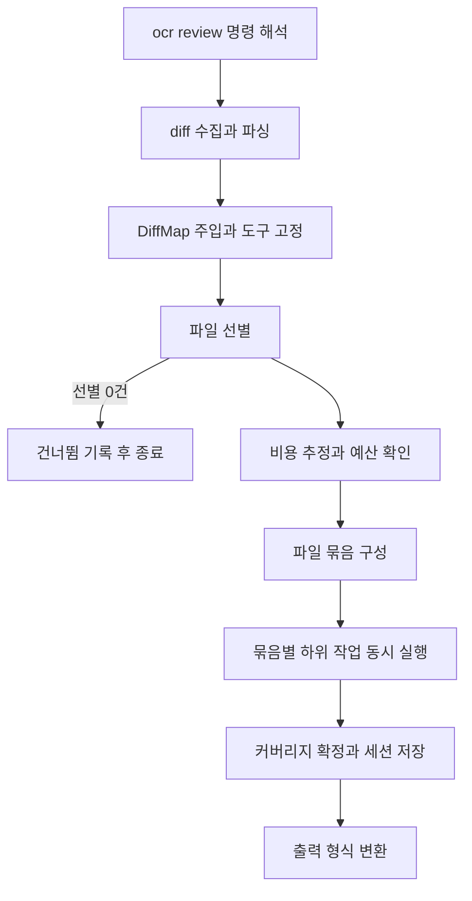
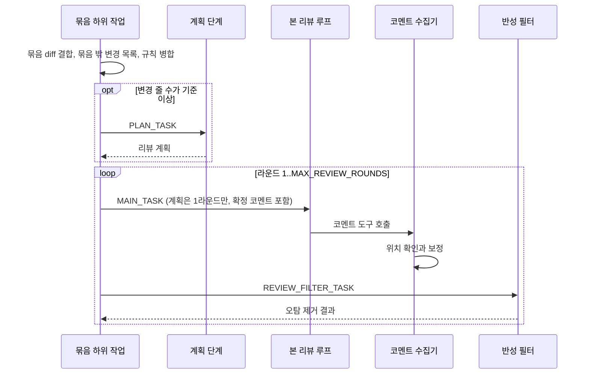
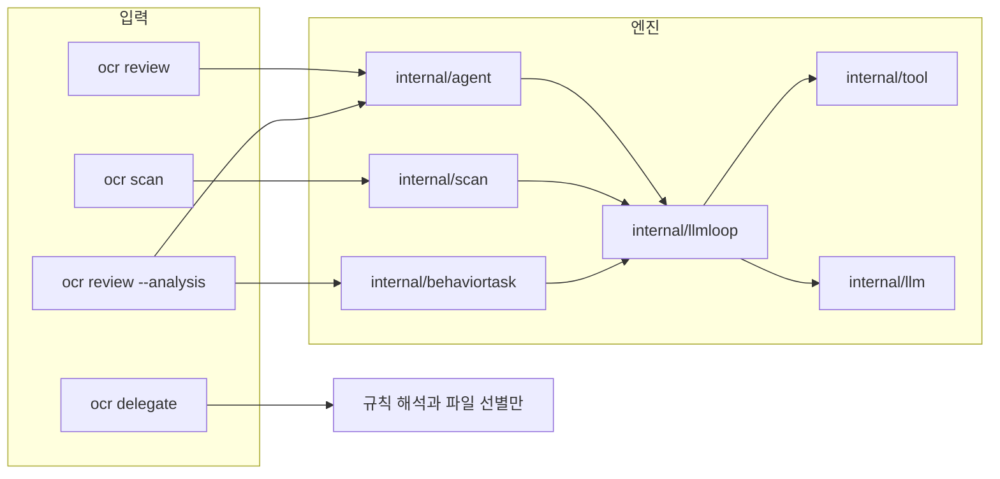

OpenCodeReview는 리뷰 과정을 "틀리면 안 되는 단계"와 "상황에 따라 판단해야 하는 단계"로 나누고, 앞쪽은 Go 코드로, 뒤쪽은 도구를 쓰는 LLM 에이전트로 처리한다. 이 장은 README가 내세우는 설계 원칙을 실제 코드 위치와 하나씩 대응시키고, 리뷰 한 번이 지나가는 전체 경로를 정리한다.

## 프로젝트 개요

[README](https://github.com/alibaba/open-code-review/blob/e74f2c6bd4422bd1e12d257d1725bcce1d6b9ddd/README.md#L43-L51)는 OpenCodeReview를 Alibaba 그룹의 사내 공식 AI 코드 리뷰 도우미에서 출발한 CLI로 소개한다. 지난 2년 동안 수만 명의 개발자가 썼고 수백만 건의 결함을 찾았다고 적었다(자체 발표). 도구가 하는 일은 세 줄로 요약된다.

- Git diff를 읽는다
- 바뀐 파일을 도구 호출이 가능한 에이전트를 통해 설정된 LLM에 보낸다
- 줄 단위 위치가 붙은 구조화된 리뷰 코멘트를 만든다

에이전트는 diff만 보는 것이 아니라 파일 전체 내용을 읽고, 코드베이스를 검색하고, 다른 변경 파일을 참고할 수 있다. diff가 없는 경우를 위해 파일 전체를 리뷰하는 `ocr scan`도 있다(11장).


출처: [OpenCodeReview 한국어 README](https://github.com/alibaba/open-code-review/blob/e74f2c6bd4422bd1e12d257d1725bcce1d6b9ddd/docs/i18n/README.ko-KR.md)

- 다섯 수치는 모두 원본 저장소의 자체 발표다. 사내 사용자 수와 작업 수는 외부에서 검증할 수 없다
- 이 책에서 실제로 의미가 있는 수치는 "토큰 비용 1/9"이다. 아래 설계 원칙 절에서 이 차이가 어디서 오는지 코드로 따라간다

| 항목 | 내용 |
|---|---|
| 언어 | Go (모듈 `github.com/alibaba/open-code-review`) |
| 라이선스 | Apache-2.0 |
| 실행 파일 | `ocr` (npm 패키지 `@alibaba-group/open-code-review`로 배포) |
| 전제 조건 | Git 2.41 이상 |
| 모델 연결 | OpenAI 호환, Anthropic 호환 등 프로바이더 설정 (10장) |
| 핵심 코드 규모 | `internal/` 약 31.8K줄, `cmd/opencodereview/` 약 11.8K줄, `acp/` 약 6.2K줄 (테스트 제외) |

## 범용 에이전트 리뷰의 문제

README의 ["Why Open Code Review?"](https://github.com/alibaba/open-code-review/blob/e74f2c6bd4422bd1e12d257d1725bcce1d6b9ddd/README.md#L71-L81) 절은 Claude Code 같은 범용 에이전트에 Skill을 붙여 리뷰할 때 생기는 문제를 세 가지로 정리한다.

| 문제 | README 설명 | 이 책에서 대응하는 장 |
|---|---|---|
| 불완전한 커버리지 | 큰 변경에서 일부 파일만 골라 리뷰하고 나머지를 놓친다 | 04장(파일 선별), 06장(커버리지 기록) |
| 위치 어긋남 | 지적한 줄 번호나 파일이 실제 코드와 다르다 | 09장(위치 보정) |
| 품질 불안정 | 자연어로 구동하는 Skill은 디버깅이 어렵고 프롬프트 변화에 결과가 크게 흔들린다 | 05장(규칙과 템플릿), 09장(반성 필터) |

README는 원인을 "순수하게 언어로 구동하는 구조에는 리뷰 과정에 대한 강한 제약이 없다"로 진단한다. 이 진단이 아래 설계 원칙 전체의 출발점이다.

## 설계 원칙과 코드 대응

README는 핵심 설계를 "deterministic 엔지니어링과 에이전트의 결합"이라고 부른다. 앞쪽 네 항목은 코드가 결과를 보장하는 단계이고, 뒤쪽 두 항목은 에이전트의 판단에 맡기는 단계다. 각 항목이 실제로 어디에 구현되어 있는지는 다음과 같다.

| README 항목 | 성격 | 구현 위치 | 장 |
|---|---|---|---|
| 정확한 파일 선별 | deterministic | [`selectFiles`](https://github.com/alibaba/open-code-review/blob/e74f2c6bd4422bd1e12d257d1725bcce1d6b9ddd/internal/agent/selection.go#L43), `internal/config/allowlist/` | 04장 |
| 관련 파일 묶음 | deterministic + 선택적 LLM | [`groupDiffs`](https://github.com/alibaba/open-code-review/blob/e74f2c6bd4422bd1e12d257d1725bcce1d6b9ddd/internal/agent/grouping.go#L68) | 04장 |
| 세밀한 규칙 매칭 | deterministic | `internal/config/rules/`, [`resolveGroupSystemRule`](https://github.com/alibaba/open-code-review/blob/e74f2c6bd4422bd1e12d257d1725bcce1d6b9ddd/internal/agent/agent.go#L1731) | 05장 |
| 외부 위치 보정, 반성 모듈 | deterministic 우선 + LLM 보조 | `internal/diff/resolver.go`, `relocation.go`, [`executeGroupReviewFilter`](https://github.com/alibaba/open-code-review/blob/e74f2c6bd4422bd1e12d257d1725bcce1d6b9ddd/internal/agent/agent.go#L1843) | 09장 |
| 리뷰 전용 프롬프트 | 에이전트 | `internal/config/template/prompts/` | 05장 |
| 리뷰 전용 도구 세트 | 에이전트 | `internal/tool/`, `internal/config/toolsconfig/tools.json` | 08장 |

표에서 "관련 파일 묶음"을 "deterministic + 선택적 LLM"으로 적은 이유는 묶음 구성에 LLM을 부르는 `GROUPING_TASK`가 있기 때문이다. README는 이 단계를 engineering logic이 보장하는 쪽에 넣었지만, 코드에서는 파일 수와 변경 줄 수가 기준을 넘을 때 LLM에게 묶음을 제안받고, 그 결과에 파일 수 상한과 토큰 상한을 코드로 다시 적용한다. 세부 조건은 04장에서 다룬다.

### 코드 분석: 기본 템플릿의 단계 정의

리뷰 한 번에 쓰이는 LLM 작업 종류와 기준값은 [`task_template.json`](https://github.com/alibaba/open-code-review/blob/e74f2c6bd4422bd1e12d257d1725bcce1d6b9ddd/internal/config/template/task_template.json#L40-L47)에 모여 있다. 앞부분에는 `MAIN_TASK`, `PLAN_TASK`, `MEMORY_COMPRESSION_TASK`, `REVIEW_FILTER_TASK`, `RE_LOCATION_TASK`, `GROUPING_TASK` 여섯 대화가 정의되고, 끝에 수치 기준이 있다.

```json
  "MAX_TOOL_REQUEST_TIMES": 100,
  "PLAN_MODE_LINE_THRESHOLD": 50,
  "PLAN_MODE_GROUP_LINE_THRESHOLD": 100,
  "GROUPING_MIN_FILES": 4,
  "GROUPING_BUNDLE_LINE_THRESHOLD": 200,
  "MAX_REVIEW_ROUNDS": 2,
  "MAX_TOKENS": 200000,
  "MAX_COMPLETION_TOKENS": 16384
```

이 값들이 "언제 LLM을 부르는가"를 정한다. 예를 들어 계획 단계(`PLAN_TASK`)는 항상 돌지 않는다. [`PlanRequired`](https://github.com/alibaba/open-code-review/blob/e74f2c6bd4422bd1e12d257d1725bcce1d6b9ddd/internal/config/template/template.go#L70-L82)는 가장 크게 바뀐 파일이 50줄 이상이거나, 파일이 2개 이상인 묶음의 변경 합계가 100줄 이상일 때만 계획 단계를 켠다. 작은 변경에 계획 호출을 생략하는 것이 토큰 사용량을 줄이는 장치 중 하나다.

| 작업 | 역할 | 장 |
|---|---|---|
| `GROUPING_TASK` | 변경 파일을 리뷰 단위로 묶는 제안 | 04장 |
| `PLAN_TASK` | 큰 변경 묶음에 대한 리뷰 계획 | 06장 |
| `MAIN_TASK` | 도구를 쓰며 코멘트를 남기는 본 리뷰 | 06장, 07장, 08장 |
| `MEMORY_COMPRESSION_TASK` | 대화가 길어질 때 이전 기록 압축 | 07장 |
| `RE_LOCATION_TASK` | 코드로 위치를 찾지 못한 코멘트의 위치 재판정 | 09장 |
| `REVIEW_FILTER_TASK` | 남은 코멘트 중 오탐 제거 | 09장 |

## 리뷰 한 번의 전체 경로

`ocr review`를 실행하면 명령 계층(02장)이 인자를 해석하고 [`Agent.Run`](https://github.com/alibaba/open-code-review/blob/e74f2c6bd4422bd1e12d257d1725bcce1d6b9ddd/internal/agent/agent.go#L280-L444)을 호출한다. `Run`은 diff 수집, 파일 선별, 비용 추정, 묶음별 하위 작업 분배, 세션 마무리를 차례로 수행한다.



### 코드 분석: 선별 전 DiffMap 주입

`Run` 안에서 눈여겨볼 지점은 파일을 거르기 **전에** 전체 diff를 도구 쪽에 넘긴다는 점이다.

```go
	// Build the read-only DiffMap from ALL parsed diffs (before filtering)
	// so the LLM can query diffs of related but filtered-out files.
	a.injectDiffMap()
	a.args.Tools.Freeze()

	// Apply the one pre-dispatch selection — the same call `--preview` makes —
	// so the set reported here is the set registerCoverage seals below.
	decisions := a.selectFiles(a.diffs)
	kept, counts := summarizeSelection(decisions)
	totalChanged := len(a.diffs)
	reviewCount := counts.Selected
	fmt.Fprintf(stdout.Writer(), "[ocr] %d file(s) changed, reviewing %d in %s\n", totalChanged, reviewCount, a.args.RepoDir)
```

출처: [agent.go L315-L326](https://github.com/alibaba/open-code-review/blob/e74f2c6bd4422bd1e12d257d1725bcce1d6b9ddd/internal/agent/agent.go#L315-L326)

- 리뷰 대상에서 빠진 파일(예: 생성 파일, 지원하지 않는 확장자)도 에이전트가 도구로 diff를 조회할 수 있다. "리뷰하지 않는다"와 "참고하지 못한다"를 분리한 것이다
- `Tools.Freeze()`로 도구 목록을 이 시점에 고정한다. 이후 하위 작업은 같은 도구 집합을 쓴다
- 주석이 밝히듯 `--preview`도 같은 `selectFiles`를 호출한다. 미리 보기에서 본 파일 목록과 실제 리뷰 대상이 다를 수 없게 한 설계다

### 묶음별 하위 작업

[`dispatchSubtasks`](https://github.com/alibaba/open-code-review/blob/e74f2c6bd4422bd1e12d257d1725bcce1d6b9ddd/internal/agent/agent.go#L634-L862)는 삭제되지 않은 파일로 묶음을 만들고, 묶음마다 하위 작업을 동시에 실행한다. 동시 실행 수는 따로 지정하지 않으면 8이다([agent.go L676-L679](https://github.com/alibaba/open-code-review/blob/e74f2c6bd4422bd1e12d257d1725bcce1d6b9ddd/internal/agent/agent.go#L676-L679)). README가 말한 "각 묶음은 독립된 컨텍스트를 가진 sub-agent로 실행된다"가 이 부분이다. 묶음 하나의 처리 순서는 [`executeGroupSubtask`](https://github.com/alibaba/open-code-review/blob/e74f2c6bd4422bd1e12d257d1725bcce1d6b9ddd/internal/agent/agent.go#L1424-L1604)에 있다.



- 라운드는 기본 2회다. 2라운드부터는 계획을 빼고 앞 라운드에서 확정된 코멘트 목록을 넣는다. 코드 주석은 이유를 "계획이 커버리지의 상한처럼 작동하지 않게 하려고"라고 적었다([agent.go L1512-L1516](https://github.com/alibaba/open-code-review/blob/e74f2c6bd4422bd1e12d257d1725bcce1d6b9ddd/internal/agent/agent.go#L1512-L1516))
- 코멘트는 에이전트가 도구로 남기는 순간 수집기로 들어가고, 위치 확인은 그 자리에서 비동기로 처리된다. 세부 순서는 09장에서 다룬다
- 토큰 예산(`--max-tokens-budget`)을 넘으면 새 라운드와 새 묶음 분배를 멈추고 경고를 기록한다

## 위치 보정의 우선순위

README의 "외부 위치 보정 모듈"은 LLM 호출 하나로 끝나지 않는다. [`reviewtask/tools.go`](https://github.com/alibaba/open-code-review/blob/e74f2c6bd4422bd1e12d257d1725bcce1d6b9ddd/internal/reviewtask/tools.go#L117-L139)의 코멘트 처리 순서는 다음과 같다.

| 순서 | 방법 | LLM 사용 |
|---|---|---|
| 1 | 코멘트가 가리키는 파일의 diff에서 인용 코드를 찾아 줄 번호 확정 (`diff.ResolveComment`) | 없음 |
| 2 | 다른 변경 파일에서 같은 코드를 찾아 파일을 바꿔 기록 (`diff.RelocateAcrossFiles`) | 없음 |
| 3 | 그래도 찾지 못하면 `RE_LOCATION_TASK`로 위치 재판정 | 있음 |

코드 주석은 2번을 LLM 단계보다 먼저 두는 이유를 "LLM 단계가 에이전트가 원래 인용한 코드(`ExistingCode`)를 덮어쓰기 때문"이라고 설명한다. 문자열 일치로 해결되는 경우를 먼저 처리하고 LLM은 마지막 수단으로 두는 구조다. 2번은 여러 파일에서 같은 코드가 발견되면 추측하지 않고 실패로 처리한다([resolver.go L76-L101](https://github.com/alibaba/open-code-review/blob/e74f2c6bd4422bd1e12d257d1725bcce1d6b9ddd/internal/diff/resolver.go#L76-L101)). 위치를 틀리게 고치느니 못 찾은 상태로 두는 쪽을 택한 것이다.

## 실행 모드와 명령 구성

같은 엔진을 여러 경로로 쓸 수 있다. 각 경로가 엔진의 어느 부분을 공유하는지 보면 패키지 구성이 이해된다.



| 경로 | 하는 일 | LLM 호출 주체 | 장 |
|---|---|---|---|
| `ocr review` | diff 기반 리뷰 | OCR | 06장 |
| `ocr scan` | diff 없이 파일 전체 리뷰 | OCR | 11장 |
| `ocr review --analysis` | 리뷰와 별도로 동작 영향 조사를 함께 실행 | OCR | 12장 |
| `ocr delegate` | 파일 선별과 규칙 해석만 제공하고 분석은 호스트 에이전트가 수행 | 호스트 에이전트 | 14장 |
| `ocr-acp` | ACP 클라이언트에서 review, scan을 호출하는 어댑터 | OCR | 14장 |

README는 위임 모드를 "별도 API 키가 없을 때의 시작점"으로 권한다. 위임 모드는 OCR의 전체 파이프라인을 돌리지 않는다는 점을 README도 명시한다. 파일 선별, 규칙 해석, 커버리지 요구, 구조화된 보고 형식은 OCR이 주고, 분석과 위치 지정은 호스트 에이전트가 맡는다. 따라서 09장의 위치 보정과 반성 필터는 위임 모드에서 작동하지 않는다.

## 벤치마크 주장

README는 50개 오픈소스 저장소, 200개 실제 PR, 10개 언어로 만든 벤치마크(AACR-Bench, 정답 이슈 1,505건)에서 같은 모델 기준으로 범용 에이전트(Claude Code)보다 Precision과 F1이 높고, 토큰은 약 1/9만 쓴다고 발표했다. Recall은 더 낮으며 README는 이것을 "잡음보다 정밀도를 택한 의도적 선택"이라고 설명한다([README L53-L69](https://github.com/alibaba/open-code-review/blob/e74f2c6bd4422bd1e12d257d1725bcce1d6b9ddd/README.md#L53-L69)).


출처: [OpenCodeReview 한국어 README](https://github.com/alibaba/open-code-review/blob/e74f2c6bd4422bd1e12d257d1725bcce1d6b9ddd/docs/i18n/README.ko-KR.md)

- 모든 수치는 자체 발표이고, 벤치마크도 같은 조직이 만들었다. 데이터셋은 [Hugging Face](https://huggingface.co/datasets/Alibaba-Aone/aacr-bench)에 공개되어 있어 재현은 가능하다(이 책에서는 재현하지 않았다)
- Recall이 낮은 이유는 코드에서 짐작할 수 있다. 반성 필터(09장)가 코멘트를 지우는 방향으로만 작동하고, 위치를 확정하지 못한 코멘트를 버리기 때문이다(추정)
- 토큰 차이는 계획 단계 생략 기준, 묶음별 독립 컨텍스트, 대화 압축(07장)이 함께 만든 결과로 보인다(추정). 항목별 기여도는 공개되지 않았다

## 정리

- OpenCodeReview는 파일 선별, 묶음 구성, 규칙 매칭, 위치 확인을 코드로 고정하고, 파일 읽기와 검색 판단만 에이전트에 맡긴다
- 리뷰 한 번은 `Agent.Run`에서 diff 수집, 선별, 묶음별 하위 작업 동시 실행, 세션 확정 순서로 진행된다
- 묶음 하위 작업은 조건부 계획, 최대 2라운드 본 리뷰, 라운드마다 반성 필터로 구성된다
- 위치 보정은 문자열 일치, 파일 간 재배치, LLM 재판정 순서이고, 모호하면 추측하지 않는다
- 위임 모드는 선별과 규칙만 OCR이 주고 분석은 호스트 에이전트가 하므로 위치 보정과 필터가 빠진다
- 벤치마크 수치는 자체 발표이며 Precision을 위해 Recall을 낮춘 설계라고 README가 밝힌다
