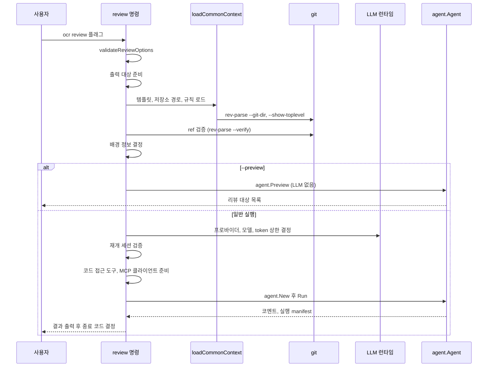

`ocr review` 한 번이 명령 계층을 지나는 순서와 진행 메시지 출력 경로를 다룬다.

## 첫 리뷰 실행 흐름

`ocr review`의 `RunE`는 세 줄이다. 옵션을 검증하고, 인터럽트를 받는 context를 만들고, [`executeReviewContext`](https://github.com/alibaba/open-code-review/blob/e74f2c6bd4422bd1e12d257d1725bcce1d6b9ddd/cmd/opencodereview/review_cmd.go#L125-L381)를 부른다. 이 함수가 diff 수집 전 준비 단계 전체를 담당한다.



### 공통 컨텍스트 로드

[`loadCommonContext`](https://github.com/alibaba/open-code-review/blob/e74f2c6bd4422bd1e12d257d1725bcce1d6b9ddd/cmd/opencodereview/shared.go#L111-L148)는 `review`와 `scan`이 같은 순서로 시작하도록 공통 준비를 묶은 함수다. 내장 템플릿을 읽고, 저장소 경로를 정하고, git 프로세스 제한기를 만들고, 리뷰 규칙을 로드한다. git 제한기 `gitcmd.New(maxGitProcs)`가 규칙 로더보다 먼저 만들어진다. 규칙 로더가 확장자만으로 언어를 정할 수 없는 파일의 내용을 git으로 읽기 때문이다(05장). 제한기 자체는 03장에서 다룬다.

### 코드 분석: 저장소 루트 고정

하위 폴더에서 `ocr review`를 실행해도 저장소 최상위를 기준으로 동작하도록 경로를 바꾼다.

파일: [cmd/opencodereview/shared.go L179-L191](https://github.com/alibaba/open-code-review/blob/e74f2c6bd4422bd1e12d257d1725bcce1d6b9ddd/cmd/opencodereview/shared.go#L179-L191)

```go
	if isGit && requireGit {
		// runGitCmdStdout captures stdout only so git stderr notices can't
		// pollute the resolved path. --show-toplevel fails (or is empty) when
		// there is no work tree — e.g. a bare repo, where --git-dir succeeds so
		// isGit is true. Fail loudly there instead of silently reusing the
		// subdir, which would reproduce the #287 root-relative-path bug.
		top, topErr := runGitCmdStdout(absPath, "rev-parse", "--show-toplevel")
		t := strings.TrimSpace(string(top))
		if topErr != nil || t == "" {
			return "", false, fmt.Errorf("%s is a git repository without a work tree (bare repo?); cannot resolve its top level for review", absPath)
		}
		absPath = t
	}
```

git diff가 출력하는 경로와 `git show HEAD:<path>`가 받는 경로는 모두 저장소 루트 기준이다. 모노레포의 하위 폴더를 작업 경로로 두면 이 경로들이 디스크에서 열리지 않는다. 주석의 이슈 #287이 그 사례다. `review`는 `--show-toplevel`로 루트를 다시 잡고, bare 저장소처럼 작업 트리가 없으면 명시적으로 실패한다. `scan`은 `requireGit=false`라 이 분기를 건너뛰고 현재 폴더를 유지한다. `git ls-files` 범위를 하위 폴더로 한정하기 위해서다.


### 코드 분석: ref 주입 차단

`--from`, `--to`, `--commit` 값은 git 명령 인자로 그대로 들어간다. `--output=/tmp/x` 같은 값이 옵션으로 해석되는 것을 막으려고 git을 부르기 전에 한 번 검사한다.

파일: [cmd/opencodereview/review_cmd.go L572-L586](https://github.com/alibaba/open-code-review/blob/e74f2c6bd4422bd1e12d257d1725bcce1d6b9ddd/cmd/opencodereview/review_cmd.go#L572-L586)

```go
	for _, item := range refs {
		if item.ref == "" {
			continue
		}
		if strings.HasPrefix(item.ref, "-") {
			return fmt.Errorf("%s value %q is not a valid git ref: refs must not start with '-'", item.flag, item.ref)
		}
		if out, err := runGitCmd(repoDir, "rev-parse", "--verify", "--end-of-options", item.ref+"^{commit}"); err != nil {
			msg := strings.TrimSpace(string(out))
			if msg != "" {
				return fmt.Errorf("%s value %q is not a valid commit ref: %s", item.flag, item.ref, msg)
			}
			return fmt.Errorf("%s value %q is not a valid commit ref", item.flag, item.ref)
		}
	}
```

방어는 두 겹이다. `-`로 시작하는 값을 거부하고, `--end-of-options` 뒤에 `^{commit}`을 붙여 그 값이 실제 commit으로 풀리는지 확인한다. 태그나 브랜치 이름도 `^{commit}`으로 commit까지 벗겨진다. 이후 03장의 diff 명령도 모두 `--end-of-options`를 넣는다.

### 준비 단계 순서

| 순서 | 단계 | 함수 | 실패 시 |
|---|---|---|---|
| 1 | 출력 대상 준비 | `resolveOutputWriter` | `--output`이 폴더이거나 상위 폴더가 없으면 오류 |
| 2 | 공통 컨텍스트 | `loadCommonContext` | git 저장소가 아니면 오류 |
| 3 | 도구 라운드, CLI 제외 패턴 | `resolveReviewMaxTools`, `applyCLIExcludes` | 없음 |
| 4 | ref 검증 | `validateReviewRefs` | 잘못된 ref 오류 |
| 5 | 배경 정보 | `resolveBackground` | 파일 크기, 길이 초과 오류 |
| 6 | 미리보기 분기 | `runPreviewContext` | LLM 런타임을 만들지 않고 종료 |
| 7 | 재개 상태 로드 | `loadReviewResumeState` | 세션 없음, 모드 불일치 오류 |
| 8 | 도구 정의 로드 | `loadToolDefs` | 템플릿의 도구 이름 오류 |
| 9 | LLM 런타임 | `loadLLMRuntime` | 프로바이더 미설정 오류 |
| 10 | token 상한, 노력 수준 | `resolveMaxTokens`, `resolveEffort` | 설정값 오류 |
| 11 | 재개 동일성 검증 | `validateResumeIdentity` | 입력, 규칙, 모델이 바뀌었으면 거부 |
| 12 | 코드 접근 도구 | `prepareReviewCodeTools` | 비교 기준을 확정할 수 없으면 오류 |
| 13 | MCP 클라이언트 | `initMCPClients` | 경고만 출력하고 해당 서버 제외 |
| 14 | 에이전트 생성과 실행 | `agent.New`, `ag.Run` | 06장 |

`--preview`가 6번째에 있다는 점이 중요하다. 미리보기는 LLM 런타임을 만들기 전에 끝나므로 API 키 없이 실행된다. 미리보기용 token 상한도 [`previewMaxTokens`](https://github.com/alibaba/open-code-review/blob/e74f2c6bd4422bd1e12d257d1725bcce1d6b9ddd/cmd/opencodereview/shared.go#L80-L95)가 설정 파일만 읽어 계산한다. 실제 실행과 같은 크기 기준으로 파일을 거르기 위해서다(04장).

11번째 재개 검증이 `agent.New`보다 앞에 있는 것도 의도된 순서다. [`validateResumeIdentity`](https://github.com/alibaba/open-code-review/blob/e74f2c6bd4422bd1e12d257d1725bcce1d6b9ddd/cmd/opencodereview/review_cmd.go#L467-L509) 주석은 `agent.New`가 세션을 만들면서 곧바로 `session_start`를 디스크에 쓰기 때문에, 거부될 재개가 고아 세션을 남기지 않도록 그 전에 검증한다고 설명한다. 재개의 세부 규칙은 13장에서 다룬다.

12번째 코드 접근 도구 준비([code_access.go L22-L62](https://github.com/alibaba/open-code-review/blob/e74f2c6bd4422bd1e12d257d1725bcce1d6b9ddd/cmd/opencodereview/code_access.go#L22-L62))는 리뷰 대상의 "이전" 쪽과 "이후" 쪽 코드를 각각 읽을 수 있는 리더 두 개를 만든다. 이 단계에서 03장의 `ResolveComparisonInput`이 처음 호출되어 비교 기준 commit이 확정된다. 도구가 그 리더를 어떻게 쓰는지는 08장에서 다룬다.

### 배경 정보 입력

리뷰에 요구사항이나 업무 맥락을 함께 넘기는 입력이 두 개 있다. `--background`는 문자열, `--background-file`은 Markdown 파일이다. 결정 순서는 [`resolveBackground`](https://github.com/alibaba/open-code-review/blob/e74f2c6bd4422bd1e12d257d1725bcce1d6b9ddd/cmd/opencodereview/background_file.go#L50-L64)에 있다.

```go
func resolveBackground(repoDir, inline, backgroundFile, commit string) (string, error) {
	if backgroundFile != "" {
		fileBg, err := loadBackgroundFile(resolveBackgroundFilePath(repoDir, backgroundFile))
		if err != nil {
			return "", err
		}
		return selectBackground(inline, fileBg), nil
	}
	if inline == "" && commit != "" {
		if msg, err := getCommitMessage(repoDir, commit); err == nil && msg != "" {
			return msg, nil
		}
	}
	return inline, nil
}
```

- 파일과 문자열을 함께 주면 파일이 이기고, stderr에 문자열이 무시된다는 안내가 나온다
- 둘 다 없고 `--commit` 모드면 commit 메시지(`git log -1 --format=%B`)를 배경으로 쓴다. README Quick Start에는 없는 동작이다
- 상대 경로 파일은 현재 폴더가 아니라 저장소 루트 기준으로 찾는다

파일 쪽에는 제한이 여럿 붙는다. [상수 정의](https://github.com/alibaba/open-code-review/blob/e74f2c6bd4422bd1e12d257d1725bcce1d6b9ddd/cmd/opencodereview/background_file.go#L15-L21)는 다음과 같다.

| 상수 | 값 | 동작 |
|---|---|---|
| `maxBackgroundFileBytes` | 1 MB | 파일 크기가 넘으면 읽기 전에 오류 |
| `backgroundSoftLimit` | 2000자 | 정리 후 길이가 넘으면 경고만 출력 |
| `backgroundHardLimit` | 8000자 | 정리 후 길이가 넘으면 오류 |
| `backgroundOpenTag`, `backgroundCloseTag` | `<ocr_user_background>` | 내용을 감싸는 구분자. 파일 안에 이미 있으면 오류 |

정리 단계 [`sanitizeMarkdown`](https://github.com/alibaba/open-code-review/blob/e74f2c6bd4422bd1e12d257d1725bcce1d6b9ddd/cmd/opencodereview/background_file.go#L116-L136)은 C0, C1 제어 문자와 유니코드 Cf 범주(폭 없는 공백, 방향 표시, BOM)를 지우고 세 줄 이상 연속된 빈 줄을 두 줄로 줄인다. 보이지 않는 문자로 prompt를 조작하는 입력을 걸러 내고, 예약 구분자를 금지해 배경 블록 밖으로 내용이 새어 나가지 못하게 한다. 문자열 `--background`는 이 정리와 길이 제한을 거치지 않는다. 코드상 정리 함수는 `loadBackgroundFile` 안에서만 호출된다.

## 출력 경로와 진행 메시지

### 결과 문서와 진행 메시지 분리

`ocr review`는 두 종류의 출력을 낸다. 하나는 결과 문서(text, JSON, SARIF)이고, 다른 하나는 실행 중 `[ocr]`로 시작하는 진행 메시지다. JSON이나 SARIF를 파이프로 받는 호출자에게 진행 메시지가 섞이면 문서를 파싱할 수 없다.

파일: [cmd/opencodereview/shared.go L388-L405](https://github.com/alibaba/open-code-review/blob/e74f2c6bd4422bd1e12d257d1725bcce1d6b9ddd/cmd/opencodereview/shared.go#L388-L405)

```go
func newQuietHandle(outputFormat, audience string) *quietHandle {
	h := &quietHandle{}
	switch {
	case audience == "agent":
		h.fn = stdout.Quiet()
	case isMachineReadable(outputFormat):
		h.fn = stdout.Swap(os.Stderr)
	}
	restoreRouting := h.fn
	restoreStyle := stdout.StyleProgress(resolveColorFor(stdout.Writer()), resolveColorFor(os.Stderr))
	h.fn = func() {
		restoreStyle()
		if restoreRouting != nil {
			restoreRouting()
		}
	}
	return h
}
```

| `--audience` | `--format` | 진행 메시지 | 결과 문서 |
|---|---|---|---|
| `human` | `text` | stdout | stdout |
| `human` | `json`, `sarif` | stderr로 이동 | stdout |
| `agent` | 모든 형식 | 버림 | stdout. text 형식은 실행 요약(trace summary)만 다시 표시 |

`stdout`은 표준 라이브러리가 아니라 `internal/stdout` 패키지다. 진행 메시지를 쓰는 모든 코드가 `stdout.Writer()`를 거치게 해 두고, 이 핸들이 그 목적지를 바꾼다. 결과 문서는 `os.Stdout`에 직접 쓰므로 영향을 받지 않는다.

### --output 파일 처리

[`resolveOutputWriter`](https://github.com/alibaba/open-code-review/blob/e74f2c6bd4422bd1e12d257d1725bcce1d6b9ddd/cmd/opencodereview/shared.go#L748-L761)는 `--output`이 비어 있거나 `-`면 stdout을 쓴다. 경로가 주어지면 그 경로가 폴더가 아닌지, 상위 폴더가 존재하는지만 먼저 확인하고 `lazyFileWriter`를 돌려준다. [flag 주석](https://github.com/alibaba/open-code-review/blob/e74f2c6bd4422bd1e12d257d1725bcce1d6b9ddd/cmd/opencodereview/shared_flags.go#L41-L46)대로 실제 파일은 처음 쓸 때 만들어진다. 실패한 실행이 기존 결과 파일을 빈 파일로 덮어쓰지 않게 하기 위해서다. text 형식으로 파일에 쓸 때는 ANSI 색 코드를 제거한다(`strip: !isMachineReadable(format)`). 결과 문서의 형식별 내용과 SARIF 변환은 14장에서 다룬다.

## README Quick Start와 실제 동작 대조

[README Quick Start](https://github.com/alibaba/open-code-review/blob/e74f2c6bd4422bd1e12d257d1725bcce1d6b9ddd/README.md#L153-L206)의 예시를 코드 동작과 하나씩 대조했다.

| README 예시 | README 설명 | 코드 동작 | 일치 여부 |
|---|---|---|---|
| `ocr review` | staged, unstaged, untracked 변경 리뷰 | workspace 모드. HEAD와 작업 트리를 비교하고 untracked 파일을 추가 (03장) | 일치 |
| `ocr review --from main` | 분기 이후 변경, `--to`는 HEAD | `normalizeDiffTarget`이 `--to`를 `HEAD`로 채움 | 일치 |
| `ocr review --from main --to feature-branch` | merge-base 모드 | `merge-base(from, to)..to` (03장) | 일치 |
| `ocr review --commit abc123` | 단일 commit | 첫 번째 부모와 비교. commit 메시지를 배경으로 자동 사용 | 일치. 배경 자동 사용은 README에 없음 |
| `--resume <session-id>` | "interrupted range or commit review" 재개 | workspace 모드 재개도 허용 ([`ValidateOptions`](https://github.com/alibaba/open-code-review/blob/e74f2c6bd4422bd1e12d257d1725bcce1d6b9ddd/internal/session/resume.go#L278-L297)) | README가 더 좁게 설명 |
| `ocr scan --path internal/agent` | 폴더나 파일 스캔 | `--path`는 쉼표 구분, 없는 경로는 오류 | 일치 |
| `--format json --output result.json` | 결과 파일 저장 | 첫 쓰기 때 파일 생성, 상위 폴더가 없으면 시작 전에 오류 | 일치 |
| `ocr delegate preview`, `ocr delegate rule ...` | LLM 설정 없이 위임 | `delegate`는 LLM 런타임을 만들지 않음 (14장) | 일치 |
| 전제 조건 Git 2.41 이상 | 필요 조건 | 낮은 버전이면 경고만 하고 계속 실행 | 코드가 더 느슨함 |

README의 재개 설명은 range와 commit만 언급하지만, 코드의 `ValidateOptions`는 workspace 모드도 지원 모드로 받아들이고 저장소의 [CLI 문서](https://github.com/alibaba/open-code-review/blob/e74f2c6bd4422bd1e12d257d1725bcce1d6b9ddd/pages/src/content/docs/en/cli-reference.md#L225-L268)도 `ocr review --resume <session-id>   # workspace (no mode flags)` 예시를 싣는다. workspace 재개는 작업 트리가 그대로일 때만 허용된다(13장).
