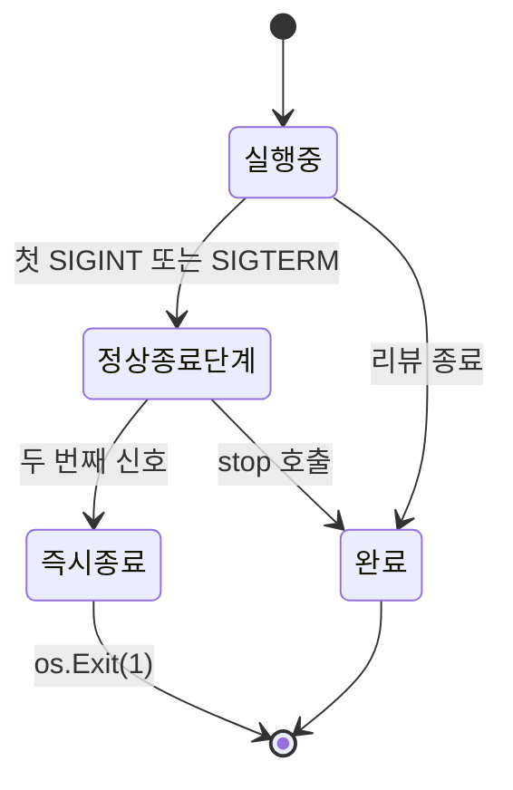

실패 판정과 종료 코드, Ctrl+C 처리, 셸 자동 완성을 다룬다.

## 종료 코드와 실패 판정

### 코드 분석: 부분 실패의 종료 코드

리뷰는 파일 묶음 여러 개를 병렬로 처리하므로 일부만 성공하는 경우가 생긴다. CI에서 "일부 파일을 리뷰하지 못했는데 성공으로 끝나는" 상황을 막으려고, 실행 manifest를 보고 종료 코드를 정한다.

파일: [cmd/opencodereview/review_cmd.go L425-L441](https://github.com/alibaba/open-code-review/blob/e74f2c6bd4422bd1e12d257d1725bcce1d6b9ddd/cmd/opencodereview/review_cmd.go#L425-L441)

```go
func reviewManifestRequiresNonZeroExit(manifest *session.RunManifest) bool {
	if manifest == nil {
		return false
	}
	if manifest.TerminalState == session.StateFailed {
		return true
	}
	if manifest.TerminalState != session.StatePartial {
		return false
	}
	for _, item := range manifest.Coverage.Failed {
		if item.Classification != session.FailureBudget {
			return true
		}
	}
	return false
}
```

부분 성공(`StatePartial`) 중 실패 원인이 모두 token 예산(`FailureBudget`)인 경우만 성공으로 본다. `--max-tokens-budget`은 사용자가 스스로 정한 한도이므로, 그 한도 때문에 멈춘 것은 운영 실패가 아니라는 판단이다. 시간 초과, 프로바이더 오류, 설정 오류가 하나라도 섞이면 실패로 끝난다.

| 실행 결과 | manifest 상태 | 종료 코드 | 대표 메시지 |
|---|---|---|---|
| 모든 묶음 완료 | completed | 0 | 없음 |
| 리뷰할 파일 없음 | skipped | 0 | `No supported files changed. Skipping review.` |
| 일부 실패, 원인이 모두 예산 | partial | 0 | 없음 |
| 일부 실패, 다른 원인 포함 | partial | 1 | `review incomplete: N of M selected item(s) failed` |
| 전부 실패(예산만이라도) | failed | 1 | `review failed: N of M selected item(s) failed` |
| 실행 자체 오류 | 없거나 failed | 1 | `review failed: ...` |
| 두 번째 Ctrl+C | 기록 안 될 수 있음 | 1 | 없음 |

[`reviewResultError`](https://github.com/alibaba/open-code-review/blob/e74f2c6bd4422bd1e12d257d1725bcce1d6b9ddd/cmd/opencodereview/review_cmd.go#L390-L418)는 manifest에 `RunFailure`가 있으면 그 분류와 사유를 메시지에 넣는다. 이 함수는 SARIF 출력과 같은 성공 정책을 공유한다고 주석에 적혀 있다.

### 결과 출력과 오류 반환의 순서

`executeReviewContext`는 실패한 실행이라도 결과를 먼저 출력하고 그 다음에 오류를 돌려준다([L345-L380](https://github.com/alibaba/open-code-review/blob/e74f2c6bd4422bd1e12d257d1725bcce1d6b9ddd/cmd/opencodereview/review_cmd.go#L345-L380)). manifest가 있으면 JSON 소비자가 어떤 파일이 왜 빠졌는지를 받을 수 있어야 하기 때문이다. 실패로 끝나면 세션 ID와 함께 `retry with: --resume <id>` 안내를 stderr에 남긴다. `--analysis` 실행은 재개를 지원하지 않으므로 안내 문구가 다르다.

## 인터럽트 처리

### 코드 분석: 두 단계 인터럽트

리뷰 도중 Ctrl+C를 누르면 진행 중인 결과를 저장하고 끝내야 한다. 그런데 정리 작업(결과 출력, manifest 기록, MCP 서버 종료)이 오래 걸리면 사용자가 다시 Ctrl+C를 누른다. 이때는 즉시 끝나야 한다.

파일: [cmd/opencodereview/interrupt.go L72-L96](https://github.com/alibaba/open-code-review/blob/e74f2c6bd4422bd1e12d257d1725bcce1d6b9ddd/cmd/opencodereview/interrupt.go#L72-L96)

```go
		defer stop()
		select {
		case <-ch:
			// First signal: start the graceful shutdown.
			cancel()
			// Second signal: the user wants out now; skip the remaining
			// cleanup. stop() (graceful shutdown finished first) releases
			// the watcher instead.
			select {
			case sig := <-ch:
				// A signal queued while stop() was running must not turn
				// an already-successful run into exit 1.
				mu.Lock()
				if stopped {
					mu.Unlock()
					return
				}
				mu.Unlock()
				forceExit(sig)
			case <-done:
			}
		case <-ctx.Done():
			// The parent context or the review ended before any signal.
		case <-done:
		}
```

[함수 주석](https://github.com/alibaba/open-code-review/blob/e74f2c6bd4422bd1e12d257d1725bcce1d6b9ddd/cmd/opencodereview/interrupt.go#L23-L41)은 표준 라이브러리의 `signal.NotifyContext`를 쓰지 않는 이유를 적었다. `NotifyContext`의 감시 고루틴은 첫 신호를 받으면 등록을 풀지 않은 채 끝난다. 그 뒤로 오는 신호는 읽히지 않는 버퍼에 쌓이고 기본 종료 동작도 막혀 있어서, 두 번째 Ctrl+C가 아무 효과도 내지 못한다.



- 신호 채널 버퍼가 2다. `os/signal`은 신호를 non-blocking으로 보내므로, 버퍼가 1이면 연달아 온 두 신호 중 두 번째가 버려질 수 있다
- `mu`와 `stopped`는 정리 작업이 이미 끝난 뒤 도착한 신호가 성공한 실행을 종료 코드 1로 바꾸는 경쟁 조건을 막는다
- 첫 신호는 context만 취소한다. [CLI 문서](https://github.com/alibaba/open-code-review/blob/e74f2c6bd4422bd1e12d257d1725bcce1d6b9ddd/pages/src/content/docs/en/cli-reference.md#L261-L265)는 파일 배정이 시작된 뒤의 Ctrl+C가 리뷰를 정상 취소하면서 manifest를 기록하므로, 완료된 체크포인트로 `--resume`할 수 있다고 적었다
- `forceExit`는 진단 메시지를 쓰지 않는다. 주석은 stderr 파이프가 가득 차 있으면 쓰기가 막혀 종료 자체가 멈출 수 있다고 설명한다

## 셸 자동 완성과 버전 정보

### 자동 완성

[`completionCmd`](https://github.com/alibaba/open-code-review/blob/e74f2c6bd4422bd1e12d257d1725bcce1d6b9ddd/cmd/opencodereview/completion.go#L13-L33)는 bash, zsh, fish, powershell 네 가지 셸의 스크립트를 cobra 생성기로 만든다. 인자 검증은 `cobra.MatchAll(exactArgs(1), cobra.OnlyValidArgs)`로, 개수 오류에는 위 `argCountError`의 안내를, 값 오류에는 cobra 기본 메시지를 쓴다.

값 자동 완성은 `--format`, `--audience`, `--effort`, `--batch`, `--color`에 고정 후보로, `--resume`에 저장된 세션 ID 목록(`completeSessionIDs`)으로 등록되어 있다. 고정 후보용 [`completeEnum`](https://github.com/alibaba/open-code-review/blob/e74f2c6bd4422bd1e12d257d1725bcce1d6b9ddd/cmd/opencodereview/shared_flags.go#L75-L79)은 `ShellCompDirectiveNoFileComp`를 돌려주어 후보 외에 파일 이름이 섞이지 않게 한다.

### 버전 정보

[version.go](https://github.com/alibaba/open-code-review/blob/e74f2c6bd4422bd1e12d257d1725bcce1d6b9ddd/cmd/opencodereview/version.go#L12-L17)의 `Version`, `GitCommit`, `BuildDate`는 빌드 때 `-ldflags -X`로 채워지고, 소스에서 직접 빌드하면 `Version`이 `dev`로 남는다. `ocr version`, `ocr --version`, `ocr -V`는 모두 [`versionString`](https://github.com/alibaba/open-code-review/blob/e74f2c6bd4422bd1e12d257d1725bcce1d6b9ddd/cmd/opencodereview/root.go#L82-L93)을 출력한다. `main`은 같은 값을 `llm.AppVersion`에도 넣어 LLM 요청 쪽에서 쓴다(10장).
