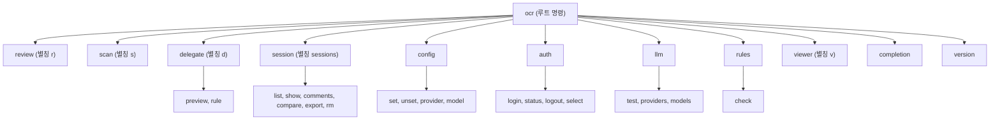

`ocr` 실행 파일은 cobra 기반 명령 트리 하나로 리뷰, 전체 스캔, 세션 조회, 설정, 위임 모드를 모두 제공한다. 이 장은 진입점에서 명령이 갈라지는 구조, 여러 명령이 공유하는 플래그와 검증 순서, 그리고 `ocr review` 한 번이 diff 수집 직전까지 거치는 준비 단계와 종료 코드 결정 규칙을 코드로 따라간다.

## 진입점과 명령 트리

### 코드 분석: main 함수

`main` 패키지는 `cmd/opencodereview/` 한 폴더에 있다. 진입점은 텔레메트리를 초기화하고 cobra 루트 명령을 실행한 뒤, 오류가 있으면 종료 코드 1을 돌려주는 일만 한다.

파일: [cmd/opencodereview/main.go L16-L32](https://github.com/alibaba/open-code-review/blob/e74f2c6bd4422bd1e12d257d1725bcce1d6b9ddd/cmd/opencodereview/main.go#L16-L32)

```go
func main() {
	llm.AppVersion = Version
	os.Exit(run())
}

func run() int {
	ctx := context.Background()
	if telemetry.Init(ctx) {
		defer telemetry.ShutdownWithTimeout(ctx, 5*time.Second)
	}

	if err := rootCmd.Execute(); err != nil {
		fmt.Fprintf(os.Stderr, "Error: %v\n", err)
		return 1
	}
	return 0
}
```

- `os.Exit`를 `main`에 두고 실제 작업은 `run`이 돌려주는 정수로 넘긴다. `run` 안의 `defer`(텔레메트리 종료)가 `os.Exit`보다 먼저 실행되게 하려는 구조다
- 종료 코드는 0과 1 두 가지뿐이다. 어떤 오류든 `Error: ...` 한 줄을 stderr에 쓰고 1로 끝난다. 리뷰가 "부분 성공"일 때 0과 1 중 무엇을 고르는지는 아래 종료 코드 절에서 다룬다
- 텔레메트리 종료에는 5초 상한이 있다. 텔레메트리 설정 자체는 14장에서 다룬다

### 코드 분석: 루트 명령과 공통 전처리

루트 명령 `ocr`은 하위 명령 11개를 등록하고, 모든 하위 명령 실행 전에 `PersistentPreRunE`를 한 번 거치게 한다.

파일: [cmd/opencodereview/root.go L28-L48](https://github.com/alibaba/open-code-review/blob/e74f2c6bd4422bd1e12d257d1725bcce1d6b9ddd/cmd/opencodereview/root.go#L28-L48)

```go
	PersistentPreRunE: func(cmd *cobra.Command, args []string) error {
		if err := validateColorMode(colorMode); err != nil {
			return err
		}
		colorEnabled = resolveColor()
		if !commandNeedsGit(cmd) {
			return nil
		}
		if err := gitcmd.CheckGitVersion(); err != nil {
			fmt.Fprintf(os.Stderr, "warning: %v\n", err)
		}
		return nil
	},
	RunE: func(cmd *cobra.Command, args []string) error {
		v, _ := cmd.Flags().GetBool("version")
		if v {
			printVersion()
			return nil
		}
		return cmd.Help()
	},
```

전처리는 두 가지다. 첫째, `--color` 값을 검증하고 색 출력 여부를 정한다. 둘째, 명령이 git을 필요로 하면 git 버전을 확인한다. [`commandNeedsGit`](https://github.com/alibaba/open-code-review/blob/e74f2c6bd4422bd1e12d257d1725bcce1d6b9ddd/cmd/opencodereview/root.go#L69-L80)은 최상위 명령 이름이 `review`, `scan`, `delegate`일 때만 참을 돌려준다. `ocr session list`나 `ocr config`는 git이 없는 환경에서도 실행된다.

버전 확인 결과는 경고로만 쓰인다. [`gitVersionMin`](https://github.com/alibaba/open-code-review/blob/e74f2c6bd4422bd1e12d257d1725bcce1d6b9ddd/internal/gitcmd/version.go#L19-L20)은 2.41.0이고, 이보다 낮으면 `warning: git ... is older than the minimum supported version ...`을 출력한 뒤 그대로 진행한다. README의 전제 조건 "Git >= 2.41"은 실행을 막는 조건이 아니라 지원 범위의 선언이다.

루트 명령에는 `SilenceUsage`와 `SilenceErrors`가 켜져 있다. cobra가 오류마다 사용법 전체를 다시 출력하지 않게 하고, 오류 출력은 위 `run` 함수의 `Error:` 한 줄로 통일한다. 그 대신 인자 개수 오류 메시지에 사용법을 직접 담는다(아래 입력 오류 절).

### 명령 트리 구조



| 명령 | 별칭 | 역할 (코드의 `Short` 기준) | git 필요 | 다루는 장 |
|---|---|---|---|---|
| `review` | `r` | diff 기반 코드 리뷰 | 필요 | 이 장, 03~09장 |
| `scan` | `s` | diff 없이 파일 전체 리뷰 | 필요(경고만) | 11장 |
| `delegate` | `d` | 호스트 에이전트용 리뷰 명세 출력, LLM 불필요 | 필요 | 14장 |
| `session` | `sessions` | 저장된 리뷰 세션 조회, 비교, 내보내기, 삭제 | 불필요 | 13장 |
| `config` | 없음 | 설정 값 지정, 대화형 프로바이더와 모델 선택 | 불필요 | 10장 |
| `auth` | 없음 | ChatGPT 로그인 인증 관리 | 불필요 | 10장 |
| `llm` | 없음 | 연결 테스트, 내장 프로바이더 목록 | 불필요 | 10장 |
| `rules` | 없음 | 특정 파일에 적용되는 리뷰 규칙 확인 | 불필요 | 05장 |
| `viewer` | `v` | 세션 기록 WebUI 뷰어 실행 | 불필요 | 13장 |
| `completion` | 없음 | 셸 자동 완성 스크립트 생성 | 불필요 | 이 장 |
| `version` | 없음 | 버전 정보 출력 | 불필요 | 이 장 |

`scan`은 `commandNeedsGit`에 포함되어 git 버전 경고를 받지만, 실제로는 git 저장소가 아닌 폴더도 받아들인다. [`loadCommonContext`](https://github.com/alibaba/open-code-review/blob/e74f2c6bd4422bd1e12d257d1725bcce1d6b9ddd/cmd/opencodereview/shared.go#L97-L111) 주석은 `scan`이 `requireGit=false`로 호출되어 `filepath.Walk`로 대체한다고 적었다. 반대로 `review`는 git 저장소가 아니면 바로 실패한다.

## 정리

- `ocr`은 cobra 명령 11개로 구성되고, `review`, `scan`, `delegate`만 git 버전을 확인한다. 2.41 미만은 경고만 하고 실행을 막지 않는다
- 공통 플래그는 작은 등록 함수로 나뉘어 명령마다 조합된다. `--from`만 주면 `--to`는 `HEAD`가 되고, `--max-tools`는 50 미만이면 50으로 올라간다
- `executeReviewContext`는 ref 주입 검사, 저장소 루트 고정, 배경 정보 정리, 재개 동일성 검증을 모두 `agent.New` 전에 끝낸다. `--preview`는 LLM 런타임을 만들기 전에 분기해 API 키 없이 동작한다
- 진행 메시지는 `--audience`와 `--format`에 따라 stdout, stderr, 버림 중 하나로 보내져 JSON, SARIF 문서를 오염시키지 않는다
- 종료 코드는 0과 1뿐이다. 부분 실패는 원인이 모두 token 예산일 때만 0이고, 결과 문서는 실패해도 먼저 출력된다
- Ctrl+C는 첫 번째에 정상 종료를, 두 번째에 즉시 종료를 한다. README는 재개를 range와 commit 모드로만 설명하지만 코드는 workspace 재개도 받아들인다
