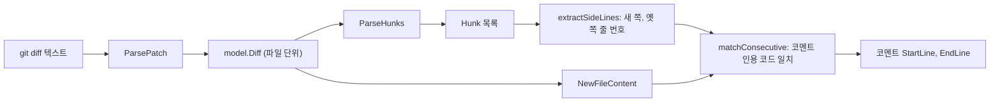

diff 텍스트와 hunk 파싱, git 프로세스 실행과 동시 실행 제한을 다룬다.

## diff 텍스트 파싱

### 파싱 결과 구조

[`ParseDiffText`](https://github.com/alibaba/open-code-review/blob/e74f2c6bd4422bd1e12d257d1725bcce1d6b9ddd/internal/diff/parser.go#L93-L106)는 diff 텍스트를 파일별 `model.Diff`로 나누고(`ParsePatch`), 각 파일의 새 버전 내용을 채운다(`finalizeDiff`). 전체에 2분 제한 시간이 걸린다.

| 필드 | 의미 | 채우는 곳 |
|---|---|---|
| `OldPath`, `NewPath` | 변경 전후 경로. 삭제면 `NewPath`가 `/dev/null` | 헤더, `rename from/to`, `copy from/to` |
| `Diff` | 이 파일의 diff 텍스트 전체(헤더 포함, `index` 줄 제외) | `ParsePatch` |
| `IsNew`, `IsDeleted`, `IsRenamed`, `IsBinary` | 변경 종류 | 확장 헤더 줄 |
| `Insertions`, `Deletions` | hunk 안의 `+`, `-` 줄 수 | `ParsePatch` |
| `NewFileContent` | 새 버전 파일 전체 내용 | `finalizeDiff` |

### 코드 분석: ParsePatch의 줄 분류

파일: [internal/diff/parser.go L139-L162](https://github.com/alibaba/open-code-review/blob/e74f2c6bd4422bd1e12d257d1725bcce1d6b9ddd/internal/diff/parser.go#L139-L162)

```go
		switch {
		case strings.HasPrefix(line, "@@"):
			inHunk = true
		// The object IDs and mode in Git's extended "index" header are not
		// useful review context. Keep index text in hunks, where it is file
		// content and therefore carries a diff prefix.
		case !inHunk && strings.HasPrefix(line, "index "):
			continue
		case !inHunk && binaryRe.MatchString(line):
			current.IsBinary = true
		// Extended header lines (unambiguous: content lines always carry a
		// leading "+", "-" or " " prefix, so a bare prefix match is safe).
		case strings.HasPrefix(line, "new file mode "):
			current.IsNew = true
		case strings.HasPrefix(line, "deleted file mode "):
			current.IsDeleted = true
		case strings.HasPrefix(line, "rename from "):
			// Authoritative old path for renames; more reliable than the
			// "diff --git" header when paths contain spaces.
			current.OldPath = unquoteRenamePath(strings.TrimPrefix(line, "rename from "))
			current.IsRenamed = true
		case strings.HasPrefix(line, "rename to "):
			current.NewPath = unquoteRenamePath(strings.TrimPrefix(line, "rename to "))
			current.IsRenamed = true
```

핵심 상태는 `inHunk` 하나다. 같은 문자열이 헤더일 때와 파일 내용일 때 의미가 다르기 때문이다. hunk 밖의 `--- /dev/null`은 새 파일 표시지만, hunk 안에서는 `-- /dev/null`이라는 줄을 지운 내용일 수 있다. 추가된 줄 `++i`는 diff에서 `+++i`로 나오는데, hunk 밖이라면 새 경로 헤더로 오해할 수 있다. 그래서 `index`, `Binary files`, `copy from/to`, `/dev/null` 판정은 hunk 밖에서만 하고, `+`, `-` 개수 세기는 hunk 안에서만 한다.

새 파일의 `diff --git` 헤더를 만나면 `inHunk`를 다시 거짓으로 돌린다([L122-L134](https://github.com/alibaba/open-code-review/blob/e74f2c6bd4422bd1e12d257d1725bcce1d6b9ddd/internal/diff/parser.go#L122-L134)). `index` 줄은 객체 ID와 파일 모드만 담고 있어 리뷰 prompt에 도움이 되지 않으므로 저장하지 않는다.

### 코드 분석: 공백이 든 경로의 헤더 분리

`diff --git a/<old> b/<new>` 헤더는 두 경로 사이 구분자가 ` b/`인데, 경로 자체에도 ` b/`가 들어갈 수 있다. git은 공백을 따옴표로 감싸지 않으므로 정규식만으로는 어디서 끊어야 할지 알 수 없다.

파일: [internal/diff/parser.go L80-L91](https://github.com/alibaba/open-code-review/blob/e74f2c6bd4422bd1e12d257d1725bcce1d6b9ddd/internal/diff/parser.go#L80-L91)

```go
func splitSamePathHeader(rest string) (oldPath string, newPath string, ok bool) {
	for i := 0; i+3 <= len(rest); i++ {
		if rest[i] != ' ' || rest[i+1] != 'b' || rest[i+2] != '/' {
			continue
		}
		stripped, isOld := strings.CutPrefix(rest[:i], "a/")
		if newPath = rest[i+3:]; isOld && stripped == newPath {
			return stripped, newPath, true
		}
	}
	return "", "", false
}
```

이름 변경이 아닌 헤더는 양쪽 경로가 같다. 그러므로 ` b/`가 나오는 모든 위치에서 잘라 보고, 양쪽이 같아지는 위치가 진짜 구분자다. [주석](https://github.com/alibaba/open-code-review/blob/e74f2c6bd4422bd1e12d257d1725bcce1d6b9ddd/internal/diff/parser.go#L50-L60)이 든 예는 `diff --git a/x b/y.go b/x b/y.go`다. 정규식은 첫 ` b/`에서 잘라 `x`에서 `y.go b/x b/y.go`로의 이름 변경으로 읽었다. 이름 변경과 복사는 양쪽이 다르므로 이 방법이 통하지 않고, 대신 뒤따르는 `rename from/to` 확장 헤더가 경로를 확정한다.

[quotedpath.go](https://github.com/alibaba/open-code-review/blob/e74f2c6bd4422bd1e12d257d1725bcce1d6b9ddd/internal/diff/quotedpath.go#L8-L21)는 git이 탭, 줄바꿈, 큰따옴표, 백슬래시가 든 경로를 C 문자열 형식(`"a/tab\tname.go"`)으로 감싼 경우를 처리한다. `core.quotepath=false`는 비ASCII 바이트만 이스케이프 대상에서 빼고 이 네 가지는 그대로 둔다. 양쪽이 각각 따로 따옴표에 싸일 수 있어 네 가지 조합이 모두 나온다. 8진 이스케이프는 바이트 단위로 풀어 다시 이어 붙여야 UTF-8 문자로 복원된다.

CRLF 줄 끝도 처리한다. [`splitDiffLines`](https://github.com/alibaba/open-code-review/blob/e74f2c6bd4422bd1e12d257d1725bcce1d6b9ddd/internal/diff/parser.go#L28-L48)는 각 줄 끝의 `\r`을 지운다. 남겨 두면 `NewPath`가 `file.go\r`이 되어 파일을 열 수 없고, `--- /dev/null` 비교가 실패해 새 파일 표시가 빠진다.

### 새 버전 파일 내용 조회

리뷰 에이전트와 9장의 위치 보정은 diff뿐 아니라 파일 전체 내용도 쓴다. [`finalizeDiff`](https://github.com/alibaba/open-code-review/blob/e74f2c6bd4422bd1e12d257d1725bcce1d6b9ddd/internal/diff/parser.go#L192-L227)가 파싱 직후 새 버전 내용을 `NewFileContent`에 채운다.

range와 commit 모드는 `git show <ref>:<path>`로 commit 안의 내용을 읽고, workspace 모드는 디스크에서 읽는다. 삭제된 파일과 바이너리 파일은 읽지 않는다. 읽기에 실패해도 리뷰를 멈추지 않고 경고만 남긴다. `NewFileContent`가 비면 9장의 줄 번호 보정이 hunk 안에서만 일치를 찾는다.

여기서 `ref`는 [`GetDiffSet`](https://github.com/alibaba/open-code-review/blob/e74f2c6bd4422bd1e12d257d1725bcce1d6b9ddd/internal/diff/git.go#L261-L267)이 range면 `p.to`, commit이면 `p.commit`으로 정한다. 둘 다 앞 절의 고정 단계를 거친 SHA다. 파일마다 `git show` 프로세스 하나가 뜨므로 변경 파일이 수백 개면 이 단계에서 git도 수백 번 실행된다. `ParseDiffText`는 `finalizeDiff`를 순차 루프로 부르므로 이 단계에서 동시에 뜨는 git 프로세스는 하나다.

## hunk 파싱

### 코드 분석: hunk 헤더

파일 단위 diff는 다시 hunk(`@@ ... @@`로 시작하는 블록) 단위로 나뉜다. 9장의 줄 번호 보정이 이 구조를 쓴다.

파일: [internal/diff/hunk.go L36-L56](https://github.com/alibaba/open-code-review/blob/e74f2c6bd4422bd1e12d257d1725bcce1d6b9ddd/internal/diff/hunk.go#L36-L56)

```go
var hunkHeaderRe = regexp.MustCompile(`^@@ -(\d+)(?:,(\d+))? \+(\d+)(?:,(\d+))? @@`)

func hunkHeader(line string) (Hunk, bool) {
	if !strings.HasPrefix(line, "@@ ") {
		return Hunk{}, false
	}
	match := hunkHeaderRe.FindStringSubmatch(line)
	if match == nil {
		return Hunk{}, false
	}
	count := func(value string) int {
		if value == "" {
			return 1
		}
		parsed, _ := strconv.Atoi(value)
		return parsed
	}
	oldStart, _ := strconv.Atoi(match[1])
	newStart, _ := strconv.Atoi(match[3])
	return Hunk{OldStart: oldStart, OldCount: count(match[2]), NewStart: newStart, NewCount: count(match[4])}, true
}
```

unified diff 형식은 줄 수가 1이면 `,1`을 생략한다(`@@ -5 +5 @@`). 그래서 줄 수 그룹이 비면 1로 본다. `@@@`로 시작하는 combined diff 헤더는 `@@ ` 접두사 검사에서 걸러진다.

[`ParseHunks`](https://github.com/alibaba/open-code-review/blob/e74f2c6bd4422bd1e12d257d1725bcce1d6b9ddd/internal/diff/hunk.go#L68-L128)는 첫 hunk 헤더 전의 파일 헤더를 건너뛰고, `\ No newline at end of file` 줄을 버리고, 줄마다 `HunkAdded`, `HunkDeleted`, `HunkContext` 중 하나로 분류한다. 접두사가 없는 줄도 문맥 줄로 취급한다.

| 타입 | 접두사 | 기존 파일 줄 번호 | 새 파일 줄 번호 |
|---|---|---|---|
| `HunkContext` | 공백 | 증가 | 증가 |
| `HunkAdded` | `+` | 그대로 | 증가 |
| `HunkDeleted` | `-` | 증가 | 그대로 |

### hunk와 줄 번호 보정의 연결



LLM이 남긴 코멘트는 줄 번호 대신 문제 코드 원문(`ExistingCode`)을 인용한다. [resolver.go](https://github.com/alibaba/open-code-review/blob/e74f2c6bd4422bd1e12d257d1725bcce1d6b9ddd/internal/diff/resolver.go#L148-L194)의 `resolveFromHunk`는 그 인용문을 hunk의 새 쪽 줄(문맥과 추가 줄)에서 먼저 찾고, 빈 줄을 뺀 새 쪽에서 다시 찾고, 마지막으로 옛 쪽 줄에서 찾는다. 실패하면 `NewFileContent` 전체에서 찾는다. 다른 파일의 코드를 인용한 코멘트를 옮기는 `RelocateAcrossFiles`와, 그래도 못 찾을 때 LLM에 다시 묻는 relocation.go는 9장에서 다룬다.

## git 프로세스 실행과 동시 실행 제한

### 코드 분석: Runner의 세마포어

리뷰는 파일 묶음을 동시에 처리하고(기본 8개), 각 묶음의 에이전트가 `file_read`, `code_search` 도구로 git을 반복 호출한다. git 프로세스 수가 묶음 수와 도구 호출 수의 곱만큼 늘어나지 않게 하는 장치가 `gitcmd.Runner`다.

파일: [internal/gitcmd/runner.go L144-L165](https://github.com/alibaba/open-code-review/blob/e74f2c6bd4422bd1e12d257d1725bcce1d6b9ddd/internal/gitcmd/runner.go#L144-L165)

```go
// New creates a Runner that allows at most maxConcurrent simultaneous git
// subprocesses. If maxConcurrent <= 0 the default (16) is used.
func New(maxConcurrent int) *Runner {
	if maxConcurrent <= 0 {
		maxConcurrent = defaultMaxConcurrent
	}
	return &Runner{sem: make(chan struct{}, maxConcurrent)}
}

func (r *Runner) acquire(ctx context.Context) error {
	if r.sem == nil {
		return fmt.Errorf("gitcmd.Runner not initialized; use gitcmd.New()")
	}
	select {
	case r.sem <- struct{}{}:
		return nil
	case <-ctx.Done():
		return ctx.Err()
	}
}

func (r *Runner) release() { <-r.sem }
```

버퍼 크기가 상한인 채널을 세마포어로 쓴다. 자리를 기다리는 중에 context가 취소되면 바로 빠져나오므로, Ctrl+C 후 대기 중인 git 호출이 쌓여 종료를 늦추지 않는다. `--max-git-procs`의 기본값 16은 [`defaultMaxConcurrent`](https://github.com/alibaba/open-code-review/blob/e74f2c6bd4422bd1e12d257d1725bcce1d6b9ddd/internal/gitcmd/runner.go#L21-L21)와 같고, 0을 주면 이 기본값을 쓴다.

Runner는 실행마다 하나만 만들어진다. 02장의 `loadCommonContext`가 `gitcmd.New(maxGitProcs)`로 만든 인스턴스가 규칙 로더, diff Provider, 코드 읽기 도구, 12장의 분석 작업까지 전달된다. CLI 문서는 이 값이 "Review와 Analysis를 합친" 상한이라고 적었다. `Runner.LocalOnly`와 `LocalForRepository`는 같은 세마포어를 공유하면서 `GIT_*` 환경 변수와 필터 드라이버를 차단한 변형을 만든다. 분석 작업이 사용자 환경과 다른 저장소 보기를 재현하지 않도록 하는 장치로, 12장에서 다룬다.

### 실행 함수 종류

| 함수 | 반환 | stderr 보관 | 주 사용처 |
|---|---|---|---|
| `Run` | stdout과 stderr를 섞은 문자열 | 섞어서 전체 | `merge-base`, `rev-parse` 같은 짧은 조회 |
| `Output` | stdout 바이트 | 앞 32 KiB와 뒤 32 KiB만 | `git show <ref>:<path>`, `ls-tree`, `cat-file` |
| `RunSplit` | stdout, stderr 분리 문자열 | 전체 | diff 생성처럼 실패 사유를 사용자에게 보여 줄 명령 |
| `Stream` | stdout을 읽는 콜백 | 별도 | 큰 출력을 한 번에 메모리에 올리지 않을 때 |

`Output`의 stderr 보관 정책은 `exec.Cmd.Output`과 같다([`boundedStderr`](https://github.com/alibaba/open-code-review/blob/e74f2c6bd4422bd1e12d257d1725bcce1d6b9ddd/internal/gitcmd/runner.go#L245-L294)). 진단 메시지는 처음과 끝만 의미가 있으므로 중간을 버리고 `...(N bytes skipped)...`로 표시한다.

[`capture`](https://github.com/alibaba/open-code-review/blob/e74f2c6bd4422bd1e12d257d1725bcce1d6b9ddd/internal/gitcmd/runner.go#L296-L373)는 stdout, stderr 파이프를 `exec.Cmd`가 아니라 Runner가 직접 만든다. git이 실행한 hook이나 helper 같은 손자 프로세스가 파이프를 물려받아 살아 있으면, `exec.CommandContext`가 git 본체를 종료해도 `Wait`가 돌아오지 않는다. Runner는 취소 후 [`cancelGracePeriod`](https://github.com/alibaba/open-code-review/blob/e74f2c6bd4422bd1e12d257d1725bcce1d6b9ddd/internal/gitcmd/runner.go#L23-L36)(5초)가 지나면 읽기 쪽을 직접 닫아 세마포어 자리를 반납한다. 주석은 `exec.Cmd.WaitDelay`를 쓰지 않는 이유도 적었다. `WaitDelay`는 정상 종료 직후에도 시작되어, 출력을 마무리하던 하위 프로세스의 결과를 잘라 버린다.

### 코드 분석: git 오류 메시지 구성

diff를 만드는 명령은 `RunSplit`을 거쳐 stdout과 stderr를 분리해서 받는다. [`runGitSplit` 주석](https://github.com/alibaba/open-code-review/blob/e74f2c6bd4422bd1e12d257d1725bcce1d6b9ddd/internal/diff/git.go#L749-L765)은 stdout과 stderr를 섞은 출력을 오류 메시지에 쓰면 안 되는 이유를 설명한다. 출력 도중 종료된 diff 명령의 출력 끝부분은 저장소 소스 코드 그 자체이고, 그 오류 문자열은 `span.RecordError`를 거쳐 텔레메트리 백엔드로 전송된다.

파일: [internal/diff/git.go L804-L823](https://github.com/alibaba/open-code-review/blob/e74f2c6bd4422bd1e12d257d1725bcce1d6b9ddd/internal/diff/git.go#L804-L823)

```go
func gitFailure(op, stderr string, err error) error {
	diag := strings.TrimSpace(stderr)
	if diag == "" {
		return fmt.Errorf("%s failed: %w", op, err)
	}
	if len(diag) > gitDiagLimit {
		// Keep the tail: die() exits the process, so the fatal git ends on is
		// the last thing it writes, behind any warnings that preceded it.
		diag = diag[len(diag)-gitDiagLimit:]
		// Cutting by bytes can land mid-rune. Git speaks the user's locale,
		// so this is not hypothetical — #972 came from a Japanese-language
		// Windows install. Drop the partial leading rune rather than emit
		// invalid UTF-8.
		for len(diag) > 0 && !utf8.RuneStart(diag[0]) {
			diag = diag[1:]
		}
		diag = "..." + diag
	}
	return fmt.Errorf("%s failed: %w: %s", op, err, diag)
}
```

- 오류에는 stderr만 넣는다. git의 진단 메시지는 항상 stderr에 쓰이므로 정보 손실이 없다
- stderr가 2000바이트([`gitDiagLimit`](https://github.com/alibaba/open-code-review/blob/e74f2c6bd4422bd1e12d257d1725bcce1d6b9ddd/internal/diff/git.go#L789-L793))를 넘으면 앞이 아니라 끝을 남긴다. git은 치명적 오류(`fatal:`)를 마지막에 쓰고 종료하기 때문이다
- 바이트로 자르면 다국어 메시지가 문자 중간에서 잘릴 수 있어, 앞쪽의 불완전한 UTF-8 바이트를 버린다

이전에는 git 출력을 버리고 `git show failed: exit status 129`만 남겨서, 지원하지 않는 옵션인지 잘못된 ref인지 권한 문제인지 구분할 수 없었다고 주석이 적었다.
