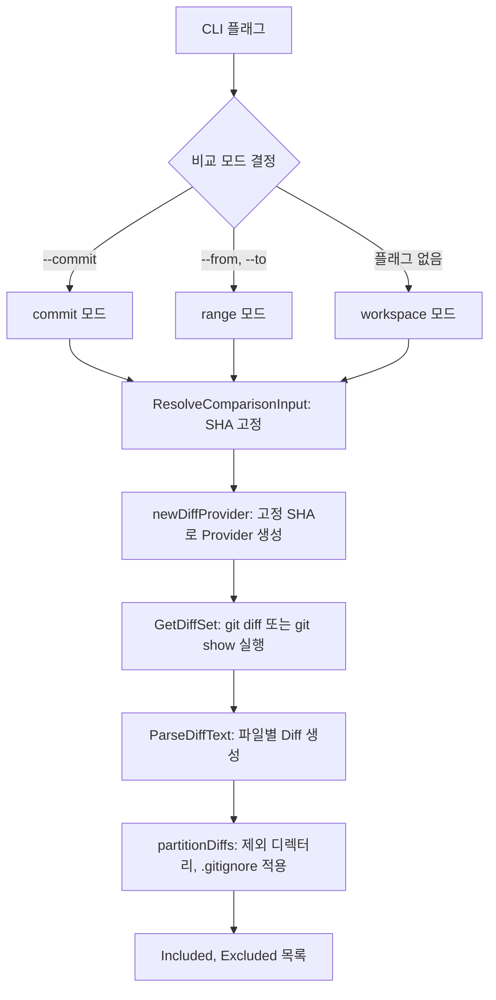

리뷰의 입력은 git이 만든 unified diff다. OpenCodeReview는 이 diff를 만드는 단계를 LLM에 맡기지 않고 `internal/diff` 패키지의 Go 코드로 처리한다. 이 장은 세 가지 비교 모드가 어떤 git 명령으로 바뀌는지, 움직이는 ref를 commit SHA로 고정하는 방식, untracked 파일을 diff로 합성하는 방법, diff 텍스트와 hunk를 파싱하는 규칙, 그리고 모든 git 호출이 거치는 동시 실행 제한기를 다룬다.

## 비교 모드 개요

### 코드 분석: Provider와 Mode

diff 수집의 중심은 `diff.Provider`다. 모드 하나와 그 모드에 필요한 ref만 들고 있다.

파일: [internal/diff/git.go L42-L49](https://github.com/alibaba/open-code-review/blob/e74f2c6bd4422bd1e12d257d1725bcce1d6b9ddd/internal/diff/git.go#L42-L49)

```go
// Mode defines how the diff is retrieved.
type Mode int

const (
	ModeWorkspace Mode = iota // current workspace (staged + unstaged + untracked)
	ModeCommit                // single commit vs its parent
	ModeRange                 // merge-base(from,to)..to
)
```

[`Provider`](https://github.com/alibaba/open-code-review/blob/e74f2c6bd4422bd1e12d257d1725bcce1d6b9ddd/internal/diff/git.go#L51-L65)는 이 모드 값과 저장소 경로, range용 `from`/`to`, commit용 `commit`, 계산해 둔 merge-base, workspace 기준 commit을 필드로 가진다. 생성자는 모드마다 하나씩 있다. `NewProvider`(range), `NewCommitProvider`(commit), `NewWorkspaceProvider`(workspace), 그리고 이미 고정된 기준 commit을 받는 `NewWorkspaceProviderWithBase`다. `runner`는 모든 git 호출을 통과시키는 동시 실행 제한기로, 이 장 마지막 절에서 다룬다.

CLI 플래그에서 모드를 고르는 규칙은 단순하다. [`reviewModeFromOptions`](https://github.com/alibaba/open-code-review/blob/e74f2c6bd4422bd1e12d257d1725bcce1d6b9ddd/cmd/opencodereview/review_cmd.go#L529-L537)는 `--commit`이 있으면 commit, `--from`과 `--to`가 모두 있으면 range, 둘 다 없으면 workspace를 고른다. `--from`만 준 경우는 02장에서 본 것처럼 `--to`가 `HEAD`로 먼저 채워지므로 range가 된다.

| 모드 | CLI 플래그 | 비교 기준(base) | 비교 대상(head) | diff 생성 명령 |
|---|---|---|---|---|
| workspace | 없음 | 현재 `HEAD` commit, 첫 commit 전이면 빈 tree | 작업 트리(파일 시스템) | `git diff <base> --` + untracked 파일 합성 |
| range | `--from A --to B` | `merge-base(A, B)` | `B`가 가리키는 commit | `git diff <merge-base> <B> --` |
| commit | `--commit C` | `C`의 첫 번째 부모, 루트 commit이면 없음 | `C` | `git show --diff-merges=first-parent <C>` |



## 정리

- 비교 모드는 workspace, range, commit 세 가지이고, `--commit`, `--from/--to`, 플래그 없음 순으로 결정된다. range는 merge-base 기준이라 풀 리퀘스트 diff와 같은 범위를 본다
- 실행 초반에 모든 ref를 SHA로 바꿔 `InputResolution`에 고정하고, 실제 diff와 manifest, 재개 검증이 같은 SHA를 쓴다. 얕은 clone에서 부모가 없으면 commit 모드는 명시적으로 실패한다
- diff 명령은 `core.quotepath=false`, `--no-ext-diff`, `--no-textconv`, `--end-of-options` 같은 인자로 사용자 git 설정의 영향을 막고, merge commit은 첫 번째 부모와 비교한다
- workspace 모드는 `HEAD`(없으면 빈 tree)와 작업 트리를 `git diff` 한 번으로 비교하고, untracked 파일은 64 MiB와 NUL 바이트 기준으로 바이너리를 가른 뒤 새 파일 diff로 합성한다. CLI 문서의 `--staged` 대체 경로는 코드에 없다
- range와 commit 모드는 리뷰 대상 commit의 루트 `.gitignore`만 마지막 일치 우선 규칙으로 적용하고, 루트의 `vendor/`, `node_modules/` 등 11개 접두사는 모든 모드에서 되살릴 수 없게 뺀다
- 파서는 `inHunk` 상태로 헤더와 내용을 구분하고, 같은 경로 헤더 분리, C 형식 따옴표 경로, CRLF를 처리한다. 모든 git 호출은 `--max-git-procs`(기본 16) 세마포어를 공유하는 `gitcmd.Runner`를 거치며, 오류 메시지에는 stderr 끝부분 2000바이트만 담는다
