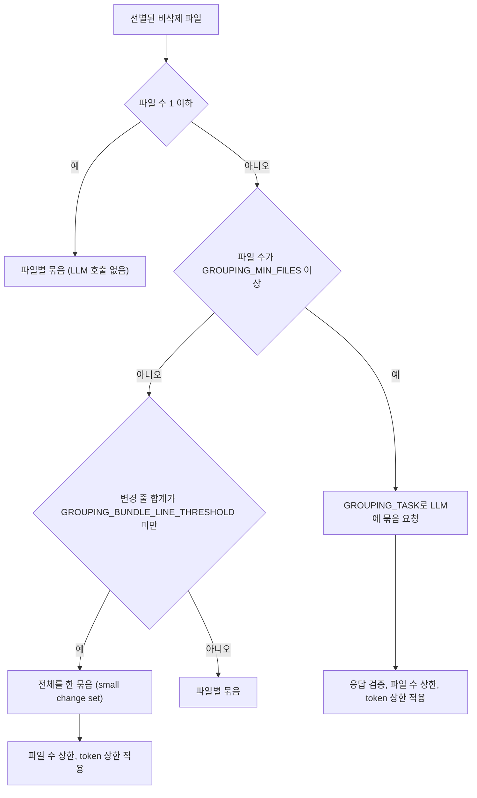

관련 파일을 리뷰 단위로 묶는 규칙과 LLM 묶음 요청의 검증을 다룬다.

## 묶음 구성 규칙

### 묶음 전략 결정

선별을 통과한 파일은 묶음(`FileGroup`)으로 나뉜다. 묶음 하나가 리뷰 하위 작업 하나, 즉 하나의 LLM 대화가 된다. 서로 관련된 파일을 한 대화에서 보면 인터페이스와 구현의 불일치 같은 문제를 찾기 쉽고, 관련 없는 파일을 한 대화에 넣으면 주의가 분산된다. 묶음 전략은 세 가지이고, [`GroupingPlan`](https://github.com/alibaba/open-code-review/blob/e74f2c6bd4422bd1e12d257d1725bcce1d6b9ddd/internal/config/template/template.go#L130-L138)이 파일 수와 변경 줄 수로 고른다.

```go
func (t Template) GroupingPlan(fileCount int, totalChanged int64) GroupingStrategy {
	if t.GroupingMinFiles <= 0 || fileCount >= t.GroupingMinFiles {
		return GroupingViaLLM
	}
	if t.GroupingBundleLineThreshold > 0 && totalChanged < int64(t.GroupingBundleLineThreshold) {
		return GroupingBundleAll
	}
	return GroupingPerFile
}
```



| 설정 | 기본값 | 위치 | 의미 |
|---|---|---|---|
| `GROUPING_MIN_FILES` | 4 | [task_template.json L43](https://github.com/alibaba/open-code-review/blob/e74f2c6bd4422bd1e12d257d1725bcce1d6b9ddd/internal/config/template/task_template.json#L43-L43) | 이 수 이상이면 LLM 묶음. 0 이하이면 항상 LLM 묶음 |
| `GROUPING_BUNDLE_LINE_THRESHOLD` | 200 | [task_template.json L44](https://github.com/alibaba/open-code-review/blob/e74f2c6bd4422bd1e12d257d1725bcce1d6b9ddd/internal/config/template/task_template.json#L44-L44) | 파일이 적을 때 변경 줄 합계가 이 값 미만이면 한 묶음. 0 이하이면 묶지 않음 |
| `maxFilesPerGroup` | 10 | [grouping.go L22](https://github.com/alibaba/open-code-review/blob/e74f2c6bd4422bd1e12d257d1725bcce1d6b9ddd/internal/agent/grouping.go#L22-L22) | 묶음 하나의 파일 수 상한 (Go 상수) |
| prompt token 상한 | `MAX_TOKENS` × 0.8 | `PromptTokenLimit` | 묶음의 diff token 합계 상한 |

[`GroupingPlan` 주석](https://github.com/alibaba/open-code-review/blob/e74f2c6bd4422bd1e12d257d1725bcce1d6b9ddd/internal/config/template/template.go#L113-L129)은 두 기준이 서로 다른 질문에 답한다고 설명한다. 파일 수 기준은 "LLM으로 나눌 가치가 있는가"를 본다. 파일이 3개 이하면 가능한 분할이 몇 개 없으므로 LLM 호출이 얻는 정보가 적다. 줄 수 기준은 "한 대화에서 함께 볼 수 있는가"를 본다. 묶음 대화의 모든 리뷰 라운드가 묶음 전체의 변경을 다뤄야 하므로, 변경이 크면 파일별로 나누는 편이 낫다는 판단이다. 파일 수가 적을 때는 줄 수만으로 결정하고, 파일 수를 다시 보지 않는다.

### 코드 분석: groupDiffs

파일: [internal/agent/grouping.go L87-L107](https://github.com/alibaba/open-code-review/blob/e74f2c6bd4422bd1e12d257d1725bcce1d6b9ddd/internal/agent/grouping.go#L87-L107)

```go
	// A small change set decides its partition without an LLM round trip: too
	// few files for the call to buy any information. Whether they can then share
	// one review is a separate question that churn answers. See
	// Template.GroupingPlan.
	totalChanged, _ := diffsChurn(diffs)
	if strategy := tpl.GroupingPlan(len(diffs), totalChanged); strategy != template.GroupingViaLLM {
		return groupDiffsResult{groups: groupWithoutLLM(ctx, diffs, strategy, tpl, totalChanged, tokenLimit)}
	}

	if tpl.GroupingTask == nil || len(tpl.GroupingTask.Messages) == 0 {
		return groupDiffsResult{groups: toSingleFileGroups(diffs)}
	}

	groups, usage, err := callGroupingLLM(ctx, diffs, client, modelName, tpl.GroupingTask, tpl.CompletionTokenLimit(), sessOpts)
	if err != nil {
		fmt.Fprintf(stdout.Writer(), "[ocr] LLM grouping failed (%v), falling back to per-file dispatch\n", err)
		return groupDiffsResult{groups: toSingleFileGroups(diffs), usage: usage}
	}

	groups = enforceGroupTokenBudget(groups, tokenLimit)
	return groupDiffsResult{groups: groups, usage: usage}
```

- 변경 줄 수는 [`diffsChurn`](https://github.com/alibaba/open-code-review/blob/e74f2c6bd4422bd1e12d257d1725bcce1d6b9ddd/internal/agent/agent.go#L1408-L1417)이 파일마다 추가 줄과 삭제 줄을 더해 합친다
- 모든 실패 경로가 같은 곳으로 간다. 템플릿에 `GROUPING_TASK`가 없거나, LLM 호출이 실패하거나, 응답을 해석하지 못하면 파일별 묶음(`toSingleFileGroups`)으로 돌아간다. 묶음 구성 실패가 리뷰 실패가 되지 않는다
- 응답을 받은 뒤 해석에 실패한 경우에도 그 호출의 token 사용량은 전체 사용량에 더한다. 호출 자체가 실패하면 사용량 정보가 없다

LLM 없이 묶을 때([`groupWithoutLLM`](https://github.com/alibaba/open-code-review/blob/e74f2c6bd4422bd1e12d257d1725bcce1d6b9ddd/internal/agent/grouping.go#L110-L153))는 `[ocr] Skipping LLM grouping for N file(s), M changed line(s)`과 결과 형태(`reviewing as one group`, `reviewing per file`)를 출력한다. 주석은 묶음 전략의 알려진 비용 하나를 적었다. `--max-tokens-budget`의 사전 점검이 묶음 단위라서, 전체를 한 묶음으로 만들면 예산이 그 묶음 하나를 거부할 때 파일 하나도 리뷰되지 않는다. 파일별 묶음이었다면 예산이 허락하는 만큼은 리뷰되었을 것이다.

### 국제화 파일 묶음 사례

묶음 prompt는 같은 리소스의 국제화 변형(`message_en.properties`와 `message_zh.properties`)을 한 묶음에 넣으라고 예시로 든다. 실제로 이 예시가 적용되는지는 파일 수에 따라 다르다.

| 변경 파일 | 변경 줄 합계 | 전략 | 결과 |
|---|---|---|---|
| `message_en.properties`, `message_zh.properties` | 60줄 | 파일 2개, 200 미만 | LLM 없이 한 묶음 (`small change set`) |
| 위 두 파일 | 300줄 | 파일 2개, 200 이상 | LLM 없이 파일별 묶음. 두 언어 파일이 따로 리뷰됨 |
| 위 두 파일 + 코드 파일 3개 | 무관 | 파일 5개 | LLM 묶음. prompt 지침에 따라 두 파일이 한 묶음이 될 것으로 보임(추정) |

`.properties`는 허용 목록에 있으므로 선별은 통과한다. 두 번째 줄처럼 파일이 적고 변경이 크면 번역 키 누락 같은 언어 간 불일치를 한 대화에서 비교하지 못한다. 이때도 리뷰 에이전트는 `file_read_diff` 도구로 다른 언어 파일의 diff를 조회할 수 있다(08장).

## LLM 묶음 요청과 응답 검증

### 묶음 prompt

`GROUPING_TASK`의 system prompt는 다음과 같다.

파일: [internal/config/template/prompts/grouping_task_system.md L1-L16](https://github.com/alibaba/open-code-review/blob/e74f2c6bd4422bd1e12d257d1725bcce1d6b9ddd/internal/config/template/prompts/grouping_task_system.md#L1-L16)

```markdown
You are a file grouping assistant for code review. Group changed files into semantically related clusters that should be reviewed together.

Files in the same group typically:
- Belong to the same module/feature
- Have producer/consumer relationships (e.g. interface and implementation)
- Are i18n/config variants of the same resource (e.g. message_en.properties and message_zh.properties)
- Share the same directory and work together on a single concern

Each file in the list is prefixed with a zero-based index in brackets, e.g. `[0] MODIFIED   path/to/file (+12/-3)`. Refer to files by that integer index, never by path.

Rules:
- Every file index must appear in exactly one group.
- A group may contain 1 file if it is unrelated to others.
- Maximum 10 files per group.
- The "files" field of each group is an array of the integer indices shown in brackets.
- Output ONLY a JSON array, no other text.
```

user prompt는 `{{file_list}}` 자리에 파일 목록을 넣고 `[{"label": "short theme description", "files": [0, 1]}]` 형식의 응답을 요구한다([grouping_task_user.md](https://github.com/alibaba/open-code-review/blob/e74f2c6bd4422bd1e12d257d1725bcce1d6b9ddd/internal/config/template/prompts/grouping_task_user.md#L1-L6)).

파일 목록은 [`buildFileList`](https://github.com/alibaba/open-code-review/blob/e74f2c6bd4422bd1e12d257d1725bcce1d6b9ddd/internal/agent/grouping.go#L249-L261)가 `[0] MODIFIED   internal/agent/grouping.go (+12/-3)` 형태로 만든다. 상태, 경로, 추가와 삭제 줄 수만 들어가고 diff 내용은 들어가지 않는다. 묶음 호출이 파일 수에 비례하는 적은 token으로 끝나는 이유다.

경로 대신 정수 번호로 응답하게 한 이유를 [`groupingResponse` 주석](https://github.com/alibaba/open-code-review/blob/e74f2c6bd4422bd1e12d257d1725bcce1d6b9ddd/internal/agent/grouping.go#L41-L49)이 설명한다. 경로는 길이만큼 출력 token을 쓰므로, 변경 파일이 많으면 응답이 출력 상한에서 잘려 JSON 해석이 실패하고 전체가 파일별 묶음으로 떨어졌다. 번호는 몇 token이면 된다. 출력 상한은 `MAX_COMPLETION_TOKENS`(16384)이고, 이 값이 0 이하이면 4096을 쓴다([L210-L212](https://github.com/alibaba/open-code-review/blob/e74f2c6bd4422bd1e12d257d1725bcce1d6b9ddd/internal/agent/grouping.go#L210-L212)).

묶음 호출은 세션 기록에 `__grouping__`이라는 가상 파일 키로 남는다([L194-L208](https://github.com/alibaba/open-code-review/blob/e74f2c6bd4422bd1e12d257d1725bcce1d6b9ddd/internal/agent/grouping.go#L194-L208)). 13장의 세션 뷰어에서 묶음 요청과 응답을 다른 리뷰 대화와 같은 방식으로 볼 수 있다. 호출 중 panic이 나도 `recover`로 받아 오류로 바꾸고, 파일별 묶음으로 돌아간다.

### 코드 분석: 응답 검증

LLM 응답은 그대로 믿지 않고 코드로 다시 확인한다.

파일: [internal/agent/grouping.go L286-L307](https://github.com/alibaba/open-code-review/blob/e74f2c6bd4422bd1e12d257d1725bcce1d6b9ddd/internal/agent/grouping.go#L286-L307)

```go
	seen := make([]bool, len(diffs))
	var groups []FileGroup

	for _, g := range resp {
		var gDiffs []model.Diff
		for _, idx := range g.Files {
			if idx < 0 || idx >= len(diffs) {
				// Skip an index that names no file — the index equivalent of the
				// unknown-path case the path-based version skipped.
				continue
			}
			if seen[idx] {
				// Skip duplicate — file already assigned to an earlier group.
				continue
			}
			seen[idx] = true
			gDiffs = append(gDiffs, diffs[idx])
		}
		if len(gDiffs) > 0 {
			groups = append(groups, FileGroup{Label: g.Label, Diffs: gDiffs})
		}
	}
```

이 루프 뒤에 어떤 묶음에도 들어가지 못한 파일을 단일 파일 묶음으로 추가하는 루프가 이어진다([L309-L314](https://github.com/alibaba/open-code-review/blob/e74f2c6bd4422bd1e12d257d1725bcce1d6b9ddd/internal/agent/grouping.go#L309-L314)). prompt의 규칙 "Every file index must appear in exactly one group"을 모델이 지키지 않을 수 있으므로, 코드가 같은 불변식을 강제한다.

| LLM 응답 문제 | 코드 처리 |
|---|---|
| 응답이 ```` ``` ````로 감싸짐 | 첫 줄과 마지막 펜스 줄을 제거 후 해석 |
| JSON 해석 실패, 출력 상한에서 잘림 | 오류 반환, 전체를 파일별 묶음으로 |
| 범위 밖 번호 | 건너뜀 |
| 같은 번호가 두 묶음에 등장 | 앞 묶음에만 넣고 뒤는 건너뜀 |
| 어떤 묶음에도 없는 파일 | 그 파일만으로 된 묶음 추가 |
| 파일이 하나도 남지 않은 묶음 | 버림 |
| 10개 초과 묶음 | `enforceMaxFilesPerGroup`이 10개씩 나눔, 라벨 유지 |

이 검증 덕분에 묶음 결과는 항상 선별된 파일 전체를 정확히 한 번씩 덮는다. 06장의 커버리지 기록이 이 성질에 기댄다. README가 "관련 파일 묶음"을 engineering logic이 보장하는 단계로 분류한 근거가 이 부분이다(01장).

### 코드 분석: 묶음 token 상한

파일 수 상한을 지켜도 diff가 큰 파일 몇 개가 모이면 prompt가 넘칠 수 있다. 마지막으로 token 합계를 확인한다.

파일: [internal/agent/grouping.go L342-L364](https://github.com/alibaba/open-code-review/blob/e74f2c6bd4422bd1e12d257d1725bcce1d6b9ddd/internal/agent/grouping.go#L342-L364)

```go
func enforceGroupTokenBudget(groups []FileGroup, tokenLimit int) []FileGroup {
	if tokenLimit <= 0 {
		return groups
	}
	var result []FileGroup
	for _, g := range groups {
		total := int64(0)
		for _, d := range g.Diffs {
			total += int64(llm.CountTokens(d.Diff))
		}
		if total <= int64(tokenLimit) {
			result = append(result, g)
		} else {
			for _, d := range g.Diffs {
				result = append(result, FileGroup{
					Label: g.Label + " (split: " + d.NewPath + ")",
					Diffs: []model.Diff{d},
				})
			}
		}
	}
	return result
}
```

상한을 넘은 묶음은 절반으로 나누지 않고 바로 파일별로 쪼갠다. 파일 하나의 diff는 선별 단계에서 이미 같은 상한 이하로 확인되었으므로, 쪼갠 결과는 항상 상한 안에 들어간다. 라벨에 `(split: <경로>)`가 붙어 세션 기록에서 쪼개진 묶음을 구분할 수 있다.

묶음의 식별 키는 [`fileGroupKey`](https://github.com/alibaba/open-code-review/blob/e74f2c6bd4422bd1e12d257d1725bcce1d6b9ddd/internal/agent/grouping.go#L366-L377)가 만든다. 파일이 하나면 그 경로, 여럿이면 경로를 정렬해 쉼표로 이은 문자열이다. LLM이 같은 파일들을 다른 순서로 묶어도 키는 같다. 06장의 체크포인트와 재개가 이 키를 쓴다.
