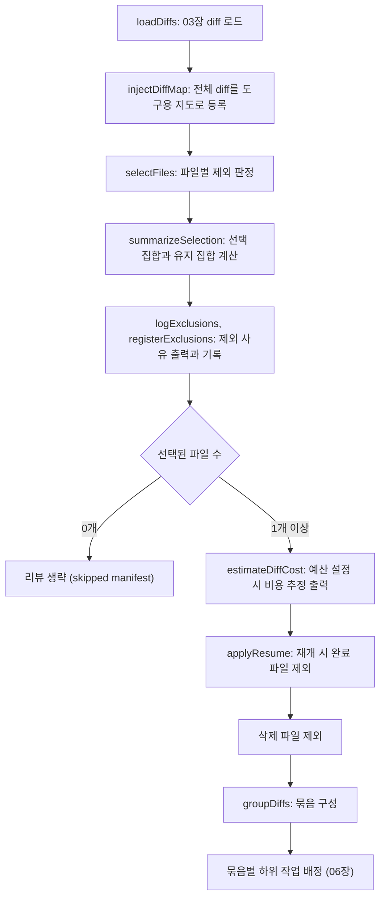

03장에서 만든 diff 목록이 그대로 LLM에 가지는 않는다. 바이너리, 비밀 정보 파일, 테스트 파일, 의존성 폴더, 너무 큰 diff를 걸러 내는 선별 단계와, 남은 파일을 리뷰 호출 단위로 묶는 묶음 구성 단계를 거친다. 이 장은 두 단계의 규칙을 코드로 정리하고, 같은 선별 결과를 LLM 호출 없이 보여 주는 `--preview`와 실행 전 비용 추정을 다룬다.

## 선별과 묶음의 위치

### 처리 순서

선별과 묶음은 에이전트 실행(`Agent.Run`) 안에서 diff 로드 직후, 실제 리뷰 작업 배정 전에 일어난다. 에이전트 본체의 나머지 흐름은 06장에서 다룬다.



### 코드 분석: 선별 호출 지점

파일: [internal/agent/agent.go L320-L334](https://github.com/alibaba/open-code-review/blob/e74f2c6bd4422bd1e12d257d1725bcce1d6b9ddd/internal/agent/agent.go#L320-L334)

```go
	// Apply the one pre-dispatch selection — the same call `--preview` makes —
	// so the set reported here is the set registerCoverage seals below.
	decisions := a.selectFiles(a.diffs)
	kept, counts := summarizeSelection(decisions)
	totalChanged := len(a.diffs)
	reviewCount := counts.Selected
	fmt.Fprintf(stdout.Writer(), "[ocr] %d file(s) changed, reviewing %d in %s\n", totalChanged, reviewCount, a.args.RepoDir)

	a.logExclusions(decisions)
	// Register before the early return so skipped runs also explain exclusions.
	// A missing exclusion record must not fail the selected review.
	if err := a.registerExclusions(decisions); err != nil {
		a.recordWarning("manifest_error", "", err.Error())
	}
	a.diffs = kept
```

- `--preview`와 실제 실행이 같은 `selectFiles`를 호출한다. 주석이 인용한 이슈 #782는 두 경로가 각자 선별 규칙을 갖고 있어서 결과가 달라졌던 문제다
- 제외 사유는 리뷰가 생략되는 경우에도 manifest에 먼저 기록된다. 커버리지 기록(06장)이 "왜 이 파일을 리뷰하지 않았는가"를 설명할 수 있게 하기 위해서다
- 시작 메시지 `[ocr] N file(s) changed, reviewing M in <repo>`의 N은 03장에서 내장 제외 디렉터리를 뺀 뒤의 파일 수다

> **주의**: 바로 앞 줄([L315-L317](https://github.com/alibaba/open-code-review/blob/e74f2c6bd4422bd1e12d257d1725bcce1d6b9ddd/internal/agent/agent.go#L315-L317))의 `injectDiffMap`은 선별 전 전체 diff로 `file_read_diff` 도구의 diff 지도를 만든다. 주석은 "걸러진 관련 파일의 diff도 LLM이 조회할 수 있게" 하려는 의도라고 적었다. 이 지도에는 아래의 비밀 경로 파일 diff도 들어가며, `internal/tool`에는 비밀 경로 검사가 없다. 찾지 못한 경로를 요청하면 [`notFoundMessage`](https://github.com/alibaba/open-code-review/blob/e74f2c6bd4422bd1e12d257d1725bcce1d6b9ddd/internal/tool/file_read_diff.go#L111-L135)가 diff가 있는 경로 목록을 돌려준다. 비밀 경로 차단은 "리뷰 대상으로 배정하지 않는다"는 의미이고, 모델이 그 diff를 도구로 요청하는 경로까지 막지는 않는다. 도구 쪽 동작은 08장에서 다룬다.

## 정리

- 선별은 `selectFiles` 한 함수가 담당하는 순수 판정이고, `--preview`와 실제 실행, 재개 동일성 계산이 같은 결과를 공유한다. 판정 순서는 바이너리, 비밀 경로, 사용자 exclude, 사용자 include, 확장자, 기본 제외 패턴, 삭제, 크기(`MAX_TOKENS`의 80%)다
- 확장자 허용 목록은 144개이고 `.md`, `.txt`는 빠진다. 확장자가 없거나 점으로 시작하는 파일은 확장자 검사를 통과한다. 기본 제외 패턴 115개 중 앞 무리는 테스트와 생성 코드라서, 테스트 파일은 include 없이는 리뷰되지 않는다
- 비밀 경로(SSH 키, `.netrc`, `.npmrc`, `.env` 계열)는 사용자 규칙보다 먼저 검사되어 include로 되살릴 수 없다. 다만 `file_read_diff` 도구의 diff 지도는 선별 전 전체 diff로 만들어지므로 비밀 경로 diff도 도구 응답에 포함될 수 있다
- 묶음 전략은 파일 수 4개 이상이면 LLM, 미만이면 변경 줄 합계 200 미만일 때 한 묶음, 이상이면 파일별이다. LLM 응답은 번호 범위, 중복, 누락, 10개 상한, token 상한을 코드로 다시 강제해 모든 파일을 정확히 한 번씩 덮는다
- 묶음 prompt는 diff 내용 없이 상태, 경로, 줄 수만 보내고 경로 대신 번호로 답하게 해 출력 잘림을 줄인다. 어떤 실패도 파일별 묶음으로 돌아가며 리뷰를 멈추지 않는다
- 비용 추정은 파일당 $8T + 21300$ token의 하한 추정이며 예산을 설정했을 때만 출력된다. 리뷰 규칙 문서는 JavaScript 테스트 패턴에 `mts`, `cts`를 빠뜨려 코드보다 좁게 적었다
