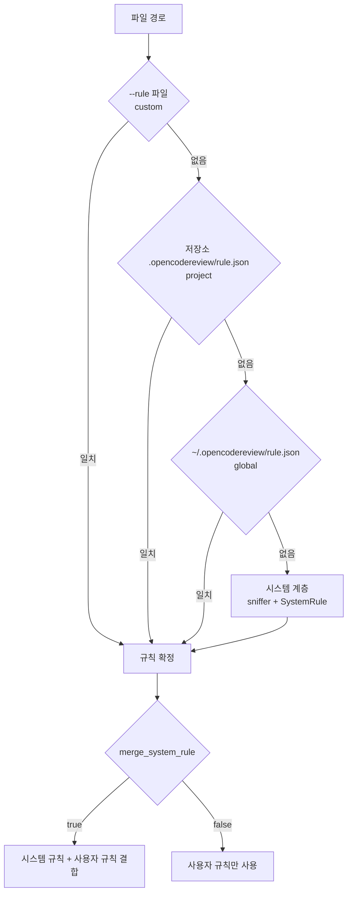

사용자 규칙 계층의 우선순위와 묶음 단위 규칙 결합, `ocr rules check`를 다룬다.

## 사용자 규칙 계층과 우선순위

사용자는 JSON 규칙 파일로 시스템 규칙을 대체하거나 보강한다. 파일은 세 곳에 둘 수 있고, 내장 시스템 계층까지 합쳐 네 계층이 된다.



| 우선순위 | 계층 | 위치 | 상대 경로 기준 | 경로 제한 |
|---|---|---|---|---|
| 1 | custom | `--rule <파일>` | 규칙 파일이 있는 디렉터리 | 없음 |
| 2 | project | `<repoDir>/.opencodereview/rule.json` | 저장소 루트 | 저장소 밖으로 벗어나면 거부 |
| 3 | global | `~/.opencodereview/rule.json` | `~/.opencodereview/` | 없음 |
| 4 | system | 바이너리 내장 | 해당 없음 | 해당 없음 |

### 코드 분석: composedResolver.Resolve

`internal/config/rules/system_rules.go`, [system_rules.go L447-L457](https://github.com/alibaba/open-code-review/blob/e74f2c6bd4422bd1e12d257d1725bcce1d6b9ddd/internal/config/rules/system_rules.go#L447-L457)

계층을 위에서부터 차례로 확인하는 함수다.

```go
func (c *composedResolver) Resolve(path string) string {
	for _, layer := range []*ProjectRule{c.custom, c.project, c.global} {
		if entry := matchProjectRuleEntry(layer, path); entry != nil {
			if entry.MergeSystemRule {
				return c.mergeWithSystemRule(path, entry.Rule)
			}
			return entry.Rule
		}
	}
	return c.system.Resolve(path)
}
```

한 계층 안에서도 [`matchProjectRuleEntry`](https://github.com/alibaba/open-code-review/blob/e74f2c6bd4422bd1e12d257d1725bcce1d6b9ddd/internal/config/rules/system_rules.go#L535-L553)가 `rules` 배열을 선언 순서대로 확인한다. 이때 `rule`이 비어 있고 `merge_system_rule`도 꺼진 항목은 건너뛴다. 이 조건이 뒤에서 설명할 "규칙 파일 참조 실패" 동작과 연결된다.

### 코드 분석: mergeWithSystemRule

`internal/config/rules/system_rules.go`, [system_rules.go L489-L504](https://github.com/alibaba/open-code-review/blob/e74f2c6bd4422bd1e12d257d1725bcce1d6b9ddd/internal/config/rules/system_rules.go#L489-L504)

`merge_system_rule: true`인 항목이 이겼을 때 두 규칙을 합치는 방식이다.

```go
func (c *composedResolver) mergeWithSystemRule(path, rule string) string {
	systemRule := c.system.Resolve(path)

	if systemRule == "" {
		return rule
	}
	if rule == "" {
		return systemRule
	}

	return "## System-Specific Rules (Mandatory)\n\n" +
		systemRule +
		"\n\n---\n\n" +
		"## User-Specific Rules (Mandatory)\n\n" +
		rule
}
```

시스템 쪽 규칙은 파일마다 다시 계산된다. 그래서 `**/*` 하나에 `merge_system_rule`을 켜 두면 Java 파일에는 `java.md`, Go 파일에는 `go.md`가 각각 붙고 그 뒤에 사용자 규칙이 이어진다. 결합은 시스템 계층과만 일어난다. 사용자 계층 두 곳에서 같은 파일에 일치하는 항목이 있어도 첫 항목만 쓰이고 서로 합쳐지지 않는다. 이 제약은 공식 문서 [review-rules.md L119-L122](https://github.com/alibaba/open-code-review/blob/e74f2c6bd4422bd1e12d257d1725bcce1d6b9ddd/pages/src/content/docs/en/review-rules.md#L119-L122)에도 적혀 있다.

이 저장소 자신도 이 기능을 쓴다. 루트의 [`.opencodereview/rule.json`](https://github.com/alibaba/open-code-review/blob/e74f2c6bd4422bd1e12d257d1725bcce1d6b9ddd/.opencodereview/rule.json#L1-L9)은 `internal/llm/providers.go` 한 파일에 대해 필드 순서, 네 언어 문서 동기화, 테스트 추가를 요구하는 규칙을 두고 `merge_system_rule: true`로 `go.md`와 결합한다.

### 규칙 본문과 파일 참조

`rule` 값은 규칙 본문일 수도 있고 규칙 파일 경로일 수도 있다. 둘을 가르는 기준은 [`looksLikeFilePath`](https://github.com/alibaba/open-code-review/blob/e74f2c6bd4422bd1e12d257d1725bcce1d6b9ddd/internal/config/rules/system_rules.go#L562-L570)다.

| 조건 | 해석 |
|---|---|
| 줄바꿈 포함 | 본문 |
| 공백 포함 (`Follow rules from team.md` 등) | 본문 |
| 공백 없는 한 줄이고 확장자가 `.md`, `.txt`, `.markdown` | 파일 경로 |
| 그 밖 | 본문 |

파일 경로로 판정되면 [`readRuleFileSafe`](https://github.com/alibaba/open-code-review/blob/e74f2c6bd4422bd1e12d257d1725bcce1d6b9ddd/internal/config/rules/system_rules.go#L635-L664)가 심볼릭 링크를 풀고, 확장자를 다시 확인하고, 크기 상한 [512KB](https://github.com/alibaba/open-code-review/blob/e74f2c6bd4422bd1e12d257d1725bcce1d6b9ddd/internal/config/rules/system_rules.go#L649-L656)를 검사한 뒤 읽는다. project 계층은 저장소에 커밋되는 파일이라 신뢰하지 않는 입력으로 취급한다. 그래서 `confineRoot`를 넘겨, 심볼릭 링크를 따라간 실제 경로가 저장소 밖이면 거부한다. `rule.json` 파일 자체도 [`loadProjectRule`](https://github.com/alibaba/open-code-review/blob/e74f2c6bd4422bd1e12d257d1725bcce1d6b9ddd/internal/config/rules/system_rules.go#L410-L442)에서 같은 검사를 받는다.

> **주의**: 파일 참조를 읽지 못하면 [`resolveRuleEntries`](https://github.com/alibaba/open-code-review/blob/e74f2c6bd4422bd1e12d257d1725bcce1d6b9ddd/internal/config/rules/system_rules.go#L575-L587)가 그 항목의 `rule`을 빈 문자열로 바꾸고 stderr에 경고만 남긴다. `merge_system_rule`이 꺼져 있으면 빈 항목은 매칭에서 건너뛰므로, 그 파일은 아래 계층의 규칙으로 리뷰된다. 실행은 계속되므로 오타 난 경로를 알아차리려면 경고 줄을 확인하거나 `ocr rules check`로 결과를 직접 봐야 한다.

### include, exclude의 계층 선택

규칙 파일에는 `rules` 외에 `include`, `exclude`도 들어간다. 이 둘이 파일 선별에 어떻게 쓰이는지는 04장에서 다루고, 여기서는 여러 계층에 있을 때 무엇을 고르는지만 본다.

[`buildFileFilter`](https://github.com/alibaba/open-code-review/blob/e74f2c6bd4422bd1e12d257d1725bcce1d6b9ddd/internal/config/rules/system_rules.go#L351-L369)는 custom, project, global 순으로 계층을 돌면서 `include`와 `exclude`가 모두 빈 계층을 건너뛰고, 처음 만난 계층의 패턴을 소문자로 바꿔 그대로 돌려준다.

필터는 `include`나 `exclude`가 하나라도 있는 **가장 높은 계층 하나**만 쓴다. 프로젝트 파일에 `exclude`가 있으면 전역 파일의 `include`, `exclude`는 모두 무시된다.

> **주의**: `FileFilter` 타입 주석([system_rules.go L219-L224](https://github.com/alibaba/open-code-review/blob/e74f2c6bd4422bd1e12d257d1725bcce1d6b9ddd/internal/config/rules/system_rules.go#L219-L224))은 "merged include/exclude glob patterns collected from all rule.json layers"라고 적지만, 실제 `buildFileFilter`는 계층을 합치지 않고 하나만 고른다. 함수 주석 "picks the highest-priority layer"가 실제 동작과 맞는다.

## 묶음 단위 규칙 결합

리뷰는 파일 하나가 아니라 묶음(04장) 하나를 단위로 돈다. 한 묶음에 Go 파일과 XML 파일이 섞이면 규칙 문서도 두 개가 필요하다. 이 결합은 `internal/agent`의 `resolveGroupSystemRule`이 맡는다.

### 코드 분석: resolveGroupSystemRule

`internal/agent/agent.go`, [agent.go L1751-L1769](https://github.com/alibaba/open-code-review/blob/e74f2c6bd4422bd1e12d257d1725bcce1d6b9ddd/internal/agent/agent.go#L1751-L1769)

같은 규칙 본문을 쓰는 파일끼리 묶는 부분이다.

```go
	for _, d := range sorted {
		r := a.args.SystemRule.Resolve(d.NewPath)
		if r == "" {
			continue
		}
		if i, ok := index[r]; ok {
			blocks[i].paths = append(blocks[i].paths, d.NewPath)
			continue
		}
		index[r] = len(blocks)
		blocks = append(blocks, ruleBlock{rule: r, paths: []string{d.NewPath}})
	}

	if len(blocks) == 0 {
		return ""
	}
	if len(blocks) == 1 {
		return blocks[0].rule
	}
```

- 규칙 본문 문자열 자체를 map 키로 써서 중복을 없앤다. Go 파일 다섯 개가 있는 묶음은 `go.md`가 한 번만 들어간다
- 서로 다른 규칙이 둘 이상이면 [agent.go L1771-L1782](https://github.com/alibaba/open-code-review/blob/e74f2c6bd4422bd1e12d257d1725bcce1d6b9ddd/internal/agent/agent.go#L1771-L1782)에서 `<rules for="a.go, b.go">...</rules>` 형식으로 감싼다. diff를 `<file path="...">`로 감싸는 방식과 맞춘 것이다
- 결합 전에 경로 순으로 정렬한다([agent.go L1740-L1743](https://github.com/alibaba/open-code-review/blob/e74f2c6bd4422bd1e12d257d1725bcce1d6b9ddd/internal/agent/agent.go#L1740-L1743)). grouping LLM이 돌려주는 순서는 실행마다 다를 수 있는데, 순서가 바뀌면 prompt 앞부분이 달라져 프로바이더의 prompt cache를 재사용하지 못한다

규칙이 하나뿐인 묶음은 태그 없이 본문만 돌려준다. 주석은 이 경우 렌더링 결과가 태그 도입 이전과 바이트 단위로 같다고 밝힌다.

## ocr rules check 명령

어떤 규칙이 어느 계층에서 왔는지는 `ocr rules check <경로>`로 확인한다.

### 코드 분석: runRulesCheck

`cmd/opencodereview/rules_cmd.go`, [rules_cmd.go L45-L61](https://github.com/alibaba/open-code-review/blob/e74f2c6bd4422bd1e12d257d1725bcce1d6b9ddd/cmd/opencodereview/rules_cmd.go#L45-L61)

```go
func runRulesCheck(filePath string) error {
	resolvedRepo, err := resolveRepoDir(rulesCheckRepoDir)
	if err != nil {
		return err
	}

	resolver, _, err := rules.NewResolver(resolvedRepo, rulesCheckRulePath, rules.ResolverOptions{})
	if err != nil {
		return fmt.Errorf("load rules: %w", err)
	}

	dr, ok := resolver.(rules.DetailResolver)
	if !ok {
		return fmt.Errorf("resolver does not support detail inspection")
	}

	detail := dr.ResolveDetail(filePath)
```

출력은 `File`, `Source`, `Pattern`, `Rule` 네 항목이고, sniffing이 규칙을 바꿨으면 `Note:` 줄이 추가된다([rules_cmd.go L63-L79](https://github.com/alibaba/open-code-review/blob/e74f2c6bd4422bd1e12d257d1725bcce1d6b9ddd/cmd/opencodereview/rules_cmd.go#L63-L79)).

`ResolverOptions{}`를 넘기므로 `ref`가 비어 있고, `.m` sniffing은 작업 트리의 파일을 읽는다. 범위 리뷰에서 커밋된 내용과 작업 트리 내용이 다르면 `rules check`의 결과와 실제 리뷰의 결과가 다를 수 있다(추정). 또한 이 명령은 `FileFilter`를 버린다. 파일이 리뷰 대상인지는 `ocr review --preview`로 따로 확인해야 한다(04장).

규칙 설정 전체는 실행 기록에도 남는다. `composedResolver.CanonicalConfig`가 계층, 경로, 본문, merge 여부를 순서대로 나열하고, 에이전트가 이를 [`ruleConfigSHA256`](https://github.com/alibaba/open-code-review/blob/e74f2c6bd4422bd1e12d257d1725bcce1d6b9ddd/internal/agent/agent.go#L1076-L1090)으로 해시해 run manifest의 `rule_config_sha256`에 넣는다. 규칙 문서 한 줄만 바뀌어도 해시가 달라지므로, 두 실행의 결과가 같은 규칙에서 나왔는지 비교할 수 있다. manifest는 13장에서 다룬다.
