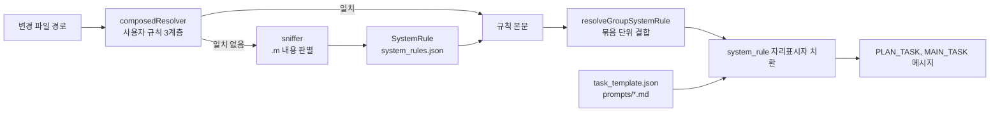

OpenCodeReview는 파일마다 다른 리뷰 체크리스트를 붙이고, 그 체크리스트를 고정된 prompt 틀의 빈자리에 끼워 넣어 LLM에 보낸다. 이 장은 경로 패턴으로 규칙을 고르는 `internal/config/rules`, 사용자 규칙 파일의 우선순위, `.m` 확장자의 내용 sniffing, 그리고 prompt 파일을 읽어 자리표시자를 채우는 `internal/config/template`과 effort 수준을 코드 기준으로 정리한다.

## 규칙과 템플릿의 연결 구조

README의 [설계 원칙](https://github.com/alibaba/open-code-review/blob/e74f2c6bd4422bd1e12d257d1725bcce1d6b9ddd/README.md#L93-L93)은 "Fine-grained rule matching"을 deterministic 단계로 분류하고, "template-engine-based rule matching is more stable and predictable"이라고 설명한다. 코드에서 이 문장은 두 부분으로 나뉜다. 어떤 규칙 문서를 고를지는 glob 패턴 매칭이 정하고, 고른 문서를 prompt에 넣는 일은 문자열 치환이 맡는다. 별도의 템플릿 엔진 라이브러리는 쓰지 않는다.

| 구성 요소 | 패키지, 파일 | 역할 |
|---|---|---|
| `SystemRule` | `internal/config/rules/system_rules.go` | 내장 패턴 표를 순서대로 매칭, 없으면 `default.md` |
| `sniffer` | `internal/config/rules/sniffer.go` | `.m` 파일 첫 줄을 읽어 MATLAB과 Objective-C 구분 |
| `composedResolver` | `internal/config/rules/system_rules.go` | `--rule`, 프로젝트, 전역, 시스템 순 우선순위 적용 |
| `FileFilter` | `internal/config/rules/system_rules.go` | 사용자 `include`, `exclude` 패턴 보관 (적용은 04장) |
| `Template` | `internal/config/template/template.go` | 작업별 대화 정의와 수치 기준 |
| `Effort` | `internal/config/template/effort.go` | low, medium, high를 리뷰 라운드 수로 변환 |

규칙 선택 결과는 하나의 문자열이다. 이 문자열이 `{{system_rule}}` 자리에 들어간다는 점은 문서 [review-rules.md](https://github.com/alibaba/open-code-review/blob/e74f2c6bd4422bd1e12d257d1725bcce1d6b9ddd/pages/src/content/docs/en/review-rules.md#L378-L379)에도 적혀 있다. 파일 선별과 `include`, `exclude`의 적용 순서는 04장에서 다루고, 이 장은 "선별을 통과한 파일에 어떤 글이 붙는가"만 다룬다.

## 정리

- 규칙 선택은 doublestar glob과 소문자 비교로 이뤄지고, 내장 표 74개 패턴은 선언 순서대로 first match 규칙을 따른다. 순서 보존을 위해 JSON을 토큰 단위로 읽는다
- 사용자 규칙은 `--rule`, 프로젝트, 전역 순으로 확인하며, `merge_system_rule`은 시스템 규칙과만 결합한다. 파일 참조 실패는 경고만 남기고 아래 계층으로 내려간다
- `include`, `exclude`는 계층을 합치지 않고 가장 높은 계층 하나만 쓴다. 타입 주석의 "merged"는 실제 동작과 다르다
- `.m` 파일은 시스템 계층을 감싼 sniffer가 첫 줄 접두어로 Objective-C를 판별하고, 사용자 규칙이 항상 sniffing보다 먼저 이긴다
- README의 "template-engine-based"는 실제로 내장 Markdown prompt와 `strings.ReplaceAll` 치환, 빈 블록 제거 정규식의 조합이다. 실행 시점에 prompt를 바꾸는 옵션은 없다
- effort는 현재 리뷰 라운드 수(1, 2, 3)만 바꾸며, 템플릿의 `MAX_REVIEW_ROUNDS` 값은 항상 effort 값으로 덮어써진다
