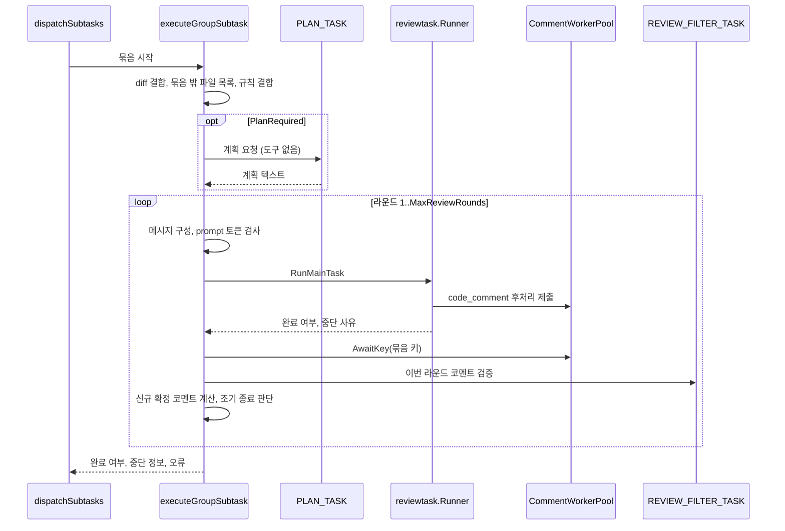

묶음 하위 작업의 동시 실행과 단계별 처리, 계획 단계를 다룬다.

## 묶음 dispatch와 동시성

README는 묶음 기능을 "Each bundle runs as a sub-agent with isolated context"라고 설명한다([README.md L92-L92](https://github.com/alibaba/open-code-review/blob/e74f2c6bd4422bd1e12d257d1725bcce1d6b9ddd/README.md#L92-L92)). 코드에서 "sub-agent"는 묶음 하나를 맡는 goroutine이고, "isolated context"는 묶음마다 별도의 메시지 목록으로 LLM 대화를 시작한다는 뜻이다. 코멘트 저장소, 세션, 토큰 집계는 모든 묶음이 공유한다.

### 코드 분석: dispatchSubtasks의 준비 단계

`internal/agent/agent.go`, [agent.go L654-L682](https://github.com/alibaba/open-code-review/blob/e74f2c6bd4422bd1e12d257d1725bcce1d6b9ddd/internal/agent/agent.go#L654-L682)

재개, 삭제 파일 제거, 묶음 구성, 동시성 설정이 이어지는 부분이다.

```go
	toDispatch := a.applyResume(a.diffs)

	// Filter out deleted files before grouping.
	var nonDeleted []model.Diff
	for _, d := range toDispatch {
		if !d.IsDeleted {
			nonDeleted = append(nonDeleted, d)
		}
	}

	// Group files semantically via LLM.
	groupResult := groupDiffs(ctx, nonDeleted, a.args.LLMClient, a.args.Model,
		a.args.Template, llmloop.PromptTokenLimit(a.args.Template.MaxTokens),
		&groupingSessionOpts{session: a.session, provider: a.args.Provider, model: a.args.Model})
	groups := groupResult.groups
	a.fileGroups = groups
	if groupResult.usage != nil {
		a.runner.RecordUsage(groupResult.usage)
	}

	var wg sync.WaitGroup

	concurrency := a.args.MaxConcurrency
	if concurrency <= 0 {
		concurrency = 8
	}

	sem := make(chan struct{}, concurrency)
	timeout := time.Duration(a.args.ConcurrentTaskTimeout) * time.Minute * time.Duration(a.args.Template.ReviewRounds())
```

- 이 앞에서 [`registerCoverage`](https://github.com/alibaba/open-code-review/blob/e74f2c6bd4422bd1e12d257d1725bcce1d6b9ddd/internal/agent/agent.go#L640-L652)가 커버리지 분모를 먼저 고정한다. 재개로 재사용할 파일도 분모에 포함되도록 `applyResume`보다 앞에 둔다
- 삭제된 파일은 묶음에서 빠진다. 삭제 diff는 리뷰 대상이 아니지만 `a.diffs`에는 남아 다른 묶음의 `{{change_files}}` 목록에 나온다
- 묶음 구성(`groupDiffs`)의 토큰 사용량도 실행 전체 집계에 더한다. 구성 규칙은 04장에서 다룬다
- 묶음 하나의 시간 상한은 `--timeout` 분에 리뷰 라운드 수를 곱한 값이다

> **주의**: `--timeout`의 도움말([shared_flags.go L52-L52](https://github.com/alibaba/open-code-review/blob/e74f2c6bd4422bd1e12d257d1725bcce1d6b9ddd/cmd/opencodereview/shared_flags.go#L52-L52))은 "concurrent task budget in minutes"라고만 적지만, 코드는 이 값에 라운드 수를 곱한다. 기본값 15분에 effort `medium`(2라운드)이면 묶음 하나의 상한은 30분, `high`면 45분이다.

### 코드 분석: semaphore와 goroutine 시작

`internal/agent/agent.go`, [agent.go L724-L738](https://github.com/alibaba/open-code-review/blob/e74f2c6bd4422bd1e12d257d1725bcce1d6b9ddd/internal/agent/agent.go#L724-L738)

묶음 하나를 띄우는 부분이다.

```go
		select {
		case sem <- struct{}{}: // acquire semaphore
		case <-ctx.Done():
			break dispatchLoop
		}
		if ctx.Err() != nil {
			<-sem // release the slot acquired concurrently with cancellation
			break dispatchLoop
		}
		dispatched += int64(len(group.Diffs))
		wg.Add(1)

		go func(g FileGroup) {
			defer wg.Done()
			defer func() { <-sem }() // release
```

semaphore를 goroutine 안이 아니라 dispatch 반복문에서 얻는다. 그래서 동시에 떠 있는 goroutine 수 자체가 `concurrency`를 넘지 않고, 예산 검사(아래)도 슬롯이 날 때마다 최신 사용량으로 다시 계산된다. 취소와 슬롯 획득이 동시에 일어난 경우 받은 슬롯을 돌려주고 빠져나오는 처리도 있다.

goroutine 안에서는 `recover`로 panic을 잡는다([agent.go L742-L755](https://github.com/alibaba/open-code-review/blob/e74f2c6bd4422bd1e12d257d1725bcce1d6b9ddd/internal/agent/agent.go#L742-L755)). 한 묶음이 panic을 일으켜도 그 묶음의 파일만 `FailurePanic`으로 기록하고 다른 묶음은 계속 돈다.

| 동시성 설정 | 기본값 | 적용 대상 |
|---|---|---|
| `--concurrency` | 8 | 동시에 도는 묶음 goroutine 수 |
| `CommentWorkerPool` 크기 | `--concurrency`와 같음 | 동시에 도는 코멘트 후처리 작업 수 |
| `--timeout` | 15분 | 묶음 하나의 시간 상한, 라운드 수를 곱해 적용 |
| `--max-git-procs` | 16 | 동시에 도는 git 하위 프로세스 수 |

## 묶음 하위 작업의 단계

goroutine 하나는 `executeGroupSubtask`를 호출한다. 이 함수가 계획 단계와 여러 라운드의 본 리뷰를 차례로 실행한다.



### 코드 분석: 계획 단계 판정

`internal/agent/agent.go`, [agent.go L1449-L1475](https://github.com/alibaba/open-code-review/blob/e74f2c6bd4422bd1e12d257d1725bcce1d6b9ddd/internal/agent/agent.go#L1449-L1475)

계획 단계를 돌릴지 정하고, 실패해도 리뷰를 계속하는 부분이다.

```go
	planEnabled := a.args.Template.PlanTask != nil && len(a.args.Template.PlanTask.Messages) > 0
	planRequired := a.args.Template.PlanRequired(len(g.Diffs), totalChanged, maxFileChanged)

	var planResult string
	switch {
	case !planEnabled:
		// No plan task configured.
	case planRequired:
		var err error
		planResult, err = a.executeGroupPlanPhase(ctx, g, concatenatedDiffs, changeFilesExcludingGroup, rule)
		if err != nil {
			fmt.Fprintf(stdout.Writer(), "[ocr] Plan phase failed for group %q: %v (continuing without plan)\n", groupKey, err)
			telemetry.Eventf(ctx, "plan.failed", err.Error(),
				telemetry.AnyToAttr("group.label", groupKey))
			planResult = ""
		}
	default:
		fmt.Fprintf(stdout.Writer(), "[ocr] Skipping plan phase for group %q (%d file(s), max %d lines, total %d lines)\n",
			groupKey, len(g.Diffs), maxFileChanged, totalChanged)
```

`PlanRequired`의 기준(파일 하나 50줄 이상, 또는 2개 이상 묶음 합계 100줄 이상)은 05장에서 다뤘다. 계획 요청이 실패해도 오류로 끝내지 않고 계획 없이 본 리뷰로 넘어간다. 계획은 품질을 높이는 보조 단계이지 필수 단계가 아니라는 판단이다.

## 계획 단계

[`executeGroupPlanPhase`](https://github.com/alibaba/open-code-review/blob/e74f2c6bd4422bd1e12d257d1725bcce1d6b9ddd/internal/agent/agent.go#L1786-L1837)는 `PLAN_TASK` 메시지를 채워 LLM을 한 번 부른다. 도구 호출 루프가 아니라 단일 요청이다.

| 항목 | 값 |
|---|---|
| 요청 형태 | `ChatRequest{Model, Messages, MaxTokens}`, `Tools` 없음 |
| 응답 상한 | `CompletionTokenLimit()` (기본 16384) |
| 도구 정보 | `{{plan_tools}}`에 계획용 도구 설명을 텍스트로 삽입 |
| 세션 기록 | 묶음 키로 `PlanTask` 기록 생성 |
| prompt cache 키 | `SessionTaskKey(세션, plan_task, 묶음 키)` |
| 실패 시 | 빈 계획으로 계속 |

계획 prompt([plan_task_system.md L9-L20](https://github.com/alibaba/open-code-review/blob/e74f2c6bd4422bd1e12d257d1725bcce1d6b9ddd/internal/config/template/prompts/plan_task_system.md#L9-L20))는 출력 형식을 고정한다.

```text
Summary: (a brief description of the purpose and scope of this code change)

Issues

1. [high|medium|low] (a clear description of the specific problem and its potential impact for this risk point)
   → (tool name) (invocation arguments) — (the purpose of calling this tool and its relevance to the current issue)
   → (one line per additional tool call planned for the same issue)
2. [high|medium|low] (...)
```

계획은 위험 지점마다 "어떤 도구로 무엇을 확인할지"를 적은 작업 목록이다. 이 텍스트가 라운드 1의 `{{plan_guidance}}`에 그대로 들어간다. prompt는 "Tools are for reference purposes only and must not be actually invoked"라고 명시하고, 실제로 요청에 도구 정의를 싣지 않으므로 모델이 호출할 방법도 없다. 위험이 없으면 `(none)`을 쓰고 목록을 지어내지 말라는 규칙도 있다.
