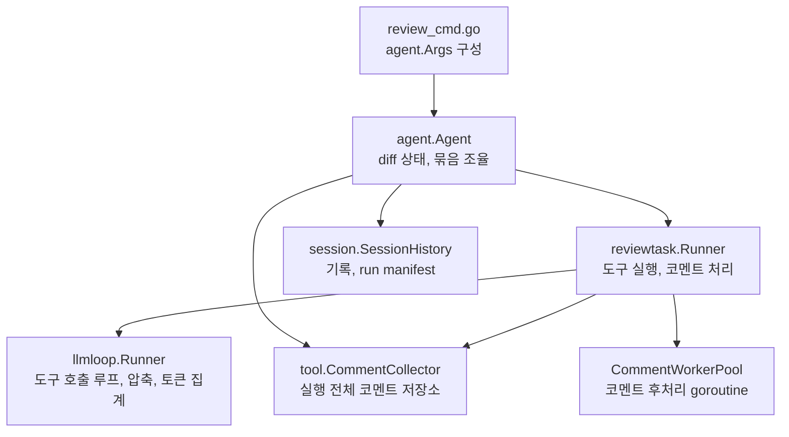
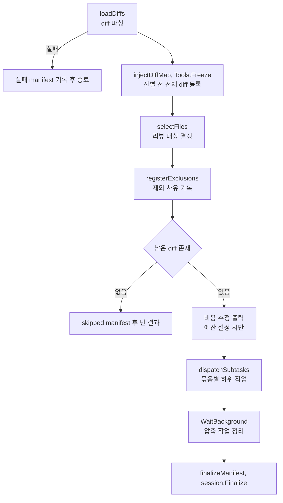

`internal/agent`의 `Agent`는 diff를 읽고, 리뷰 대상을 고르고, 묶음마다 하위 작업을 띄워 계획 단계와 여러 라운드의 본 리뷰를 돌린 뒤, 파일별 커버리지와 코멘트를 모아 돌려준다. 이 장은 `agent.go`의 `Run`, `dispatchSubtasks`, `executeGroupSubtask`를 중심으로 동시성, 계획 단계, 다중 라운드, 토큰 예산, 커버리지 기록이 어떻게 맞물리는지 정리한다. 도구 호출 루프 내부는 07장, 도구 구현은 08장, 코멘트 위치 보정과 반성 필터는 09장에서 다룬다.

## Agent의 구성 요소

`Agent`는 LLM 대화 자체를 직접 돌리지 않는다. 주석([agent.go L177-L179](https://github.com/alibaba/open-code-review/blob/e74f2c6bd4422bd1e12d257d1725bcce1d6b9ddd/internal/agent/agent.go#L177-L179))이 밝히듯 도구 호출 루프, 메모리 압축, 토큰 집계는 `internal/llmloop.Runner`로 옮겨졌고, `Agent`는 diff 쪽 상태를 들고 묶음별 하위 작업을 조율한다. 그 사이를 `internal/reviewtask.Runner`가 잇는다.



| 구성 요소 | 타입 | 역할 | 다루는 장 |
|---|---|---|---|
| 조율자 | `agent.Agent` | diff 로드, 선별, 묶음 dispatch, 라운드 관리, 커버리지 기록 | 이 장 |
| 작업 실행기 | `reviewtask.Runner` | `llmloop.Runner`를 감싸고 도구 호출을 실행, `code_comment` 후처리 | 이 장, 09장 |
| 대화 루프 | `llmloop.Runner` | 도구 호출 반복, 메모리 압축, grace round, 토큰 집계 | 07장 |
| 코멘트 저장소 | `tool.CommentCollector` | mutex로 보호되는 코멘트 슬라이스 하나 | 09장 |
| 후처리 풀 | `reviewtask.CommentWorkerPool` | `code_comment` 위치 계산을 비동기로 실행 | 09장 |
| 세션 | `session.SessionHistory` | 요청 기록, 재개 checkpoint, run manifest | 13장 |

`Agent`를 만드는 쪽은 [`review_cmd.go L251-L279`](https://github.com/alibaba/open-code-review/blob/e74f2c6bd4422bd1e12d257d1725bcce1d6b9ddd/cmd/opencodereview/review_cmd.go#L251-L279)다. 주요 인자는 다음과 같다.

| `Args` 필드 | 출처 | 의미 |
|---|---|---|
| `Template` | 내장 템플릿 + effort, `--max-tokens`, `--max-tools` | prompt와 수치 기준 (05장) |
| `SystemRule`, `FileFilter` | `rules.NewResolver` | 규칙 해석기와 사용자 필터 (05장) |
| `MaxConcurrency` | `--concurrency` (기본 8) | 동시에 도는 묶음 수 |
| `ConcurrentTaskTimeout` | `--timeout` (기본 15, 분) | 묶음 하나의 시간 상한 기준 |
| `CommentWorkerPool` | `NewCommentWorkerPool(opts.concurrency)` | 코멘트 후처리 풀, 크기는 `--concurrency`와 같음 |
| `MaxTokensBudget` | `--max-tokens-budget` (기본 0) | 실행 전체 토큰 합계 상한, 0이면 무제한 |
| `SkipFilter` | `--no-filter` | 반성 필터 생략 (09장) |
| `Background` | `--background`, `--background-file` | `{{requirement_background}}` 값 |
| `Resume` | `--resume` | 이전 세션의 완료 파일 재사용 (13장) |

플래그 기본값 출처: [shared_flags.go L54-L61](https://github.com/alibaba/open-code-review/blob/e74f2c6bd4422bd1e12d257d1725bcce1d6b9ddd/cmd/opencodereview/shared_flags.go#L54-L61)

## Run의 전체 흐름

`Run`은 리뷰 한 번의 시작부터 끝까지를 담당한다.



`injectDiffMap`은 선별로 제외될 파일까지 포함한 전체 diff를 도구 쪽에 넘긴다. 그래서 에이전트는 리뷰 대상이 아닌 파일의 diff도 `file_read_diff`로 읽을 수 있다. 이 부분은 01장과 08장에서 다룬다. 선별 규칙과 제외 사유는 04장의 범위다.

### 코드 분석: 리뷰 대상이 없을 때의 처리

`internal/agent/agent.go`, [agent.go L356-L378](https://github.com/alibaba/open-code-review/blob/e74f2c6bd4422bd1e12d257d1725bcce1d6b9ddd/internal/agent/agent.go#L356-L378)

선별 후 남은 파일이 없으면 LLM을 한 번도 부르지 않고 끝난다.

```go
	if len(a.diffs) == 0 {
		// no.files.changed keeps firing for the case it always covered, so existing
		// consumers are unaffected; it stayed silent when the size gate emptied the
		// set, which is the reading review.skipped adds.
		if counts.TooLarge > 0 {
			fmt.Fprintf(stdout.Writer(), "[ocr] %d file(s) exceeded the token size limit; nothing left to review. Skipping review.\n", counts.TooLarge)
		} else {
			fmt.Fprintln(stdout.Writer(), "[ocr] No supported files changed. Skipping review.")
			telemetry.Event(ctx, "no.files.changed")
		}
		// No item was ever selected: finalize yields a skipped manifest (no
		// run_failure), which is the correct terminal state for "nothing to do".
		// A persistence failure here is still a delivery error — a clean skip
		// cannot be claimed if its session_end never reached disk.
		manifestErr := a.finalizeManifest()
		if ferr := a.session.Finalize(); ferr != nil {
			manifestErr = errors.Join(manifestErr, fmt.Errorf("finalize session: %w", ferr))
		}
		if manifestErr != nil {
			return []model.LlmComment{}, manifestErr
		}
		return []model.LlmComment{}, nil
	}
```

리뷰할 것이 없는 실행도 "건너뜀" 상태의 manifest를 남긴다. diff 로드 자체가 실패한 경우([agent.go L288-L309](https://github.com/alibaba/open-code-review/blob/e74f2c6bd4422bd1e12d257d1725bcce1d6b9ddd/internal/agent/agent.go#L288-L309))에는 `RunFailureInput`을 기록하고 같은 방식으로 manifest를 저장한다. 어떤 경로로 끝나든 세션 파일에 종료 기록이 남도록 하는 것이 이 함수 전체의 원칙이다.

비용 추정은 `--max-tokens-budget`을 지정했을 때만 출력된다([agent.go L398-L406](https://github.com/alibaba/open-code-review/blob/e74f2c6bd4422bd1e12d257d1725bcce1d6b9ddd/internal/agent/agent.go#L398-L406)). 예산을 쓰지 않는 사용자의 출력은 바꾸지 않겠다는 주석이 함께 있다. 추정식은 아래 토큰 예산 절에서 다룬다.

## 정리

- `Agent`는 diff 상태와 묶음 조율을 맡고, 대화 루프는 `llmloop.Runner`, 도구 실행과 코멘트 후처리는 `reviewtask.Runner`에 맡긴다. README의 "sub-agent"는 묶음 하나를 맡는 goroutine과 그 묶음 전용 메시지 목록이다
- 묶음 동시 실행 수는 `--concurrency`(기본 8)이고, 묶음 하나의 시간 상한은 `--timeout`(기본 15분)에 리뷰 라운드 수를 곱한 값이다. 도움말에는 곱셈이 드러나지 않는다
- 계획 단계는 도구 없는 단일 요청이고 라운드 1에만 쓰인다. 실패해도 리뷰는 계속된다
- 라운드 2부터는 확정 코멘트(최대 30개, 내용 300자)를 넣고 계획을 뺀다. 신규 코멘트가 없거나 30개에 이르면 조기 종료한다
- 토큰 제한은 묶음 prompt 80% 상한과 실행 전체 예산 두 축이다. 예산 초과는 실행 실패가 아니라 미실행 파일의 `failed(budget)`으로 기록되고 최종 상태는 커버리지로 정해진다
- 커버리지는 dispatch 전에 분모를 고정하고 파일마다 완료, 재사용, 실패를 표시한다. `task_done` 없이 멈춘 묶음은 코멘트 유무로 파일별 판정을 나눈다
