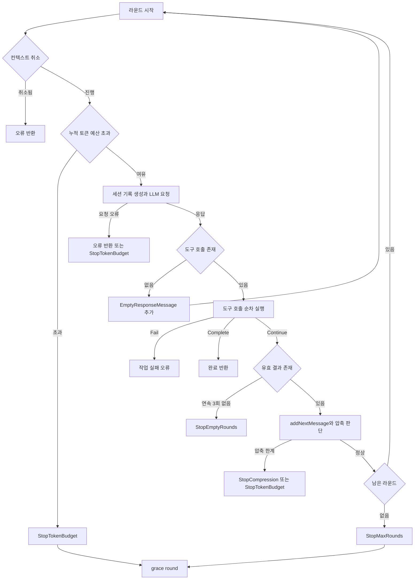

대화 한 턴의 처리 순서와 도구 호출 디스패치를 다룬다.

## 턴 루프 구조

`Run`은 `runMainTask`를 감싼 얇은 함수이고, 실제 반복은 `runMainTask`의 `for` 문 하나다. 한 라운드는 "예산 확인, 세션 기록, LLM 요청, 도구 실행, 다음 메시지 구성" 순서로 진행된다.



### 코드 분석: runMainTask의 준비 단계

루프에 들어가기 전에 prompt cache용 키를 고정하고, 압축 상태를 대화 단위로 만든다.

파일: [`internal/llmloop/loop.go` L294-L317](https://github.com/alibaba/open-code-review/blob/e74f2c6bd4422bd1e12d257d1725bcce1d6b9ddd/internal/llmloop/loop.go#L294-L317)

```go
func (r *Runner) runMainTask(ctx context.Context, messages []llm.Message, taskKey string) (bool, MainLoopStop, error) {
	// Every round of this loop re-sends the growing conversation, so each
	// request is a prefix extension of the previous one — exactly what
	// provider prompt caches reuse. Scope the affinity key to this subtask's
	// main-task conversation so every round routes to the same cache node.
	ctx = llm.ContextWithSessionKey(ctx,
		llm.SessionTaskKey(r.deps.Session.SessionID, string(session.MainTask), taskKey))

	toolReqCount := r.task.MaxRounds
	const maxConsecutiveEmptyRounds = 3
	consecutiveEmptyRounds := 0
	sessionID := uuid.NewString()

	// Async compression is owned by this conversation alone; the deferred
	// cancel aborts any job still in flight when the conversation ends.
	st := &compressionState{}
	defer r.cancelPendingCompression(st)

	// stop defaults to StopMaxRounds: if the for-loop exits because toolReqCount
	// reached zero, the run stopped on the round budget. The empty-round,
	// compression and token-budget breaks overwrite it at their trigger points.
	stop := StopMaxRounds
	started := false
	for toolReqCount > 0 {
```

- 매 라운드는 지금까지의 대화 전체를 다시 보낸다. 요청은 항상 이전 요청의 접두어를 확장한 모양이 되고, 세션 키를 하위 작업 단위로 고정해 같은 캐시 노드로 가도록 한다(캐시 라우팅의 실제 효과는 프로바이더 구현에 달려 있다, 10장)
- 연속 빈 라운드 상한 3은 상수로 박혀 있고 설정으로 바꿀 수 없다
- `stop`의 기본값을 `StopMaxRounds`로 둔 점이 핵심이다. 반복문이 라운드 소진으로 빠져나오면 별도 대입 없이 이 값이 남는다

### 코드 분석: LLM 요청과 오류 처리

한 라운드의 요청 부분이다. 요청 전에 세션 기록을 먼저 만들고, 응답이나 오류를 그 기록에 채운다. 인용 중 `// ...`는 텔레메트리 코드를 생략한 자리다.

파일: [`internal/llmloop/loop.go` L333-L366](https://github.com/alibaba/open-code-review/blob/e74f2c6bd4422bd1e12d257d1725bcce1d6b9ddd/internal/llmloop/loop.go#L333-L366)

```go
		toolReqCount--

		fs := r.deps.Session.GetOrCreateFileSession(taskKey)
		rec := fs.AppendTaskRecord(session.MainTask, append([]llm.Message(nil), messages...))
		startTime := time.Now()
		// ...
		request := llm.ChatRequest{
			Model:     r.deps.Model,
			Messages:  messages,
			Tools:     r.task.ToolDefs,
			MaxTokens: r.task.MaxCompletionTokens,
			SessionID: sessionID,
		}
		resp, err := r.deps.LLMClient.CompletionsWithCtx(reqCtx, request)
		duration := time.Since(startTime)
		if err != nil {
			rec.SetError(err, duration)
			// ...
			if errors.Is(err, llm.ErrTokenBudget) {
				if !started {
					return false, StopTokenBudget, nil
				}
				stop = StopTokenBudget
				break
			}
```

- 라운드 카운터는 요청 전에 줄인다. 요청이 실패해도 라운드 하나를 쓴 것으로 센다
- `messages`를 복사해 세션 기록에 넣는다. 이후 압축이 `messages`를 바꿔도 기록된 요청 내용은 그대로 남는다(13장)
- 일반 오류는 즉시 오류로 반환한다. 재시도는 루프가 아니라 LLM 클라이언트 계층에서 처리한다(10장)
- `ErrTokenBudget`만 예외다. 첫 요청부터 예산에 막혔다면(`started == false`) grace round 없이 끝내고, 한 번이라도 응답을 받았다면 반복을 빠져나가 grace round로 넘어간다

### 도구 호출이 없는 응답

모델이 도구를 부르지 않고 텍스트만 돌려주면([`loop.go` L384-L393](https://github.com/alibaba/open-code-review/blob/e74f2c6bd4422bd1e12d257d1725bcce1d6b9ddd/internal/llmloop/loop.go#L384-L393)) 루프는 `EmptyResponseMessage`를 user 메시지로 붙이고 다음 라운드로 넘어간다. 리뷰 쪽 문구는 "You did not successfully call any tools. Please try again or use task_done if finished."이다. 모델이 낸 텍스트나 reasoning이 있으면 그 assistant 메시지를 재촉 메시지 앞에 끼워 assistant, user 순서를 맞춘다. 이 경로는 빈 라운드 카운터를 늘리지 않으므로, 텍스트만 반복하는 모델은 빈 라운드가 아니라 라운드 상한(`StopMaxRounds`)으로 멈춘다.

## 도구 호출 디스패치

응답에 도구 호출이 있으면 루프는 호출을 순서대로 하나씩 실행한다. 병렬 실행은 없다. 루프가 직접 하는 일은 "이 도구가 이번 요청에서 허용된 도구인가"를 확인하는 것뿐이고, 실제 실행은 `Task.ExecuteTool` 콜백이 맡는다.

### 코드 분석: executeTool의 허용 목록 확인

파일: [`internal/llmloop/loop.go` L477-L486](https://github.com/alibaba/open-code-review/blob/e74f2c6bd4422bd1e12d257d1725bcce1d6b9ddd/internal/llmloop/loop.go#L477-L486)

```go
// Check the current request before dispatch so restricted rounds cannot invoke
// providers or completion actions that were only available in earlier rounds.
func (r *Runner) executeTool(ctx context.Context, definitions []llm.ToolDef, taskKey string, call llm.ToolCall, rec *session.TaskRecord, thinking string) ToolOutcome {
	for _, definition := range definitions {
		if definition.Type == "function" && definition.Function.Name == call.Function.Name {
			return r.task.ExecuteTool(ctx, taskKey, call, rec, thinking)
		}
	}
	return ToolOutcome{Content: tool.NotAvailableMsg}
}
```

- 확인 기준은 레지스트리가 아니라 "이번 요청에 실어 보낸 도구 정의 목록"이다. grace round는 도구를 줄여 보내므로, 모델이 이전 라운드에서 본 `file_read`를 grace round에서 불러도 여기서 막힌다
- 같은 원리로, 스캔은 레지스트리에 `file_read_diff`가 등록되어 있어도 스캔 템플릿의 도구 목록에 없으므로 호출할 수 없다(11장)
- 허용되지 않은 도구는 `tool.NotAvailableMsg`("Error: Tool not found. ...")를 결과로 돌려준다. 루프를 끝내지 않고 모델에게 알려 다음 라운드에서 고치게 한다

### 도구 결과 분류

콜백은 `ToolOutcome{Content, Action}`을 돌려준다. `Action`은 `Continue`, `Complete`, `Fail` 세 값이다([`task.go` L13-L24](https://github.com/alibaba/open-code-review/blob/e74f2c6bd4422bd1e12d257d1725bcce1d6b9ddd/internal/llmloop/task.go#L13-L24)). 루프는 호출마다 결과를 다음처럼 분류한다([`loop.go` L403-L431](https://github.com/alibaba/open-code-review/blob/e74f2c6bd4422bd1e12d257d1725bcce1d6b9ddd/internal/llmloop/loop.go#L403-L431)).

| `Action` | `Content` | 루프의 처리 | 다음 메시지에 붙는 결과 |
|---|---|---|---|
| `Fail` | 실패 사유 | 즉시 `task failed: ...` 오류 반환. 같은 턴의 나머지 호출은 실행하지 않는다 | 없음 |
| `Complete` | 완료 문구 | `taskCompleted = true`. 같은 턴의 나머지 호출은 계속 실행한 뒤 완료 반환 | 완료 문구 |
| `Continue` | 비어 있지 않음 | 유효 결과로 센다(`hasValidResult = true`) | 도구 출력 |
| `Continue` | 빈 문자열 | 유효 결과로 세지 않는다 | `Error: Tool execution returned no result.` |

- 한 턴에 `code_comment`와 `task_done`을 함께 부르는 경우가 흔하다. `Complete`를 만나도 반복을 멈추지 않으므로 같은 턴의 `code_comment`도 실행된다
- 반대로 `Fail`은 즉시 반환한다. 리뷰 쪽에서는 `task_done(state="FAILED")`만 `Fail`을 만든다(08장)
- 도구가 오류 문자열(`Error executing tool ...`)을 돌려준 경우도 `Content`가 비어 있지 않으므로 "유효 결과"다. 빈 라운드는 도구가 실패한 라운드가 아니라 결과 문자열이 아예 비어 있는 라운드다
- 같은 턴의 모든 호출은 같은 reasoning 텍스트(`thinking`)를 공유한다. 리뷰 쪽은 이 값을 코멘트의 `thinking` 필드로 채운다

리뷰와 스캔이 쓰는 콜백은 `reviewtask`가 `tool.TaskCheckpoint`를 `ToolOutcome`으로 바꾸는 어댑터다([`reviewtask/task.go` L84-L97](https://github.com/alibaba/open-code-review/blob/e74f2c6bd4422bd1e12d257d1725bcce1d6b9ddd/internal/reviewtask/task.go#L84-L97)). 완료 시 결과 문구를 "Task completed successfully."로 고정한다. 레지스트리 조회와 인자 파싱, 연속 실패 처리 같은 콜백 내부는 08장에서 다룬다.
