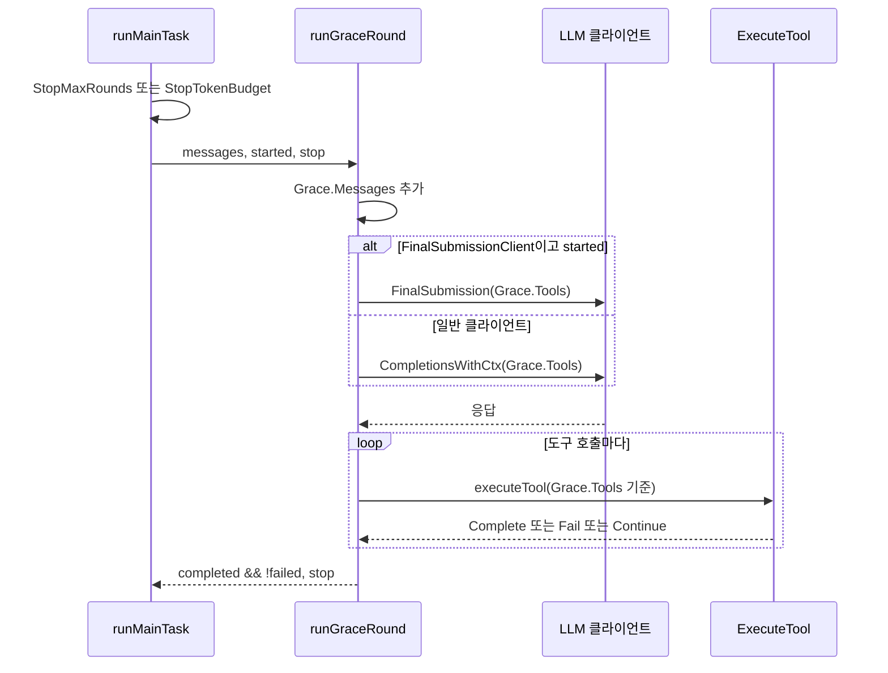

루프 종료 조건과 grace round, 토큰 집계, 경고 기록을 다룬다.

## 종료 조건과 grace round

`runMainTask`가 끝나는 경로는 완료, 오류, 그리고 다섯 가지 `MainLoopStop` 값이다. 종료 사유는 출력 형식이 JSON이어도 남는 유일한 진단 정보라서, 코드는 사유마다 고정 문장을 따로 둔다.

### 코드 분석: MainLoopStop과 Reason

파일: [`internal/llmloop/loop.go` L272-L287](https://github.com/alibaba/open-code-review/blob/e74f2c6bd4422bd1e12d257d1725bcce1d6b9ddd/internal/llmloop/loop.go#L272-L287)

```go
func (s MainLoopStop) Reason() string {
	switch s {
	case StopNone:
		return "main task stopped before completing"
	case StopMaxRounds:
		return "reached the maximum tool-request rounds without finishing"
	case StopEmptyRounds:
		return "stopped after repeated rounds without a usable tool result"
	case StopCompression:
		return "stopped because context compression exceeded its threshold"
	case StopTokenBudget:
		return "reached the aggregate token budget before finishing"
	default:
		return fmt.Sprintf("main task stopped for an unrecognized reason (stop=%d)", int(s))
	}
}
```

| 값 | `String()` | 발생 지점 | 성격 | grace round |
|---|---|---|---|---|
| `StopNone` | `none` | 완료 또는 오류 반환 | 의미 없음 | 없음 |
| `StopMaxRounds` | `max_rounds` | 라운드 카운터 소진 | 선언된 예산 | 있음 |
| `StopEmptyRounds` | `empty_rounds` | 결과가 빈 라운드 연속 3회 | 분류 불가 | 없음 |
| `StopCompression` | `compression` | 압축 후에도 경고 임계값 이상 | 컨텍스트 한계 | 없음 |
| `StopTokenBudget` | `token_budget` | 라운드 전 예산 확인, `ErrTokenBudget`, 압축 중 예산 거부 | 선언된 예산 | 있음 |

`Reason()` 주석은 이 문자열이 diff 리뷰의 manifest 사유와 스캔의 하위 작업 경고 양쪽에 그대로 쓰인다고 밝힌다. 스캔은 실패 사유를 `"main_task did not complete before stopping: " + stop.Reason()`으로 기록한다(11장). `default` 분기가 `StopNone` 문장을 재사용하지 않고 숫자를 드러내는 것도 같은 이유다. 나중에 값이 추가되면 출력에서 바로 보이게 한다.

### grace round 동작

선언된 예산(라운드, 누적 토큰)으로 멈춘 경우에만 마지막 기회를 한 번 준다. 압축 한계나 빈 라운드로 멈춘 경우는 바로 끝낸다.



### 코드 분석: runGraceRound의 판정

파일: [`internal/llmloop/loop.go` L558-L573](https://github.com/alibaba/open-code-review/blob/e74f2c6bd4422bd1e12d257d1725bcce1d6b9ddd/internal/llmloop/loop.go#L558-L573)

```go
	calls := resp.ToolCalls()
	if len(calls) == 0 {
		return false, stop, nil
	}

	// Any explicit failure keeps the round incomplete, even if another tool
	// in the same response reported completion.
	completed := false
	failed := false
	thinking := resp.ReasoningContent()
	for _, call := range calls {
		checkpoint := r.executeTool(ctx, request.Tools, taskKey, call, rec, thinking)
		completed = completed || checkpoint.Action == Complete
		failed = failed || checkpoint.Action == Fail
	}
	return completed && !failed, stop, nil
}
```

- 메인 루프와 달리 `Fail`을 만나도 즉시 반환하지 않고 모든 호출을 실행한 뒤 판정한다. 같은 응답에 완료와 실패가 섞여 있으면 미완료로 본다
- grace round에서 완료해도 `stop`은 원래 값(`StopMaxRounds` 등)을 유지한다. 리뷰 쪽은 이 조합을 보고 `review_limit_reached` 경고를 남긴다([`reviewtask/task.go` L118-L155](https://github.com/alibaba/open-code-review/blob/e74f2c6bd4422bd1e12d257d1725bcce1d6b9ddd/internal/reviewtask/task.go#L118-L155)). 완료만 보면 잘리지 않은 리뷰처럼 읽히기 때문이다
- 리뷰 쪽 grace 메시지는 "Your review budget is exhausted. This is your FINAL round."로 시작하고, 아직 보고하지 않은 발견을 제출할 기회만 준다
- `GracePolicy.ReportErrors`가 거짓이면 grace round의 LLM 오류를 버리고 결과만 돌려준다. 리뷰는 거짓, 동작 영향 분석은 참이다

`llm.FinalSubmissionClient`를 구현한 클라이언트는 현재 `behaviortask`의 예산 래퍼뿐이다([`behaviortask/budget.go` L46](https://github.com/alibaba/open-code-review/blob/e74f2c6bd4422bd1e12d257d1725bcce1d6b9ddd/internal/behaviortask/budget.go#L46)). 리뷰와 스캔은 grace round에도 일반 `CompletionsWithCtx`를 쓴다.

## 토큰 집계와 누적 예산

`Runner`는 입력, 출력, 캐시 읽기, 캐시 쓰기 토큰을 `atomic` 카운터 네 개로 누적한다. 값은 API 응답의 `Usage`에서 오며, 루프 바깥에서 LLM을 부르는 plan 단계나 스캔의 dedup, 요약 단계도 `RecordUsage`로 같은 카운터에 더한다([`loop.go` L205-L213](https://github.com/alibaba/open-code-review/blob/e74f2c6bd4422bd1e12d257d1725bcce1d6b9ddd/internal/llmloop/loop.go#L205-L213)).

예산 확인은 [`tokenBudgetExceeded`](https://github.com/alibaba/open-code-review/blob/e74f2c6bd4422bd1e12d257d1725bcce1d6b9ddd/internal/llmloop/loop.go#L488-L493) 한 함수가 맡는다. 예산이 0보다 크고 누적 사용량이 예산을 넘었을 때만 참이다.

- `TotalTokensUsed()`는 입력과 출력의 합이다. 캐시 토큰은 예산 계산에 들어가지 않는다
- 예산은 세션 전체에 하나다. `Runner`가 하위 작업 사이에 공유되므로, 동시에 돌던 다른 파일의 사용량까지 합쳐서 판단한다
- 확인 시점은 각 라운드의 요청 직전이다(L328-L331). 주석은 "대화가 라운드마다 커지고 전체 이력을 다시 보내므로, 하위 작업 분배 시점의 확인만으로는 긴 묶음 하나가 예산을 넘는 것을 막지 못한다"고 설명한다
- 예산 초과는 "다음 요청을 보내기 전에 이미 넘었는가"로 판단하므로, 마지막 요청 하나만큼은 예산을 넘길 수 있다. 스캔은 이와 별도로 파일 분배 직전에 "현재 사용량 + 다음 파일 추정치"로 한 번 더 확인한다(11장)

## 경고와 도구 실패 기록

루프를 멈출 정도는 아니지만 사용자에게 알려야 하는 일은 `AgentWarning`으로 남긴다. 구조는 `File`, `Message`, `Type` 세 필드뿐이고, 이름은 예전 `internal/agent` 패키지와의 호환을 위해 유지한다고 주석에 적혀 있다([`warnings.go` L6-L13](https://github.com/alibaba/open-code-review/blob/e74f2c6bd4422bd1e12d257d1725bcce1d6b9ddd/internal/llmloop/warnings.go#L6-L13)).

llmloop 자체는 경고를 만들지 않는다. `RecordWarning`이라는 저장소만 제공하고, 경고 종류는 호출 측이 정한다.

| 경고 `Type` | 기록 위치 | 의미 |
|---|---|---|
| `review_limit_reached` | `reviewtask` | 라운드 또는 누적 예산으로 grace round에 들어감 |
| `comment_args_repaired`, `comment_refiled` | `reviewtask` | `code_comment` 인자 복구, 다른 파일로 재기록 (09장) |
| `token_budget_reached` | `agent`, `scan` | 누적 예산 때문에 분배를 멈춤 |
| `token_threshold_exceeded` | `agent`, `scan` | 첫 프롬프트가 80% 기준을 넘어 건너뜀 |
| `subtask_error`, `scan_subtask_error` | `agent`, `scan` | 하위 작업 오류 |

도구 호출은 별도로 두 가지를 센다. `RecordToolCall`은 도구 이름별 호출 횟수를 세고 세션 전체의 일련번호를 돌려준다. `RecordToolFailure`는 실패한 호출을 `ToolFailureDetail`로 남기는데, 모델이 보낸 원본 인자 문자열을 그대로 보관한다([`loop.go` L66-L78](https://github.com/alibaba/open-code-review/blob/e74f2c6bd4422bd1e12d257d1725bcce1d6b9ddd/internal/llmloop/loop.go#L66-L78)). `FilePath` 필드에는 하위 작업 키가 들어가므로, 리뷰에서는 파일 하나가 아니라 묶음 키일 수 있다고 주석이 경고한다. 이 정보는 `--format json` 출력에 실린다(14장).
